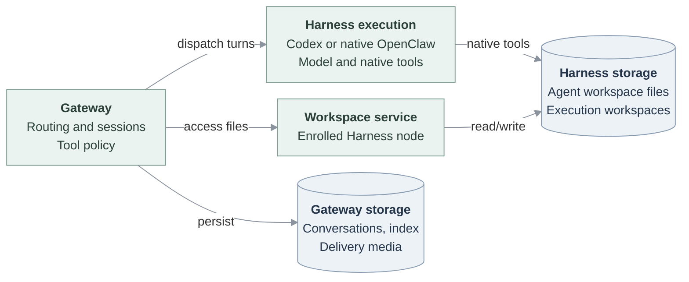

# Remote Harness execution and split storage

In `dedicated` mode, an Agent's Gateway receives messages and controls access,
while a separate Harness calls the model and runs native tools. OCE supports
two dedicated runtimes: Codex and experimental native OpenClaw workers. Embedded
OpenClaw runs both roles in one workload; see [Agent compute](agent-compute.md)
for mode selection.

## Gateway and Harness

The Gateway owns conversation routing, session admission, tool policy, and reply
delivery. The Harness owns model execution and its local file and command tools.
Separating their storage keeps the Harness from mounting Gateway conversations,
databases, and channel credentials.

Each Agent revision uses one Harness runtime. Codex uses an app-server plus a
companion file node; native OpenClaw uses a node host that serves workspace
operations and manages worker processes. Execution and workspace access are separate operations, even
when they use the same node connection.

“Remote” does not require two clusters. In the ordinary Kubernetes topology,
Gateway and Harness have separate Pods, ServiceAccounts, and storage within the
same tenant namespace. Operators can choose different node placement or the
experimental two-cluster profile. See [workload placement](../../design/workloads.md).

## Two execution paths

| Aspect                 | Dedicated Codex                                                      | Dedicated native OpenClaw                                                                              |
| ---------------------- | -------------------------------------------------------------------- | ------------------------------------------------------------------------------------------------------ |
| Runtime                | Codex app-server shared by the Agent's sessions                      | Node host managing session-owned native workers                                                        |
| Model and native tools | Run in the Codex Harness                                             | Run in each native worker                                                                              |
| Execution workspace    | Harness workspace used by Codex                                      | Separate managed workspace for each hosted session                                                     |
| Execution history      | Codex threads on Harness; conversation and thread binding on Gateway | Canonical transcripts and turn admission on Gateway                                                    |
| Availability           | Supported on Kubernetes                                              | Experimental; requires a provisioning SandboxDriver with networking, filesystem, and process isolation |

### Codex

Gateway sends turns to Codex app-server and receives progress and results.
Codex's native file and command tools operate in the Harness. Requests for
Gateway-provided tools return to Gateway for authorization and execution.
Gateway-local file, shell, and administration tools are excluded from Codex's
dynamic tool set.

A companion file node serves the Harness workspace to Gateway features outside
model turns. For example, editing `AGENTS.md` in the console uses this node;
asking Codex to change project code uses Codex's native tools. The Gateway does
not maintain a second execution workspace to synchronize after each Codex turn.

### Native OpenClaw

OCE requires placement on the enrolled node with worker-local inference.
Gateway admits turns, applies tool policy, and commits transcripts; workers call
the model and run native coding tools. A missing model or disconnected node
fails the turn without falling back to Gateway inference.

Each hosted session has a managed execution workspace. It is distinct from the
Agent workspace exposed by the console's four-file editor. The native worker
lifecycle prepares that workspace and reconciles eligible file changes when a
turn completes. Depending on the workspace source, Gateway retains checkpoints
or applies changes to a managed worktree. This is separate from remote access
to Agent documents, Memory, and Skills.

One Agent revision shares a node host and its outer Sandbox across sessions;
separate worker directories do not give each session its own Sandbox. The
[Harness reference](../../reference/harness-execution.md#supported-topology)
defines capacity, and [native worker support](../../reference/harness-execution.md#native-worker-support)
lists deployment prerequisites. The bundled OpenShell path remains
verification-only because of upstream provisioning blockers.

## What each side stores

| Data                                                   | Location                                                                                |
| ------------------------------------------------------ | --------------------------------------------------------------------------------------- |
| Conversation routing, transcripts, and tool policy     | Gateway                                                                                 |
| Agent documents, Memory source files, workspace Skills | Harness Agent workspace, reached through the enrolled node                              |
| Native tool working files                              | Codex workspace or native worker's session workspace on Harness                         |
| Memory search index and embedding configuration        | Gateway                                                                                 |
| Codex thread history                                   | Harness; separate from Gateway conversation history                                     |
| Native worker recovery data                            | Gateway checkpoints or managed worktrees, as required by the session's workspace source |
| Uploads and retrieved reply attachments                | Gateway media store; execution receives staged input files                              |

The selected [Harness authentication binding](../../reference/harness-execution.md#harness-authentication)
keeps its inference credential off the dedicated Gateway. Gateway features,
such as Memory embeddings, can use separately configured credentials.

The [storage reference](../../reference/drivers/kubernetes-compute/storage-and-credentials.md)
defines Kubernetes claim sizes, mounts, and persistence. A Sandbox provider may
supply a different Harness layout. Neither workload mounts the other's private
state.

## Files across the boundary

### Agent documents

The console's [Workspace files](workspace-files.md) editor authorizes access
through OCC and the Agent Gateway, then reads or writes the Harness Agent
workspace. It exposes `AGENTS.md`, `SOUL.md`, `IDENTITY.md`, and `USER.md`.
Completed initialization preserves later edits across restarts and redeploys.
Live edits are last-write-wins; reload after an uncertain save.

### Memory

Memory source files stay in the Harness Agent workspace. Gateway reads them and
receives change notifications through the node, maintains the index, and serves
search. Remote reads need the workspace service: a configured but unavailable
remote workspace returns an error instead of using a local Gateway workspace.
The retained index does not guarantee fresh results during disconnection.

### Skills

Gateway-provided Skill sources remain on Gateway; workspace Skill sources
remain on Harness. Native worker turns can receive temporary copies of selected
Skill files. Gateway discovers remote Skill sources and applies installation policy.
Approved dependency installation runs on the workspace host. Each host supplies
its own bundled assets, without a shared Skill-tree mount. Remote channel menu
discovery remains deferred; see the [workspace flow](../../flows/workspace-files.md#6-compute-resolves-a-route-and-occ-loads-the-current-key).

### Attachments

Gateway retains admitted uploads and stages input bytes for execution. For
Codex, the workspace service creates private input files on Harness and supplies
local paths before dispatch; a failed required transfer stops dispatch.
Codex's remote-media reader retrieves selected reply artifacts over app-server
while its connection is available. Gateway stores those bytes for delivery.
Native workers use their session workspace transfer and result lifecycle.

An attachment transfer does not grant a shared filesystem. Command admission and
path policy still apply, and an allowed output may contain sensitive content;
file transfer does not inspect it for safe sharing.

## Access and recovery limits

The workspace binding names an enrolled node and remote root. Default reads
cover the Agent workspace and managed Skill roots. Default writes cover
designated documents, Memory, Skill state, and staged inputs; explicit policies
remain authoritative. Default file access does not follow symlinks. The console
editor exposes fewer operations than this underlying workspace service.

Persistent files do not guarantee that an interrupted turn resumes. Codex thread
state, Gateway conversation state, and native worker checkpoints have different
recovery roles. Kubernetes dedicated replacement stops earlier workloads before
preparing the replacement, causing downtime, with no automatic rollback. Check
[activation and restart limits](../../reference/harness-execution.md#isolation-and-activation)
before relying on recovery behavior.
