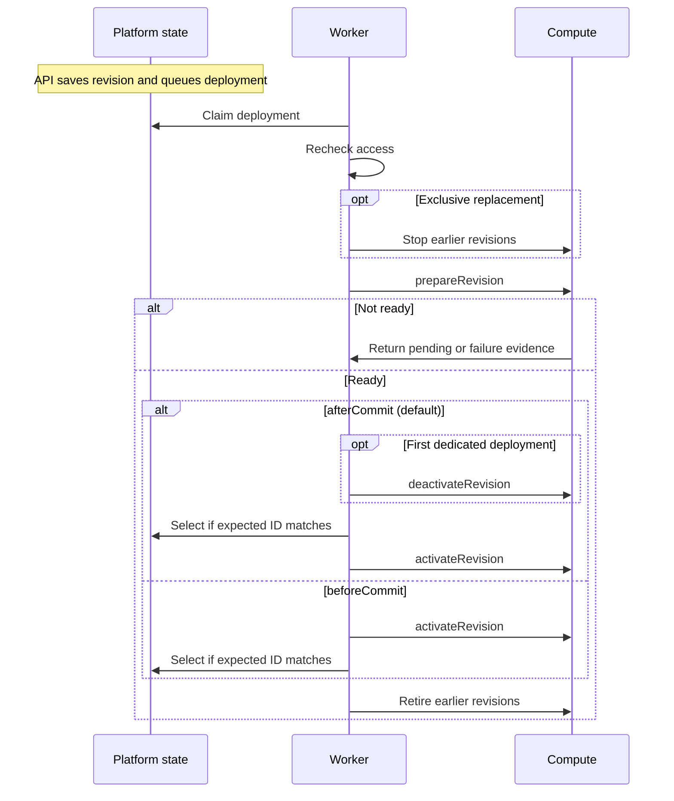

# ComputeDriver contract

## Overview

The OpenClaw Control Plane (OCC) selects one Compute Driver per Installation.
The worker calls it to prepare Namespace infrastructure, run an Agent revision,
route traffic to it, and stop or retire it. Compute owns workload identity,
isolation, and readiness. A paired [Sandbox Driver](sandbox.md) can provision
the dedicated Harness while Compute retains the gateway and routing.

## Interface

The [exported TypeScript interface](../../../packages/contracts/src/drivers/compute/index.ts)
defines each member.

### Properties

| Property                          | Requirement | Value and meaning                                                                                                                                                                  |
| --------------------------------- | ----------- | ---------------------------------------------------------------------------------------------------------------------------------------------------------------------------------- |
| `id`, `implementation`            | Required    | Identify the selected Driver. OCC records both on the Agent revision for the worker to check before dispatch.                                                                      |
| `capability`                      | Required    | Must be `"compute"`.                                                                                                                                                               |
| `activationOrder`                 | Optional    | Defaults to `"afterCommit"`. Controls when the worker switches traffic relative to saving the selected revision.                                                                   |
| `agentProvisioning`               | Optional    | Advertises supported execution modes. OCC rejects a request outside a supplied list. Omission alone does not disable provisioning.                                                 |
| `computeLifecycleHooks`           | Optional    | Inherited from `Driver`. Installed packages supply hooks on the registration. See [selected-driver hooks](#optional-selected-driver-hooks).                                        |
| `maintenanceIntervalMs`           | Optional    | Positive safe integer in milliseconds. Sets the interval between maintenance passes requested by Compute.                                                                          |
| `requiresAgentRuntimeCredentials` | Optional    | When `true`, OCC checks transport credentials before deployment and can create them before the first revision. Missing status or provisioning methods mean dependency unavailable. |
| `runtimeLogging`                  | Optional    | Defaults to `"platform"`. With `"driver"`, Compute owns the native logging configuration and log delivery.                                                                         |
| `supportsGatewayManagedMode`      | Optional    | Set to `true` to enforce Gateway administration restrictions. Without support, managed mode defaults off and OCC refuses an explicit request to enable it.                         |
| `supportsWorkspaceSetup`          | Optional    | Set to `true` to deliver initial workspace files. The worker refuses a revision with workspace setup if this flag is absent.                                                       |

### Methods

| Method                                   | Requirement | Caller and behavior                                                                                                                                                                                                                                                                                                                                       |
| ---------------------------------------- | ----------- | --------------------------------------------------------------------------------------------------------------------------------------------------------------------------------------------------------------------------------------------------------------------------------------------------------------------------------------------------------- |
| `ensureNamespace`                        | Required    | Prepare or check isolation for the supplied Namespace, before an Agent exists. Return `namespaceReady` when ready.                                                                                                                                                                                                                                        |
| `deleteNamespace`                        | Required    | Remove supported infrastructure for an empty Namespace. Return `namespaceDeleted` only after teardown. Refuse deletion of infrastructure outside the Driver's ownership.                                                                                                                                                                                  |
| `prepareRevision`                        | Required    | Create or reuse the gateway and prepare the Harness. Return readiness for the requested Namespace, Agent, and revision. The worker supplies authorized revision context.                                                                                                                                                                                  |
| `stopRevision`                           | Required    | Remove inbound routing and stop execution, including applicable Driver hooks and Sandbox cleanup. Keep Agent credentials, workspace data, and saved revisions. Repeated calls must be safe.                                                                                                                                                               |
| `retireRevision`                         | Required    | Revoke workload access, stop the workload, and complete applicable Sandbox cleanup. Preserve the replacement's gateway.                                                                                                                                                                                                                                   |
| `preflight`                              | Optional    | Check startup dependencies. An error blocks startup. Warnings are logged as `compute.preflight-warning`. Bundled Kubernetes Compute must implement this in production.                                                                                                                                                                                    |
| `setLifecycleDrivers`                    | Optional    | Receive the selected Drivers that supply lifecycle hooks. Startup refuses a hook provider if Compute cannot accept it.                                                                                                                                                                                                                                    |
| `bindAgent`                              | Optional    | The worker supplies the approved Namespace and Agent before revision work. A rejection prevents further runtime work on that attempt.                                                                                                                                                                                                                     |
| `validateConfiguration`                  | Optional    | Check native Configuration values on save. Preset validation identifies unresolved variables separately.                                                                                                                                                                                                                                                  |
| `validateGatewaySettings`                | Optional    | Refuse gateway settings the Driver cannot honor at deployment. Name the setting without exposing its value. OCC skips this check if omitted.                                                                                                                                                                                                              |
| `validateHarnessAuth`                    | Optional    | Check the Harness, authentication method, Configuration, and bindings. Deployment and Agent provisioning fail if this check is unavailable.                                                                                                                                                                                                               |
| `validateWorkspaceSetup`                 | Optional    | Check whether initial files can be delivered on the selected topology. See [admission checks](compute-admission.md) for when OCC calls each validator.                                                                                                                                                                                                    |
| `validateAgentProvisioning`              | Optional    | Required for Agent provisioning; see prerequisites and refusals below.                                                                                                                                                                                                                                                                                    |
| `validateRepositoryCredentialSupport`    | Optional    | Check support for repository credentials on the selected Sandbox topology. Without it, OCC cannot offer repository options.                                                                                                                                                                                                                               |
| `validateRepositoryCredentials`          | Optional    | Check repository bindings against the requested Harness and Sandbox. OCC refuses bindings if it cannot validate them.                                                                                                                                                                                                                                     |
| `validateExecutionAdmission`             | Optional    | Check whether Compute supports the requested execution at admission and again before release. Without it the platform admits ordinary unprotected execution only.                                                                                                                                                                                         |
| `admitRevision`                          | Optional    | Return Driver-owned admission data for OCC to save with the revision. Without it, OCC stores the revision without Driver admission data.                                                                                                                                                                                                                  |
| `activateRevision`, `deactivateRevision` | Optional    | Switch traffic to a ready revision or withdraw an unpublished candidate. Production startup checks for both. A Driver selecting `beforeCommit` must also implement activation in development.                                                                                                                                                             |
| `requiresStoppedPredecessors`            | Optional    | Return `true` to stop older revisions before preparing a replacement. Otherwise the previous route can serve during preparation.                                                                                                                                                                                                                          |
| `describePrepareRevisionFailure`         | Optional    | Supply safe diagnostic fields for a rejected preparation. The worker validates the fields and excludes raw provider errors.                                                                                                                                                                                                                               |
| `getGatewayEndpoint`                     | Optional    | Return the selected revision's private WSS address, or `undefined`. Workspace-file access and Agent native admin need this endpoint.                                                                                                                                                                                                                      |
| `getAgentRuntimeCredentialStatus`        | Optional    | Report whether the Agent's generated transport credentials are stored. Missing support prevents the status read.                                                                                                                                                                                                                                          |
| `provisionAgentRuntimeCredentials`       | Optional    | Create initial transport credentials for the approved Agent. Missing support prevents provisioning.                                                                                                                                                                                                                                                       |
| `deleteAgentRuntimeCredentials`          | Optional    | Remove Agent-owned credentials after revision retirement. A Driver that provisions them but omits deletion fails Agent deletion permanently.                                                                                                                                                                                                              |
| `deleteServiceAccountCredential`         | Optional    | On forced ServiceAccount deletion, remove the account-owned Secret when the ServiceAccount Driver can no longer revoke the token. OCC skips this call if absent.                                                                                                                                                                                          |
| `resolveSandboxNamespace`                | Optional    | Return the Namespace as provisioned by Compute. Paired Sandbox and Credential Gateway operations need this placement.                                                                                                                                                                                                                                     |
| `withdrawCredentialSource`               | Optional    | Confirm that the revision's attachment was revoked or is absent. Without this method the worker fails withdrawal with `CREDENTIAL_WITHDRAWAL_UNSUPPORTED`.                                                                                                                                                                                                |
| `withdrawHarnessExposure`                | Optional    | Remove dedicated OpenClaw status exposure after enrollment or permanent candidate failure with a Sandbox retained for diagnosis. The sweep makes at most five attempts per revision per worker start. Without this method the worker skips it.                                                                                                            |
| `verifyRepositoryExecution`              | Optional    | Identify an existing execution without starting or repairing it. Missing support supplies no identity for a repository credential session.                                                                                                                                                                                                                |
| `retireExpiredRepositoryAccess`          | Optional    | Report `withdrawn` after verifying Git access is gone and separately authorized inference can continue. Report `pending` while confirmation is outstanding, or `retire-runtime` if it cannot safely continue. Without this method, expiry retires the runtime except for `policyReductionVersion: 2` egress plans, which use policy reduction.            |
| `rejectedExecutionWithdrawal`            | Optional    | After release is refused, select a callback to withdraw a previously admitted grant. The worker runs it under the active revision's claim. With no callback, the refusal stands.                                                                                                                                                                          |
| `observeRevision`                        | Optional    | Read the existing Harness state during supervision of an unverified repository execution. A failed or invalid observation yields `unknown`. This read cannot establish the execution identity for Git access.                                                                                                                                             |
| `getRuntimeImages`                       | Optional    | Report revision-owned containers, excluding separate Sandbox Driver workloads. Return full lowercase 40-character Git SHAs for known commits and `null` for unknown image IDs or commits; never infer commits from tags. OCC returns entries without validation. Without a selected revision it reports `undeployed`; without this method, `unsupported`. |
| `discoverHarnessModels`                  | Optional    | Accept `authMethod`, `provider`, and `apiKey`. Return native model IDs and names. Never persist the credential. If discovery is unavailable, enter the model ID manually.                                                                                                                                                                                 |
| `diagnoseAgentDeployment`                | Optional    | Return current checks for one revision. Without support, OCC reports dependency unavailable.                                                                                                                                                                                                                                                              |
| `describeAgentRuntime`                   | Optional    | Describe the revision's workloads and log sources. Without this method, the runtime description and log routes return `501`.                                                                                                                                                                                                                              |
| `readAgentRuntimeLogs`                   | Optional    | Return raw lines from a listed, revision-owned container within the request limits. Without it, Compute container logs are unavailable. Sandbox logs use the paired Sandbox Driver.                                                                                                                                                                       |

### Model discovery

For model discovery, OCC checks Agent creation permission in the Namespace.
The bundled Docker and Kubernetes [model discovery client](../../../apps/controller/src/drivers/compute/model-discovery.ts)
uses a 10-second timeout and accepts up to 4 MiB per response, ten pages, and
10,000 model IDs. It refuses redirects. See [model discovery and API egress](../console/create-and-deploy.md#create-an-agent).

### Namespace and gateway results

Each Namespace result must carry the requested `namespaceId`. It can report a
`retryable` or `permanent` failure. A true ready
or deleted flag succeeds only without a failure. A failure reason for the worker
log may contain up to 256 characters using letters, digits, spaces, and
`. _ : / @ -`. Exclude provider output and other tenants' values.

Derive a [gateway endpoint](kubernetes-compute/networking-and-isolation.md#private-agent-gateway-routes)
from trusted settings and the approved resource IDs. Returning an address does
not establish readiness or authorize a connection.

### Optional initial runtime credential provisioning

Agent provisioning requires `validateAgentProvisioning({ executionMode,
configuration })`, credential status and provisioning methods, and Configuration
`createExact` and `inspectExact`. Missing methods mean dependency unavailable.
Validation runs for new requests, replay, retry, and worker writes, not stored-status reads.

Throw `ComputeGatewaySettingError` for a rejected setting; name its requirement,
never its value. OCC returns `409`; the worker records permanent
`PROVISIONING_REJECTED`. `DependencyUnavailableError` remains
retryable. Other validator errors become `ComputeProvisioningRefusedError` with
a fixed `409` and a reason in worker logs. Exclude secrets and provider output.
An uncertain pending write instead yields retryable `PROVISIONING_OUTCOME_UNKNOWN`.

For credential status and creation, OCC preserves
`RuntimeCredentialsForbiddenByClusterError` and converts other errors to a
fixed dependency-unavailable error.

Read status with Agent `read`. Initial provisioning also requires
`operate`, a ready Namespace, and no earlier revision. OCC passes approved
identities under Namespace and Agent locks. External credential writes can
survive a database rollback. Read stored status before retrying. If credentials
are missing after a revision exists, restore them before deploying. These methods
verify stored transport credentials. They cannot rotate them or verify model authentication. Codex device login
belongs to the [Credential Refresh Driver](credential-refresh.md#device-authorization).

### Startup failure evidence

An ordinary `ready: false` keeps preparation pending. Return a
[`pendingReason`](../agents/deployment.md#pending-deployment-progress) if known.
The worker rejects a readiness result for another revision. For a held startup
failure, return validated `runtimeFailure` evidence for this revision:
`component`, `check`, `checkedAt`, `code`, and an optional
[`cause`](../agents/deployment.md#model-check-failure-cause). Omit credentials,
provider messages, and untrusted observations. The [worker flow](../controller/reconciliation.md#deferred-namespace-and-agent-convergence)
explains which failures end deployment immediately and which wait until its deadline.

Throw `ComputePreparationFailedError` for terminal initialization failure.
The worker records the failed deployment and queues `stopRevision` for that
candidate in one transaction. After restart it resumes cleanup.

### Runtime reads and logging

Diagnostics read the requested revision without changing its deployment or running
another model probe. OCC accepts up to 32 checks and validates timestamps and
state. With platform logging, OCC applies its [Harness logging policy](../harness-execution.md#runtime-logging).
The Driver rechecks workload ownership before each read. For a cluster `403`,
raise `RuntimeLogsForbiddenByClusterError`. OCC redacts
and limits each response to 512 KiB. A Driver-managed collector must supply its own
access control, redaction, and delivery guarantees. With Driver-owned logging, OCC preserves
the validated native settings and both runtime-description and log routes return
`501`. See [Agent logs](../../guides/topics/agent-logs.md) and
[image provenance](../console/debug-fields.md#where-the-source-commit-comes-from).

## IAM

OCC authenticates the caller and uses the [IAM Driver](iam.md) to authorize the
exact resource. For deployment, the worker rechecks the original actor's
`deploy` on the Agent and `read` on its Configuration. Both actor and Agent
service principal need `operate` on each bound Secret and applicable credential
source. ServiceAccount authentication also requires the actor to read the
account. Denied access or unavailable IAM blocks preparation.

Use the Namespace, Agent, revision, and references supplied by OCC. Deliver
model credentials only to the selected Harness. Keep Secret values out of
Configuration, responses, logs, errors, and audit records. See
[credential delivery](../../flows/native-service-account-credential-delivery.md).
Installed Drivers run with control-plane privileges.

## Lifecycle

### Driver initialization and shutdown

Each API or worker process loads its configured Driver, validates its methods,
attaches selected hooks, and runs applicable preflight. Process shutdown does
not delete Namespace or Agent resources. See [Driver loading](../../flows/driver-plugin-loading.md).

### Production revision stages

The diagram shows ordinary production deployment. The worker checks the selected
Compute identity and current credential references before calling the Driver.
Activation must be safe to repeat. A failed activation after selection resumes
at finalization. One [protected Git startup mode](../repository-credentials/protected-openshell-git.md)
has a separate selection step. With version 6 `request-hook-observed`, Compute
can report `heldForRepositoryGitMaterial` and `REPOSITORY_GIT_ROUTE_PENDING`
without a runtime failure. The worker can then record the selection while
preparation is pending. Activation, retirement, and completion still wait for readiness.

Exclusive replacement closes earlier credential sessions and stops each earlier
revision, including failed candidates, before preparation. A failed stop blocks
the successor. Older work and maintenance cannot recreate the stopped execution.
Compute must confirm resource release and preserve workspace data on repeated
stops. This policy permits downtime. Recover by deploying a newer revision.

### SandboxDriver coordination

Bundled Kubernetes Compute prepares Namespace isolation before Sandbox setup.
A Sandbox can create the dedicated Harness. Compute owns the gateway, workload
identity, readiness decision, and routing. Wait for required credential
attachments before activation. Complete [Sandbox cleanup](sandbox.md#lifecycle)
even if the workload is already absent.

### Optional selected-driver hooks

Startup hooks run in selection order on the embedded workload or the dedicated
Harness. Cleanup runs in reverse. Hooks cannot change images, commands,
placement, networking, or authorization. Preserve the `opaque-` environment
restriction (up to 64 values, no plaintext credentials or reserved names).
Undo completed hooks after preparation fails. On cancellation, rollback uses
a separate five-second cleanup signal. See [hook execution](../../flows/compute-driver-lifecycle-hooks.md).

### Optional active-runtime maintenance

A Compute interval queues another authorized preparation and activation for the
selected revision. Repository access or standing approvals can schedule
maintenance independently. The worker uses the earliest applicable interval.
A failed maintenance observation leaves the selected revision in place and schedules
another authorized pass. A newer deployment or an
exclusive replacement can supersede an older pass.

### Plugin startup warnings

A ready revision may report `PLUGIN_INSTALL_FAILED` or `PLUGIN_AUTH_REQUIRED`
for an approved plugin only after disabling it and confirming the rest of the
runtime is ready. The worker records warnings on successful deployment. See
[Kubernetes startup status](kubernetes-compute.md#plugin-startup-status).

## Limits

Compute operates on the revision's recorded identity. Selecting another Driver
does not migrate that revision. Completion of a stop, retirement, or deletion
requires confirming the cleanup the Driver owns. Check the [feature matrix](compute-matrix.md)
for topology, deletion support, and private gateway access.

## Troubleshooting

| Symptom                                   | First check                                                                  | Recovery and expected result                                                                       |
| ----------------------------------------- | ---------------------------------------------------------------------------- | -------------------------------------------------------------------------------------------------- |
| Production startup refuses the Driver     | Inspect the missing activation method, preflight error, or unsupported hook. | Supply the reported capability and restart. A preflight warning alone does not block startup.      |
| Deployment fails before a revision exists | Check Harness authentication and admission errors.                           | Correct the rejected setting or missing capability. An accepted request returns a revision ID.     |
| A revision stays pending                  | Check the pending reason, revision ID, and authenticated workload readiness. | Fix the named dependency and confirm the worker selects and routes the expected revision.          |
| Stop or retirement stalls                 | Check credential revocation, hooks, and Sandbox cleanup.                     | Retry after restoring access. Confirm the revision no longer accepts traffic and cleanup succeeds. |
| Credential creation was interrupted       | Read the Agent's stored transport status.                                    | Provision only missing credentials. A configured status establishes storage, not provider login.   |

## Implementations

- [Docker ComputeDriver](docker-compute.md) runs the local development stack. It rejects current Harness authentication bindings for new Agent deployments.
- [Kubernetes ComputeDriver](kubernetes-compute.md) supports embedded and dedicated workloads.
- [SSH ComputeDriver](ssh-compute.md) runs embedded OpenClaw on Linux hosts with operator-managed model authentication.

## Related

- [Driver selection](selection.md) and [Harness execution](../harness-execution.md)
- [Agent lifecycle](../agents.md) and [controller reconciliation](../controller/reconciliation.md)
- [Deployment diagnostics flow](../../flows/agent-deployment-diagnostics.md)
- [Worker source](../../../apps/controller/src/worker.ts) and [OCC source](../../../packages/occ/src/index.ts)
