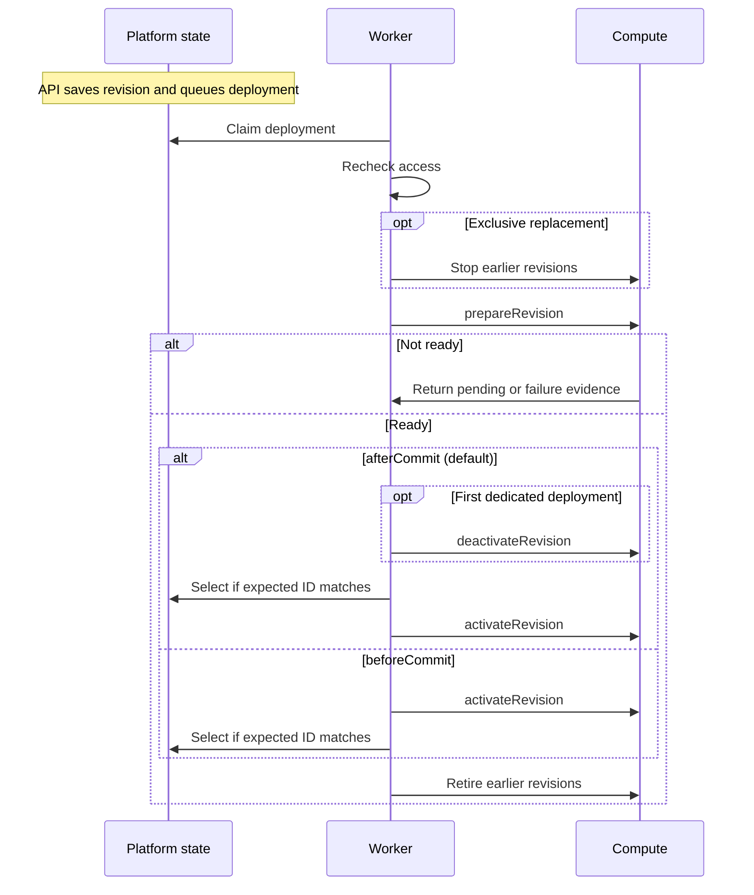

# ComputeDriver contract

**Interface contents**

- [Properties](#properties)
  - [`id`](#property-id)
  - [`implementation`](#property-implementation)
  - [`capability`](#property-capability)
  - [`activationOrder`](#property-activation-order)
  - [`agentProvisioning`](#property-agent-provisioning)
  - [`computeLifecycleHooks`](#property-compute-lifecycle-hooks)
  - [`maintenanceIntervalMs`](#property-maintenance-interval-ms)
  - [`requiresAgentRuntimeCredentials`](#property-requires-agent-runtime-credentials)
  - [`runtimeLogging`](#property-runtime-logging)
  - [`supportsGatewayManagedMode`](#property-supports-gateway-managed-mode)
  - [`supportsWorkspaceSetup`](#property-supports-workspace-setup)
- [Methods](#methods)
  - [`ensureNamespace`](#method-ensure-namespace)
  - [`deleteNamespace`](#method-delete-namespace)
  - [`checkNamespaceDeletion`](#method-check-namespace-deletion)
  - [`resolveSandboxNamespaceContext`](#method-resolve-sandbox-namespace-context)
  - [`prepareRevision`](#method-prepare-revision)
  - [`stopRevision`](#method-stop-revision)
  - [`retireRevision`](#method-retire-revision)
  - [`preflight`](#method-preflight)
  - [`setLifecycleDrivers`](#method-set-lifecycle-drivers)
  - [`bindAgent`](#method-bind-agent)
  - [`validateConfiguration`](#method-validate-configuration)
  - [`validateGatewaySettings`](#method-validate-gateway-settings)
  - [`normalizeHarnessOverrides`](#method-normalize-harness-overrides)
  - [`resolveHarnessConfiguration`](#method-resolve-harness-configuration)
  - [`validateHarnessCredentialSources`](#method-validate-harness-credential-sources)
  - [`validateHarnessAuth`](#method-validate-harness-auth)
  - [`validateWorkspaceSetup`](#method-validate-workspace-setup)
  - [`validateAgentProvisioning`](#method-validate-agent-provisioning)
  - [`validateRepositoryCredentialSupport`](#method-validate-repository-credential-support)
  - [`validateRepositoryCredentials`](#method-validate-repository-credentials)
  - [`validateExecutionAdmission`](#method-validate-execution-admission)
  - [`admitsProtectedRepositoryNetworkPolicySave`](#method-admits-protected-repository-network-policy-save)
  - [`validateProtectedRepositoryNetworkPolicy`](#method-validate-protected-repository-network-policy)
  - [`admitRevision`](#method-admit-revision)
  - [`snapshotRuntimeInputs`](#method-snapshot-runtime-inputs)
  - [`activateRevision`](#method-activate-revision)
  - [`deactivateRevision`](#method-deactivate-revision)
  - [`requiresStoppedPredecessors`](#method-requires-stopped-predecessors)
  - [`describePrepareRevisionFailure`](#method-describe-prepare-revision-failure)
  - [`getGatewayEndpoint`](#method-get-gateway-endpoint)
  - [`getGatewayBrowserRequest`](#method-get-gateway-browser-request)
  - [`getChatCompletionsEndpoint`](#method-get-chat-completions-endpoint)
  - [`getAgentRuntimeCredentialStatus`](#method-get-agent-runtime-credential-status)
  - [`provisionAgentRuntimeCredentials`](#method-provision-agent-runtime-credentials)
  - [`deleteAgentRuntimeCredentials`](#method-delete-agent-runtime-credentials)
  - [`deleteServiceAccountCredential`](#method-delete-service-account-credential)
  - [`resolveSandboxNamespace`](#method-resolve-sandbox-namespace)
  - [`withdrawCredentialSource`](#method-withdraw-credential-source)
  - [`withdrawHarnessExposure`](#method-withdraw-harness-exposure)
  - [`repositoryWorkerRestartDisposition`](#method-repository-worker-restart-disposition)
  - [`verifyRepositoryExecution`](#method-verify-repository-execution)
  - [`retireExpiredRepositoryAccess`](#method-retire-expired-repository-access)
  - [`rejectedExecutionWithdrawal`](#method-rejected-execution-withdrawal)
  - [`observeRevision`](#method-observe-revision)
  - [`getRuntimeImages`](#method-get-runtime-images)
  - [`discoverHarnessModels`](#method-discover-harness-models)
  - [`diagnoseAgentDeployment`](#method-diagnose-agent-deployment)
  - [`describeAgentRuntime`](#method-describe-agent-runtime)
  - [`readAgentRuntimeLogs`](#method-read-agent-runtime-logs)

## Overview

Compute owns Namespace infrastructure, Agent workloads, identity, isolation, readiness, and
gateway routing. A paired [Sandbox Driver](sandbox.md) can provision Harnesses.

## Interface

[Exported interface](../../../packages/contracts/src/drivers/compute/index.ts)

### Properties

| Property                                                                                  | Requirement | Value and meaning                                                                                                                                                          |
| ----------------------------------------------------------------------------------------- | ----------- | -------------------------------------------------------------------------------------------------------------------------------------------------------------------------- |
| `id`, `implementation`        | Required    | Identify the Driver; OCC records both for worker checks before dispatch.                                                                                                   |
| `capability`                                              | Required    | Must be `"compute"`.                                                                                                                                                       |
| `activationOrder`                                   | Optional    | Defaults to `"afterCommit"`; controls traffic switching relative to revision selection.                                                                                    |
| `agentProvisioning`                               | Optional    | Lists supported execution modes; OCC rejects unlisted modes. Omission does not disable provisioning.                                                                       |
| `computeLifecycleHooks`                      | Optional    | [Workload hooks](#optional-selected-driver-hooks).                                                                                                                         |
| `namespaceLifecycleHooks`                                                                 | Optional    | [Registration-level Namespace hooks](namespace-lifecycle.md).                                                                                                              |
| `maintenanceIntervalMs`                      | Optional    | Interval between maintenance passes, in milliseconds; positive safe integer.                                                                                               |
| `requiresAgentRuntimeCredentials` | Optional    | When `true`, OCC checks transport credentials before deployment; creation can precede the first revision. Missing status/provisioning methods mean dependency unavailable. |
| `runtimeLogging`                                     | Optional    | Defaults to `"platform"`; `"driver"` gives Compute ownership of native logging configuration and delivery.                                                                 |
| `supportsGatewayManagedMode`           | Optional    | Set `true` to enforce Gateway administration restrictions. Otherwise managed mode defaults off; OCC refuses explicit enablement.                                           |
| `supportsWorkspaceSetup`                    | Optional    | Set `true` to deliver initial workspace files. Without it, the worker refuses revisions with workspace setup.                                                              |

### Methods

| Method                                                                                                               | Requirement | Caller and behavior                                                                                                                                                                                                                                                                                                                                       |
| -------------------------------------------------------------------------------------------------------------------- | ----------- | --------------------------------------------------------------------------------------------------------------------------------------------------------------------------------------------------------------------------------------------------------------------------------------------------------------------------------------------------------- |
| `ensureNamespace`                                                                | Required    | Prepare or verify Namespace isolation before Agents; return `namespaceReady` when ready.                                                                                                                                                                                                                                                                  |
| `deleteNamespace`                                                                | Required    | Remove supported infrastructure for an empty Namespace. Return `namespaceDeleted` only after teardown. Refuse deletion of infrastructure outside the Driver's ownership.                                                                                                                                                                                  |
| `checkNamespaceDeletion`                                                 | Conditional | Read-only eligibility before participant cleanup.                                                                                                                                                                                                                                                                                                         |
| `resolveSandboxNamespaceContext`                                | Conditional | Resolve Sandbox placement and client without provisioning.                                                                                                                                                                                                                                                                                                |
| `prepareRevision`                                                                | Required    | Create or reuse the gateway, prepare the Harness, and return readiness for the requested Namespace, Agent, and revision using authorized worker context.                                                                                                                                                                                                  |
| `stopRevision`                                                                      | Required    | Remove inbound routing, stop execution, run applicable hooks and Sandbox cleanup. Preserve Agent credentials, workspace data, and saved revisions; calls must be repeatable.                                                                                                                                                                              |
| `retireRevision`                                                                  | Required    | Revoke workload access, stop the workload, and complete applicable Sandbox cleanup. Preserve the replacement's gateway.                                                                                                                                                                                                                                   |
| `preflight`                                                                             | Optional    | Check startup dependencies; errors block startup. Log `compute.preflight-warning`; required for production Kubernetes Compute.                                                                                                                                                                                                                            |
| `setLifecycleDrivers`                                                       | Optional    | Receive selected lifecycle-hook Drivers; startup refuses providers Compute cannot accept.                                                                                                                                                                                                                                                                 |
| `bindAgent`                                                                            | Optional    | Receive the approved Namespace and Agent before revision work; rejection ends the attempt.                                                                                                                                                                                                                                                                |
| `validateConfiguration`                                                    | Optional    | Check native Configuration values on save. Preset validation identifies unresolved variables separately.                                                                                                                                                                                                                                                  |
| `validateGatewaySettings`                                               | Optional    | Refuse gateway settings the Driver cannot honor at deployment. Name the setting without exposing its value. OCC skips this check if omitted.                                                                                                                                                                                                              |
| `normalizeHarnessOverrides`                                           | Optional    | Normalize overrides; requires `resolveHarnessConfiguration`. Omission rejects nonempty requests.                                                                                                                                                                                                                                                          |
| `resolveHarnessConfiguration`                                       | Optional    | Resolve before credentials and egress; save for execution. Omission saves `{}`.                                                                                                                                                                                                                                                                           |
| `validateHarnessCredentialSources`                            | Optional    | Check source consent against resolved settings before delivery.                                                                                                                                                                                                                                                                                           |
| `validateHarnessAuth`                                                       | Optional    | Check the Harness, authentication method, Configuration, and bindings. Deployment and Agent provisioning fail if this check is unavailable.                                                                                                                                                                                                               |
| `validateWorkspaceSetup`                                                 | Optional    | Check whether initial files can be delivered on the selected topology. See [admission checks](compute-admission.md) for when OCC calls each validator.                                                                                                                                                                                                    |
| `validateAgentProvisioning`                                           | Optional    | Required for Agent provisioning; see prerequisites and refusals below.                                                                                                                                                                                                                                                                                    |
| `validateRepositoryCredentialSupport`                      | Optional    | Check support for repository credentials on the selected Sandbox topology. Without it, OCC cannot offer repository options.                                                                                                                                                                                                                               |
| `validateRepositoryCredentials`                                   | Optional    | Check repository bindings against the requested Harness and Sandbox. OCC refuses bindings if it cannot validate them.                                                                                                                                                                                                                                     |
| `validateExecutionAdmission`                                         | Optional    | Check whether Compute supports the requested execution at admission and again before release. Without it the platform admits ordinary unprotected execution only.                                                                                                                                                                                         |
| `admitsProtectedRepositoryNetworkPolicySave`      | Optional    | Qualify protected grant saves.                                                                                                                                                                                                                                                                                                                            |
| `validateProtectedRepositoryNetworkPolicy`           | Optional    | Validate frozen policy before credentials.                                                                                                                                                                                                                                                                                                                |
| `admitRevision`                                                                    | Optional    | Return Driver-owned admission data to save with the revision; omission saves none.                                                                                                                                                                                                                                                                        |
| `snapshotRuntimeInputs`                                                   | Optional    | Capture bounded private launch inputs after admission; omission preserves legacy behavior. These facts are not execution authority.                                                                                                                                                                                                                       |
| `activateRevision`, `deactivateRevision` | Optional    | Switch traffic to a ready revision or withdraw an unpublished candidate. Production requires both; `beforeCommit` also requires development activation.                                                                                                                                                                                                   |
| `requiresStoppedPredecessors`                                       | Optional    | Return `true` to stop predecessors before replacement preparation; otherwise the previous route can serve during preparation.                                                                                                                                                                                                                             |
| `describePrepareRevisionFailure`                                | Optional    | Supply safe diagnostic fields for a rejected preparation. The worker validates the fields and excludes raw provider errors.                                                                                                                                                                                                                               |
| `getGatewayEndpoint`                                                         | Optional    | Private machine workspace WSS address, or `undefined`.                                                                                                                                                                                                                                                                                                    |
| `getGatewayBrowserRequest`                                            | Optional    | Resolve authorized per-human browser transport; keep credential headers private. Unsupported transport or missing credentials fails closed without machine fallback.                                                                                                                                                                                      |
| `getChatCompletionsEndpoint`                                        | Optional    | [HTTP completions](../agent-http-chat.md).                                                                                                                                                                                                                                                                                                                |
| `getAgentRuntimeCredentialStatus`                             | Optional    | Report stored Agent transport credentials; missing support prevents status reads.                                                                                                                                                                                                                                                                         |
| `provisionAgentRuntimeCredentials`                            | Optional    | Create approved Agent transport credentials; missing support prevents provisioning.                                                                                                                                                                                                                                                                       |
| `deleteAgentRuntimeCredentials`                                  | Optional    | Remove Agent-owned credentials after revision retirement. A Driver that provisions them but omits deletion fails Agent deletion permanently.                                                                                                                                                                                                              |
| `deleteServiceAccountCredential`                                | Optional    | On forced ServiceAccount deletion, remove the account-owned Secret when the ServiceAccount Driver can no longer revoke the token. OCC skips this call if absent.                                                                                                                                                                                          |
| `resolveSandboxNamespace`                                               | Optional    | Return the Namespace as provisioned by Compute. Paired Sandbox and Credential Gateway operations need this placement.                                                                                                                                                                                                                                     |
| `withdrawCredentialSource`                                             | Optional    | Confirm revision attachment revocation or absence; omission fails withdrawal with `CREDENTIAL_WITHDRAWAL_UNSUPPORTED`.                                                                                                                                                                                                                                    |
| `withdrawHarnessExposure`                                               | Optional    | Remove dedicated OpenClaw status exposure after enrollment or permanent candidate failure retaining a Sandbox for diagnosis. Sweep: at most five attempts per revision per worker start; skipped if absent.                                                                                                                                               |
| `repositoryWorkerRestartDisposition`                        | Optional    | Assess [replacement](../repository-credentials/worker-replacement.md) from existing revision evidence. Omission means `unknown`.                                                                                                                                                                                                                          |
| `verifyRepositoryExecution`                                           | Optional    | Identify existing execution without starting or repairing it; omission supplies no repository credential session identity.                                                                                                                                                                                                                                |
| `retireExpiredRepositoryAccess`                                  | Optional    | For expiry or committed standing/finite withdrawal, report `withdrawn` only after verifying revoked Git and the same independently authorized, ready inference runtime; otherwise `pending` or `retire-runtime`. Without this method, expiry retires the runtime except for `policyReductionVersion: 2` egress plans, which use policy reduction.         |
| `rejectedExecutionWithdrawal`                                       | Optional    | After release refusal, select a callback to withdraw a previously admitted grant under the active revision's worker claim. Without a callback, refusal stands.                                                                                                                                                                                            |
| `observeRevision`                                                                | Optional    | Read Harness state for an unverified repository execution. Failure yields `unknown`. This cannot establish Git execution identity.                                                                                                                                                                                                                        |
| `getRuntimeImages`                                                             | Optional    | Report revision-owned containers, excluding separate Sandbox Driver workloads. Return full lowercase 40-character Git SHAs for known commits and `null` for unknown image IDs or commits; never infer commits from tags. OCC returns entries without validation. Without a selected revision it reports `undeployed`; without this method, `unsupported`. |
| `discoverHarnessModels`                                                   | Optional    | Accept `authMethod`, `provider`, and `apiKey`. Return native model IDs and names. Never persist the credential. If discovery is unavailable, enter the model ID manually.                                                                                                                                                                                 |
| `diagnoseAgentDeployment`                                               | Optional    | Return current checks for one revision. Without support, OCC reports dependency unavailable.                                                                                                                                                                                                                                                              |
| `describeAgentRuntime`                                                     | Optional    | Describe the revision's workloads and log sources. Without this method, the runtime description and log routes return `501`.                                                                                                                                                                                                                              |
| `readAgentRuntimeLogs`                                                    | Optional    | Return request-limited raw lines from a listed, revision-owned container. Omission makes Compute container logs unavailable; Sandbox logs use the paired Sandbox Driver.                                                                                                                                                                                  |

### Model discovery

Model discovery requires Namespace-scoped Agent creation permission. The Docker and Kubernetes [model discovery client](../../../apps/controller/src/drivers/compute/model-discovery.ts)
uses a 10-second timeout and accepts up to 4 MiB per response, ten pages, and
10,000 model IDs. It refuses redirects. See [model discovery and API egress](../console/create-and-deploy.md#create-an-agent).

### Namespace and gateway results

Namespace results follow the [lifecycle contract](namespace-lifecycle.md).
Worker-log failure reasons allow at most 256 letters, digits, spaces, or
`. _ : / @ -`; exclude provider output and other tenants' values.

Derive [gateway endpoints](kubernetes-compute/networking-and-isolation.md#private-agent-gateway-routes)
from trusted settings and approved resource IDs, independently of readiness and authorization.

Keep headers private. Admission cannot provision credentials or use machine authentication.

### Optional initial runtime credential provisioning

Agent provisioning requires `validateAgentProvisioning({ executionMode,
configuration })`, credential status and provisioning methods, and Configuration
`createExact` and `inspectExact`. Missing methods mean dependency unavailable.
Validation runs for new requests, replay, retry, and worker writes, not stored-status reads.

Throw `ComputeGatewaySettingError` for a rejected setting; name its requirement,
never its value. OCC returns `409`; the worker records permanent
`PROVISIONING_REJECTED`. `DependencyUnavailableError` remains
retryable. Other validator errors become `ComputeProvisioningRefusedError` with
a fixed `409` and a reason in worker logs. Exclude secrets and provider output.
An uncertain pending write instead yields retryable `PROVISIONING_OUTCOME_UNKNOWN`.

For credential status and creation, OCC preserves `RuntimeCredentialsForbiddenByClusterError`;
other errors become fixed dependency-unavailable errors.

Read status with Agent `read`. Initial provisioning also requires
`operate`, a ready Namespace, and no earlier revision. OCC passes approved
identities under Namespace and Agent locks. External credential writes can
survive a database rollback. Read stored status before retrying. If credentials
are missing after a revision exists, restore them before deploying. These methods verify stored transport credentials, not rotation or model authentication.
Codex device login belongs to the [Credential Refresh Driver](credential-refresh.md#device-authorization).

### Startup failure evidence

An ordinary `ready: false` keeps preparation pending. Return a
[`pendingReason`](../agents/deployment.md#pending-deployment-progress) if known.
The worker rejects another revision's readiness result. For a held startup
failure, return validated `runtimeFailure` evidence for this revision:
`component`, `check`, `checkedAt`, `code`, and an optional
[`cause`](../agents/deployment.md#model-check-failure-cause). Omit credentials,
provider messages, and untrusted observations. The [worker flow](../controller/reconciliation.md#deferred-namespace-and-agent-convergence)
distinguishes immediate failures such as [`crash-loop`](kubernetes-compute.md#troubleshooting)
from failures that wait until the deadline.

Throw `ComputePreparationFailedError` for terminal initialization failure.
The worker atomically records failure and queues candidate `stopRevision`; cleanup resumes after restart.

### Runtime reads and logging

Diagnostics read the requested revision without deployment changes or another model probe.
OCC validates timestamps and state for up to 32 checks. With platform logging, OCC applies its [Harness logging policy](../harness-execution.md#runtime-logging).
The Driver rechecks workload ownership before each read and reports post-read stream
identity. OCC rejects invalid container stream metadata; a changed Pod UID or restart
count withholds the chunk and produces a `stream_replaced` gap. See the [runtime log flow](../../flows/agent-runtime-logs.md#3-read-one-page).
For a cluster `403`, raise `RuntimeLogsForbiddenByClusterError`. OCC redacts
and limits each response to 512 KiB. A Driver-managed collector must supply its own
access control, redaction, and delivery guarantees. With Driver-owned logging, OCC preserves
the validated native settings and both runtime-description and log routes return
`501`. See [Agent logs](../../guides/topics/agent-logs.md) and
[image provenance](../console/debug-fields.md#where-the-source-commit-comes-from).

## IAM

OCC authenticates callers and authorizes exact resources through the [IAM Driver](iam.md).
For deployment, the worker rechecks the original actor's
`deploy` on the Agent and `read` on its Configuration. Actor and Agent service principal each need `operate` on every bound Secret and
applicable credential source. ServiceAccount authentication also requires actor
`read` on the account. Denied access or unavailable IAM blocks preparation.

Use the Namespace, Agent, revision, and references supplied by OCC. Deliver
model credentials only to the selected Harness. Keep Secret values out of
Configuration, responses, logs, errors, and audit records. See
[credential delivery](../../flows/native-service-account-credential-delivery.md).
Installed Drivers run with control-plane privileges.

## Lifecycle

### Driver initialization and shutdown

Each API or worker process loads and validates its configured Driver, attaches
selected hooks, and runs applicable preflight. Shutdown does not delete Namespace or Agent resources. See [Driver loading](../../flows/driver-plugin-loading.md).

### Production revision stages

Before calling Compute, the worker checks its selected identity and current credential
references. Activation must be safe to repeat; failed post-selection activation resumes at finalization. In [protected Git startup](../repository-credentials/protected-openshell-git.md),
both version 5 `online-request` and version 6 `request-hook-observed` support
selection before readiness. With `heldForRepositoryGitMaterial` and `REPOSITORY_GIT_ROUTE_PENDING` but no runtime
failure, the worker can record selection. Work remains queued until readiness, then
the worker activates the revision, retires its predecessor, and completes the work.

Exclusive replacement crosses the [shared stop boundary](../agents/planned-replacement.md)
before closing credentials and stopping predecessors. Failed stop blocks preparation.
Repeated stops must preserve workspace data; stopped revisions cannot be recreated.

### SandboxDriver coordination

Bundled Kubernetes Compute prepares Namespace isolation before Sandbox setup.
A Sandbox can create the dedicated Harness. Compute owns the gateway, workload
identity, readiness decision, and routing. Wait for required credential
attachments before activation. Complete [Sandbox cleanup](sandbox.md#lifecycle)
even if the workload is already absent.

### Optional selected-driver hooks

Startup hooks run in selection order on the embedded workload or the dedicated
Harness. Cleanup runs in reverse. Hooks cannot change images, commands,
placement, networking, or authorization. Preserve the `opaque-` environment
restriction (up to 64 values, no plaintext credentials or reserved names).
Undo completed hooks after preparation fails. On cancellation, rollback uses
a separate five-second cleanup signal. See [hook execution](../../flows/compute-driver-lifecycle-hooks.md).

### Optional active-runtime maintenance

Compute intervals queue authorized preparation and activation for the selected revision.
Repository access or standing approvals can independently schedule maintenance; the
worker uses the earliest interval. Failed observations preserve selection and schedule
another authorized pass. Newer deployments or exclusive replacements can supersede older passes.

### Plugin startup warnings

A ready revision may report `PLUGIN_INSTALL_FAILED` or `PLUGIN_AUTH_REQUIRED`
for an approved plugin only after disabling it and confirming the rest of the
runtime is ready. The worker records warnings on successful deployment. See
[Kubernetes startup status](kubernetes-compute.md#plugin-startup-status).

## Configuration

Select Compute under `drivers.compute` in Installation startup YAML. Restart API and worker after changes.

| Setting         | Type   | Requirement | Value, default, and constraints                                  |
| --------------- | ------ | ----------- | ---------------------------------------------------------------- |
| `id`            | string | Required    | Nonempty Driver identity; no default.                            |
| `configuration` | object | Required    | Implementation-defined settings; no shared fields or default.    |
| `package`       | string | Optional    | Installed package. Omit for bundled Kubernetes or SSH selection. |

See [selection and validation](selection.md#configuration-definitions-and-discovery)
and the [implementation references](#implementations). Docker uses development
environment settings instead. Agent Configuration and Harness bindings are
separate inputs saved with each revision.

## Limits

Compute uses the revision's recorded identity. Changing Drivers does not migrate it.
Stop, retirement, and deletion require confirmation of Driver-owned cleanup. Check the [feature matrix](compute-matrix.md)
for topology, deletion support, and private gateway access.

## Troubleshooting

| Symptom                                   | First check                                                                  | Recovery and expected result                                                                       |
| ----------------------------------------- | ---------------------------------------------------------------------------- | -------------------------------------------------------------------------------------------------- |
| Production startup refuses the Driver     | Inspect the missing activation method, preflight error, or unsupported hook. | Supply the reported capability and restart. A preflight warning alone does not block startup.      |
| Deployment fails before a revision exists | Check Harness authentication and admission errors.                           | Correct the rejected setting or missing capability. An accepted request returns a revision ID.     |
| A revision stays pending                  | Check the pending reason, revision ID, and authenticated workload readiness. | Fix the named dependency and confirm the worker selects and routes the expected revision.          |
| Stop or retirement stalls                 | Check credential revocation, hooks, and Sandbox cleanup.                     | Retry after restoring access. Confirm the revision no longer accepts traffic and cleanup succeeds. |
| Credential creation was interrupted       | Read the Agent's stored transport status.                                    | Provision only missing credentials. A configured status establishes storage, not provider login.   |

## Implementations

- [Docker ComputeDriver](docker-compute.md) runs the local development stack. It rejects current Harness authentication bindings for new Agent deployments.
- [Kubernetes ComputeDriver](kubernetes-compute.md) supports embedded and dedicated workloads.
- [SSH ComputeDriver](ssh-compute.md) runs embedded OpenClaw on Linux hosts with operator-managed model authentication.

## Related

- [Driver selection](selection.md) and [Harness execution](../harness-execution.md)
- [Agent lifecycle](../agents.md) and [controller reconciliation](../controller/reconciliation.md)
- [Deployment diagnostics flow](../../flows/agent-deployment-diagnostics.md)
- [Worker source](../../../apps/controller/src/worker.ts) and [OCC source](../../../packages/occ/src/agent-deployment-admission.ts)
