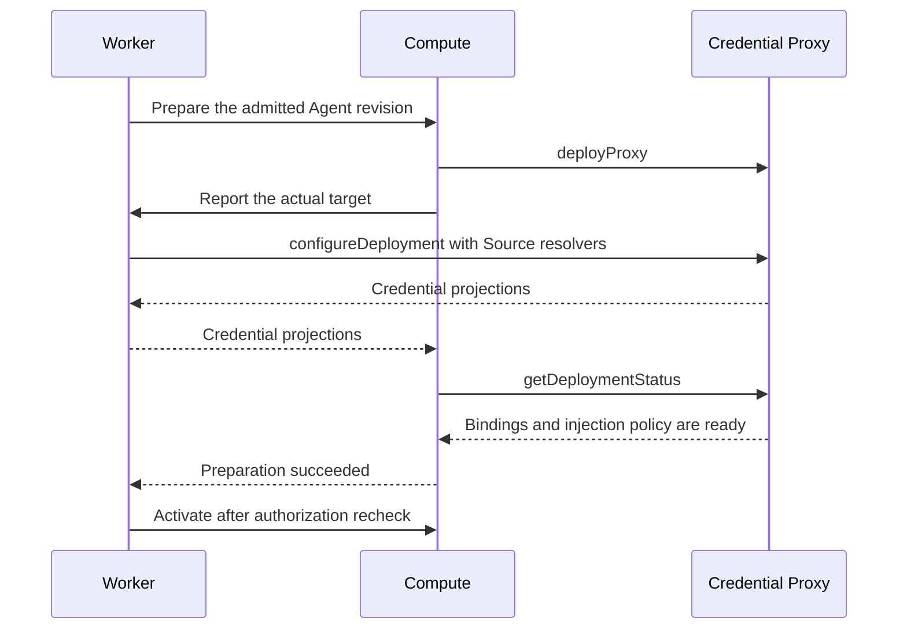

# Credential Proxy Driver contract

**Interface contents**

- [Properties](#properties)
- [Methods](#methods)
- [Historical protected egress](#historical-protected-egress)

## Overview

Use `CredentialProxyDriver` with TokenService for managed Agent credentials.
TokenService owns credential custody and lifecycle. Credential Proxy prepares
credential delivery and enables injection only for bindings and requests admitted
in the Agent revision. `SandboxDriver` enforces network policy and routing;
it does not delegate network authorization to the Proxy.

The native Driver owns the `credential_proxy` capability. The historical protected
exchanges used a separate Driver that is retired.

## Interface

The public [contracts entry point](../../../packages/contracts/src/index.ts)
exports `CredentialProxyDriver`. The [Driver source](../../../packages/contracts/src/drivers/credential-proxy/index.ts)
defines the canonical `CredentialProxyDriver` contract, which extends `Driver`.

### Properties

| Property                                     | Requirement | Value and meaning                                    |
| -------------------------------------------- | ----------- | ---------------------------------------------------- |
| `id`, `implementation`                       | Required    | Identify the selected Driver and its implementation. |
| `capability` | Required    | `credential_proxy`; native managed delivery.         |

### Methods

| Method                                                               | Requirement | Caller and behavior                                                                                                                                                                                    |
| -------------------------------------------------------------------- | ----------- | ------------------------------------------------------------------------------------------------------------------------------------------------------------------------------------------------------ |
| `deployProxy`                         | Required    | Compute prepares Proxy resources for the Namespace, revision, network policy, and injection policies; returns any required routing configuration.                                                      |
| `configureDeployment`         | Required    | The Worker supplies the target reported by Compute, admitted bindings, exact Source resolvers, and injection policies. The Proxy rejects a mismatched target before resolving and returns projections. |
| `getDeploymentStatus`         | Required    | Compute checks the target's expected configuration, policy, serving copies, and versions without reloading or repairing them.                                                                          |
| `removeDeployment`               | Required    | Compute removes only the named target's bindings or unbound resources left by failed staging.                                                                                                          |
| `notifyCredentialUpdated` | Optional    | TokenService notifies the Proxy of an update for one Source. With no delivery resource, the Proxy does nothing. Otherwise, it resolves only when transfer is needed and confirms serving copies.       |

OCC currently registers native delivery with Sandbox; independent composition is
planned. OpenShell prepares admitted HTTP and managed MCP projections with a
Provider per projection. See [current support and limits](../credential-sources.md#implementation-status).

### Historical protected egress

The `LegacyEgressProxyDriver` contract and its protected exchanges were removed.
See the [former Driver contract](https://github.com/openclaw/openclaw-enterprise/blob/691409b2130052b4403d396dd91c7f20b468cd47/docs/reference/drivers/credential-proxy.md#legacy-protected-egress)
for their behavior before removal.

## IAM

OCC authorizes the deployer and Agent's exact Source access before admission and
checks again before release. Each resolver supplied to `configureDeployment` is
authorized for its binding's Source only. Keep credentials out of public status,
logs, and receipts. Resolving a value for delivery does not authorize an upstream
request.

## Lifecycle

Compute prepares an idle Sandbox and calls `deployProxy`. It reports the actual
target to the Worker, which binds Source resolvers to the admitted credential
bindings and calls `configureDeployment`. Compute receives only the returned
projections and checks `getDeploymentStatus` before the Worker releases the Agent.
For OCC custody, the Proxy resolves the
Source to initialize or update existing delivery copies. For native OpenShell
custody, it attaches the authoritative Provider. TokenService commits a
replacement before notification; a failed delivery retries the committed value
without minting another token. Removal or withdrawal detaches the exact binding;
TokenService retains Source custody until Source deletion.

## Configuration

Select TokenService and the bundled OpenShell Sandbox. Its registration supplies
`credential_proxy` automatically. Startup rejects the old
`drivers.credential_proxy` setting. See [supported selections](selection.md#supported-selections).

## Limits

Supported models, Git, Plugin paths, and custody modes have separate
[implementation limits](../credential-sources.md#implementation-status).
OpenShell's accepted temporary MCP exceptions allow bodyless legacy SSE GET and
unsolicited JSON-RPC response POST to reach substitution without an admitted RPC
or tool match. A successful delivery push or Provider metadata check does not
prove that a running Harness consumed the credential.

## Troubleshooting

- If deployment remains unready, inspect the exact target, policy, binding, and
  expected credential version. Do not treat desired configuration as receipt.
- If update delivery fails after commit, retry the committed version through the
  [Source API](../credential-sources.md#retry-credential-delivery).

## Implementations

The bundled OpenShell Sandbox supplies native managed delivery. Its
[Sandbox reference](openshell-sandbox.md) and the [Source lifecycle flow](../../flows/credential-source-lifecycle.md)
state the current scope and evidence limits.

## Related

- [Credential design](../../design/credential-proxy.md)
- [Credential Sources](../credential-sources.md)
- [Sandbox Driver](sandbox.md)
