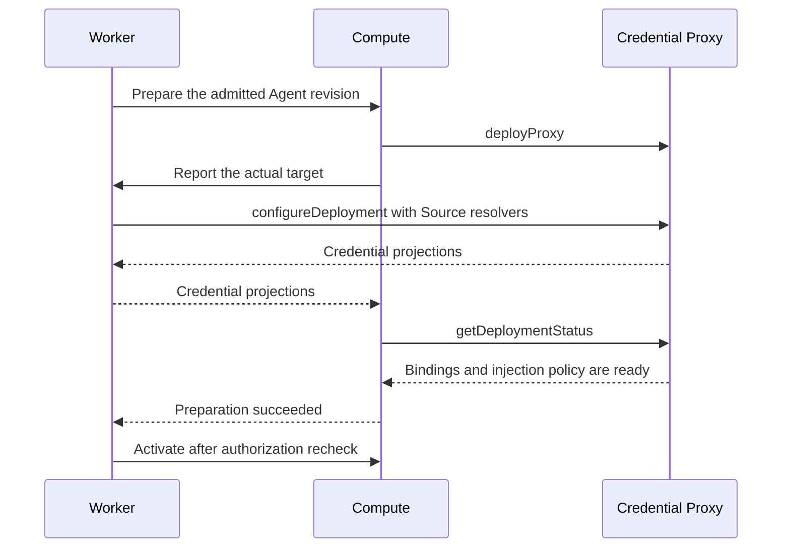

# Credential Proxy Driver contract

**Interface contents**

- [Properties](#properties)
- [Methods](#methods)
- [Legacy protected egress](#legacy-protected-egress)

## Overview

Use `CredentialProxyDriver` with TokenService for managed Agent credentials.
TokenService owns credential custody and lifecycle. Credential Proxy prepares
credential delivery and enables injection only for bindings and requests admitted
in the Agent revision. `SandboxDriver` enforces network policy and routing;
it does not delegate network authorization to the Proxy.

The separate `LegacyEgressProxyDriver` credential-egress interface is deprecated
and pending removal. Credential Design 1.0 retires its special protected
metadata and repository exchanges instead of migrating them. The interface
remains in current code until removal. Credential Gateway and
Credential Refresh selections are retired and unsupported; their exported
legacy contracts are deprecated pending removal.

## Interface

The public [contracts entry point](../../../packages/contracts/src/index.ts)
exports both interfaces. The [Driver source](../../../packages/contracts/src/drivers/credential-proxy/index.ts)
defines the canonical `CredentialProxyDriver` contract, which extends `Driver`.

### Properties

| Property                                     | Requirement | Value and meaning                                     |
| -------------------------------------------- | ----------- | ----------------------------------------------------- |
| `id`, `implementation`                       | Required    | Identify the selected Driver and its implementation.  |
| `capability` | Required    | `credential_proxy_delivery`; native managed delivery. |

### Methods

| Method                                                               | Requirement | Caller and behavior                                                                                                                                                                                    |
| -------------------------------------------------------------------- | ----------- | ------------------------------------------------------------------------------------------------------------------------------------------------------------------------------------------------------ |
| `deployProxy`                         | Required    | Compute prepares Proxy resources for the Namespace, revision, network policy, and injection policies; returns any required routing configuration.                                                      |
| `configureDeployment`         | Required    | The Worker supplies the target reported by Compute, admitted bindings, exact Source resolvers, and injection policies. The Proxy rejects a mismatched target before resolving and returns projections. |
| `getDeploymentStatus`         | Required    | Compute checks the target's expected configuration, policy, serving copies, and versions without reloading or repairing them.                                                                          |
| `removeDeployment`               | Required    | Compute removes only the named target's bindings or unbound resources left by failed staging.                                                                                                          |
| `notifyCredentialUpdated` | Optional    | TokenService notifies the Proxy of an update for one Source. With no delivery resource, the Proxy does nothing. Otherwise, it resolves only when transfer is needed and confirms serving copies.       |

OCC currently registers native delivery with Sandbox; independent composition is
planned. OpenShell prepares admitted HTTP and managed MCP projections with a
Provider per projection. See [current support and limits](../credential-sources.md#implementation-status).

### Deprecated legacy protected egress

`LegacyEgressProxyDriver` uses the `credential_proxy` capability. Do not select
it for new workflows. Its protected exchange features are retired from 1.0. It
is distinct from both native
`CredentialProxyDriver` delivery and ordinary network egress.

| Member               | Requirement | Retained behavior                                                                                            |
| -------------------- | ----------- | ------------------------------------------------------------------------------------------------------------ |
| `sourceControl`      | Required    | Identifies the Backend, sender, resolver, and provider used by deprecated protected admission.               |
| `configureRevision`  | Required    | Prepares the exact admitted protected plan without broadening it.                                            |
| `wiringStatus`       | Required    | Observes authenticated installation evidence for that plan.                                                  |
| `verifyInstallation` | Required    | Rechecks current counterpart evidence before release.                                                        |
| `removeRevision`     | Required    | Removes the owned installation and reports confirmed cleanup.                                                |
| `bindExchange`       | Optional    | Required by a retained request-time exchange transport.                                                      |
| `bindRepositoryGit`  | Optional    | Required by retained protected repository delivery, together with Sandbox repository access.                 |
| `policyReduction`    | Optional    | Required when the admitted plan records reduction; applies and independently observes a nonexpanding change. |

#### Delivery profiles

Retained admissions preserve their original guarantee: version 3 covers protected
request-time routes, version 4 exact dispatch, version 5 online authorization,
version 6 an observed-hook installation preview, and version 7 exact dispatch
with verified reduction v2. Online authorization and a hook observed at startup
do not establish exact dispatch or filtered response custody. A lost
request-time authorization reply records possible use; do not repeat the send.

#### Registration and execution release

The API and Worker must match the Driver registration, admitted plan, execution,
and authenticated installation evidence. Compute verifies the counterpart before
releasing a retained protected execution. A stored receipt or accepted
configuration is not current readiness evidence.

#### Request-time exchange

A retained transport binds `resolve`, `authorizeSend`, `beginResponse`,
`renewResponse`, and `protectResponse` to the captured request and reply.
Resolution does not authorize a send. `authorizeSend` rechecks current authority;
the sender enforces its deadline at the controlled send boundary. Do not retry an
uncertain authorized exchange.

#### Installed material

For retained protected Git, material installation and send authorization remain
separate. A Provider attachment is not permission to send, and an authorization
decision does not prove delivery or the upstream result.

#### Cancellation, retries and uncertainty

Preserve operation identities, deadlines, and pending outcomes across restart.
Cancellation is not proof of remote rollback. Observe existing state before a
new mutation; do not repeat an uncertain installation, policy reduction, or
business exchange just to obtain a reply. Withdrawal prevents fresh authority
but cannot undo an already authorized upstream effect.

#### Request-time capacity

The deprecated exchange registry keeps limits per API process. For an existing
installation, the retained `requestCapacity` defaults are 1,024 operations,
256 authenticating operations, 256 operations per Sandbox, 8,192 request IDs,
and 2,048 IDs per Sandbox. Operation counts have a maximum of 8,192; ID counts
have a maximum of 131,072. Shares cannot exceed their pools. The request-ID
window is 30 seconds. A limit breach refuses resolution; invalid settings fail
startup. Consult the [release-specific legacy reference](https://github.com/openclaw/openclaw-enterprise/blob/691409b2130052b4403d396dd91c7f20b468cd47/docs/reference/drivers/credential-proxy.md#request-time-capacity)
for old configuration and resource sizing when retiring an existing deployment.

## IAM

OCC authorizes the deployer and Agent's exact Source access before admission and
checks again before release. Each resolver supplied to `configureDeployment` is
authorized for its binding's Source only. Keep credentials out of public status,
logs, and receipts. Resolving a value for delivery does not authorize an upstream
request.

## Lifecycle

Compute prepares an idle Sandbox and calls `deployProxy`. It reports the actual
target to the Worker, which binds Source resolvers to the admitted credential
bindings and calls `configureDeployment`. Compute receives only the returned
projections and checks `getDeploymentStatus` before the Worker releases the Agent.
For OCC custody, the Proxy resolves the
Source to initialize or update existing delivery copies. For native OpenShell
custody, it attaches the authoritative Provider. TokenService commits a
replacement before notification; a failed delivery retries the committed value
without minting another token. Removal or withdrawal detaches the exact binding;
TokenService retains Source custody until Source deletion.

## Configuration

Select TokenService and a compatible Sandbox registration. The registration
supplies `credential_proxy_delivery`; it has no separate Installation YAML
selector. See [supported selections](selection.md#supported-selections).

## Limits

Supported models, Git, Plugin paths, and custody modes have separate
[implementation limits](../credential-sources.md#implementation-status).
OpenShell's accepted temporary MCP exceptions allow bodyless legacy SSE GET and
unsolicited JSON-RPC response POST to reach substitution without an admitted RPC
or tool match. A successful delivery push or Provider metadata check does not
prove that a running Harness consumed the credential.

## Troubleshooting

- If deployment remains unready, inspect the exact target, policy, binding, and
  expected credential version. Do not treat desired configuration as receipt.
- If update delivery fails after commit, retry the committed version through the
  [Source API](../credential-sources.md#retry-credential-delivery).
- If a retained legacy exchange is uncertain, inspect its original owner and
  pending outcome; do not repeat the authorized request.

## Implementations

The bundled OpenShell Sandbox supplies native managed delivery. Its
[Sandbox reference](openshell-sandbox.md) and the [Source lifecycle flow](../../flows/credential-source-lifecycle.md)
state the current scope and evidence limits.

## Related

- [Credential design](../../design/credential-proxy.md)
- [Credential Sources](../credential-sources.md)
- [Sandbox Driver](sandbox.md)
