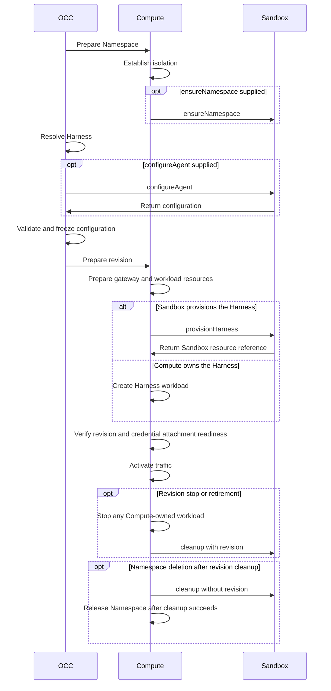

# SandboxDriver contract

## Overview

`SandboxDriver` confines an Agent Harness's network, filesystem, or processes.
OpenClaw Control Plane (OCC) supports this Driver with the bundled
[Kubernetes Compute Driver](kubernetes-compute.md).
The Sandbox can provision a dedicated Harness. Compute owns the gateway,
workload identity, baseline isolation, routing, and activation.

## Interface

The [exported interface](../../../packages/contracts/src/drivers/sandbox/index.ts) extends `Driver`.

### Properties

| Property                       | Requirement | Value and meaning                                                                                                                                     |
| ------------------------------ | ----------- | ----------------------------------------------------------------------------------------------------------------------------------------------------- |
| `id`, `implementation`         | Required    | Identify the selected Driver and its implementation.                                                                                                  |
| `capability`                   | Required    | Must be `"sandbox"`.                                                                                                                                  |
| `supportsHarnessExecutionMode` | Required    | OpenClaw mode support set during Driver construction. See [mode support](#harness-mode-support).                                                      |
| `facets`                       | Required    | Declare at least one distinct [containment facet](#containment-facets). Startup rejects unknown, duplicate, or empty declarations.                    |
| `harnessHome`                  | Optional    | Normalized absolute Harness user home. Compute uses it for Harness-local paths. Default: `/home/node`.                                                |
| `repositoryAccess`             | Optional    | Compute verifies the execution receiving repository access, checks whether its Git route is ready, and retires expired access through this interface. |
| `networkPolicy`                | Optional    | Declare support for [network policy operations](#optional-network-policy-operations).                                                                 |
| `computeLifecycleHooks`        | Optional    | Inherited from `Driver`. Installed packages supply hooks on the registration and must omit them on the capability object.                             |

### Harness mode support

`supportsHarnessExecutionMode.openclaw` has `embedded` and `dedicated` entries.
Each `HarnessExecutionModeSupport` value is either `{ supported: true }` or
`{ supported: false, reason?: string }`. Set these values in the Driver constructor.
Use `Object.freeze` for the support object, its `openclaw` object, and both mode
entries. Registration checks their shape and read-only state.

Use `reason` for refusals caused by Installation settings. Limit the message to
setting names and corrective actions. OCC reports it in `openclaw.settingRefusals`
and uses the same message during admission. OCC supplies a standard refusal
message when `reason` is absent.

Installation reads combine this declaration with native-worker support and
provisioning requirements. A selected Sandbox still requires Dedicated execution.
Agent save, deployment, and provisioning writes check support before transforming
Configuration values. Provisioning status reads return stored work.
The Configuration resource supplies the input; OCC stores the validated result in
the Agent revision. OCC rejects a result that selects a different Harness.
Construct a new Driver after changing Installation settings.

### Methods

| Method                                       | Requirement | Caller and behavior                                                                                                                                                                                                                                       |
| -------------------------------------------- | ----------- | --------------------------------------------------------------------------------------------------------------------------------------------------------------------------------------------------------------------------------------------------------- |
| `cleanup`                                    | Required    | Compute passes the Agent revision on stop or retirement. For Namespace cleanup, it omits the revision.                                                                                                                                                    |
| `configureAgent`                             | Optional    | Synchronously transform Configuration values for the resolved Harness. OCC validates the result and stores it in the Agent revision. OCC uses the original values by default.                                                                             |
| `validateWorkspaceSetup`                     | Optional    | Synchronously checks the projected configuration. Without it, Compute rejects initial workspace files in a Sandbox. Compute still checks storage and workload identity.                                                                                   |
| `ensureNamespace`                            | Optional    | Prepare the backend after Compute prepares baseline Namespace isolation. Without it, Compute proceeds.                                                                                                                                                    |
| `provisionHarness`                           | Optional    | Creates a dedicated Harness and returns its stable [resource identity](#sandbox-resource-identity). Without it, Compute rejects dedicated native OpenClaw and revisions that bind credential sources.                                                     |
| `harnessEndpoint`, `harnessStatus`           | Optional    | Compute calls `harnessEndpoint` for the transport and `harnessStatus` to check startup. See [Sandbox-provided Harness transport](#harness-transport).                                                                                                     |
| `withdrawHarnessExposure`                    | Optional    | Remove the temporary Harness status endpoint after the dedicated worker's workspace node enrolls.                                                                                                                                                         |
| `enrollHarness`                              | Optional    | Binds the verified installation to the Harness before Compute releases startup. Protected egress needs this method plus `provisionHarness`, `harnessEndpoint`, and `harnessStatus`.                                                                       |
| `observeHeldRepositoryGitPreview`            | Optional    | Reports the held or installed stage for request-hook-observed Git startup. Without a stage, startup stays pending.                                                                                                                                        |
| `harnessResource`                            | Optional    | Derives the Sandbox reference without side effects. Without it, Compute cannot [withdraw credentials](credential-gateway.md#optional-additions) from a running revision.                                                                                  |
| `workspaceNodePeerLabels`                    | Optional    | Return exact Pod labels for this revision's workspace-node connection, or `undefined` before its Sandbox exists. Compute admits only those Pods and the serving revision's Pods during replacement.                                                       |
| `readSandboxLogs`                            | Optional    | Derive the Sandbox from the revision. Return at most `lines` raw lines at or after `sinceTime` and the number examined, using read-only access. OCC classifies and redacts each line. See [Agent logs](../../guides/topics/agent-logs.md#sandbox-source). |
| `observeHarness`                             | Optional    | Read provider lifecycle state for [Harness Sandbox status](#harness-sandbox-status).                                                                                                                                                                      |
| `admitNetworkPolicy`                         | Optional    | Validates additions and returns an admitted snapshot. Declaring `networkPolicy` without this method fails startup.                                                                                                                                        |
| `observeNetworkPolicy`, `applyNetworkPolicy` | Optional    | Read provider state or apply the snapshot against the expected version. Declaring live policy support without both methods fails startup.                                                                                                                 |
| `readPolicyRecommendations`                  | Optional    | Return provider suggestions for review.                                                                                                                                                                                                                   |

### Sandbox-provided Harness transport

When a provider supplies `harnessEndpoint`, Compute routes the Agent Gateway to
the provider-owned Harness. For Codex, Compute derives the native hook credential
directory from `harnessHome`. The Sandbox creates that owner-only directory
outside the Harness workspace and file-transfer roots. Compute validates the path
and owns the relay URL and authentication.

Compute calls `harnessStatus(context)` with the Agent transport token. The
Driver returns `serving` only after an authenticated handshake. It returns
`starting` while startup is pending, or `failed` with evidence of a startup
failure. Compute validates that evidence before it fails the revision. If the
provider does not answer, Compute reports a transient dependency failure.

For Codex, when the Driver supplies a provider endpoint and `harnessStatus`,
Compute checks status while the workspace node is pending and waits for
`serving` before it activates the revision.
For a dedicated OpenClaw worker, Compute checks status only before its node
enrolls. After enrollment, `withdrawHarnessExposure(context)` removes the
temporary status endpoint. The method resolves only after a read under the
controller's identity confirms removal. A missing response does not confirm removal.
Compute can also call this method for a serving or permanently failed revision.

The endpoint can select `codexPermissionProfile: ":danger-full-access"` when the
provider supplies the sandbox boundary. Kubernetes Compute projects the selection
to the Gateway. Without it, the Codex bridge keeps its configured sandbox behavior.

The endpoint can supply `tls.caBundle` with public PEM CA certificates for a WSS
origin. It accepts no private keys, client credentials, or source paths. Without a bundle, the Gateway uses system trust. Kubernetes Compute mounts one combined `NODE_EXTRA_CA_CERTS`
bundle read-only into the dedicated Agent Gateway. Certificate and hostname
verification remain enabled. Compute creates the revision's ConfigMap with
`immutable: true` before Gateway rollout and removes it after the revision
workloads terminate.
Changing its certificates requires a new revision.

`enrollHarness(context, installation, release)` receives a callback from Compute.
Compute commits and rechecks the verified installation before it signs the startup
release. The Driver authenticates the Harness transport and binds a fresh startup
challenge to that execution and plan before it releases the first model probe. A
starting transport can remain pending. Enrollment conveys no credential material
or send permission. See [protected static inference](../credential-sources/protected-inference.md).

### Harness Sandbox status

`observeHarness(context)` reads the provider's lifecycle record without contacting
the Harness endpoint. The Driver reports `running`, `starting`, `unknown`, or
`lost` with a reason code. For a provider-managed restart, it can report `starting` with
`HARNESS_RESTARTING`, the last exit code, and the restart count.

The [Harness status API](../api.md#get-namespacesnamespaceidagentsagentidharnessstatus)
requires Agent `read`. For an active Agent set to run with a dedicated Sandbox,
OCC returns the provider state for the selected revision. If the Sandbox
cannot be observed or no longer serves the revision, check the result below.

- `unobserved` if the Driver omits `observeHarness`.
- `observed` with `harness.state: unknown` if the provider read fails.
- `observed` with `harness.state: lost` and a reason code if the provider reports
  loss. OCC treats a missing or deleting Sandbox as lost only for the selected
  revision of an Agent set to run. Deploy a new revision to replace a lost Sandbox.

`occ agent get` and the Console's **Live serving** show this result.
[OpenShell Harness observation](openshell-sandbox/harness-providers.md#harness-observation)
describes how that provider maps its phases to these states.

### Containment facets

| Facet        | What the Driver enforces                                                           |
| ------------ | ---------------------------------------------------------------------------------- |
| `networking` | Connections only to approved destinations and peers.                               |
| `filesystem` | Approved image paths and Agent-owned workspace paths, with their read/write modes. |
| `process`    | Approved process identity, capabilities, and operating-system limits.              |

### Provisioning inputs

Compute supplies the Namespace, Kubernetes client, and cancellation signal.
For Harness provisioning it also supplies the Agent revision and
[`HarnessWorkloadRequirements`](../../../packages/contracts/src/drivers/sandbox/index.ts).
Use the identity, mounts, login mode, and credential references Compute selected.

If `workspaceSetup` is present, read only the specified key of the Agent-owned
Secret in the same Namespace. Initialize the approved workspace and verify its
completion marker before starting the Harness. If OCC recorded completion but
the marker is missing or mismatched, refuse startup with
`SandboxWorkspaceSetupRefusedError` to preserve later edits. See the
[workspace setup sequence](../../flows/workspace-files.md#2-deployment-initializes-storage-before-execution).

The paired [Credential Gateway](credential-gateway.md#lifecycle) issues one opaque
`{ sourceId, ref }` attachment per bound credential source. Compute passes them
in `credentialAttachments`, which is empty when the revision uses no sources.
The Sandbox must consume every attachment and reject references from any other
provider. Compute waits for the gateway to report every attachment
`ready` before activation.

### Sandbox resource identity

`SandboxResourceRef` contains `namespaceName`, `resourceName`, `agentId`, and
`revisionId`. It stays stable when a controller replaces the underlying Pod;
retirement must find the provider resource even if that Pod is already gone.

### Optional network policy operations

`networkPolicy` declares `wildcards`, `portRanges`, and `live` support. An
implementation advertising it must declare the configuration contribution
`{ scope: "agent", key: "sandbox-network-policy" }` for `{ additions }`, using the
[shared definition contract](selection.md#configuration-definitions-and-discovery).
OCC resolves this definition through the registry before admission. For invalid
settings, throw `ConfigurationValidationError` and identify the rejected fields
in `error.details` without including secret values.
`admitNetworkPolicy(additions, version, defaults?, scope?)` validates every requested
constraint and returns a detached snapshot of Driver identity, version, defaults,
and additions. Provisioning uses that saved policy even if startup defaults change. `scope.repositoryCredentials` marks an
Agent with repository bindings: a Driver that routes repository hosts only through
its own path refuses a rule that reaches them with a
`SandboxNetworkPolicyConflictError` naming the rule.

`observeNetworkPolicy(context, snapshot)` returns the provider resource version,
policy version, load state, and whether the complete candidate matches.
`applyNetworkPolicy(context, {snapshot, expectedProviderVersion, operationId})`
must apply the change only at the expected provider version and must tolerate a
retry with the same operation ID. OCC confirms application only when the full
policy matches the requested snapshot and the provider has loaded that version.
Reject a change that would discard static, default, or generated policy.

`readPolicyRecommendations(context, limit)` must honor `limit`. OCC currently
requests at most 32 suggestions. Return each suggestion's ID, grant, status,
and optional observation count. Reviewing a suggestion does not apply it, and
its observation count is not a count of denied requests.

A Driver that parses network decisions from its logs can return
`SandboxLogLine.decision`. OCC validates and redacts the result. See
[per-Agent policies](../sandbox-policies.md#denials-and-recommendations) for
denial events and the review workflow.

## IAM

OCC authorizes deployment and access to the bound credential sources.
Use the supplied Namespace, Agent revision, workload identity, and credential
references. Refuse provisioning if the Sandbox cannot enforce those bindings
or Compute's network and workspace isolation.

Keep Secret values out of configuration, revision metadata, logs, and provider
configuration. Deliver private workspace files only through the authenticated
setup call. Keep their contents out of arguments and environment variables.
See [authorization](../authorization.md) and [Harness execution](../harness-execution.md).

## Lifecycle

### Admission and lifecycle

Startup validates the selected Sandbox and its declared facets. The shared
interface has no initializer or destructor; workload and Namespace removal use
the same cleanup operation with or without an Agent revision.

Dedicated native OpenClaw requires a selected Sandbox that implements
`provisionHarness` and declares networking, filesystem, and process containment.
Other dedicated Harnesses may use a subset of facets or no Sandbox according to
their Compute contract.

The revision stores the selected `sandboxDriverId`. Before routing traffic,
Compute checks that the workload's revision ID matches the requested revision.
Namespace setup, provisioning, and cleanup must be safe to repeat.
Run revision cleanup even when the Pod is already absent. The Sandbox removes
any workload it owns. Namespace cleanup follows revision cleanup.

- If the Driver cannot run this revision, throw
  [`SandboxRevisionUnsupportedError`](../../../packages/occ/src/errors.ts).
  The worker fails the deployment with the error code. The provider's message
  stays in controller diagnostics.
- If the provider rejects the controller's identity during Namespace setup or
  cleanup, throw `SandboxNamespaceRefusedError`. Compute marks the step as a
  permanent failure.
- During removal, a missing role is a permanent `SANDBOX_GATEWAY_UNAUTHORIZED`
  failure. The worker retries transient authentication failures within the
  attempt budget. Leave removal pending if the provider cannot confirm absence.

## Limits

- Sandbox selection is optional. Only dedicated execution with bundled Kubernetes Compute supports a Sandbox, including one from an installed package.
- Supported facets are `networking`, `filesystem`, and `process`. The Sandbox
  does not authorize commands or create a Sandbox for each tool invocation.
- The Sandbox reports Harness status. Compute decides when to activate traffic.

## Troubleshooting

| Symptom                                                 | Check and next action                                                                                                                                                                                              |
| ------------------------------------------------------- | ------------------------------------------------------------------------------------------------------------------------------------------------------------------------------------------------------------------ |
| Startup rejects the Sandbox                             | Confirm that the Installation selects bundled Kubernetes Compute. Check that `facets` contains at least one supported value and no duplicates.                                                                     |
| Dedicated native OpenClaw deployment is refused         | Check for `provisionHarness` and all three containment facets. The Driver must also support the supplied workload identity, mounts, and credential references.                                                     |
| Cleanup retries after the Pod disappears                | Look up the provider resource using the revision's [Sandbox resource identity](#sandbox-resource-identity). Confirm removal with a read authorized for that resource. Pod absence alone does not complete cleanup. |
| The temporary Harness status endpoint cannot be removed | Check whether the controller can still read the resource. Restore access before retrying. See [OpenShell gateway recovery](openshell-sandbox.md#gateway-identity-and-removal).                                     |

## Implementations

- [OpenShell SandboxDriver](openshell-sandbox.md): bundled implementation, paired
  with the OpenShell Credential Gateway through an `openshell` Backend. Trusted
  YAML can also select an operator-installed Sandbox package, which cannot pair
  with a Credential Gateway.

## Related

- [Kubernetes ComputeDriver](kubernetes-compute.md) and [Compute Sandbox coordination](compute.md#sandboxdriver-coordination)
- [OCC deployment admission](../../../packages/occ/src/index.ts) and [Kubernetes Compute caller](../../../apps/controller/src/drivers/compute/kubernetes/index.ts)
- [OpenShell verification guide](../../testing/openshell.md)
