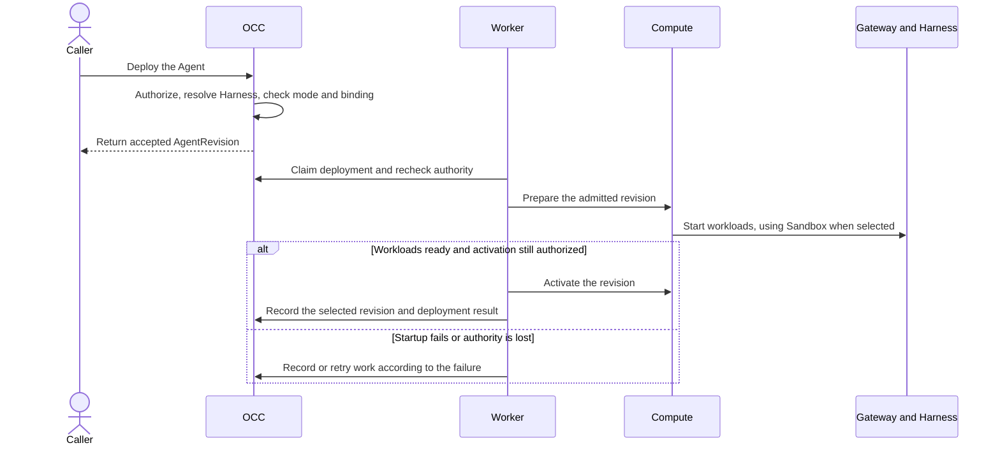

# Harness execution contract

**Interface contents**

- [Properties](#properties)
  - [`id`](#property-id)
  - [`version`](#property-version)
  - [`mode`](#property-mode)
- [Methods](#methods)
  - [`HarnessResolver(harnessId, executionMode)`](#method-harness-resolver)

## Overview

A Harness calls the model and runs Agent tools. OpenClaw Control Plane (OCC)
selects the Harness from the Agent's Configuration, checks its execution mode,
and records the selection in the AgentRevision. A Harness is a runtime. It has
no independent OCC resource, Driver registration, or provisioning methods.
Compute starts the gateway and routes traffic. A selected Sandbox can provision
a dedicated Harness.

## Interface

### Properties

The [revision descriptor](../../packages/contracts/src/index.ts) records the
selection at `AgentRevision.harness`. All three properties are required.

| Property                               | Requirement | Meaning                                                                          |
| -------------------------------------- | ----------- | -------------------------------------------------------------------------------- |
| `id`           | Required    | Approved runtime identifier. The bundled resolver accepts `openclaw` or `codex`. |
| `version` | Required    | Version of the descriptor approved by the resolver.                              |
| `mode`       | Required    | `embedded` runs inside the gateway. `dedicated` runs in a separate workload.     |

### Methods

| Method                                                                          | Requirement | Caller and result                                                                                                                                                                                                                                                                                                              |
| ------------------------------------------------------------------------------- | ----------- | ------------------------------------------------------------------------------------------------------------------------------------------------------------------------------------------------------------------------------------------------------------------------------------------------------------------------------ |
| `HarnessResolver(harnessId, executionMode)` | Required    | At deployment, OCC asks the [resolver](../../packages/occ/src/index.ts) for an approved descriptor. The [bundled implementation](../../apps/controller/src/composition/production-harness.ts) returns an ID and version for a recognized pair, or `undefined` otherwise. OCC rejects an unapproved pair before it queues work. |

### Supported topology

| Harness  | Mode      | Where it runs                                                                                                                                                                               |
| -------- | --------- | ------------------------------------------------------------------------------------------------------------------------------------------------------------------------------------------- |
| OpenClaw | Embedded  | One gateway on Kubernetes or SSH. The built-in Harness shares the gateway's identity and storage.                                                                                           |
| Codex    | Dedicated | On Kubernetes, a separate Codex app-server serves the AgentRevision. A Sandbox can provide the Harness workload.                                                                            |
| OpenClaw | Dedicated | Experimental on Kubernetes. The gateway admits sessions and owns transcripts. A paired OpenClaw node runs inference and tools in its own environment. A disconnected worker fails the turn. |

### Optional sandbox provisioning

Use `GET /installation` to check `capabilities.openclaw.executionModes`.
A selected Sandbox requires dedicated execution. For dedicated native OpenClaw,
it must also support that mode, provision the Harness, and enforce all three
[containment facets](drivers/sandbox.md#containment-facets): networking,
filesystem, and process. Compute still owns gateway identity and routing.

## IAM

Deployment requires `deploy` on the exact Agent and `read` on its Configuration
in the same Namespace. OCC also authorizes the Agent's selected model credential.
The worker rechecks authority and source ownership before runtime effects.

### Harness authentication

An Agent draft can have an empty `harnessAuth`; deployment requires an
[explicit binding](../../packages/contracts/src/harness-auth.ts).

| Binding                                | Authority and delivery                                                                                                                                                                                                                                                                                                                                                                                                  |
| -------------------------------------- | ----------------------------------------------------------------------------------------------------------------------------------------------------------------------------------------------------------------------------------------------------------------------------------------------------------------------------------------------------------------------------------------------------------------------- |
| `api_key` or `codex_pat` from a Secret | The caller and Agent service principal need `operate` on the exact Secret. On Kubernetes the embedded process or dedicated Harness receives the key. PAT login is for dedicated Codex.                                                                                                                                                                                                                                  |
| `codex_pat` from a ServiceAccount      | The caller needs `read` on the exact ServiceAccount. OCC checks the private Backend binding and records the account's credential reference. Dedicated Codex receives the PAT.                                                                                                                                                                                                                                           |
| `credential_source`                    | The caller and Agent principal need `operate` on the source. Dedicated OpenClaw or Codex receives a placeholder for proxy-based API-key authentication; the paired Credential Gateway and OpenShell inject the key on egress. Dedicated Codex also supports [external ChatGPT authentication](drivers/credential-gateway.md#external-chatgpt-authentication). All required attachments must be ready before activation. |
| `runtime`                              | SSH embedded OpenClaw uses operator-managed host credentials. OCC checks gateway readiness without probing model access. Kubernetes accepts it only for protected dedicated Codex with a selected Credential Proxy and an admitted egress plan that has no inference route. Agent provisioning rejects this method.                                                                                                     |

For embedded OpenClaw, Kubernetes projects the Secret as `OPENAI_API_KEY`,
`ANTHROPIC_API_KEY`, or `OCE_MODEL_API_KEY`. A custom provider must reference
`OCE_MODEL_API_KEY` in its Configuration. Dedicated Codex logs in with the key
or PAT through stdin. With a selected Credential Gateway, choose a compatible
`credential_source`; deployment rejects Secret-backed and account bindings.

The dedicated gateway does not receive the selected Harness model credential.
The revision records source references, never historical Secret bytes. A managed
account retains its exact credential reference and Backend ownership. See
[Agent credential grants](agents.md#harness-authentication) and
[renewal and revocation](../guides/deploy/credential-lifecycle.md).

## Lifecycle

### Admission and immutable execution

OCC records the admitted Configuration and generation, Harness ID, version and
mode, Compute identity, and credential binding in the AgentRevision. A Sandbox
can transform the runtime Configuration before admission. The stored
Configuration remains the author's input. Later edits take effect on a new deployment.

### Isolation and activation

On Kubernetes, a dedicated Harness and gateway use separate workload identities
and storage. A replacement stops earlier dedicated revisions before preparing
the new one. Embedded preparation can run while the predecessor serves, but
gateway replacement can interrupt service before the new credentials pass the
model probe. A failed replacement can leave the Agent unavailable. OCC guards
activation so an older retry cannot replace a newer selected revision.

On first dedicated Codex deployment, the gateway waits for Harness plugin
status. The deployment convergence deadline bounds that wait. The Agent Service
publishes ready endpoints. Use the
[worker flow](../flows/controller-worker.md) for claim, activation, and retirement order.

### Startup model checks

On Kubernetes, the process that owns model access probes the primary model.
OpenClaw disables tools and fallback. Ordinary dedicated Codex retries a
transient failure once, at most 30 seconds per attempt within a 61-second
budget including backoff. It does not retry rejected credentials or a protected
profile with `providerTools: "none"`. A protected Codex execution with no
inference route skips the probe and can serve its local app protocol.

Codex logs `codex.model_probe` with the attempt, duration, exit status, and
final code, omitting tokens and raw provider output. Its default model
transport requires a Responses WebSocket upgrade; compatible endpoints use
HTTPS streaming. Read the [startup wrapper](../../apps/controller/src/drivers/compute/kubernetes/runtime-entrypoints.ts)
and [Compute failure evidence](drivers/compute.md#startup-failure-evidence)
for the retry conditions and terminal codes.

### Runtime logging

For platform-owned logging, admission stamps the runtime log settings after
Sandbox configuration. Kubernetes sends gateway JSON console output and Codex
stderr to the Collector. Codex stdout carries protocol messages. A trusted
Compute Driver can instead declare [Driver-managed logging](drivers/compute.md#runtime-logging-ownership).
See [observability](../guides/observability.md) for collection settings.

## Configuration

### Installation settings

The Harness has no Driver registration settings. The Installation selects Compute
and, optionally, Sandbox. Their capabilities determine which execution modes an
Agent can use. See [Driver selection and configuration discovery](drivers/selection.md#configuration-definitions-and-discovery).

#### Native worker support

Dedicated native OpenClaw requires enforced worker placement and inference on the
node. The [bundled image](../../deploy/runtime/README.md) supplies these capabilities.
For a custom image, the operator can declare support in the
[Installation startup configuration](configuration.md#installation-startup-configuration).
The API and worker read this setting at startup. On a qualifying Installation,
`GET /installation` reports `capabilities.nativeWorkers.support` as
`pinned-runtime` when the pinned runtime supplies support, or `custom-image`
when OCC relies on the operator declaration.

| Setting                       | Type   | Requirement | Value, default, and constraints                                                                                                                                                        |
| ----------------------------- | ------ | ----------- | -------------------------------------------------------------------------------------------------------------------------------------------------------------------------------------- |
| `runtime.nativeWorkerSupport` | string | Optional    | `custom-image` declares that the operator's image supports native workers. Omit the setting to rely on built-in support for the pinned runtime. A qualifying Sandbox is also required. |

### Agent settings

Set these fields when creating or updating an Agent. Deployment saves the
resolved settings in a new AgentRevision. An edit to the Agent or its
Configuration takes effect on the next deployment.

| Setting           | Type           | Requirement | Value, default, and constraints                                                                                                                                                                                          |
| ----------------- | -------------- | ----------- | ------------------------------------------------------------------------------------------------------------------------------------------------------------------------------------------------------------------------ |
| `configurationId` | string         | Required    | On creation, supply the ID of an Agent Configuration in the same Namespace. An update that omits the field keeps the current Configuration.                                                                              |
| `executionMode`   | string         | Optional    | `embedded` (default on creation) or `dedicated`. An update that omits the field keeps the current mode.                                                                                                                  |
| `harnessAuth`     | object or null | Optional    | A new draft can omit the binding. An update that omits it keeps the current binding. Deployment requires a binding compatible with the selected runtime and mode. See [Harness authentication](#harness-authentication). |

### Native runtime selection

In the Configuration, select a primary model as `provider/model`. The model ID can contain slashes. An
explicit `agentRuntime.id` selects `openclaw` or `codex`. Agent entries must
agree on the primary model and Harness. Fallbacks must use the same provider and
resolve to the same Harness. Admission preserves their order.

The [model policy resolver](../../packages/occ/src/configured-harness.ts) selects
OpenClaw when there is no model candidate or an unambiguous built-in provider.
OpenAI, Codex, custom providers, and plugin-routed providers require an explicit
runtime policy. Catalog entries may use the full model reference or the ID after
the first slash. Each listed provider model must be a selected primary or fallback.
When no model is selected at all, that refusal says so and names
`agents.defaults.model` or an `agents.entries` model as the setting to set.
Codex accepts its native `codex` provider, or `openai` with the
Codex plugin explicitly enabled for WebSocket app-server transport.
An embedded or dedicated Gateway cannot start when an active plugin's startup
secret input reads an unset variable: Codex `appServer.authToken` or
`appServer.headers`, or Google `webSearch.headers`. Kubernetes sets the
`APP_SERVER_` variables only in a dedicated Codex Gateway, so deployment and
Agent save refuse them for other Agents. Deployment also refuses another
variable that no Configuration Secret binding sets, unless an Installation
Driver adds launch variables. Bind a Secret to it, or remove or disable the
plugin entry.

Configuration writes run these rules in deployment's order. They refuse settings
that conflict, with deployment's message: an entry primary that differs, selectable
models on another provider or runtime, an unselected catalog entry, conflicting
runtime policies, an unsupported runtime ID, or Codex on another provider. Each
message names the settings to change and, for a runtime, the allowed values `openclaw`
and `codex`. A draft without a model, or a model without its required runtime, still
saves; deployment refuses it and names the setting to add:
`agents.defaults.models["<ref>"].agentRuntime.id` for a missing runtime, and on
Kubernetes Compute `agents.defaults.model` for a missing model. A missing runtime names a
setting that keeps the selectable rule: the entry's `agents.entries.<id>.models` policy when
it lists the model or sets the primary's runtime, or the model's provider catalog entry or
provider when the primary's runtime comes from there. A missing or conflicting runtime offers
only values that deployment accepts: `codex` only where Codex accepts the model, and the
runtime that the other selected models, the listed models, or another policy already select.
Deployment and Agent provisioning also check the Agent: if the Agent is dedicated and the
Installation does not list dedicated OpenClaw, the refusal offers only `codex` where Codex
accepts the model. Deployment of an embedded Agent, where the Installation approves Codex only
for dedicated execution, offers only `openclaw`. For a `codex/<model>` model, embedded OpenClaw
cannot run it either, so the refusal tells you to set `codex` on a dedicated Agent or to select
a model of another provider. Configuration save can serve any Agent, so it offers both values.
A Preset is checked when a launch creates its Configuration.

## Limits

- One dedicated Harness serves all sessions for an AgentRevision. OpenShell
  contains the revision. The native OpenClaw node defaults to eight retained
  session workers on Kubernetes. Set `runtime.nativeOpenClawSessionCapacity`
  to an integer from 1 to 1024 to change the limit. At capacity the node refuses
  additional sessions until a hosted session stops.
  Codex has no separate OCE session-count limit. OpenClaw's
  `agents.defaults.maxConcurrent` bounds active turns.
- A startup model probe can incur charges.
  A successful probe establishes model access at startup only. SSH checks process
  readiness. Neither establishes that a fallback model works.
- Retained gateway state does not guarantee recovery of an interrupted turn.
  Dedicated restart acceptance remains incomplete. For the workload and storage
  boundaries, see [runtime isolation](security/runtime-isolation.md#agent-runtime-isolation).
- Docker Compute rejects all current Harness authentication bindings and cannot
  deploy a new Agent. See [Docker Compute](drivers/docker-compute.md).

## Troubleshooting

| Symptom                                                       | Check                                                                                                                                                                                                              | Recovery and expected result                                                                                                                                                              |
| ------------------------------------------------------------- | ------------------------------------------------------------------------------------------------------------------------------------------------------------------------------------------------------------------ | ----------------------------------------------------------------------------------------------------------------------------------------------------------------------------------------- |
| Deployment returns `400 INVALID_REQUEST`                      | Check the primary model, explicit runtime policies, execution mode, and native worker support.                                                                                                                     | Choose a supported pair or configure a qualifying native image. Verify the mode appears in the Installation response.                                                                     |
| Dedicated native OpenClaw returns `409 RESOURCE_CONFLICT`     | Check whether the Installation has a Sandbox that supports the mode, provisions the Harness, and enforces the required facets.                                                                                     | Do the step that the message names: set `agentRuntime.id` to `codex` for models that Codex accepts, or ask an Installation administrator for a qualifying Sandbox. Then retry deployment. |
| Agent save or deployment returns `503 DEPENDENCY_UNAVAILABLE` | Check `GET /installation` for `sandboxDriverUnavailable: true`. OCC reports an empty list of OpenClaw execution modes while the selected Driver is unavailable.                                                    | Restore the selected Sandbox. Verify that the mode appears again, then retry the request. Queued provisioning can resume when the Driver returns.                                         |
| A model probe holds a workload unready                        | Check the [deployment failure cause](agents/deployment.md#model-check-failure-cause). `AUTHENTICATION_FAILED` indicates rejected credentials; `MODEL_PROBE_TIMEOUT` indicates the probe exhausted its time budget. | Correct the binding, provider endpoint, or connectivity and redeploy. Readiness polling does not start another model call. Check that deployment succeeds.                                |
| Gateway reports `Waiting for Harness plugin runtime status`   | Inspect Harness login, model probe, and plugin status first.                                                                                                                                                       | Restore the Harness dependency. Check both the gateway endpoint and the AgentRevision's deployment status before sending a turn.                                                          |

## Implementations

- **OpenClaw** runs embedded in the gateway or as the dedicated native node.
  See [Kubernetes execution modes](drivers/kubernetes-compute.md#execution-modes),
  [SSH Compute](drivers/ssh-compute.md), and the
  [OpenShell qualification contract](drivers/openshell-sandbox.md#qualification-contract).
- **Codex** runs as a dedicated app-server. See
  [remote Harness execution and split storage](../guides/topics/remote-harness.md)
  for deployment and workspace placement.

## Related

- [Harness execution and shared storage flow](../flows/harness-execution-topology.md)
- [ComputeDriver contract](drivers/compute.md) and [SandboxDriver contract](drivers/sandbox.md)
- [Agent identity and deployment](agents/deployment.md)
- [ServiceAccount credentials](service-accounts.md)
