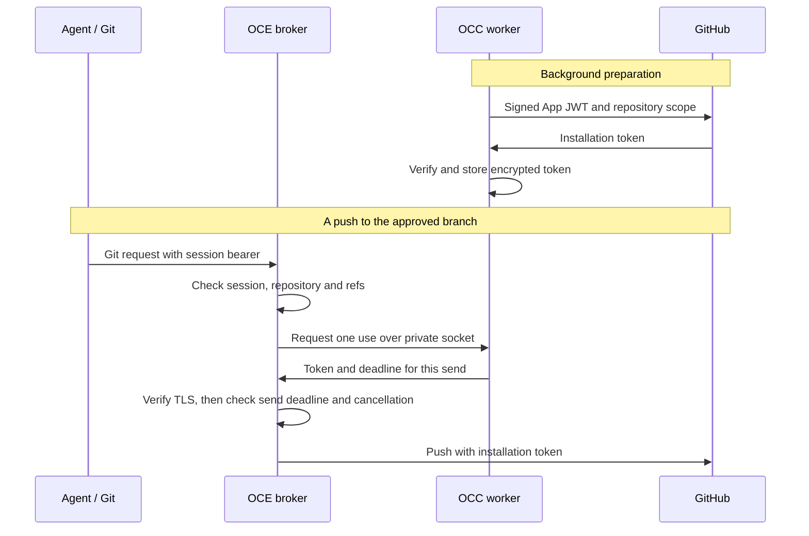

# Repository credentials

A repository binding gives an Agent HTTPS access to a named repository under
an approved profile. The OpenClaw Control Plane (OCC) saves the grant with the
Agent revision. To configure a binding, follow the [operator guide](../guides/repository-credentials.md).

## Native Git from the Agent to GitHub

Prepared native Git requires a dedicated Codex Harness (API key or ChatGPT service
account), Kubernetes Compute and no Sandbox Driver. Git authenticates to the
broker with the Agent's repository session bearer. The broker authenticates to
GitHub with a repository-scoped installation token.



Only the worker holds the App signing key. A Git request fails if no prepared
token is eligible. Reads cover the repository. For pushes, the broker checks
each ref against the approved branch. Protect important branches at GitHub.
See [withdrawal and draft PR creation](repository-credentials/prepared-native-git.md).

[Metadata reads](../flows/credential-source-egress.md) and
[OpenShell Git](repository-credentials/protected-openshell-git.md) require their
own sender and Sandbox selections. OCC rejects unsupported combinations.
Helm uses `Recreate` to prevent overlapping worker or credential service owners.

Model credentials stay with their consumer and dedicated Slack tokens with the
gateway. The repository-bound Codex proxy allows the exact broker hostname.
`allow_local_binding = true` disables the private-address guard. `mode = "full"`
allows all HTTP methods at allowed destinations. Explicit denies, Kubernetes
NetworkPolicy, TLS and broker authorization still apply. See
[consumer networking](drivers/kubernetes-compute/networking-and-isolation.md#networking)
and [anonymous public reads](public-github-reads.md).

## Repo Driver contract

The GitHub Backend selects [GitHub repository policy](../../apps/controller/src/drivers/repo/github/policy.ts)
by ID in `drivers.repo`. Its [contract](../../packages/contracts/src/repo.ts) is separate from
`NativeRepositorySender`. For protected Git, [composition](../../apps/controller/src/composition/repository-credentials/platform.ts)
supplies the resolver that checks the admitted grant and selects its destination.

- `listOptions` lists approved repositories and profiles for the Namespace.
- `resolve` checks the selection against Namespace policy and returns the bindings and duration.

For protected delivery, select `repository` and the installed Sandbox and
Credential Proxy Driver. For native delivery, select `repository.nativeSender`
with `repository.preparedGitHub`. Controller startup rejects the legacy
Installation-level `drivers.repo` in every mode. Before switching, stop new
admissions and drain accepted work on its original owner.

| Native sender operation          | Result                                                                                                                                      |
| -------------------------------- | ------------------------------------------------------------------------------------------------------------------------------------------- |
| `checkAdmissionReady` (optional) | Checks dependencies for fresh admission. Unavailable dependencies block new attempts and worker readiness.                                  |
| `open`                           | Returns `created` with private runtime files, `recovered` with status alone, or `missing`. A recovery-only request cannot create a session. |
| `status`                         | Returns the current observation or authoritative absence.                                                                                   |
| `close`                          | Ends local use and reports closure or absence. Provider revocation and runtime termination have separate outcomes.                          |

Public status records `sessionId`, `state`, `deadlineWallMs` and `binding`
(provider instance, repository and grant IDs) in an immutable snapshot.
Configuration decoding and cleanup counters stay private. Status cannot
regenerate Git or gh client files, which contain no signing or service modules.

### Deletion and restart

OCC keeps the saved revision's Driver, Backend, profile and grant. After Agent
deletion, it retains the Namespace, Agent, revision, admission and session IDs
and deadlines, without bearers or tokens. Compute can retire while repository
cleanup is pending, missing, unknown or `invalidated`. Cleanup Work continues
independently and is shared by version and purpose. `maintenanceIntervalMs`
sets the worker's reconciliation interval. It does not set a withdrawal deadline.

On worker restart, surviving sessions and Compute material may still be usable.
A broker can recover the original broker's committed `DISPOSED` receipt.
A missing session that was exposed fails the version and keeps its cleanup open.
A closing session blocks replacement until disposal. A new version cannot settle
older cleanup. Deletion, invalidation and elapsed deadlines do not establish
disposal or provider revocation. Evidence pruning and durable recovery of lost token material from
a session are unimplemented. See [sessions and closure](#sessions-and-closure)
for what the original broker can confirm.

## Configuration

### Canonical platform registry

The API, worker and service read the same immutable, versioned ConfigMap at
`configuration.registryPath`. This registry grants the `team` Namespace
access to one repository and one writable ref on one App installation.

```json
{
  "version": 1,
  "backendId": "repository-backend",
  "providerInstanceId": "github-production",
  "appId": "123456",
  "githubInstallationId": "789012",
  "maximumDurationSeconds": 86400,
  "repositories": [
    {
      "repositoryRef": "application",
      "repositoryId": "345678",
      "repository": "example/project",
      "namespaces": [
        {
          "namespaceId": "team",
          "profiles": ["git-write"],
          "transport": "git-only",
          "pushRefAllowlist": ["refs/heads/review/example-123"]
        }
      ]
    }
  ]
}
```

Use platform Namespace IDs. Supply positive decimal safe integers as strings
for App, installation and repository IDs. Repository references, IDs and
lowercased names must each be unique. The registry accepts up to 1,000
repositories, 128 Namespace policies per repository and 4,096 policies total.

The service independently checks the grant fingerprint before admission. It
covers provider, App, installation, repository, maximum duration, Namespace,
allowed and selected profiles, push-ref policy and permissions. Reusing a
reference after a policy change cannot retain the old grant.
The [push-ref guardrail](repository-credentials/push-ref-guardrail.md)
describes the client hook and the prepared broker's separate ref check.

### Repository options

`GET /namespaces/:namespaceId/agents/repository-options` requires Agent `create`
for a new Agent. The edit route, `GET /namespaces/:namespaceId/agents/:agentId/repository-options`,
requires `update` on that Agent. Both read the local registry and return `repositoryRef`, `displayName`, `allowedProfiles` and
any configured description.

| Discovery result                     | Meaning                                                                                                      |
| ------------------------------------ | ------------------------------------------------------------------------------------------------------------ |
| Success with choices                 | The caller may select an approved reference and profile.                                                     |
| Empty list                           | No repositories are approved. With `meta.notConfigured`, the Installation has no `repository` settings.      |
| `503 REPOSITORY_OPTIONS_UNAVAILABLE` | Discovery failed after authorization. A new ordinary draft can still be saved without repository selections. |
| HTTP 409                             | The Namespace is closed.                                                                                     |

Editing requires successful discovery. Writes reauthorize and resolve the
selection. See [Console repository access](console/repository-access.md#discover-and-select-repositories)
for the creation and deployment rules.

### Profiles

Native Git requires `git-write` and one writable branch. `git-only` permits
fetch and push. `git-and-draft-pr` also permits draft creation against an
approved base. Both exclude general REST, GraphQL, issues and arbitrary PR
operations. The [OpenShell installation profile](repository-credentials/protected-openshell-git.md#grant-access-to-a-github-app-installation)
inherits the App installation's repositories and permissions.

### Standalone service inputs

Before listening, the service validates a protected JSON file with `gateway`,
`sessionPolicy`, `backend` and optional `limits` (positive safe integers).
Configuration and private keys must be private regular files owned by root or
the service user. Ancestor directories must have one of those owners and forbid
group and other writes. A root-owned sticky directory such as `/tmp` is allowed
above the immediate parent. The loader rejects symlinks and file replacement.
See [configuration and TLS ownership](../flows/repository-credential-configuration.md).

For production native Git, set `backend.kind` to `github-prepared-git-registry`
and supply `backendId` and `registryFile`. Driver configuration supplies
`controlSocket`, `sessionDurationSeconds` and `publicCaPath`. Kubernetes mounts
only configuration, registry and TLS in the sender. The worker alone mounts the
App signing key and custody key. The service image must trust GitHub's HTTPS
certificate chain. For a private CA, set `NODE_EXTRA_CA_CERTS` to a readable
bundle and keep certificate and hostname verification enabled.
See [Backend configuration](backends.md) and [Installation setup](../guides/deploy/production-installation.md).

The service refuses the legacy `github-app` and `github-app-registry`
backends. Leave uncertain issuance or PR creation with the original owner.
Keep the App key there and retain the existing approval scope. The development
`github-token` backend requires both its configuration opt-in and
`--development-authority`. See [development token authority](repository-credentials/development-token.md).

## Token Service lifecycle

The worker signs a short-lived JSON Web Token (JWT) with the App key. For
repository-scoped Git, it requests the numeric repository ID and approved
permissions from GitHub. It verifies the returned scope and expiry, encrypts
the token and commits it to PostgreSQL. Renewal and retirement belong to the
worker. Renewal cannot extend the session.

For a protected metadata read, the worker prepares the repository's
`metadata: read` grant. OCC must separately authorize the sender's exact GET.
See [token preparation, expiry and withdrawal](../flows/credential-source-refresh.md#6-issue-and-renew-a-github-installation-token).
If the worker reports `PREPARED_GITHUB_RECOVERY_REQUIRED` (`quarantined` or
`blocked`), [recover on the issuing owner](../guides/repository-credentials/team-runbook.md#replace-a-rejected-app-key).
An uncertain issuance blocks automatic minting.

## Sessions and closure

Only the trusted worker or operator has access to the private mode-0600 Unix
control socket. Its parent directory stays outside the client. The HTTPS client
listener exposes no admission or close endpoint. Control bodies may be at most
16 KiB.

| Control request                                                   | Result                                                            |
| ----------------------------------------------------------------- | ----------------------------------------------------------------- |
| `GET /v1/capabilities`                                            | Registry-backed service's durable admission version               |
| `POST /v1/sessions` with `durationSeconds` and optional `profile` | Private status, client configuration and bearer on first creation |
| `GET /v1/sessions/{id}`                                           | Private session and cleanup status                                |
| `POST /v1/sessions/{id}/close`                                    | Immediate local closure status, with cleanup reported separately  |

### Recover an admission

Before dispatch, the CLI prints a nonsecret `X-Admission-Id` (13-digit Unix
timestamp in milliseconds, a hyphen and a lowercase UUIDv4). A new ID must be
under 60 seconds old and cannot be future-dated. HTTP 201 returns the bearer
once. Reusing the ID with the same duration and profile returns HTTP 200 with
status alone. Conflicts fail. Follow the [lost-response procedure](../guides/repository-credentials/standalone-service.md#recover-an-admission)
before requesting replacement material.

For platform admission the worker requires `durableAdmissionVersion: 1` before
new attempts and readiness. Checking this version does not inspect the journal.
Recovery, closure and runtime retirement can proceed without that check.

The saved attempt binds `namespaceId`, `repositoryRef`, normalized `profile`,
`expectedBinding` and `deadlineWallMs`. The broker reserves through the worker's
private receipt socket **before it constructs the route or releases the
bearer**. Recovery can durably fence a missing admission. For a reservation or
active session without a confirmed terminal receipt, disposal remains unknown.
Only the original broker records its `DISPOSED` result. Credential-free receipts
stay with the attempt. If the journal fails, new bound admissions stop and
absence or disposal cannot be confirmed.

Standalone admission correlations live in the process. At twice the session
limit the broker can return `overloaded`. Unresolved cleanup outlives that
window. Restart loses the correlations, and none can recover a bearer.

### End a session

Closing or expiring a session prevents use and cancels its exchanges. A status
read observes expiry without starting cleanup or cancellation. Clock rollback
cannot restore even a reserved exchange. The bearer requires a live broker
and upstream authorization.

An exchange keeps its original credential through replacement. The replacement
must cover the remaining exchange budget and safety margin. After verifying TLS,
the sender runs any configured standing callback before its first write. For
prepared Git, it checks the original one-use permit, cancellation and send
deadline. Withdrawal blocks new permits. A permitted send can still start
within its deadline. If a push or API mutation may have reached GitHub,
inspect the outcome. Never replay it automatically.

Authentication and cleanup have separate monotonic deadlines from capture.
Delayed settlement extends neither. Authentication stops 60 seconds before
reported token expiry. Cleanup retains its one-hour bound from local receipt.
A forward wall-clock jump can deny authentication without proving remote expiry.

`CLOSED` ends local use. Private status tracks pending, revoked, expired and
uncertain credentials and auxiliary cleanup. `DISPOSED` requires all actions,
token obligations and auxiliary cleanup to finish. Historical revoked or
expired counts may remain. Failed construction closes renewal immediately.
Retained material counts against capacity and shutdown's `pendingAuxiliary`
until callbacks and disposal finish.

## GitHub response data

A [protected metadata read](../flows/repository-credentials.md#5-deliver-an-outcome-and-release-ownership)
releases only `{ id, full_name }` after checking repository identity and reaching
stream end without actual trailers. Joined OpenShell enforcement still needs
deployment proof.

For profiles that allow broader API access, bounded REST JSON responses omit
`temp_clone_token` from the repository, its `parent` and `source`, and a pull
request's `head.repo` and `base.repo`. GraphQL requests selecting `tempCloneToken`
receive HTTP 400. The broker rewrites pagination and followed links only after
checking origin, repository, route and profile. It translates
`/repositories/<id>` for the configured ID to the admitted `/repos/OWNER/REPO`
route. Direct ID-route requests remain unsupported. Pagination checks the length
and format of `after` and `before`. Other links, human text and unrelated
metadata pass through.

## Client routing and limits

### Git and GitHub CLI

The client runs `/usr/bin/git` with the user's arguments, HOME, identity, hooks,
aliases, remotes and worktrees. Git and gh preserve exit codes or return
`128 + signal number`.

At startup, Kubernetes copies the client material and prepares its private
subPath. Preparation checks generation, manifest, session metadata, paths and
ownership before writing `gitconfig`. It never reads a bearer or opens a session.

Each HTTPS host maps to one gateway origin and CA policy. Rewrites preserve
repository casing and an optional final `.git`. Other repositories on that
host also reach the gateway, but receive no bearer. Separate authentication
requires a native override. SSH and cross-repository submodules are unsupported.

The generated Git configuration resets helpers, sets `credential.useHttpPath=true`,
verifies TLS with optional CA trust and disables redirects for the exact gateway
origin. The helper checks the effective protocol, host, port, username and
repository path after Git decodes percent-escapes. An escaped spelling can
match the admitted host and path. The gateway rejects any `%` in a request
path. Dot segments, extra components, unmatched names or ambiguous `.git`
spellings yield no bearer. The broker constructs the canonical upstream path
for discovery, upload-pack and receive-pack. Endpoint, method, media-type,
service-query and profile checks still apply.

Select among duplicate bindings with `OCE_REPOSITORY_REF`. The gh launcher also
propagates `OCE_REPOSITORY_SELECTION` with generation, reference and session
ID. A pin cannot change the gateway origin. Conflicting or stale pins fail
remote authentication. The helper checks its prepared generation and original
deadline before reading the bearer. The gateway can close the session earlier.
Local Git commands skip the helper and still work. Pins do not freeze arbitrary
subprocesses. There is no command-wide preflight. Native settings can override these defaults and other helpers can
retain credentials. OCE's helper ignores `store` and `erase`.

For the API launcher, use GitHub CLI **2.103.2**, `GH_HOST=github.com` and a
gateway hostname with verified TLS on port 443. Its private `hosts.yml` uses the
experimental `api_host` setting and stores the gateway bearer in `oauth_token`.
The launcher admits [selected commands](repository-credentials/access-levels.md#supported-commands)
and relative API paths. It rejects absolute destinations. Network controls must
separately enforce egress restrictions.

### Service limits

| Resource                 | Default                                                                                                             |
| ------------------------ | ------------------------------------------------------------------------------------------------------------------- |
| Sessions and credentials | 16 sessions including pending cleanup, two credential slots per session                                             |
| Provider actions         | One active, 64 queued, 30 seconds per action                                                                        |
| Sockets and exchanges    | 64 sockets per listener, 32 exchanges total, four per session                                                       |
| Request head             | 32 KiB and 64 header pairs, 8 KiB request target                                                                    |
| Git data                 | 1 MiB fetch input, 256 MiB push input and Git output. Gzip input has separate wire and decoded limits.              |
| API data                 | 1 MiB input, 8 MiB response                                                                                         |
| Exchange timing          | Five minutes total, 30 seconds for response headers, five seconds without progress, 60 seconds of credential margin |

For a larger upload-pack response, set the fetch-specific bounds in protected
service configuration. For example, `gitFetchResponseBytes: 17179869184` allows
16 GiB. Set `gitFetchFirstHeaderMs` and `gitFetchStallMs` to `60000` and
`gitFetchExchangeMs` and `maxExchangeMs` to `1800000` for a 30-minute ceiling.
Absent a fetch-specific limit, the corresponding `gitResponseBytes`,
`firstHeaderMs`, `stallMs` or `exchangeMs` override applies. `maxExchangeMs`
caps every exchange and defaults to the `exchangeMs` override when one is set.

Each stream occupies a socket and an exchange slot until completion or session
expiry. Credential validity must cover the deadline plus the margin.
Development static-token upload-pack is capped at its lease less two margins.
Overrides must be positive and finite. See [dispatch deadlines](../flows/repository-credentials.md#4-reserve-acquire-and-dispatch).

On `SIGTERM` or `SIGINT`, the service allows 60 seconds for cleanup. Unsettled
actions retain capacity until exit. On timeout it reports outstanding
obligations and terminates. Restart loses provider cleanup inventory.
Verify disposal or revocation separately.

The [service flow](../flows/repository-credentials.md) and [Agent flow](../flows/agent-repository-credentials.md)
trace the implementation. The [testing guide](../testing/repository-credentials.md)
distinguishes fixture coverage from live-provider qualification.
