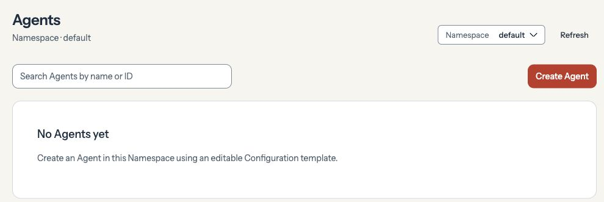
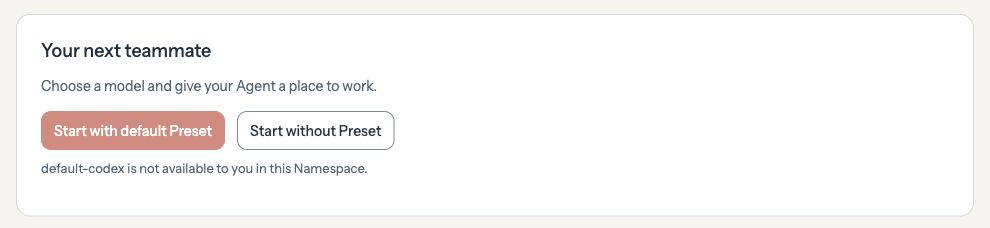
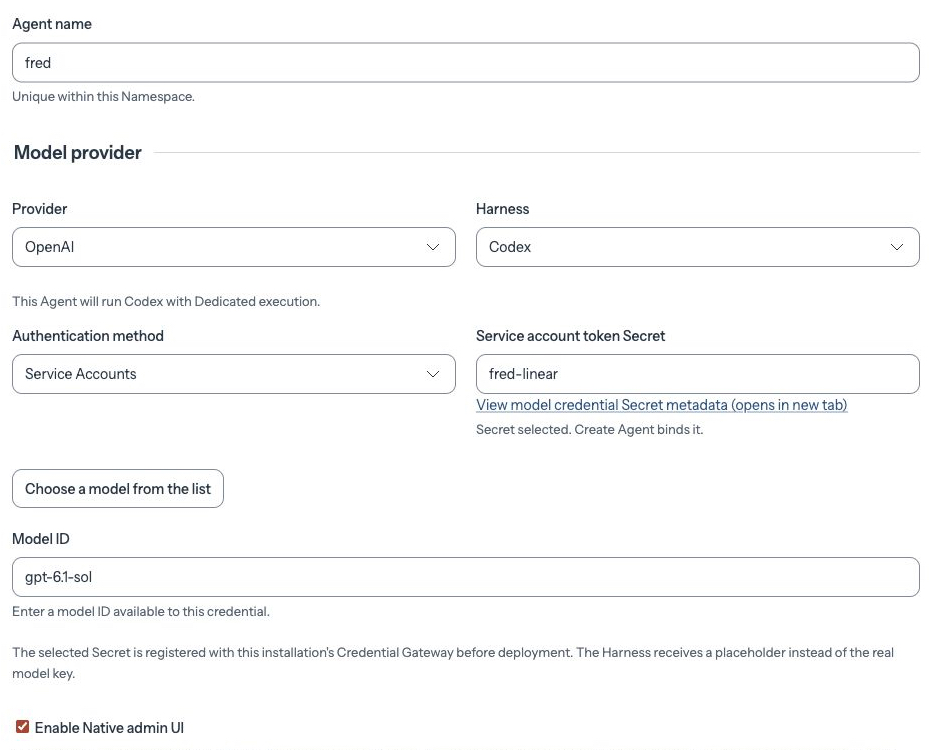

Open **Agents**, select the **default** Namespace, and click **Create Agent**. Choose **Start without Preset**.

<Frame caption="Create Agent starts a new Agent in the selected Namespace.">

</Frame>

<Frame caption="Start without Preset opens the form where you choose the model and credentials.">

</Frame>

Enter `fred` for **Agent name**. Choose **OpenAI** as the provider and **Codex** as the harness. Under **Authentication method**, choose one:

- **OpenAI API key** — For chat, select the Secret that holds your API key.
- **Service Accounts** — For workspace plugins such as Linear, select a separate Secret that holds your ChatGPT workspace service account’s Codex access token. [Get a service account access token](https://learn.chatgpt.com/docs/enterprise/service-accounts#create-an-access-token).

To save a new credential, choose **Create new Secret...**, paste the key or token into **Value**, and click **Create Secret**.

Choose a **Model** your credential can access. If it’s missing from the list, click **Enter model ID manually** and enter its ID. Check **Enable Native admin UI** so you can open `fred`’s chat after deployment.

<Frame caption="In this example, fred uses the fred-linear service account Secret. Use the Secret and model for your own account.">

</Frame>

Click **Create Agent** once. OCE saves `fred` and starts its first deployment.
