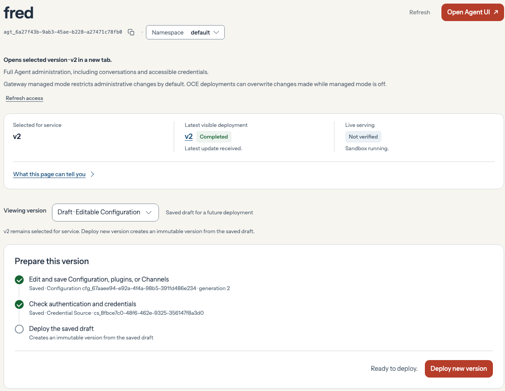

On **Agents → fred**, choose **Draft · Editable Configuration** under **Viewing version**. Check the saved changes in **Prepare this version**, then click **Deploy new version**. This deploys a new version of the same Agent.

<Frame caption="The Console shows that fred’s draft is ready to deploy. Version 2 is still selected for service.">

</Frame>
