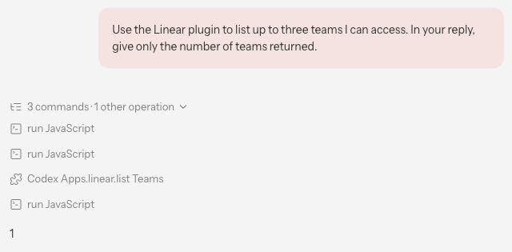
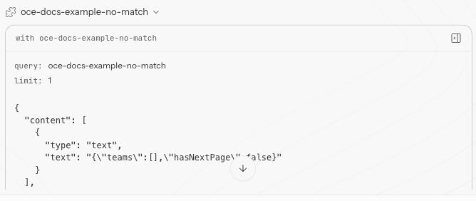

In fred’s chat, paste this prompt, add the marker from your operator shell on a separate line, and send it once.

> Use the Linear plugin to list up to three teams I can access. In your reply, give only the number of teams returned.

Expand the activity for that turn and open the Linear **list Teams** tool result. Count the entries in `teams` and compare that number with fred’s reply. Your count depends on the connected account.

<Frame caption="In this example, fred returned a count of one Linear team.">

</Frame>

A separate example below shows the expanded tool output for a filtered search. The empty `teams` list gives a count of zero. If the chat hides your result, [read the existing turn’s transcript](#read-the-existing-runs-native-transcript).

<Frame caption="In a separate search, Linear returned an empty team list for the filter oce-docs-example-no-match.">

</Frame>
