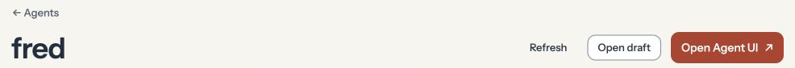

Open **Agents → fred**, select the running version under **Viewing version**, and click **Open Agent UI**. The Agent's Control UI opens in a new tab.

<Frame caption="Open Agent UI launches the selected version’s Control UI in a new tab.">

</Frame>
