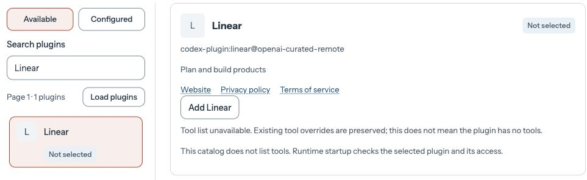
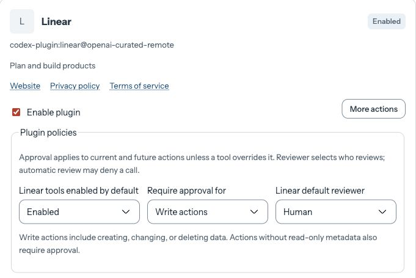

Open **Agents → fred** and select its editable draft. Open **Plugins → Configure plugins**. If the page shows a read-only summary, check the [permissions for editing plugins](../../guides/console/configuration-plugins-and-files.md#plugins-tab).

Under **Available**, search for `Linear`, select the result, and click **Add Linear**.

<Frame caption="Add Linear from the plugin catalog for fred’s service account.">

</Frame>

Under **Plugin policies**, enable Linear’s tools and require a **Human** reviewer for **Write actions**. Keep fred’s other plugin selections. Click **Done**, then **Save plugin selections**.

<Frame caption="Allow reads and require human approval for writes.">

</Frame>
