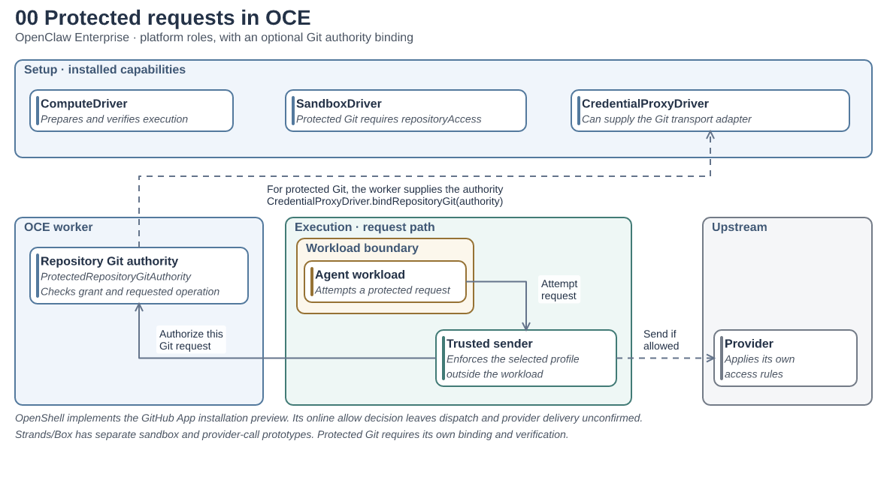

# Draw an interface diagram

Change the **TypeScript** to describe a component or connection. The tool lays out the graph and generates an editable JSON scene and a PNG. Use the PNG in a review; use the TypeScript for the next change.

| Diagram                                                               | What it shows                                                                                                                                       | Authoring source                                                    |
| --------------------------------------------------------------------- | --------------------------------------------------------------------------------------------------------------------------------------------------- | ------------------------------------------------------------------- |
| [00 · Protected requests in OCE](examples/platform-roles.png)         | Platform roles and the optional Git binding. Start here before the OpenShell reference views.                                                       | [platform-roles.ts](examples/platform-roles.ts)                     |
| [1 · Protected Git request](examples/current-git.png)                 | One push attempt in the GitHub App installation preview. The supervisor calls the worker hook; an allow does not prove GitHub received the request. | [current-git.ts](examples/current-git.ts)                           |
| [1b · Protected Git setup](examples/current-git-setup.png)            | How OCE prepares a token, updates an attached provider and verifies what the supervisor loaded.                                                     | [current-git-setup.ts](examples/current-git-setup.ts)               |
| [2 · Who sends a protected request?](examples/generic-exchange.png)   | The controller API binds an exchange authority; the trusted sender owns provider TLS and response delivery.                                         | [generic-exchange.ts](examples/generic-exchange.ts)                 |
| [3 · Credential pull proposal](examples/credential-pull-proposal.png) | A design proposal with a supervisor credential cache. Its ownership and refresh assumptions are separate from the current implementation.           | [credential-pull-proposal.ts](examples/credential-pull-proposal.ts) |

## Which parts are backed by code?

The pictures are authored in TypeScript. A separate [claim catalog](evidence.ts) connects selected boxes and arrows to relationships that the TypeScript compiler can resolve in OCE source. The graph is extracted from code independently of the claims. Diagram 00 describes a contract, 1 and 1b trace a specific preview, 2 describes a conditional composition, and 3 is a proposal. None is a deployment inventory.

From this directory, after installing dependencies:

```sh
pnpm graph:check                      # exit nonzero if a catalogued relationship disappears
node graph.ts > coupling.json         # all observed edges, source lines, unknowns and claim results
jq '.evidence.claims[] | select(.diagram == "generic-exchange")' coupling.json
node graph.ts --root /path/to/oce --file apps/controller/src/composition/egress-authority.ts
```

The default scan checks selected files. Use a clean checkout with `--root` to compare revisions. Each observed edge names its enclosing declaration, the kind of reference (call, construction, binding or explicit implementation), its target declaration and its source line. For example, follow the controller factory’s construction of `CredentialProxy`, then inspect the separate listener calls against `CredentialProxyExchange`. A similarly named method on a different interface cannot satisfy the same claim.

Look at `.evidence.diagrams[].coverage` before relying on a picture: unmapped elements have no automated claim. A match establishes a lexical relationship, even if the branch never runs. It cannot tell you which Driver an installation selects, where a process runs, which request reached a provider, or whether withdrawal stopped a send. Those require configuration and runtime evidence. CI checks the static claims separately from whether the generated pictures are up to date.



**Read the headings as roles.** The Git transport adapter is supplied by the selected backend. The public extension point is [`CredentialProxyDriver.bindRepositoryGit(authority)`](https://github.com/openclaw/openclaw-enterprise/blob/cdbbee5b97230097f43ae715d3f2fda087546a3c/packages/contracts/src/credential-proxy.ts#L429-L439); there is no required `GitTransportDriver` service. In 1 and 1b, OpenShell implements this role and its supervisor calls the worker hook. A different backend can implement the capability differently. [AWS Strands/Box sandbox work](https://github.com/openclaw/openclaw-enterprise/pull/3832) illustrates a different Sandbox implementation; the [separate Box sender prototype](https://github.com/openclaw/openclaw-enterprise/blob/ee2da743e54a8540b24c4ae217d8237fb17a5538/apps/controller/src/backends/strands-box.ts#L165) explores protected provider calls. Neither establishes support for this Git binding.

For diagrams 1 and 1b, see the [worker hook and Git authority](https://github.com/openclaw/openclaw-enterprise/blob/cdbbee5b97230097f43ae715d3f2fda087546a3c/apps/controller/src/drivers/egress-proxy/openshell-git-runtime.ts#L2157-L2200) and the [profile admission checks](https://github.com/openclaw/openclaw-enterprise/blob/cdbbee5b97230097f43ae715d3f2fda087546a3c/apps/controller/src/drivers/egress-proxy/openshell.ts#L418-L437). Diagram 2 separates the controller API’s [exchange object and its five bound methods](https://github.com/openclaw/openclaw-enterprise/blob/4e9e2ccefd7e17bdb0746b62f3c90c59b3f822bb/apps/controller/src/composition/egress-authority.ts#L13-L42) from the sender that injects credentials and sends the request. Diagram 3 is a proposal.

## Make a change

From the repository root, use Node 24 and the repository's pinned pnpm:

```sh
cd scripts/interface-sketches
pnpm install --frozen-lockfile
pnpm build
```

Open `examples/current-git.ts`, change the Agent's title, and run `pnpm build` again. Open `examples/current-git.png` to see the change. Commit the TypeScript, generated JSON and PNG together. `pnpm check` compares generated output without overwriting files; `pnpm test` type-checks the examples and runs tool tests.

Canonical checks treat each top-level `examples/*.png` file as a preview. It must have a same-stem regular `.ts` source; declarations (`.d.ts`), symlinks and directories do not qualify. After renaming or deleting a source, restore it or manually remove the reported orphan PNG and its same-stem JSON, if present. Builds never delete old assets. Checks ignore standalone JSON and nested entries, and fail if no eligible sources remain. Custom `node build.ts INPUT.ts OUTPUT_PREFIX` builds are unchanged.

## Add a diagram

Create a module under `examples/` with a default export. Use a stable ID for each group and component; use those IDs to connect them. A title is the name readers scan for. Use the detail for what the component does.

```ts
import type { Diagram } from "../diagram.ts";

export default {
  title: "Request authorization",
  subtitle: "Example interface",
  groups: [
    { id: "worker", title: "OCE worker", role: "control" },
    { id: "runtime", title: "OpenShell", role: "runtime" },
  ],
  nodes: [
    { id: "sender", group: "runtime", title: "Supervisor", detail: "Intercepts the request" },
    { id: "adapter", group: "worker", title: "Git transport adapter" },
  ],
  edges: [{ from: "sender", to: "adapter", label: "EvaluateHttpRequest" }],
} satisfies Diagram;
```

Nest a group using `parent` when containment is meaningful, for example an Agent inside a sandbox. Label a conditional edge in words and use `kind: "conditional"` so the drawing also distinguishes it by line style.

## How the tool fits together

- [diagram.ts](diagram.ts) defines what authors describe: groups, components, relationships and notes. The examples contain domain facts, not SVG.
- [layout.ts](layout.ts) compiles a definition into positioned boxes, text and lines. [ELK Layered](https://eclipse.dev/elk/reference/algorithms/org-eclipse-elk-layered.html) supplies node placement and orthogonal routing. By default the compiler compares horizontal and vertical layouts. Set `layout: { direction: "RIGHT" }` or `"DOWN"` to fix the reading direction. Pinned presentation boards use [board.ts](board.ts) instead of automatic layout.
- [scene.ts](scene.ts) defines and validates the JSON passed between layout and rendering. A scene contains geometry and semantic roles; it can be used without the TypeScript authoring API.
- [theme.ts](theme.ts) owns the colors and typography. [render.ts](render.ts) draws a scene with bundled Liberation Sans regular, bold, and italic faces. Component names are bold, details use dark-gray italics, and labeled regions use distinct tints.
- [build.ts](build.ts) loads trusted local diagram modules and writes or checks generated artifacts. A TypeScript module runs as code. Use the data-only JSON renderer for input from elsewhere.

## Fit a diagram on one screen

Leave placement automatic for sketches in progress. For a presentation, set `layout: { board: [1180, 640] }` and give each group and component a `pin: [x, y, width, height]`. Root groups use board coordinates; child groups and nodes use coordinates relative to their parent, so moving a group moves its contents. The compiler rejects cards or text that cannot fit. The gallery uses landscape boards: at 1,000 pixels wide, each PNG is about 542 pixels tall.

Connections still identify components by ID. Use an edge's optional `pin` to select endpoint sides (`from`, `to`), add bends (`via`), or position the label (`label`). Bend points and label positions use board coordinates. See [diagram 1's layout](examples/current-git.ts) for a working example.

## Keep a presentation override in TypeScript

Start with automatic placement. For a one-off highlight or label adjustment that must survive a rebuild, export a pure `refineScene` function alongside the default diagram. It receives the laid-out scene and returns another scene. For example, give one existing component a stronger outline:

```ts
import type { Sketch } from "../scene.ts";

export function refineScene(scene: Sketch): Sketch {
  return {
    ...scene,
    items: scene.items.map((item) =>
      item.kind === "node" && item.id === "sender" ? { ...item, color: "#245580" } : item,
    ),
  };
}
```

The renderer still validates this result. Automatic routing has already finished at this point: if you move a node, update any fixed edge points and labels that should move with it.

## Render a scene from JSON or Python

Copy a generated scene to a separate file, then move a box or change an edge's points. Absolute points stay fixed; named side anchors track their box. You can also generate this JSON from Python or another language. Pass the result to the same renderer:

```sh
cp examples/current-git.json my-layout.json
node render.ts my-layout.json my-layout
```

This writes `my-layout.svg` and `my-layout.png`. Keep hand-edited scenes outside the generated examples: the next build replaces those JSON files. No installed system fonts or browser are needed.
