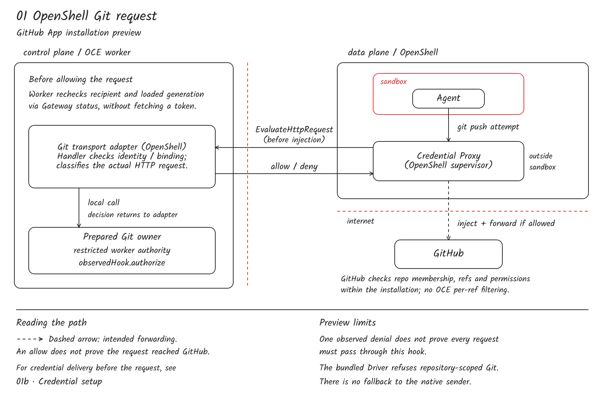

# Draw an interface sketch

Edit one JSON file to change a box, label, boundary or connection. The renderer writes a PNG to share and a standalone SVG to zoom into. Both use the bundled Kalam handwriting font. No browser, font installation or drawing account is required.

| Example                                                                                                                            | What it shows                                                                                                                                                            |
| ---------------------------------------------------------------------------------------------------------------------------------- | ------------------------------------------------------------------------------------------------------------------------------------------------------------------------ |
| [1 · OpenShell Git request](examples/current-git.png) · [Edit JSON](examples/current-git.json)                                     | Follow one Git push attempt in the GitHub App installation preview. The supervisor calls the OCE worker hook; the worker returns a decision.                             |
| [1b · OpenShell Git setup](examples/current-git-setup.png) · [Edit JSON](examples/current-git-setup.json)                          | Follow the same preview before a request: how OCE configures the sandbox, updates the attached provider and checks which credential generation the supervisor loaded.    |
| [Generic exchange: editable source](examples/generic-exchange.json) · [PNG](examples/generic-exchange.png)                         | How the exchange interface composes with a trusted sender. The sender is a requirement of this contract; the drawing does not assert that stock OpenShell implements it. |
| [Credential pull proposal: editable source](examples/credential-pull-proposal.json) · [PNG](examples/credential-pull-proposal.png) | Whiteboard view: IAM authorizes access to material; the supervisor checks the outbound request. Credential caching and Token Service refresh are design assumptions.     |



For **1** and **1b**, see the [worker hook and Git authority](https://github.com/openclaw/openclaw-enterprise/blob/cdbbee5b97230097f43ae715d3f2fda087546a3c/apps/controller/src/drivers/egress-proxy/openshell-git-runtime.ts#L2157-L2200) and the [OpenShell profile admission checks](https://github.com/openclaw/openclaw-enterprise/blob/cdbbee5b97230097f43ae715d3f2fda087546a3c/apps/controller/src/drivers/egress-proxy/openshell.ts#L418-L437). An allow records possible use; it does not prove a request reached GitHub. The bundled Driver refuses the repository-scoped Git profile. The [generic exchange](https://github.com/openclaw/openclaw-enterprise/tree/d1e543d3b5348070ac41e41ef346cc8f03070f0d) is a separate contract, and the credential pull drawing is a proposal.

## Make your first change

From the repository root, using Node 24 and the repository’s pinned pnpm:

```sh
cd scripts/interface-sketches
pnpm install --frozen-lockfile
cp examples/current-git.json my-sketch.json
node render.ts my-sketch.json my-sketch
```

Open `my-sketch.png`. In `my-sketch.json`, find the node whose ID is `agent` and change its `lines` from `["Agent"]` to `["Team Agent"]`. Rerun the last command. The renderer replaces the two output images and leaves the JSON alone. To refresh a checked-in preview, use the same prefix as its source, for example `node render.ts examples/current-git.json examples/current-git`. Commit the updated JSON and PNG together; the SVG is generated on demand.

## Place a box and connect it

Coordinates are pixels from the top-left corner. Items paint in array order, so put frames before their contents. Here is a complete sketch:

```json
{
  "title": "A protected request",
  "width": 520,
  "height": 130,
  "items": [
    { "kind": "node", "id": "agent", "x": 20, "y": 40, "w": 120, "h": 56, "lines": ["Agent"] },
    {
      "kind": "node",
      "id": "proxy",
      "x": 300,
      "y": 40,
      "w": 200,
      "h": 56,
      "lines": ["Credential Proxy"]
    },
    {
      "kind": "line",
      "points": [
        { "node": "agent", "side": "right" },
        { "node": "proxy", "side": "left" }
      ]
    },
    { "kind": "text", "x": 220, "y": 55, "text": "git push", "center": true }
  ]
}
```

| Item   | How to use it                                                                                                                                                                         |
| ------ | ------------------------------------------------------------------------------------------------------------------------------------------------------------------------------------- |
| `node` | Labeled box. Set `x, y, w, h` and `lines` (one string per line). A stable `id` lets arrows follow the box when you move or resize it.                                                 |
| `box`  | Frame or unlabelled box. Use the same rectangle dimensions. Set `color`, `dashed` or `radius` to mark a boundary.                                                                     |
| `line` | List two or more points. A point can be a named side (`top`, `right`, `bottom`, `left`) or a fixed `[x,y]` bend. An arrowhead is drawn by default; set `"arrow":false` for a divider. |
| `text` | Place a label at `x, y` (its baseline). Use `size`, `center`, `color` or `halo` for a label over a line.                                                                              |

Labels and fixed bends stay where you place them; there is no automatic layout. Use the same coordinates across before/after drawings to make changes easy to see. Set `"color":"#24834d"` on added nodes or lines and `"color":"#b42318"` on removed ones. Label additions/removals so the comparison also reads without color.

Run `pnpm test` in this directory to type-check the renderer and run its tests. The [font license](fonts/OFL.txt) travels with the font.
