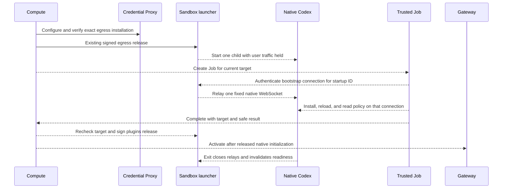

# Implementation plan: Bootstrap dedicated Codex plugins with a trusted Job

- **ID:** TASK-0048
- **Delivery status:** Planned
- **Owner:** Compute, Sandbox, and Codex runtime maintainers
- **Source baseline:** OCE `7257c814cdcba4daa53f3d1766f72f3696c7b4c6`; Codex `a6274249d5877030676db098914db686bab7c921` (`0.163.0-alpha.2`).

## Problem and Decision

A trusted Kubernetes Job outside OpenShell installs selected plugins through an authenticated WebSocket into the actual dedicated Codex process. The Job checks installed identity and policy on that same connection. A trusted launcher holds user traffic until Compute accepts the result for its one live native child. Codex receives only `APP_TOKEN_SHA`, never a provisioned capability token. Upstream credentials remain behind the Credential Proxy.

[PR #3985](https://github.com/openclaw/openclaw-enterprise/pull/3985), inspected at `8315cc1deb9e7063c7a4e7937b7683926c71989c`, owns the transport RFC and its active primary plan. Its launcher installs with an incoming bearer; this plan assigns installation to the Job. It preserves that active work and creates no RFC. Before product implementation, reconcile the Job owner and two release stages in that RFC and submit the revision for human review. Its branch and worktree remain read-only here.

The frontmatter links the policy RFC. The unmerged transport RFC remains an external dependency through its [pinned proposal](https://github.com/openclaw/openclaw-enterprise/blob/8315cc1deb9e7063c7a4e7937b7683926c71989c/specs/rfcs/0024-openshell-codex-plugin-transport.md) until it lands. Then link its final path in `rfc` and add its backlink. The Driver changes below remain proposed.

## Scope

V1 covers dedicated Codex with OpenShell and enforced protected egress. Every selected plugin must install and pass policy checks. Empty selections still pass the native startup gate. Embedded execution shares the Gateway process, credentials, and local installation path; it cannot use this separate Harness lifecycle unchanged. Embedded execution, ordinary Kubernetes best-effort plugin behavior, and native OpenClaw remain unchanged. Protected Git, new user-facing resources, deployments, and image publication are outside this task.

## Contract

### Current behavior and required changes

| Owner and pinned source                                                                                                                                                                        | Verified behavior; proposed change                                                                                                                                                               |
| ---------------------------------------------------------------------------------------------------------------------------------------------------------------------------------------------- | ------------------------------------------------------------------------------------------------------------------------------------------------------------------------------------------------ |
| [Sandbox admission](https://github.com/openclaw/openclaw-enterprise/blob/7257c814cdcba4daa53f3d1766f72f3696c7b4c6/apps/controller/src/drivers/sandbox/openshell.ts#L655)                       | Requires one verifier, rejects `APP_SERVER_TOKEN` and nonempty selections. Retain verifier checks; admit selections only for an explicit Job-bootstrap capability.                               |
| [Runtime installer](https://github.com/openclaw/openclaw-enterprise/blob/7257c814cdcba4daa53f3d1766f72f3696c7b4c6/apps/controller/src/drivers/compute/kubernetes/runtime-entrypoints.ts#L1494) | Opens a connection per RPC using an environment token. Parameterize its client and reuse the translator, metadata, ownership, and policy checks in the Job with one connection and no reconnect. |
| [Native launcher](https://github.com/openclaw/openclaw-enterprise/blob/7257c814cdcba4daa53f3d1766f72f3696c7b4c6/apps/controller/src/drivers/compute/kubernetes/runtime-entrypoints.ts#L4165)   | Plugin status rejects verifier-only startup and derives a per-start HMAC token. Bypass that installer/status/HMAC path only for the declared provider capability. Keep it for ordinary Compute.  |
| [Compute lifecycle](https://github.com/openclaw/openclaw-enterprise/blob/7257c814cdcba4daa53f3d1766f72f3696c7b4c6/apps/controller/src/drivers/compute/kubernetes/index.ts#L7140)               | Enrolls protected execution before provider readiness and Gateway cutover. Insert Job preparation before readiness; remove the ordinary Gateway peer-status dependency for this capability.      |

Compute owns Jobs, transport delivery, and activation. Sandbox owns the launcher, endpoint, native-child lifetime, and cleanup. PluginDriver owns selection translation. Native Codex owns installation and policy resolution. Gateway consumes only the released endpoint and never installs for this path. OCC owns durable attempts, deadlines, and route activation.

### Exact process and release ordering

Use one launcher-generated random `startupId` per child spawn, held only in launcher memory. The launcher owns exactly one child handle; it never adopts a listener or replaces that child. The child listens on a fixed loopback port. The existing exposed endpoint relays to it with backpressure. Child exit synchronously closes relays and clears readiness; the launcher exits. Every launcher restart begins closed with a new ID, even within the same Pod.

The bootstrap target is the tuple of Namespace, Agent, revision, Sandbox identity, launcher startup ID, runtime image digest, and selection/configuration digest. Pod UID, PID, restart count, Deployment availability, and Job completion alone are insufficient. Sandbox returns the tuple through authenticated status and accepts a bootstrap WebSocket only for its current startup ID. Admit exactly one bootstrap connection per launcher generation; reject subsequent connections. The client never reconnects. After every forwarded RPC response drains, clean closure seals bootstrap ingress. Abrupt loss or an outstanding mutation retires the child. No bootstrap writes are accepted after sealing.

Reuse the existing [Compute-signed release](https://github.com/openclaw/openclaw-enterprise/blob/7257c814cdcba4daa53f3d1766f72f3696c7b4c6/apps/controller/src/drivers/compute/harness-egress-enrollment.ts#L1), extending its challenge with a domain-separated `plugins` stage and the target tuple. Current enrollment closes its temporary listener before native spawn; retaining a status/release listener after spawn is required new behavior. No native process-ID or bootstrap RPC is needed. Job completion alone leaves a restart race.

Proposed sequence; dashed arrows show the new integration, not deployed behavior:

Preserve `ProtectedExecutionDriver.enroll`: observe enforcement, verify prepared source readiness, persist installation custody, recheck it, and sign egress release. This release permits login, model probing, catalog access, and installation under admitted policy; it does not admit user requests. Neither egress release nor the Job waits for Agent/Gateway serving readiness. Job egress reaches only DNS and the exact provider endpoint; native downloads and account calls use the existing enforced proxy plan. Do not add direct upstream Job egress, attribution exceptions, or proxy bypasses. Candidate preparation uses its own endpoint and preserves existing exclusive-replacement/cutover rules.

Before release, the launcher admits authenticated status/release calls and the sole bootstrap connection, restricted to the methods below. Gateway traffic receives not-ready. Only Compute holds the signing key. It checks ownership, the sealed live target, current egress custody, and Job result before signing a release valid for at most 60 seconds. The launcher accepts it only while that same sealed child lives. Old, wrong-stage, or mismatched releases fail closed.

### Native installation and policy evidence

The pinned [plugin processor](https://github.com/openai/codex/blob/a6274249d5877030676db098914db686bab7c921/codex-rs/app-server/src/request_processors/plugins.rs#L1481) installs through its process's plugin manager, reloads configuration, and invalidates MCP runtimes. [Native tests](https://github.com/openai/codex/blob/a6274249d5877030676db098914db686bab7c921/codex-rs/app-server/tests/suite/v2/plugin_install.rs#L222) exercise installation through one initialized server, with hosted dependencies mocked. This supports the same-process call path, not live OCE proof.

The complete relay allowlist is `initialize`, the `initialized` notification, `plugin/list`, `plugin/read`, `plugin/install`, `mcpServerStatus/list`, `configRequirements/read`, `config/read`, and `config/batchWrite`. Restrict writes to the admitted managed policy with `reloadUserConfig: true`; use the exact Harness workspace. Reuse ownership/tool mapping checks. Reject unselected enablement, auth-required results, partial installation, and every other RPC.

There is one source-proven policy gap. [`config/read`](https://github.com/openai/codex/blob/a6274249d5877030676db098914db686bab7c921/codex-rs/app-server/src/request_processors/config_processor.rs#L104) reports layered configuration; `configRequirements/read` omits managed `apps` and `plugins`. The [native tool resolver](https://github.com/openai/codex/blob/a6274249d5877030676db098914db686bab7c921/codex-rs/connectors/src/app_tool_policy.rs#L42) applies managed app disablement and per-tool approval afterward. [`app/read`](https://github.com/openai/codex/blob/a6274249d5877030676db098914db686bab7c921/codex-rs/app-server-protocol/src/protocol/v2/apps.rs#L175) supplies display-only tools; `app/installed` supplies aggregate enabled/callable state, not tool approval or reviewer. Existing OCE readback explicitly records this limitation.

For the requested effective-policy guarantee, extend the existing native `config/read` response with a resolved plugin-policy view for the requested workspace: installed selection identity, app/tool identity, effective enabled state, approval mode, reviewer, and defaults for tools without overrides. Produce it through native policy resolvers, including managed/account restrictions and link/tool precedence; do not reconstruct it in the Job. Reject missing fields or a mismatch with admitted policy. This response extension is an unimplemented native prerequisite, not a new bootstrap protocol. Native enforcement continues at execution time; startup readback does not freeze later account policy. Publish a pinned runtime with this capability before enabling the Driver combination.

### Lifecycle, deadlines, and status

Reuse [deployment states](https://github.com/openclaw/openclaw-enterprise/blob/7257c814cdcba4daa53f3d1766f72f3696c7b4c6/packages/occ/src/state/controller-work.ts#L12) `queued`, `running`, `succeeded`, `failed`. [Public creation status](https://github.com/openclaw/openclaw-enterprise/blob/7257c814cdcba4daa53f3d1766f72f3696c7b4c6/packages/occ/src/agent-provisioning.ts#L25) uses the same four values; internal provisioning also has `cancelled`. Agent lifecycle remains `active`/`deleting`. API acceptance is not readiness. New codes below are proposed closed-vocabulary progress/failure codes and require the existing worker/API mappings.

| Event                                  | Required action and visible outcome                                                                                                                       |
| -------------------------------------- | --------------------------------------------------------------------------------------------------------------------------------------------------------- |
| Initial deployment                     | One Job for current target; `running`, proposed `PLUGIN_BOOTSTRAP_PENDING`; readiness false.                                                              |
| Unchanged reconciliation               | Adopt only the exactly owned Job/target. Released live target needs no new Job.                                                                           |
| Plugin, revision, or image change      | New immutable revision/target and Job; no previous result reuse.                                                                                          |
| Native/Harness loss                    | Local gate closes immediately. Cancel old Job; recreate target and bootstrap. Proposed `PLUGIN_BOOTSTRAP_PROCESS_LOST`; no requests between reconciles.   |
| Gateway restart                        | Reconnect only through released endpoint; no reinstallation for the same live target.                                                                     |
| Pending/unschedulable/image pull/quota | Reuse workload pending reasons and sanitized Pod evidence; count elapsed time from Job creation.                                                          |
| Endpoint unavailable or transport loss | Retry transient failures before bootstrap acceptance; after acceptance retire the native generation before retry.                                         |
| Auth rejection/install/policy failure  | No automatic retry; `failed` with `PLUGIN_BOOTSTRAP_AUTH_REJECTED`, `PLUGIN_INSTALL_FAILED`, or `PLUGIN_POLICY_MISMATCH`. Correct input and deploy again. |
| Deadline/retry exhaustion              | Close target and stop Job before terminal failure; `PLUGIN_BOOTSTRAP_TIMEOUT` or `PLUGIN_BOOTSTRAP_RETRY_LIMIT`.                                          |
| Superseded/deleted target              | Cancel and clean up; stale cancellation is not failure of the newer deployment.                                                                           |

Proposed Job limits: `activeDeadlineSeconds: 300`, `backoffLimit: 0`, `restartPolicy: Never`. Each RPC gets at most 30 seconds and the remaining Job budget. Keep egress enrollment's 180-second limit. Reuse durable `ControllerWork.attemptCount`, worker `maxAttempts` (default five), retry backoff, and work-age convergence deadline (default 900 seconds). Pending observations use `queue.defer`; failed transport/Job attempts consume the retry budget. Earlier deadlines win. Store no ongoing result in terminal-only `resultData`. Cleanup must finish before success.

Kubernetes currently has no maintenance interval. For this capability only, select 5,000 ms in [worker `revisionMaintenanceInterval`](https://github.com/openclaw/openclaw-enterprise/blob/7257c814cdcba4daa53f3d1766f72f3696c7b4c6/apps/controller/src/worker.ts#L1772). `completeActivatedRevision` queues maintenance; `enqueueMaintenance` schedules each next observation. With available workers, process loss is observed on that cadence; the local gate blocks requests immediately. The detecting maintenance work becomes the recovery episode, retaining its own creation time and attempt budget until recovery completes. Do not restart terminal deployment work or reuse its expired deadline. On permanent failure/exhaustion, stop this bootstrap maintenance chain, including `continueExhaustedActiveRevision` and stale-claim continuation; require redeploy. Thus later maintenance cannot reset the budget. Historical deployment success remains unchanged; current readiness and recovery failure are reported separately.

After worker restart, recover controller work, exact Job UID/labels, manifest digest, and live challenge. Read/adopt unknown create outcomes. Deterministic naming and ownership-checked create admit one Job per target; ownership conflicts fail. A lost claim cannot release. Reap uncertain native mutations before retry; retained packages require full revalidation.

### Credential delivery and cleanup

Reuse Compute's [Agent transport Secret owner](https://github.com/openclaw/openclaw-enterprise/blob/7257c814cdcba4daa53f3d1766f72f3696c7b4c6/apps/controller/src/drivers/compute/kubernetes/index.ts#L15430) and ownership checks. Run the Job in the trusted control-plane tenant namespace with a dedicated `codex-bootstrap-<agent-hash>` ServiceAccount, `automountServiceAccountToken: false`, and no RoleBinding or API verbs. Compute's worker identity creates/observes Jobs; add only missing namespace-scoped Job permissions to its tenant Role.

Mount only the canonical Secret's transport-token key directly: read-only `0440`, `runAsUser: 1000`, `runAsGroup: 1000`, `fsGroup: 1000`. Kubelet supplies root ownership and group readability, as in the [existing projection](https://github.com/openclaw/openclaw-enterprise/blob/7257c814cdcba4daa53f3d1766f72f3696c7b4c6/apps/controller/src/drivers/compute/kubernetes/index.ts#L12027). Create no copied Secret. No model/account Secret, workload-identity token, Compute signing key, or upstream credential enters the Job. Use a non-root image, read-only root filesystem, bounded temporary storage, and the existing workload security profile. Read the token in memory for the Authorization header; never put it in arguments, environment, result, logs, or Agent configuration.

The canonical transport token is currently Agent-scoped. A verifier is not a revision/process identifier: bind proof through the target tuple and signed release. Before transport rotation/revocation, close affected gates, terminate old Jobs and Harnesses, then rotate the canonical Secret and provision matching verifiers. Deleting a Secret alone cannot revoke an already open socket. Normal native restarts can reuse the token only because they reset the local gate and startup ID; old Job success remains unusable. Only the verifier is provisioned inside OpenShell. The bearer transiently reaches native memory: [authentication](https://github.com/openai/codex/blob/a6274249d5877030676db098914db686bab7c921/codex-rs/websocket-auth/src/lib.rs#L288) hashes the header and returns fixed errors. This is not a guarantee about unrelated logs; the new relay must redact credentials.

Capture a schema-checked result of at most 4 KiB in the Job termination message: target, Job attempt, selected plugin IDs, and fixed result codes. Compute reads Pod/Job status; the Job needs no Kubernetes credential. Reuse bounded preparation evidence for scheduling and image failures. Exclude native errors, account data, headers, plugin payloads, and endpoint query strings. Stop/foreground-delete exactly owned Jobs on cancellation or revision deletion; delete the Sandbox before its provider. Retain terminal Job evidence until Compute records it, then delete it; never use TTL deletion as the only cleanup owner. Agent transport Secret deletion remains with the Agent owner.

## Implementation

1. Reconcile the external transport RFC, including capability, status/release stages, and strict dedicated readiness. Add the new capability to curated contracts and admission; do not enable unsupported images.
2. Extend native policy readback and its real-server tests; pin the verified image through the existing image workflow. No native bootstrap RPC or process identity field is required.
3. Extract the reusable installer/client from `runtime-entrypoints.ts` into the Compute-owned Job entrypoint. Keep translation in its existing owner; require one connection and strict success.
4. Extend `harness-egress-enrollment.ts`, the launcher, and `openshell.ts` for one-child gating, generation-bound bootstrap routing, signed plugin release, and synchronous invalidation. Preserve model startup checks, enforced egress, and provider cleanup.
5. Add Job lifecycle/token mounting to Kubernetes Compute, scoped maintenance/retry and reason mappings to OCC, and namespace-scoped Helm permissions. Update Agent plugin reference, Sandbox/Compute contracts, existing plugin flow, deployment diagnostics, and affected permission/environment cheat sheets in the implementation PR.

## Verification

All runtime acceptance below is **not run**; this task changes specifications only.

| Required outcome       | Acceptance evidence                                                                                                                                                                                                                                                                       |
| ---------------------- | ----------------------------------------------------------------------------------------------------------------------------------------------------------------------------------------------------------------------------------------------------------------------------------------- |
| Same native process    | Real dedicated Agent workflow on disposable enforcing Kubernetes/OpenShell; Job installs and reads policy over one authenticated connection; record target/image identities and native calls.                                                                                             |
| Correct policy         | Native real-server coverage for managed app denial, managed approval, reviewer inheritance, tool/link overrides, disabled/unselected plugins, and missing readback capability; real allowed/denied tool calls through the Agent.                                                          |
| Restart safety         | Kill child during install, after Job completion, and after release; send an immediate user request before reconciliation. No unprepared process executes it; replacement gets a new Job. A second bootstrap connection and post-seal mutation are refused.                                |
| Recovery               | Unschedulable and bad-image Jobs, wrong token, endpoint outage, policy mismatch, worker restart/claim loss, uncertain creation, and stale completion obey deadlines and ownership without duplicates. Exhausted post-success recovery stays closed across worker restarts until redeploy. |
| Egress and credentials | Prove egress release precedes native startup without waiting for readiness; proxy denies disallowed destinations; Job holds no upstream secret; wrong signature/stage/target cannot release.                                                                                              |
| User outcome           | Existing real Agent QA path performs selected authorized plugin reads after bootstrap, with user traffic blocked beforehand. Missing infrastructure or credentials remains a proof gap.                                                                                                   |

## Manual Notes

[keep this for the user to add notes. do not change between edits]

## Changelog

- 2026-10-28 16:18: Drafted Job ownership, process gate, native policy prerequisite, and acceptance plan (session `01a184c4-f2ec-7e20-b009-e7bcd2c8e836`; OCE `7257c814cdcba4daa53f3d1766f72f3696c7b4c6`).
