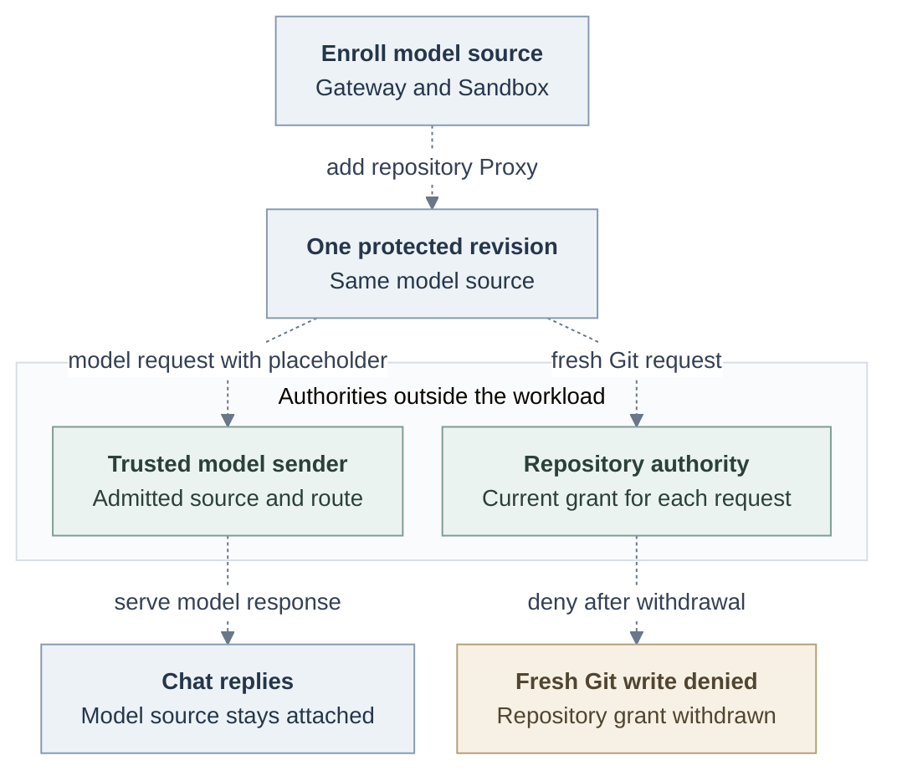

# Proposed amendment: Select a packaged Credential Gateway with its Sandbox

A dedicated Codex Agent needs to keep answering through its ordinary model
source after an operator withdraws its GitHub grant. The same protected v5
revision already admits one online-authorized repository and a separately
authorized ordinary Harness credential source. Startup currently accepts a
Credential Gateway only as a member of the bundled OpenShell Backend. An
installed Sandbox package can supply the Credential Proxy, but cannot select
its own Credential Gateway to attach that model source.

Allow an Installation operator to select the Credential Gateway view of the
same trusted Driver registration as its packaged Sandbox. Use the existing
[Driver package loader](../../../docs/reference/drivers/selection.md#package-identity-and-factory-exports)
and [Credential Gateway attachment contract](../../../docs/reference/drivers/credential-gateway.md).
This is a proposed addition to the [original composition decision](index.md#composition).

## Selection and ownership

The operator installs one reviewed package as an exact direct controller
production dependency. The `drivers.sandbox.package` entry selects it.
The operator opts in by setting `drivers.credential_gateway.id` to the
Sandbox Driver ID and `drivers.credential_gateway.configuration` to
`{}`. The Sandbox entry holds the package's closed configuration with
nonsecret settings and references. The Credential Gateway entry cannot name
another package. Credential values stay out of Installation configuration.

The controller and Worker each call the factory once, select the configured
views from that registration, and close the owner once at shutdown. A package
view requires an explicit selection. Backend validation accepts a Gateway
without a bundled Backend only when the selected Gateway and Sandbox are the
exact views of that installed registration.
Startup refuses a missing view, a different ID or implementation, a conflicting
Backend selection, or unexpected configuration. The operator may omit the
Credential Proxy. When enabled, it must come from the same registration and
satisfy the existing repository delivery checks. The bundled OpenShell Backend
keeps its existing member selections and exact attachment path.

## One revision, independent authorities

For the pilot, enroll one ordinary OpenAI source with the selected Gateway
before enabling the repository Proxy. Keep that Gateway's source identity and
custody when enabling the Proxy. Fresh ordinary-source creation on an
Installation with a selected Proxy remains outside this amendment.

Compute passes the paired Sandbox the admitted source ID and the Gateway's
opaque attachment reference. The Sandbox accepts the reference only from its
paired owner for the original revision and configured model destination.
The trusted sender holds the upstream model credential outside the workload.
Codex receives a nonsecret placeholder and uses the saved HTTPS model route.
An unavailable or mismatched attachment fails closed. Repository withdrawal
ends fresh Git authorization and leaves the independent model attachment in
place. The existing [online Git authorization](../0023-egress-proxy-credential-lifecycle/online-authorization.md)
and protected inference admission rules still apply.

Dashed arrows show the proposed packaged lifecycle. Withdrawing the repository
grant ends fresh Git authorization while the admitted model source stays attached.

## Verification

Exercise normal startup with the same precompiled package in both selections:
Sandbox and Gateway for enrollment, then those views plus Credential Proxy.
Require refusal for a missing or foreign capability at startup and for a
separately registered Gateway at Backend validation. Verify that the existing
bundled OpenShell selection still loads.

On one installed protected revision, receive an ordinary chat reply, complete
the granted repository action, and deny an unassigned repository. After
effective Git withdrawal, deny a fresh write and receive a reply in the same
conversation. Verify that provider material remains outside the workload.
Startup package tests cannot establish these installed outcomes.
