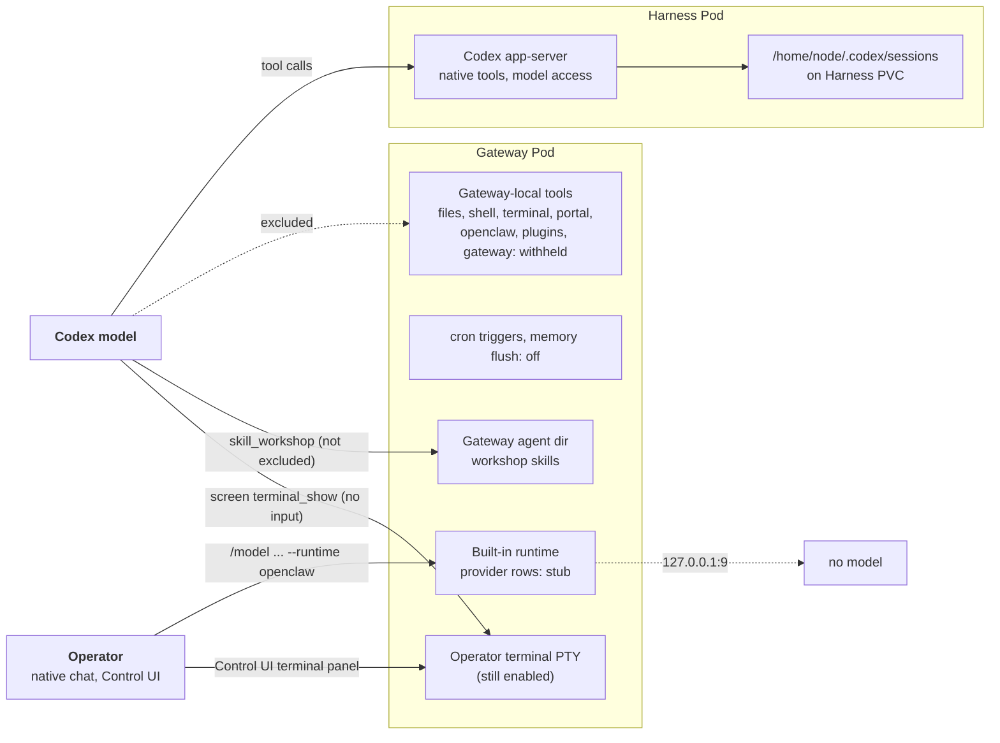

# Proposal: Keep dedicated Codex Gateways from acting on their own Pod

- **ID:** RFC-0019
- **Created:** 2026-10-01
- **Last updated:** 2026-10-13
- **RFC PR:** [#853](https://github.com/openclaw/openclaw-enterprise/pull/853)
- **Implementation:** landed [#808][pr-808], [#814][pr-814], [#824][pr-824], [#2273][pr-2273]; open [#830][pr-830]. Follow-ups: [#874][pr-874], [#895][pr-895], [#896][pr-896], [#1549][pr-1549]. Related Harness hardening: [#765][pr-765], [#796][pr-796], [#1994][pr-1994].
- **Related:** [Gateway–Harness storage split](0003-gateway-harness-storage-split.md), [Harness authentication bindings](0005-harness-auth-binding.md), [Dedicated Harness RWO workspace plan](../plans/38-harness-rwo-workspace-plan.md), [Workspace files flow](../../docs/flows/workspace-files.md).
- **Source baseline:** `main` at `84755c0ab`; OpenClaw runtime pin `90d30a117` (`OPENCLAW_COMMIT` in `deploy/runtime/Dockerfile`, since [#1574][pr-1574]).

## Summary

A dedicated Codex Agent with a workspace node runs two Pods. Codex, its
workspace and its model access live in the Harness Pod. The OpenClaw Gateway
Pod only orchestrates: it routes chat, holds the transcript, and reaches the
Harness workspace through the paired node. Its own `/home/node/workspace` is
empty. The decision recorded here: **on these Gateways, the model loses
OpenClaw's Gateway-local file, shell, terminal and port-proxy tools and the
tools that reconfigure, extend or update the Gateway; automation triggers and
memory flush are off; and OpenClaw's built-in runtime, which runs in the
Gateway process, has no reachable `codex` or `openai` model.** The Gateway
wrapper applies this by rewriting the owner's OpenClaw config each time it
starts OpenClaw. Codex thread state lives on the Harness volume so threads
survive a restart.

This narrows the Gateway Pod's exposure; it does not seal it. A model turn can
still write skill files on the Gateway, plugins the owner enables can add
Gateway-local tools, operators keep a Gateway shell, and other provider rows
stay open (see Known gaps).

This is a retroactive record. Maintainers of the Kubernetes Compute Driver and
the Harness runtime should accept or revise the landed design and decide the
open continuation, #830.

## Context

Dogfooding found the Gateway acting on its own Pod (findings D74 and D86-D90
in the OCE dogfood log):

- **D74.** OpenClaw dynamic tools such as `ls` and `gateway_exec` ran in the
  Gateway Pod, so the model saw an empty workspace and ran commands there.
  Codex rollouts lived in Pod-local `/home/node/.codex/sessions`, so a
  stop/start lost the thread.
- **D86.** After #808, the model could still reach a Gateway shell through the
  `terminal` tool, the `openclaw` delegate's `config.set` (which removed the
  exclusion and hot-applied), or an `automations` stream schedule.
- **D87, D89, D90.** The built-in `openclaw` runtime executes in the Gateway
  with Gateway-local `exec`/`read`/`write`. The model cannot select it. An
  operator can (`/model <ref> --runtime openclaw`), and Codex hands every turn
  to it when a provider route has transport overrides or authored `params`.

## Decision as landed

Enforcement lives in the Gateway wrapper generated by
`apps/controller/src/drivers/compute/kubernetes/runtime-entrypoints.ts`. When
the Gateway has a workspace node (`OPENCLAW_WORKSPACE_NODE_ID` or
`OPENCLAW_WORKSPACE_NODE_PATH` is set), `configureGateway` calls
`excludeGatewayLocalCodexTools` before writing `openclaw.json`. That runs at
container start and again when the wrapper respawns OpenClaw in place for a
changed Harness peer. Gateways without a workspace node keep their config.
Without a Codex plugin entry, only the provider pin (item 3) applies, and only
when `APP_SERVER_URL` names a remote Codex Harness.

1. **Withhold Gateway-local tools from Codex (#808, #814, #2273).**
   `GATEWAY_LOCAL_CODEX_DYNAMIC_TOOLS` is merged into the Codex plugin's
   `codexDynamicToolsExclude`, keeping owner entries. It holds fourteen names:
   - `ls`, `read`, `write`, `edit`, `apply_patch`, `exec`, `process`,
     `gateway_exec`, `gateway_process`: they act on the Gateway's files or run
     commands in its Pod. Codex's native tools act in the Harness, and the
     file-transfer tools reach the workspace through the node.
   - `terminal` types into shells in the Gateway Pod; `portal` proxies its
     ports (#2273).
   - `openclaw`, `plugins`, `gateway` (#2273 added the last two): control-plane
     tools. `openclaw` delegates config changes, which could drop this list;
     `plugins` installs, enables or disables plugins, loading code into the
     Gateway process; `gateway` runs the Gateway's self-update (`update.run`)
     and reads its full config. OCC owns the Gateway's plugins, config and
     version.

   These matter because OCE's proxy connects with `operator.admin`, so every
   operator chat is an owner turn and OpenClaw's owner-only tool gate removes
   nothing. At `90d30a117`, `filterCodexDynamicTools` applies the list after
   lowercasing (`bash` aliases `exec`), `addShellDynamicTools` adds no
   `gateway_exec`, `sandbox_exec` or `node_exec` projection once `exec` is
   excluded, and no tool passes a model-chosen Gateway method (source read,
   not live). The OpenClaw assistant still bypasses the list (see Threat
   model).

2. **Turn off automation triggers and memory flush (#814, #2273).**
   `cron.triggers.enabled` is forced to `false`: stream schedules, script
   payloads and condition scripts run in the Gateway process. Timed automations
   still run Codex turns in the Harness. `agents.defaults.compaction.memoryFlush.enabled`
   is forced to `false` (#2273): the pre-compaction flush run took OpenClaw's
   `read` and `write` from the unfiltered tool list, so it could read any
   Gateway Pod file and wrote its memory to the Gateway's empty workspace,
   where the Harness never sees it.
3. **Give the built-in runtime no model (#824).** `pinCodexProviderTransport`
   rewrites every `codex` and `openai` provider row (keys matched after trim and
   lowercase). Only model-naming, limit/cost and `agentRuntime` fields survive
   (`CODEX_PROVIDER_KEPT_KEYS`, `CODEX_MODEL_KEPT_KEYS`); `request`, `headers`, `params`, `localService`,
   credentials and per-model transport fields are dropped. An authored transport,
   and always the `codex` row, becomes `CODEX_PROVIDER_STUB_URL`
   (`http://127.0.0.1:9`, `api: openai-responses`). A missing `codex` row is
   added because `codex` is a bundled provider. An `openai` row with no authored
   transport keeps OpenClaw's default, which has no credential in the Gateway
   unless the Configuration's `env`/`env.vars` supplies `OPENAI_API_KEY`, the
   only key OpenClaw's built-in `openai` provider reads.
   With transport overrides gone, those rows no longer make Codex declare
   `fallbackRuntime: "openclaw"`: none of the fields
   `createModelProviderRouteOverrideResolver` counts at `90d30a117` is kept.
4. **Persist Codex threads on the Harness volume (#808).**
   `HARNESS_CODEX_SESSIONS_CATEGORY` mounts subPath `codex-sessions` of the
   Harness claim at `/home/node/.codex/sessions` for non-OAuth logins; OAuth
   logins already keep all of `CODEX_HOME` in `codex-home`. A stop/start on a
   controller built from #808 was not verified.
5. **Report the rewrite and refuse what it cannot apply (#874, #895, #896).**
   `logOverriddenSettings` writes one `runtime.gateway_settings_overridden`
   stderr event at start naming, never valuing, the replaced settings
   (`occ agent logs` shows a warning). Deployment admission runs `requireCodexGatewayConfigurationShape`
   for dedicated Codex and refuses a shape the entrypoint cannot rewrite with
   400 `INVALID_REQUEST` naming the setting path (a long provider key is cut to
   fit the 256-character message cap, #1549): a non-list
   `codexDynamicToolsExclude`; a non-object Codex plugin `config`, `cron`,
   `cron.triggers`, `models`, `models.providers` or step of
   `agents.defaults.compaction.memoryFlush` (#2273); or a `codex`/`openai` row
   that is not an object or whose `models` is not a list of objects. These checks run only
   when the owner's document has the Codex plugin entry; otherwise the
   entrypoint fails the start (closed).

Related Harness-side hardening landed in the same window:

- **#765.** `codexChildEnvironment()` removes `APP_SERVER_TOKEN` and
  `APP_TOKEN_SHA` from the environment of `codex login` and `codex app-server`;
  the listener gets only the digest. The wrapper can still hold the token. This
  reduces ambient inheritance by model-run commands; it does not isolate
  same-UID processes.
- **#796, #1994.** The Codex OAuth seed writer mounts only subPath `codex-home`
  of the Harness claim, in a bounded Job (`oauthBootstrapJob`) whose
  `prepare-oauth-home` init container creates the directory as uid 1000, mode
  `0700`, removing a planted link or file.

Solid arrows are implemented and reachable; dashed arrows are cut by the
landed changes.

## Threat model

**Model-driven paths** are the ones this design must close, because a prompt
injection in any file or web page reaches them. Every OCE operator chat is an
owner turn, so owner-only tools are offered. After #2273:

- In a normal Codex turn the model has none of the fourteen excluded tools, so
  no Gateway file, shell, terminal or port access and no tool that writes
  Gateway config, changes its plugins or updates it. `automations` stays
  (it stores jobs that run Codex turns; triggers are off). The tools it keeps
  that still act in the Gateway Pod are listed under Known gaps.
- It could not start a non-Codex run in the D89 checks: `sessions_spawn` and
  `subagents` stay callable, but every spawn resolved to `codex/<model>`, and
  other refs fail `model not allowed` against the allowlist seeded from
  configured provider rows. Spawned runs execute in the Gateway process; one that reached the built-in
  runtime would be stopped by the transport pin (item 3), not by exclusion.
- It cannot set a session runtime override: no tool at `90d30a117` references
  `agentRuntimeOverride`, and live attempts were refused (D89, earlier pin).

**Operator-driven paths** need native chat or Configuration access, which is
already admin-level on that Agent:

- `/model <ref> --runtime openclaw` switches a session to the built-in runtime;
  no OpenClaw config can forbid it (`AgentRuntimePolicySchema` is strict
  `{ id }`). #824 makes that run fail against the stub for `codex` and `openai`
  rows (live: the model proxy logged no request).
- The Control UI terminal panel opens a login shell in the Gateway Pod: OCE
  sets nothing under `gateway.terminal`, and OpenClaw enables it by default.
  The model's `screen terminal_show` can open that panel in the operator's
  browser but cannot type into it (`terminal` is withheld).
- The rewrite runs only when the wrapper starts or respawns OpenClaw. A later
  config change, which OpenClaw hot-reloads (seen live with `config.set` in
  D86), is not re-checked until then. Since #2273 every model-reachable config
  writer (`openclaw`, `plugins`, `gateway`) is excluded; an operator with
  Gateway config write access can still make such a change.
- An operator chat with the OpenClaw assistant keeps the `openclaw` tool. At
  `90d30a117`, `dynamic-tool-build.ts` re-adds it, whatever
  `codexDynamicToolsExclude` says, only for a run carrying the host-set
  ring-zero tool scope, which only the assistant's `openclaw.chat` turn sets;
  the model cannot reach that method. Operator-only; not checked live.

So an operator can already reach the Gateway Pod. The provider pin keeps a
misconfigured Configuration from turning that into a model with Gateway tools.

## Verification

The PRs add conformance cases and extend the runtime-image check against the
pinned image. Live checks ran on a dogfood install:

- #808 on `769c8cd88`: no Gateway-local tools; the thread resumed after a restart.
- #814 on `f22a584e6`: the Gateway config lists the then eleven exclusions and
  `cron.triggers.enabled: false`; a stream schedule was refused by the tool
  schema; no shell child appeared in the Gateway.
- #824: applied by hand to a running Gateway's config (the shared controller was
  not upgraded). Normal turns stayed on the Harness; an operator
  `--runtime openclaw` turn hit only the stub.

#2273 was checked by conformance tests running the real wrapper and by the
runtime-image check, not on a dogfood install. The `openai` default-transport
case was not run live. Every live check predates the OpenClaw pin moves to
`6f91eda9c`, `11d3d04a1` and `90d30a117`; none was repeated on the current
image.

## Alternatives considered

- **Mount the Harness workspace in the Gateway.** Rejected by the storage split
  (RFC-0003): the workspace is RWO on the Harness, and Gateway tools would still
  run with Gateway credentials and network.
- **Route the tools through the node.** Upstream work per tool; Codex's native
  tools cover them.
- **Reject unsafe Configurations at admission.** Every new OpenClaw key would
  need a rule there, and rewriting at Gateway start also covers config admitted
  earlier. Admission refuses only shapes the rewrite cannot handle; a
  well-formed unsafe setting is admitted and then rewritten.
- **Persist all of `CODEX_HOME`.** It holds the login; resume needs only
  `sessions`.

## Known gaps and residual risk

- **Other provider rows and request params (#830, open).** #824 pins only
  `codex` and `openai`. A Configuration that adds another row with a credential
  (`apiKey: "${VAR}"` from a Secret binding) plus an allowing
  `agents.defaults.modelPolicy` (admission does not check it) gives an operator's
  built-in run a reachable model; the Gateway NetworkPolicy was the only barrier
  live. Any non-empty `agents.defaults.params`, agent `params` or non-run-control
  model `params` make `hasAuthoredProviderRequestParams` true, so Codex declares
  the fallback and every normal turn fails closed in the Gateway (the Workspace
  files flow's "Codex never hands that runtime a turn" holds only without them). The default `openai` row can also pick up a credential:
  an `OPENAI_API_KEY` reference in Configuration `env`/`env.vars` can resolve
  from a Secret binding. Separately, admission forces only `OPENAI_API_KEY`,
  `ANTHROPIC_API_KEY`, `ANTHROPIC_AUTH_TOKEN` and `CODEX_ACCESS_TOKEN` to be
  `${VAR}` references, so a literal `CODEX_API_KEY` passes; the Codex app-server
  reads that name, the built-in runtime does not. #830 strips `OPENAI_*`,
  `CODEX_*` and `ANTHROPIC_*` names from `env` and rejects every `CODEX_*`
  name at admission.
- **#830 is open-ended.** It stubs every provider row (including those named by
  image, PDF, utility and hook models), forces an explicit `modelPolicy.allow`,
  and strips params and model-credential env names. Review found it widens an alias-only allowlist (still true at `4916f264c`),
  and each new OpenClaw model key needs another rule. The branch conflicts with main.
- **Operator terminal.** The Control UI panel still opens a Gateway PTY
  (Threat model).
- **`skill_workshop` (not excluded; follow-up).** It is offered on
  unsandboxed runs and writes skill files under the Gateway agent dir
  (`workshop-skills`), which later prompts can load. It runs no commands.
  Codex-native skills in the Harness are the intended path.
- **Plugin-contributed tools.** The list names core tools. A plugin the owner
  enables in the Configuration can add Gateway-local tools outside it.
- **Lower-risk kept tools.** `secrets` lists or deletes entries in the
  Gateway's own secret store, which OCE does not use; `personal_instructions`
  writes an agent-dir file later prompts load; `web_fetch` makes
  requests from the Gateway Pod under OpenClaw's SSRF policy (default not
  re-verified); media tools (`tts`, image, video, music, `pdf`) write files
  under the Gateway workspace.
- **Memory flush is off, not filtered.** Upstream still gives a flush run
  unfiltered `read`/`write`; the forced setting is the only barrier.
- **Rewrite warns, not refuses.** A well-formed setting the entrypoint drops is
  admitted; only the start-time warning records it.
- **Upstream drift.** The exclusion list and kept-key sets were written against
  OpenClaw `9d9c8568c`, unchanged through three pin moves (#1062, #1414,
  #1574), and the list was extended at `90d30a117` by #2273. On 2026-10-13 the
  upstream claims here were re-derived from source at `90d30a117` (tool names
  unchanged from `11d3d04a1`, though implementations changed); nothing was
  re-run live. New upstream tools or transport fields need matching changes.

## Open questions for reviewers

1. **How should the built-in runtime be closed?** Options: (a) land #830's
   config rewrite after fixing alias handling; (b) ask upstream for an
   `agentRuntime` setting that disables fallback and rejects session runtime
   overrides (recorded as upstream ask OC1), then delete the pin; (c) disable
   session runtime overrides and the operator terminal on dedicated Gateways;
   (d) accept the operator-only risk and keep #824. **Implemented today:** (d),
   #824 only.
2. **Should operator terminals open in the Gateway Pod?** Setting
   `gateway.terminal.enabled: false` on workspace-node Gateways would remove the
   operator shell. **Implemented today:** terminals enabled (OpenClaw default).
3. **Should Gateway-local provider features keep working?** #830 would stop
   image, PDF, utility and hook models whose provider is not `openai` on these
   Gateways. **Implemented today:** they keep their rows unless the provider is
   `codex` or `openai`.
4. **Should dropped settings be surfaced as an Agent condition?**
   **Implemented today:** a start-time warning only; admission refuses shapes
   the rewrite cannot handle.
5. **Should `agents.defaults.params` be refused at admission?** It cannot work
   on these Agents. **Implemented today:** admitted; every Codex turn then fails
   in the Gateway.

[pr-765]: https://github.com/openclaw/openclaw-enterprise/pull/765
[pr-796]: https://github.com/openclaw/openclaw-enterprise/pull/796
[pr-808]: https://github.com/openclaw/openclaw-enterprise/pull/808
[pr-814]: https://github.com/openclaw/openclaw-enterprise/pull/814
[pr-824]: https://github.com/openclaw/openclaw-enterprise/pull/824
[pr-830]: https://github.com/openclaw/openclaw-enterprise/pull/830
[pr-874]: https://github.com/openclaw/openclaw-enterprise/pull/874
[pr-895]: https://github.com/openclaw/openclaw-enterprise/pull/895
[pr-896]: https://github.com/openclaw/openclaw-enterprise/pull/896
[pr-1549]: https://github.com/openclaw/openclaw-enterprise/pull/1549
[pr-1574]: https://github.com/openclaw/openclaw-enterprise/pull/1574
[pr-1994]: https://github.com/openclaw/openclaw-enterprise/pull/1994
[pr-2273]: https://github.com/openclaw/openclaw-enterprise/pull/2273
