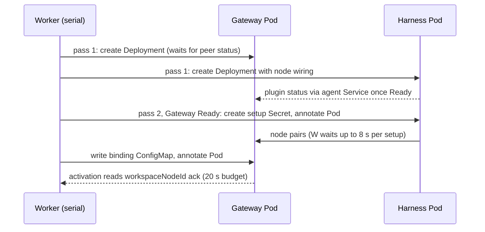

# Proposal: First-deploy activation for dedicated Agents on Kubernetes

- **ID:** RFC-0019
- **Created:** 2026-10-01
- **Last updated:** 2026-10-13
- **RFC PR:** [#855] (retroactive record, not an approval)
- **Related:** superseded plan [Workspace enrollment without a Harness restart](../plans/40-workspace-enrollment-without-harness-restart.md);
  [Harness RWO workspace plan](../plans/38-harness-rwo-workspace-plan.md); current contracts in
  [harness execution](../../docs/reference/harness-execution.md),
  [Kubernetes storage](../../docs/reference/drivers/kubernetes-compute/storage-and-credentials.md) and
  [networking](../../docs/reference/drivers/kubernetes-compute/networking-and-isolation.md);
  open proposals on activation evidence ([#458](https://github.com/openclaw/openclaw-enterprise/pull/458))
  and on the redeploy serving gap ([#1045](https://github.com/openclaw/openclaw-enterprise/pull/1045)).
- **Source baseline:** `main` at `07590c64e`. Symbols are in the driver [`kubernetes/index.ts`][index]
  or the wrappers [`runtime-entrypoints.ts`][entry] unless named.

## Summary

With status-proxy CIDRs set, a first deploy of a dedicated Codex Agent on Kubernetes starts
each workload once: one Harness and one Gateway, both created in the first preparation pass,
with one pending pass (a pass that waits on a workload start) before the revision is ready. The workspace node's setup code reaches the running Harness through an
optional Secret volume, and its node id reaches the running Gateway through an optional
ConfigMap volume that the Gateway wrapper hot-applies. Nothing in the pod specs changes after
the first start, so Kubernetes replaces nothing. The profile renderer requires
`network.pluginStatusProxySourceCidrs` and the dev launcher sets it; the production example
`installation.yaml` does not, and without it the Gateway is replaced once.

The Compute and security owners review this design. It replaced a flow that started five workloads over three
pending passes (see [Why it is built this way](#why)).

## Scope

This record covers a dedicated Codex Agent whose Harness is a Kubernetes Deployment
(`initialDedicatedCodexGateway`), authenticated with a model key. Outside it:

- **OAuth (ChatGPT sign-in) Codex Agents** first run a one-shot bootstrap Job that seeds the
  Harness credential volume (`prepareOAuthCredentials`; since [#1994] a Job with
  `backoffLimit: 2` and a 300 s deadline). Preparation stays pending until it completes, so these deploys add one Job Pod
  and at least one pending pass before the flow below.
- **SandboxDriver Harnesses** (OpenShell, [#1400]) receive the setup code in their provisioning
  request, so Compute provisions them only after the Gateway is Ready and the setup exists.
- **Native OpenClaw workers** keep the env-based setup code and replace-to-attach
  (`prepareWorkspaceNode`, `addNativeWorker`). With enabled plugins and no workspace setup, their
  Gateway is created only after the Harness reports plugin status
  (`deferInitialDedicatedGatewayForPluginStatus`).
- **Embedded Agents** keep their single-Pod path.
- **Redeploys** keep the agent Service on the serving revision until activation. Their serving
  gap (D67) is open question 1.

## How a first deploy runs today

A pass is one run of preparation (creating and wiring workloads) or activation (confirming the
Gateway applied the node) on the serial worker, which handles one Work item at a time; a pending
pass ends before the revision is ready, and the worker re-polls it. These steps assume
status-proxy CIDRs are set.

1. **Pass 1 creates everything.** With no Gateway yet, preparation reconciles the agent Service
   (selecting this revision at once), the Agent NetworkPolicies, the Harness route, the Gateway
   Deployment, then the Harness Deployment. The pass ends pending.
2. **Harness start.** The Harness carries its node wiring from its first start: node state
   volume, the `AGENT_WITH_NODE_ENTRYPOINT` supervisor, the CA, and an optional Secret volume at
   `/run/openclaw-node-setup` projecting only `setupCode`, mode `0440`. The supervisor starts Codex
   at once and the node host only when the file holds a complete code.
3. **Gateway start.** The wrapper's first peer wait (`waitForPeerPluginRuntimeStatus`) reads the
   Harness's plugin status through the agent Service every 250 ms, with no deadline, and keeps
   the Gateway unready meanwhile. The Gateway also mounts an optional Agent-scoped ConfigMap
   `gateway-<agent hash>-workspace-node` at `/run/openclaw-workspace-node`.
4. **Setup delivery.** Once the Gateway is Ready, the next pass mints the setup Secret
   (`prepareWorkspaceNode`) and patches the `openclaw.dev/workspace-node-setup` annotation on the
   running Harness **Pod**. The Pod update makes the kubelet refresh the volume at once (1.3-1.7 s
   on k3d in #612, 58-84 s without).
5. **Pairing wait.** The same pass waits for the node to pair on one Gateway connection
   (`workspaceNodeReady` → `GatewayNodeEnrollment.observeSetup` with `{ waitMs }`, reading every
   250 ms), up to `WORKSPACE_NODE_PAIRING_WAIT_MS` (8 s). Once paired, Compute records the `deviceId`, removes
   `setupCode` from the Secret, and nudges the Harness Pod again.
6. **Binding.** The same pass writes `{revisionId, deviceId}` to the binding ConfigMap and
   annotates the Gateway Pod. Preparation reports ready.
7. **Hot apply and ack.** The wrapper polls the binding every second and rewrites only
   `plugins.*` / `cloudWorkers.*`. It reports `workspaceNodeId` only after OpenClaw, asked over its
   Gateway SDK connection (`plugins.list`), lists `file-transfer` active in a plugin registry
   loaded after the write. Activation reads that ack within `WORKSPACE_NODE_BINDING_ACK_TIMEOUT_MS`
   (20 s); without it the attempt ends pending as `WORKSPACE_NODE_BINDING_PENDING`. The wrapper
   reports a cause such as `RELOAD_NOT_CONFIRMED` 30 s after the write, so a later attempt reads
   it; that attempt also ends pending, retried until the deadline. `GATEWAY_UNAUTHORIZED` fails
   the revision as `AGENT_GATEWAY_UNAUTHORIZED`.

_First dedicated Codex deploy with status-proxy CIDRs set._

### Without status-proxy CIDRs

Activation must read the ack from the Gateway's private status, reachable only through the API
server's Pod proxy. `usesWorkspaceNodeBinding()` therefore needs `gatewayPrivateStatusReachable()`,
a non-empty `network.pluginStatusProxySourceCidrs`. Without it the node id goes into the Gateway
pod spec as `OPENCLAW_WORKSPACE_NODE_ID`, and activation replaces the Gateway once (Harness 1 +
Gateway 2). The dev launcher (`internal/occdev/status_proxy_k3d.go`) writes the k3d API server's
`cni0` source as a `/32`.

### Waits on the serial worker

Both waits are budgets, not per-pass timeouts, each kept in memory in a map of at most 1,024
entries:

- The 8 s pairing wait is spent per setup ID across passes (`workspaceNodePairingSpentMs`, in
  memory); once spent, later passes read once and end pending (D88).
- The 20 s ack wait is spent per revision and node across activation attempts
  (`workspaceNodeBindingAckSpentMs`); once spent, each attempt reads once.
- Both end after at least one read when another Agent's Work could be claimed
  (`computeWorkWaiting`, backed by `PostgresWorkQueue.claimableWorkWaiting`). Preparation then ends
  pending; unspent time stays in the budget (D221).

### Failure and restart handling

- **Peer changes.** The Gateway wrapper polls the Harness every 2 s. When its `startupId`, Pod
  UID, plugin set or plugin failures change, or it is unreadable and returns changed,
  `respawnForPeerStatus` drops readiness and respawns OpenClaw in place. The container restarts
  instead after more than `GATEWAY_RESPAWN_LIMIT` (5) respawns in 10 minutes, a respawn not
  serving after 3 attempts, or a peer that changes or vanishes during verification; a changed
  binding `deviceId` also restarts it. A first deploy needs none.
- **Fail fast.** Runtime status codes the entrypoints hold until restart fail the revision at
  once instead of at the convergence deadline (`HELD_RUNTIME_FAILURE_CODES` in `worker.ts`;
  deadline 900 s by default, `OCC_WORKER_CONVERGENCE_TIMEOUT_MS`):
  `AUTHENTICATION_FAILED` (provider 401/403 or invalid key) → `RUNTIME_AUTHENTICATION_FAILED`,
  and the other held startup failures each map to a code. Unknown codes wait for the deadline.
- **Upfront key check.** Before the full OpenClaw model probe, `credentialRejectedUpfront` sends
  one empty `POST` to the default OpenAI or Anthropic base URL at the configured API's path. Only
  a 401 fails. Non-default endpoints, APIs, providers or request options and setup tokens skip it.

### Related workload settings

- **Volume ownership.** Pods with private state set `fsGroupChangePolicy: OnRootMismatch`, so a
  start no longer walks 10-40 Gi claims recursively.
- **Predecessors.** The worker's in-memory `stoppedPredecessors` stops each predecessor of an
  exclusive revision once, then again after 1, 2, 4… leases. While another revision's Gateway
  serves, Agent-scoped NetworkPolicies select every revision (`anyRevision`).
- **Resources.** The profile renderer and production example set Gateway request `1792Mi`, limit
  `3Gi`; Harness request `768Mi`, limit `6Gi`; CPU request `100m`, limit `"4"`. The dev launcher
  (`internal/occdev/kubernetes.go`) uses the same memory and CPU limit `"2"`.

## Why it is built this way

The S1 ratchet test (#588) pinned the old first deploy at 5 starts over 3 pending passes:
Harness, Gateway, Harness again, a Gateway container restart, and the Gateway again. Each start
repeated scheduling, the RWO attach, a recursive chown, login, the model probe and plugin
install. The causes were structural:

1. The setup code could be minted only once the Gateway was ready, and adding it changed the
   Harness template, so Kubernetes replaced the Harness. Delivering it as a refreshed volume
   removes that change.
2. The new Harness had a new `startupId`; the Gateway wrapper exited, so the kubelet restarted it.
   Starting the Harness once, plus the in-place respawn, removes that restart.
3. Activation added the node id to the Gateway pod spec, replacing it. The binding ConfigMap
   and hot apply remove that change.
4. The Gateway was created only after the Harness reported plugin status, and the agent Service
   selected the revision only after Harness readiness. Creating both in pass 1, with the Service
   selecting at once and an unbounded peer wait, removes that pass.

Pairing inside the pass removed 2.2-5.2 s of pass cadence (D25); the budgets keep it from
starving other Agents' deploys.

## Measured effect

| Measurement                                | Before              | After (main revision)        |
| ------------------------------------------ | ------------------- | ---------------------------- |
| Starts per first Codex deploy (ratchet)    | 5, 3 pending passes | 2, 1 pending pass            |
| Codex first deploy, launcher install (D68) | 99.6-123.7 s        | 28.4 s (`81207521e`)         |
| Paired → binding written (D25)             | 2.2-5.2 s           | 0-1 s (`f22a584e6`)          |
| Pending passes after Ready (D25)           | 3-4                 | 0-1 (`f22a584e6`)            |
| Codex first deploy, round 5 (load 70-77)   | –                   | 30.8 s, 33.3 s (`cc06ec34b`) |
| Wrong model key reported (#838, D26)       | 29-53 s             | 489 ms (`cc06ec34b`)         |

Only the first row is checked in: the ratchet pins it on every CI run. It counts starts as
Deployment template renders plus inferred Gateway restarts and marks workloads ready once
waited on; real deploys re-poll more often. The timing rows are
single dogfood runs on a local k3d install, recorded in notes outside this repository; treat
them as attributed reports, not verified results. Loads differed (after-runs 6-77, D25
before-runs 44-154 at `769c8cd88`), so only the cadence rows compare like for like.
#580, #652 and #668 were not measured separately. No timing was rerun after #1400 or #1994.

## Security and trust

- **Setup code file.** Every uid-1000 process in the Harness, Codex included, can read it;
  under `fsGroup`, `0400` would act as `0440`. The code was already exposed similarly in the node
  child's argv and, earlier, the container env. Mitigations: one projected key; removal once the
  `deviceId` is recorded; the code is one-shot and expires.
- **Pod `patch`.** The tenant worker ClusterRoles (`openclaw-tenant-worker` in
  `openclaw-enterprise`, `execution-tenant-worker` in `openclaw-execution`) include `patch` on
  `pods` for three Pod patches of two kinds (Harness setup and setup removal, Gateway binding).
  The charts bind no role with Pod `patch` cluster-wide; operators grant
  the tenant role with a RoleBinding in each tenant namespace
  ([production guide](../../docs/guides/deploy/production-agents.md#grant-tenant-rolebindings)).
  Within a tenant namespace a label patch could retarget Service selectors; the worker could
  already patch Deployments there. Only a 404 on the nudge is ignored, so a custom role without
  the verb fails the pass.
- **Binding ConfigMap.** Identifiers only, read through `getOwned` with the Gateway's Agent
  ownership (a foreign one is refused) and covered by the immutability check.
- **Status-proxy source.** Compute refuses all-address sources; the launcher admits one `/32` on
  TCP 18791, never the default-route source.
- **Upfront key check.** The key goes only to the endpoint and header OpenClaw itself would use.

## Alternatives considered

- **Setup code over the private status port.** Held in reserve in case kubelet refresh was slow;
  #612 measured 1.3-1.7 s, so it was not built.
- **Overlap model probes with process start (S2, #595).** Closed unmerged: no Codex saving
  (0.1-0.3 s slower) and embedded probe timeouts at 500m.
- **Reuse probe results across restarts (S3).** Dropped: it would store a credential-derived
  digest on a PVC that Codex can read.
- **Release the worker between pairing and activation.** Rejected: it re-adds a pending pass
  after Ready on every first deploy.

## Known gaps and residual risk

- **Hot apply is not zero-disruption.** OpenClaw reloads the Codex plugin runtime with
  `file-transfer`, so the app-server session is re-established at activation.
- **Serial worker hold.** On an idle worker the last pass still holds it 9-11 s (pairing plus the
  ack). Claimable Work ends the waits, but still runs one item at a time. A node that boots in
  more than 8 s under load gets single reads after its budget.
- **Unbounded peer wait.** A Gateway whose Harness never reports holds its PVC and scheduling
  slot until the convergence deadline.
- **Stale comments.** Two driver comments still describe the old flow: "Enrolling the workspace
  node replaces the Harness and restarts its Gateway" and "Node enrollment updates the initial
  Harness after its Gateway starts".
- **Upgrade restarts (historical).** Rolling these changes out restarted every workload once;
  in-place upgrades needed a manual CIDR and resource edit (D81, D97).

## Open questions for reviewers

1. **D67: redeploy serving gap.** `requiresStoppedPredecessors` is true for every dedicated
   revision, so the worker stops the serving Harness and Gateway before preparing the successor,
   and Gateways use `Recreate`. Dogfood measured about 75 s at first, then 19.8-34.9 s (Codex)
   and 26.2-32.4 s (embedded). A replacement that cannot start makes it an outage (D95). Configuration shapes known to break the Gateway are now refused
   before the stop (`configuration-rules.ts`), but a rejected credential still is not.
   **Implemented default:** accept the gap; the
   [Kubernetes Compute reference](../../docs/reference/drivers/kubernetes-compute.md#execution-modes)
   says exclusive preparation "introduces deployment downtime". The open proposal
   [#1045](https://github.com/openclaw/openclaw-enterprise/pull/1045) checks the replacement
   before stopping its predecessor.
2. **Tie the hot apply to the status-proxy CIDR?** **Default:** without CIDRs, keep the pod-spec
   node id and one Gateway replacement. Alternative: a separate ack channel so those installs
   also start once.
3. **Setup-code exposure to Codex.** **Default:** `0440` file, removed after pairing. #616 asked
   for explicit security sign-off.
4. **Pod `patch` in the tenant worker role.** **Default:** included in both charts' tenant worker
   ClusterRole, granted per tenant namespace by operator RoleBindings. Alternative: a narrower
   role for the nudge, or a nudge that needs no Pod write.
5. **Pairing wait on the serial worker.** **Default:** 8 s per setup and 20 s per binding, in
   memory (reset by a controller restart), ended early when other Work is claimable. Remaining alternative: dispatch different Agents' Work concurrently.
6. **CPU overcommit.** **Default:** limit `"4"`, request `100m`. A `limits.cpu` quota counts the
   whole limit, and bursts can overcommit nodes.

## Delivery history

The design landed in pieces between 2026-09-29 and 2026-10-04:
setup-code volume and Harness node wiring from the first start ([#616]); binding ConfigMap and
hot apply ([#640]); Gateway created alongside the Harness ([#652]); in-place respawn ([#668]);
status-proxy CIDR in the launcher ([#791], D68); pairing inside the pass ([#816]); per-setup
pairing budget ([#821]); per-binding ack budget ([#877]); waits ended by claimable Work ([#892]);
`plugins.list` over the SDK ([#857]); `GATEWAY_UNAUTHORIZED` fails the revision ([#1128]).
Supporting changes: `OnRootMismatch` ([#580]), predecessor stops and policies ([#584], [#620],
[#698], [#752]), fail fast ([#583], [#871], [#1070]), the upfront key check ([#838], [#932]) and
resources ([#683], [#841], [#866], [#1168], [#1178]). Later work outside this design narrowed its
scope: SandboxDriver Harnesses ([#1400]) and the OAuth bootstrap Job ([#1994]).

## References

[index]: ../../apps/controller/src/drivers/compute/kubernetes/index.ts
[entry]: ../../apps/controller/src/drivers/compute/kubernetes/runtime-entrypoints.ts
[#580]: https://github.com/openclaw/openclaw-enterprise/pull/580
[#583]: https://github.com/openclaw/openclaw-enterprise/pull/583
[#584]: https://github.com/openclaw/openclaw-enterprise/pull/584
[#616]: https://github.com/openclaw/openclaw-enterprise/pull/616
[#620]: https://github.com/openclaw/openclaw-enterprise/pull/620
[#640]: https://github.com/openclaw/openclaw-enterprise/pull/640
[#652]: https://github.com/openclaw/openclaw-enterprise/pull/652
[#668]: https://github.com/openclaw/openclaw-enterprise/pull/668
[#683]: https://github.com/openclaw/openclaw-enterprise/pull/683
[#698]: https://github.com/openclaw/openclaw-enterprise/pull/698
[#752]: https://github.com/openclaw/openclaw-enterprise/pull/752
[#791]: https://github.com/openclaw/openclaw-enterprise/pull/791
[#816]: https://github.com/openclaw/openclaw-enterprise/pull/816
[#821]: https://github.com/openclaw/openclaw-enterprise/pull/821
[#838]: https://github.com/openclaw/openclaw-enterprise/pull/838
[#841]: https://github.com/openclaw/openclaw-enterprise/pull/841
[#855]: https://github.com/openclaw/openclaw-enterprise/pull/855
[#857]: https://github.com/openclaw/openclaw-enterprise/pull/857
[#866]: https://github.com/openclaw/openclaw-enterprise/pull/866
[#871]: https://github.com/openclaw/openclaw-enterprise/pull/871
[#877]: https://github.com/openclaw/openclaw-enterprise/pull/877
[#892]: https://github.com/openclaw/openclaw-enterprise/pull/892
[#932]: https://github.com/openclaw/openclaw-enterprise/pull/932
[#1070]: https://github.com/openclaw/openclaw-enterprise/pull/1070
[#1128]: https://github.com/openclaw/openclaw-enterprise/pull/1128
[#1168]: https://github.com/openclaw/openclaw-enterprise/pull/1168
[#1178]: https://github.com/openclaw/openclaw-enterprise/pull/1178
[#1400]: https://github.com/openclaw/openclaw-enterprise/pull/1400
[#1994]: https://github.com/openclaw/openclaw-enterprise/pull/1994

- Volume refresh measurement: [#612](https://github.com/openclaw/openclaw-enterprise/pull/612).
- Enrollment client: [`node-enrollment-client.ts`](../../apps/controller/src/gateway/node-enrollment-client.ts);
  worker: [`worker.ts`](../../apps/controller/src/worker.ts).
- Ratchets in `tests/conformance/kubernetes-compute.test.mjs`: "a first dedicated deploy pins
  its workload starts through activation", "a first dedicated deploy pass waits a bounded time
  for its node to pair", "without a status proxy a dedicated Codex Gateway keeps its workspace
  node in the pod spec".
