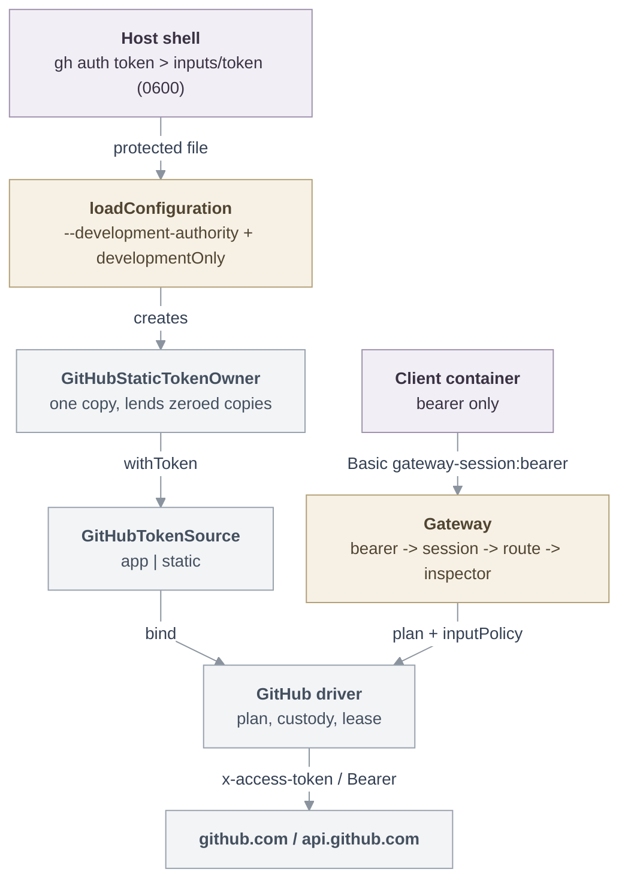

# Proposal: GitHub token authority for local development

- **ID:** RFC-0019
- **Created:** 2026-10-04
- **Last updated:** 2026-10-13
- **RFC PR:** [#1196](https://github.com/openclaw/openclaw-enterprise/pull/1196)
- **Implementation plan:** none. This RFC is a retroactive record of delivered work (#1197,
  #1206, #1236, #1239, #1257, #1266); a plan for finished work would be moot. Phases 2 and 3
  are unplanned.
- **Related:** [RFC-0008 repository credentials](0008-repository-credentials/index.md);
  [repository credential reference](../../docs/reference/repository-credentials.md);
  [development token reference](../../docs/reference/repository-credentials/development-token.md)
  and [guide](../../docs/guides/repository-credentials/development-token.md);
  [push-ref guardrail](../../docs/reference/repository-credentials/push-ref-guardrail.md);
  [local repository credentials guide](../../docs/guides/deploy/local-repository-credentials.md);
  [RFC-0015 credential recovery](0015-repository-credential-recovery.md).

<a id="problem-and-decision"></a>

## Summary

The standalone repository credential service has a second, development-only authority: a
static GitHub token (a fine-grained or classic personal access token, or the token the host
`gh` CLI holds) that the service process owns and lends into the same custody, session, route
and transport machinery as the GitHub App path. A developer can clone, push and call the GitHub
API from the client container against a real repository without a GitHub App installation,
and the token never enters that container. A static token cannot be narrowed per session, so
the gateway enforces scope: GraphQL is refused unless the token is fine-grained and the
operator opts in, and then only plain read-only query documents pass; every push's ref names
are checked against a required allowlist before the push body reaches GitHub, though push
contents are not inspected. Kubernetes deployments cannot select the kind; a standalone
service selects it only with two explicit operator opt-ins.

## Motivation

Local repository testing otherwise requires a GitHub App private key, an installation and the
registry flow ([guide](../../docs/guides/deploy/local-repository-credentials.md)). The
developer's host already holds working GitHub credentials (`gh auth status` and
`ssh -T git@github.com` succeed). The goal was to use them while keeping the credential out of
the agent or client container, exactly as the App key is.

The SSH key cannot be that credential: the broker is a smart-HTTP and REST/GraphQL gateway
end to end. The container's credential helper answers only `protocol=https` for the gateway
host; [route classification](../../apps/controller/src/drivers/repo/github/credentials/routes/classification.ts)
admits only `info/refs`, `git-upload-pack`, `git-receive-pack` and allowlisted REST paths; the
[upstream sender](../../apps/controller/src/drivers/repo/credentials/transport/upstream.ts)
speaks HTTPS to two fixed origins. An SSH key authenticates none of that and gives no API
access. A token does, and the host has one.

<a id="scope"></a>

## Goals

- **One seam.** Authority-specific behaviour sits behind `GitHubTokenSource`
  ([`token-source.ts`](../../apps/controller/src/drivers/repo/github/credentials/token-source.ts)).
  `createTokenSource` is the only place that selects an implementation; the other kind checks
  in the driver tree are configuration validation (`config.ts`, `factory.ts`,
  `registry-factory.ts`) and the grant identity shape (`grants.ts`).
- **Same custody.** The token enters through the protected-file reader the App key uses, is
  held by one process-owned owner, and reaches requests only through custody slots. Client
  material is the same as on the App path.
- **Scope enforced, not described.** GraphQL off for `git-read`, off by default, read-only
  when enabled; a required `pushRefAllowlist` checked at the gateway; sessions capped at eight
  hours; grant identity disjoint from App grants.
- **Kept out of production.** Kubernetes composition cannot select it; a standalone service
  needs two explicit opt-ins.
- **Proven live** (see Delivery).

## Non-goals

- SSH as a credential or transport; never by mounting `~/.ssh` or forwarding `SSH_AUTH_SOCK`.
- A Kubernetes path (`occ dev up`, Helm, registry) for the token kind.
- Per-session down-scoping, an acquire-time repository probe, or token revocation by the
  service. Operators revoke in GitHub.
- Changing App-path push-ref behaviour, where the allowlist is a client-side hook only.

<a id="design"></a>

## Design (as implemented)

### Owners

[`loadConfiguration`](../../apps/controller/src/composition/repository-credentials/config.ts)
reads either the App key into `createGitHubKeyOwner` or the token file into
`createGitHubStaticTokenOwner`
([`static-token.ts`](../../apps/controller/src/drivers/repo/github/credentials/static-token.ts)),
both through `readProtectedFile` (owner, mode, no symlink, stable inode). The loader zero-fills
both read buffers. The token owner zero-fills its copy on `close()`; the App owner only drops
its `KeyObject`, which cannot be zeroed. The token owner lends zero-on-return copies through
`withToken`. `createTokenSource` returns the App source (`token-source/app.ts`, wrapping the
existing acquisition, retirement and provider transport) or the static source
(`token-source/static.ts`). The driver binds a session with `source.bind(session)`, getting
`acquire` and `retire`; `cleanup` is `revocable` for the App and `expiry-only` for the token.
Custody, lifecycle, sessions and transport are the common owners from
[RFC-0008](0008-repository-credentials/index.md).

### Configuration

`backend.kind: "github-token"` takes `tokenFile` (absolute), the literal `developmentOnly:
true`, a required `pushRefAllowlist` (registry guardrail syntax; `[]` denies every push),
optional `allowGraphql` (default false) and optional `leaseSeconds` (900..86400, default 3600).
The loader refuses the kind unless the process was started with `--development-authority`,
and refuses `sessionPolicy.maximumDurationSeconds` above 28800 and `limits.gitPushInputBytes`
above 64 MiB. It strips one trailing LF or CRLF from the token file and requires 1 to
`limits.accessTokenBytes` bytes (that limit's ceiling is 16384); the owner requires non-space
printable ASCII. The owner records a non-secret token class from the
prefix (`fine-grained`, `classic`, `oauth`, `app-user`, `app-installation`, `unknown`); the
static source refuses `allowGraphql: true` unless the class is `fine-grained`.
[`check-config`](../../apps/controller/src/composition/repository-credentials/check-config.ts)
(which takes the same flag) and one `started` stderr line report `authority:
"github-token-development"` and the class, never the value.

### Acquisition and custody

The static `acquire`
([`static-acquisition.ts`](../../apps/controller/src/drivers/repo/github/credentials/driver/static-acquisition.ts))
performs every admission, abort, deadline and validity check first, then borrows a copy and
captures it into custody with a `leaseSeconds` lease, marked accepted. It never dispatches, so
the lifecycle cannot record an uncertain acquisition; `retire` answers `unsupported`. The
static source refuses a lease shorter than `limits.exchangeMs + 2 * limits.credentialMarginMs`,
because the [lifecycle](../../apps/controller/src/drivers/repo/credentials/lifecycle.ts)
demands validity covering an exchange deadline plus its margin.

One common-owner rule supports `expiry-only` backends: in the lifecycle sweep, a settled
custody record that is not the admitted current credential and has no active use is released
at once, instead of at its lease deadline. No provider call will end such a credential, so
holding the bytes has no value. The rule branches only on the declared `cleanup` discipline,
covers superseded, refused and post-close copies alike, and leaves `revocable` behaviour
unchanged. For `expiry-only` backends the `expired` counter counts custody leases ended, not
upstream expiry.

### Scope at the gateway

- **GraphQL.** The route policy carries `graphql: "token-bounded" | "read-only" | "deny"` per
  profile. The App source answers `token-bounded`. The static source answers `deny` for
  `git-read` always, and for other profiles unless `allowGraphql` is set; then `read-only`.
  [`allowsReadOnlyGraphqlInput`](../../apps/controller/src/drivers/repo/github/credentials/graphql-input.ts)
  accepts only one plain query document: a JSON object with a string `query` and no keys other
  than `query`, `variables` and `operationName`, so batches, persisted queries, document IDs
  and extensions are refused. Any string literal containing the `mutation` keyword as a whole
  name, or the `tempCloneToken` field, is refused. Mutations such as `createRef` or `updateRef`
  would write refs outside the push allowlist; `gh` commands built on mutations fail.
- **Pushes.** The static source sets `RequestPlan.inputPolicy` on `git-push` plans to
  [`allowsReceivePackInput`](../../apps/controller/src/drivers/repo/github/credentials/routes/receive-pack.ts),
  which reads pkt-lines up to the first flush as `<old> <new> <ref>` commands plus `shallow`
  lines and never parses the packfile. `push-cert` and other line forms are refused. Each ref
  must be strict UTF-8 with no control characters (C0, DEL or C1), a well-formed branch name
  under `refs/heads/` (tag pushes are refused), with no invisible or bidi characters
  (U+061C, U+200B to U+200F, U+2028 to U+202E, U+2060, U+2066 to U+2069, U+FEFF), and pass
  the client hook's `allowsPushRef` matcher, byte for byte with no normalization. A refused ref
  is answered 400 `unsupported-request` before any byte goes upstream, so `git push
--no-verify` and a replaced `core.hooksPath` change nothing. More than 256 ref commands get
  413 `push-ref-limit-exceeded`. Receive-pack has no protocol-v2 form and Git does not gzip it.
  Pushes are buffered; a body over `limits.gitPushInputBytes` gets 413 `limit-exceeded`
  before the token is used for it.
- **Identity.** A token grant
  ([`grants.ts`](../../apps/controller/src/drivers/repo/github/credentials/grants.ts)) hashes
  `authority: "github-token"`, a static capability policy
  (`static-token-route-bounded-rest-only-v1` or `…-read-only-graphql-v1`), the push allowlist
  and the profile's REST write-route map under the name `routePermissions`. App grant JSON is
  unchanged, so an App binding never matches a token grant and vice versa.

### Architecture



All arrows are implemented paths.

### Request lifecycle

```mermaid
sequenceDiagram
  participant Git as git (client container)
  participant GW as Gateway
  participant LC as Lifecycle
  participant TS as Static source
  participant DR as Driver transport
  participant GH as github.com
  Git->>GW: GET info/refs?service=git-receive-pack, Basic gateway-session:bearer
  GW->>LC: acquire(deadline)
  LC->>TS: acquire(attempt, previous, minimumValidity)
  TS->>TS: checks, borrow copy, custody.capture (lease)
  TS-->>LC: acquired
  GW->>DR: discovery plan
  DR->>GH: GET with Basic x-access-token:token
  GH-->>Git: ref advertisement (URLs rewritten to the gateway)
  Git->>GW: POST git-receive-pack
  GW->>GW: route git-push; buffer body; inspect commands
  alt ref refused by allowlist or ref rules
    GW-->>Git: 400 unsupported-request (push body not sent upstream)
  else refs allowed
    GW->>DR: plan + body, custody credential
    DR->>GH: body with Basic x-access-token:token
    GH-->>Git: receive-pack report
  end
  Git->>GW: POST /graphql (git-read, or allowGraphql unset)
  GW-->>Git: 400 unsupported-request
```

### Trust boundary and failure

On the service side the token exists in three places. The host file holds it until the guide's
`shred` step. The service's read-only input mount holds it for the container's lifetime. The
service process holds the owner's copy and custody copies behind opaque refs, zero-filled when
released, and every upstream request builds an `Authorization` header string from it. Those
strings are immutable, cannot be zeroed, and stay on the heap until garbage collection, so a
heap or core dump can hold copies of the long-lived token (on the App path these are
short-lived installation tokens). The [development compose
overlay](../../deploy/examples/repository-credentials/compose.development-token.yaml) adds only
the process flag; the client mounts only `/session` and `/workspace`.

Every startup failure, including a malformed token or backend, surfaces as
`invalid-configuration`. A closed owner surfaces as an `authority-unavailable` acquisition
outcome. Requests refused at the gateway get 400 `unsupported-request`, 413 `limit-exceeded` or
413 `push-ref-limit-exceeded`. The new modules import no `node:` builtins, so the [boundary
script](../../scripts/verify-repository-credentials-boundary.mjs) needed no new reviewed
import.

The weakening is scope, not custody: a leaked session bearer acts as the token owner, for up to
the session duration, on one repository's git and allowlisted REST routes, plus GraphQL reads
across every repository the token can read when `allowGraphql` is set. The token is read once
per process; rotation is a restart; a revoked token presents as upstream 401 on the next
exchange. Operators are told to prefer a fine-grained token limited to a scratch repository,
ideally on a scratch account, and to revoke it when done.

### Production gating

Two layers prevent selection. (1) Kubernetes composition is structurally closed: projected
inputs refuse the kind (`invalid-projected-inputs`), Helm has no token value or mount, the k3d
launcher writes the registry kind, and `createGitHubRegistryDriverFactory` accepts only an App
authority. (2) The standalone loader needs the config literal and the process flag; either
missing is `invalid-configuration`.

Two further measures gate nothing. `check-config` and the `started` line name the authority. A
configuration test asserts that `github-token`, `developmentOnly` and `development-authority`
are absent from `deploy/helm/**`, `deploy/examples/production/**` and the non-development
standalone examples; it cannot see an operator's configuration. Disjoint grant identity keeps
App and token bindings from matching each other.

### Later phases (not implemented, unplanned)

- **Phase 2, Kubernetes development path:** a registry `authority` discriminant, a `token`
  projected input, a Helm Secret reference mutually exclusive with the App key, and the Go
  launcher capturing `gh auth token` into a 0600 file. It reopens the path phase 1 keeps
  closed and needs its own gate review.
- **Phase 3, SSH transport:** a `RequestPlan` transport discriminant for `git-*` plans, an
  exchange sender bridging smart-HTTP to SSH with the same limits and outcomes, and an
  agent-backed authority whose key never enters the service. API routes would still need a
  token. Separate RFC and security review.

## Delivery and verification

This RFC was filed alongside the implementation and is kept as a record of what landed, all
on 2026-10-04:

- **#1197** added the `expiry-only` lifecycle sweep rule, tested failing-first.
- **#1206** added the token source seam, static owner and acquisition, receive-pack
  inspector, read-only GraphQL, grant identity, loader and `check-config` flags, the 8-hour
  and 64 MiB caps, development examples, and the reference and guide.
- **#1236** made oversized token pushes answer a readable 413 and measured buffering cost
  (a 60 MB push peaked near 117 MiB).
- **#1239** added a token mode to the
  [isolation harness](../../tests/fixtures/repository-credentials-isolation/harness.mjs),
  proving the token absent from the agent container.
- **#1257** accepted UTF-8 branch names and named the 256-ref limit; **#1266** then refused
  invisible and bidi characters.

Evidence on main: `tests/conformance/repository-credentials-github-token.test.mjs`,
`tests/conformance/repository-credentials-receive-pack.test.mjs`,
`tests/integration/repository-credentials-github-token.test.mjs`, and the projected-input and
configuration tests. The live check with #1206 (host `gh` OAuth token, private scratch
repository) passed: clone, push to `refs/heads/agent/*`, gateway 400 for `--no-verify` pushes
outside the allowlist with the default branch unchanged, `gh api` 200, GraphQL 400, and no
token bytes in the client probe, logs or `docker inspect`. That run was not repeated for
later follow-ups. The RFC-0008 [qualification](0008-repository-credentials/qualification.md)
does not cover this authority.

Open follow-up: streaming pushes instead of buffering them.

<a id="alternatives-and-open-decisions"></a>

## Rationale and alternatives

- **SSH key as the credential (owner's first idea):** rejected; it authenticates nothing the
  broker speaks and gives no API access. Recorded as a transport, not an authority.
- **Side channel (`GH_TOKEN` or a mounted token in the client):** rejected; it is the
  boundary violation the request forbids, and the isolation probe would fail.
- **A separate `github-pat` driver:** rejected; it would duplicate routing, response
  rewriting and lifecycle. The seam keeps one driver.
- **Client-side push allowlist only:** rejected; with an owner token, branch protection no
  longer backstops the hook, and `--no-verify` bypasses it.
- **Acquire-time `GET /repos/{repo}` probe:** deferred; it extends the privileged transport,
  a boundary change needing review.
- **Shorter default lease:** rejected; unneeded copies are released on the next sweep, so a
  short lease only adds renewal churn.

## Residual risk

- A leaked bearer acts as the token owner within the route allowlist until the session ends.
- Pushes are buffered in memory, about twice their size per concurrent push.
- REST scope is one repository's route allowlist, not provider-checked permissions.
- Push inspection reads ref names only and never parses the packfile. App sessions carry
  `contents: write` without the `workflows` permission, so GitHub refuses App pushes that
  change `.github/workflows/`. A classic token or `gh` OAuth token with `workflow` scope gets
  no such refusal: a leaked `git-write` bearer can push a workflow file to an allowed branch,
  where it runs in Actions with the repository's secrets.
- With `allowGraphql`, GraphQL reads reach every repository the fine-grained token can read.
- The keyword-based GraphQL filter over-denies; it cannot under-deny a mutation, because
  operation keywords cannot be escaped.

## Unresolved questions

1. **Which local development path?** (Owner.) Default: standalone service and client images
   only; an agent under `occ dev up` stays on the App. Phase 2 is needed if a k3d agent must
   push with the host token.
2. **Gateway push inspection for App grants.** (Repository-credentials maintainers.) Default:
   off; the App path sets no `pushRefAllowlist` on its source and relies on the client hook.
   The same inspector could enforce registry allowlists at the cost of buffering production
   pushes. App grant identity stays unchanged either way.

## References

- [`drivers/repo/github/credentials/factory.ts`](../../apps/controller/src/drivers/repo/github/credentials/factory.ts),
  [`driver.ts`](../../apps/controller/src/drivers/repo/github/credentials/driver.ts),
  [`routes.ts`](../../apps/controller/src/drivers/repo/github/credentials/routes.ts),
  [`profiles.ts`](../../apps/controller/src/drivers/repo/github/credentials/profiles.ts)
- [`drivers/repo/credentials/backend-contracts.ts`](../../apps/controller/src/drivers/repo/credentials/backend-contracts.ts)
  (`RepositoryBackend.cleanup`, `RequestPlan.inputPolicy`, `InputVerdict`),
  [`custody.ts`](../../apps/controller/src/drivers/repo/credentials/custody.ts),
  [`client-contracts.ts`](../../apps/controller/src/drivers/repo/credentials/client-contracts.ts)
  (`allowsPushRef`, `decodePushedBranchRef`)
- [`protected-file.ts`](../../apps/controller/src/composition/repository-credentials/protected-file.ts),
  [`projected-inputs.ts`](../../apps/controller/src/composition/repository-credentials/projected-inputs.ts),
  [`repository-credentials.ts`](../../apps/controller/src/repository-credentials.ts)
- [Development service config](../../deploy/examples/repository-credentials/service-config.development-token.json);
  [isolation probe](../../tests/fixtures/repository-credentials-isolation/probe.mjs)
- [Specification process](../../docs/contributing/specifications.md)
