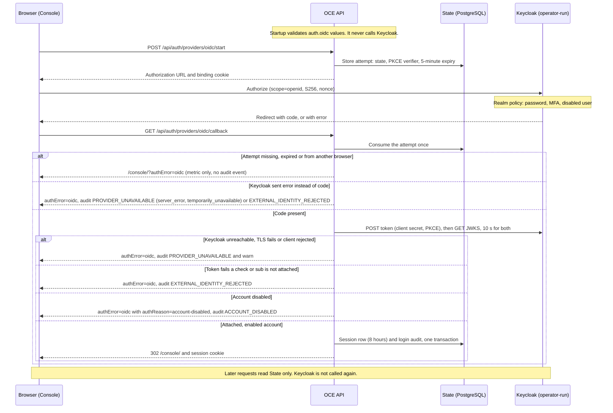
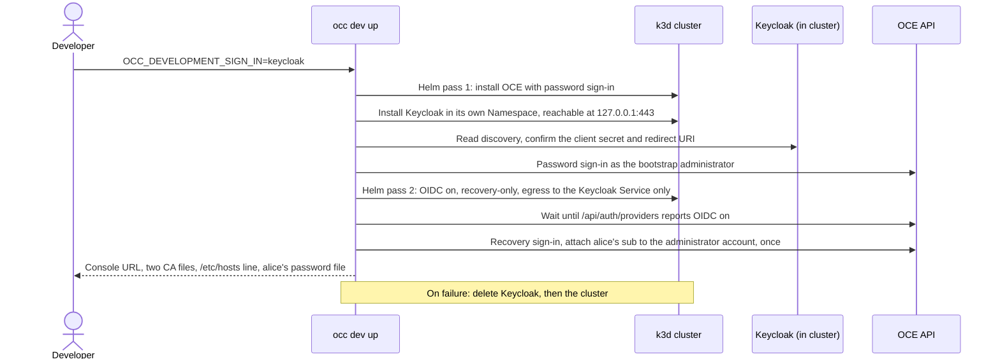

# Proposal: Support Keycloak OIDC sign-in with a guide, real-Keycloak CI and a local profile

- **ID:** RFC-0019
- **Created:** 2026-10-03
- **Last updated:** 2026-10-13
- **RFC PR:** [#1117](https://github.com/openclaw/openclaw-enterprise/pull/1117)
- **Implementation plan:** none; delivery is tracked [below](#delivery-and-verification)
- **Related:** [RFC-0001](0001-oidc-sign-in.md) (generic OIDC sign-in,
  [#790](https://github.com/openclaw/openclaw-enterprise/pull/790));
  [Keycloak operator guide](../../docs/guides/deploy/oidc-keycloak.md);
  [Keycloak CI job](../../docs/testing/keycloak.md); local profile
  [#1137](https://github.com/openclaw/openclaw-enterprise/pull/1137) and
  [#1138](https://github.com/openclaw/openclaw-enterprise/pull/1138) (open); private CA
  [#1774](https://github.com/openclaw/openclaw-enterprise/pull/1774) (draft)

## Summary

OCE already signs people in through Keycloak, using the generic `oidc` provider from RFC-0001.
There is no Keycloak-specific sign-in code on `main`, and this RFC adds none. It proposes how
OCE supports Keycloak around that provider:

1. **An operator guide (merged 2026-10-09).** How to connect OCE to a Keycloak the operator
   runs, and what OCE does when keys rotate, Keycloak is down, or someone leaves.
2. **A CI job against real Keycloak (merged, not yet required).** The `keycloak-oidc` job signs
   in through a real, digest-pinned Keycloak instead of the `fakeOidc` test fixture. It is not
   yet in `CI Required`, the check a PR must pass to merge.
3. **An opt-in local Keycloak (proposed in #1137 and #1138).** `occ dev up`, OCE's Local Setup
   command, can run Keycloak inside the developer's k3d cluster.

Keycloak must present a certificate that Node already trusts. Private certificate authority
(CA) support is a separate change (#1774), needed before OCE 1.0.

@freeqaz accepted this scope on 2026-10-09 (relayed in
[this comment](https://github.com/openclaw/openclaw-enterprise/pull/1117#issuecomment-6086953202)).
That acceptance does not cover production use. Reviewers are asked to accept this scope, the
proposed rule for when `keycloak-oidc` joins `CI Required`, and the rule that production
Keycloak stays not qualified until a human maintainer, who may be the author, reviews a
recorded walk-through. An agent may run and record the walk-through but cannot sign it off. See [Delivery and verification](#delivery-and-verification) and
[Unresolved questions](#unresolved-questions).

## Motivation

Before the `keycloak-oidc` job, every automated OIDC test ran against `fakeOidc`, a test
fixture that imitates an identity provider (IdP) the way OCE expects one to behave. That proves
OCE against its own reading of OIDC, not against a real IdP. Manual Keycloak checks during #790
and on our shared internal test install found two gaps the fixture could not: a provider outage
left no operational log ([#806](https://github.com/openclaw/openclaw-enterprise/pull/806)), and
an in-cluster Keycloak on a port other than 443 needed a NetworkPolicy the guide did not mention
([#903](https://github.com/openclaw/openclaw-enterprise/pull/903)). Neither manual setup was
saved in the repository, and no developer could run a real IdP locally.

## Goals

- An operator can connect OCE to their Keycloak from one guide, which also says what OCE does
  during rotation, outage and offboarding (the
  [Keycloak operator guide](../../docs/guides/deploy/oidc-keycloak.md)).
- CI runs browser sign-in, token exchange and key rotation against a real Keycloak on every
  push to `main` (the `keycloak-oidc` job).
- A developer can opt in to a local Keycloak with `occ dev up` (#1137 and #1138, once landed).

## Non-goals

This RFC does not install or manage Keycloak.

RFC-0001 sets the following limits, and this RFC keeps them:

- OCE never creates an account at sign-in; an administrator attaches a Keycloak user to an
  existing account.
- OCE reads only the token's `sub`, never email, groups or roles.
- OCE does not refresh or store Keycloak tokens, sign people out of Keycloak, or learn when
  Keycloak disables a user.
- One issuer, RS256 signatures only, port 443 only.
- Service keys and Agent credentials are unchanged.

## Proposal

### How production sign-in works

This is RFC-0001's flow, already on `main`, with Keycloak as the provider. Keycloak checks who
the person is. OCE's access rules (IAM) decide what their account can do. The API is the
`controller` service; State is OCE's PostgreSQL database.

The issuer, authorization, token and key-set (JWKS) URLs are Helm values copied from
Keycloak's discovery document; a bad value fails Helm rendering or API startup. A Keycloak
login slower than 5 minutes, for example a slow MFA step, fails at the callback.
The token check requires the exact issuer, the client ID as the only audience, an RS256
signature from a key of at least 2,048 bits, and this attempt's nonce.

### What the operator provides

The [Keycloak operator guide](../../docs/guides/deploy/oidc-keycloak.md) owns the steps.

| Item        | Requirement                                                                                                                                  |
| ----------- | -------------------------------------------------------------------------------------------------------------------------------------------- |
| Keycloak    | Operator-run, production mode, persistent database, stable HTTPS hostname on 443, certificate in Node's default trust store.                 |
| Client      | Confidential, standard flow only, PKCE `S256`, one exact redirect URI `<auth.baseUrl>/api/auth/providers/oidc/callback`, no audience mapper. |
| URLs        | Issuer written exactly as `iss`, without a port. Authorization, token and JWKS URLs on the issuer's host.                                    |
| Secrets     | Client ID and secret in a dedicated Secret (default `occ-oidc-login`).                                                                       |
| Recovery    | `auth.recoveryUserId` names an existing account that signs in with a password.                                                               |
| OCE profile | One API replica with `strategy: Recreate`, PostgreSQL State, HTTPS `auth.baseUrl`, `agentNativeAdmin.enabled: false`.                        |
| Proxy       | `api.trustedProxy` set when an ingress fronts the API; without it the chart only warns.                                                      |
| Egress      | The chart's NetworkPolicy allows TCP 443 to Keycloak.                                                                                        |

Limits behind those rows:

- Turn OIDC on by upgrading an installed release: the chart refuses `auth.oidc.enabled`
  without `auth.recoveryUserId`.
- One replica, because sign-in limits and session admission live in the API process.
- Empty `egressCidrs` allows any address except `169.254.0.0/16`. A Keycloak on a Pod port
  other than 443 needs an operator-written NetworkPolicy (#903).

### Operating it

The [rotation and outage procedure](../../docs/guides/deploy/oidc-sign-in.md#changes-rotation-and-outages)
owns the steps. The behavior behind them:

- **Keycloak down.** OCE redirects to `/console/?authError=oidc`, audits
  `PROVIDER_UNAVAILABLE`, and logs
  `authentication.provider-unavailable-warning` with the failed step and cause (for example
  `connect_refused`, `tls`, `timeout`, `client_rejected`). Existing sessions and the recovery
  password keep working; neither contacts Keycloak.
- **Signing-key rotation.** Add the new key in Keycloak. The API fetches the JWKS on every
  callback, uncached, so no restart is needed. A token signed by a removed key is refused.
- **Client-secret rotation.** The API reads the secret only at startup. Stop the API
  ([stopped maintenance](../../docs/guides/deploy/auth-maintenance.md)), replace the secret in
  Keycloak and in the Kubernetes Secret, then start the API; until then every sign-in fails as
  `client_rejected`. Accounts stay attached: the provider instance ID is
  `sha256(issuer, clientId)` and excludes the secret.
- **Issuer or client-ID change.** This is a new provider instance: every attachment stops
  matching, and every OIDC session ends on its next request, audited
  `authentication.session.end` with reason `PROVIDER_NOT_CONFIGURED`. An administrator
  re-attaches every person and detaches the old methods.
- **Offboarding.** Disabling the user in Keycloak blocks the next sign-in but leaves an OCE
  session alive for up to 8 hours; disabling the OCE account ends every session at once.
  Service keys outlive both detaching and disabling, so revoke them separately.
- **Removing OIDC.** If it is the only external provider, the API refuses to start until
  `pnpm auth:maintain deactivate` runs with every State writer stopped.

### CI coverage

The `keycloak-oidc` job (a lane, in this repository's CI vocabulary) runs the production API in
a host process, behind an HTTPS test ingress, against Keycloak `26.7.5` pinned by digest in
[`tests/fixtures/keycloak/image.json`](../../tests/fixtures/keycloak/image.json). Headless
Chromium fills Keycloak's real login form.

The job takes about 75 seconds. It runs on pull requests in full mode, on every push to `main`
and in the manual Full Integration `all` run. It first ran on `main` on 2026-10-09; the
question below proposes when it joins `CI Required`.

The realm has two users: `alice` is attached to an OCE account and `carol` is not. The job
checks ([full list](../../docs/testing/keycloak.md#verified-flows)):

- Discovery and JWKS shape.
- `alice` signs in with `client_secret_post` and with `client_secret_basic`.
- A new signing key works without an API restart.
- `carol` is refused and audited as `EXTERNAL_IDENTITY_REJECTED`.
- Sign-out, then one-click sign-in again.
- A user disabled in Keycloak stops at Keycloak and never reaches the callback.

These cases still run only against `fakeOidc`, in `CI Required`: wrong issuer, extra audience,
bad nonce, expired token, unknown key ID, short key, an unreachable or untrusted endpoint,
client-secret rotation, the 8-hour session limit, an API restart, and sessions ending after an
issuer change, detach or disable.

The job uses `start-dev`, a file database, a per-run private CA and a loopback hostname, in a
container on the host. It does not qualify a production Keycloak.

### Local Keycloak profile (proposed)

#1137 and #1138 let a developer set `OCC_DEVELOPMENT_SIGN_IN=keycloak` to run Keycloak inside
their local k3d cluster. The flow below is proposed, from #1138 head `d5368cf7e`; none of it is
on `main`. The browser sign-in that follows it is the production flow above.

What differs from the default local profile:

- The profile needs Kubernetes compute and control plane,
  `OCC_DEVELOPMENT_SANDBOX_DRIVER=none`, a free `127.0.0.1:443` and a cluster created with the
  `127.0.0.1:443:30443@loadbalancer` port map; otherwise `occ dev up` refuses to start.
- Keycloak runs `start-dev` with `KC_DB=dev-file` on a 1 Gi PVC, so the realm survives Pod
  restarts. A changed realm fixture needs `occ dev down` and `up`.
- Keycloak is `https://keycloak.<cluster>.oce.test` on its own Envoy Gateway at host port 443.
  Its certificate comes from the chart's routing CA, which the API already trusts through
  `NODE_EXTRA_CA_CERTS`; #1774 is not needed here.
- The second Helm pass sets `auth.passwordSignIn: recovery-only`, limits API egress to the
  Keycloak Service addresses, and turns native Agent administration off, because the chart
  refuses OIDC while it is on. The attach call is never retried: attaching ends that account's
  sessions.
- The browser needs two CAs, `browser-ca.crt` for the Console and `gateway-ca.crt` for
  Keycloak, plus an `/etc/hosts` line. Automated runs make Chromium trust the two server
  certificates directly, so they do not prove that a person's CA import works.
- After a failed cluster delete, the launcher keeps local state so `occ dev down` can finish.

### Private CA

`main` has no `auth.oidc` CA value, and the API Deployment sets `NODE_EXTRA_CA_CERTS` only to
the Gateway CA. The API code already honors
that variable: the CI job and the local profile both pass a private CA through it. What is
missing is a chart value an operator can set. Until then, a Keycloak with a private CA needs a
post-renderer or a forked chart, and every callback fails as `PROVIDER_UNAVAILABLE` with
`cause: tls` until the API trusts the CA.

#1774 (draft) adds `auth.oidc.caSecretName` and `caSecretKey`, and an init container that
merges the Keycloak and Gateway roots into one bundle. Its open review findings are tracked on
that PR. It is required before 1.0 and is not part of this RFC.

## Delivery and verification

State on 2026-10-13:

- **CI job and guide (#1133 to #1136): merged 2026-10-09.**
  [Run 37980297660](https://github.com/openclaw/openclaw-enterprise/actions/runs/37980297660)
  passed 6 of 6 with cleanup. Every completed `Keycloak OIDC` job on `main` has passed: 160
  through 2026-10-13 (18 more were cancelled by later pushes).
- **Local Keycloak profile (#1137, #1138): open.** #1138 conflicts with `main` in two docs and
  one CI suite file. The manual `dev-up-k3d` job passed 6 of 6 at head
  `4eadb978` ([run 37796527211](https://github.com/openclaw/openclaw-enterprise/actions/runs/37796527211));
  nothing has run on the current head.
- **Manual local check: not done.** A person imports the two CAs, adds the hosts line and signs
  in through a browser on a developer host. Proposed: @freeqaz or a named maintainer does this
  and records the result on #1138 before #1137 and #1138 land.
- **Private CA (#1774): draft**, with open review findings.
- **Production qualification: not done.** It needs a production-mode Keycloak with a
  persistent database and real TLS, an installed OCE, and a recorded test of attaching a user,
  refusing an unattached user, an outage, both rotations, an API restart and offboarding.
  A human maintainer, who may be the author, reviews the recording; production stays not
  qualified until then.

## Rationale and alternatives

**Keep only the fake provider.** Cheapest, but it did not find #806 or #903; a manual Keycloak
check did. Rejected.

**A separate job rather than extending `postgres-auth`.** The Keycloak image is about 450 MB
and takes 20 to 50 seconds to start. `postgres-auth` also replaces `globalThis.fetch` with a
mock, so a Keycloak test there would never make a real HTTP call.

**A k3d chart-topology job** is the most faithful proof but costs about ten minutes per run.
Deferred; the local profile gives the same topology on demand once it lands.

**Rejected:** a user namespace for the CI network (`unshare -rn`), because Ubuntu 24.04
runners restrict it; `.localhost` names for the local profile, because inside a Pod they resolve
to the Pod itself; Testcontainers, because it hides the digest pin.

**Costs that stay:** about 1 GB of memory, login-form selectors tied to the pinned version, and
loopback 443 contention between the CI job and the local profile.

## Unresolved questions

These need a maintainer's decision. Each row gives the author's proposed answer.

| Question                                                                                           | Owner       | Proposed answer                                                                                                                                                                                                               |
| -------------------------------------------------------------------------------------------------- | ----------- | ----------------------------------------------------------------------------------------------------------------------------------------------------------------------------------------------------------------------------- |
| When does `keycloak-oidc` join `CI Required`?                                                      | @freeqaz    | After two weeks green on `main` with no infrastructure failures (about 2026-10-23): add a row to the CI Impact lane table and the lane to the `ci` group.                                                                     |
| Keycloak version policy                                                                            | maintainers | Pin 26.x by digest. On each bump, recheck the login-form selectors and run Full Integration `openshell` by hand: its refresh proof shares the image pin ([#2013](https://github.com/openclaw/openclaw-enterprise/pull/2013)). |
| A permanent k3d chart-topology job?                                                                | maintainers | Not now. Revisit after #1137 and #1138 land.                                                                                                                                                                                  |
| Should our shared internal test install keep OIDC on, which turns native Agent administration off? | @freeqaz    | No. Run OIDC on a dedicated persona cluster. Revisit when native Agent administration works with host-only cookies.                                                                                                           |

## References

[RFC-0001](0001-oidc-sign-in.md) owns the generic contract: configuration, endpoint trust,
ID-token checks, attach semantics and routes. Current behavior:
[Keycloak operator guide](../../docs/guides/deploy/oidc-keycloak.md),
[OIDC sign-in guide](../../docs/guides/deploy/oidc-sign-in.md),
[external sign-in reference](../../docs/reference/authentication/external-sign-in.md),
[stopped maintenance](../../docs/guides/deploy/auth-maintenance.md),
[Keycloak CI job](../../docs/testing/keycloak.md). Source:
[`auth/oidc.ts`](../../apps/controller/src/auth/oidc.ts),
[`auth/id-token.ts`](../../apps/controller/src/auth/id-token.ts) and
[`auth/github.ts`](../../apps/controller/src/auth/github.ts) (shared routes).
