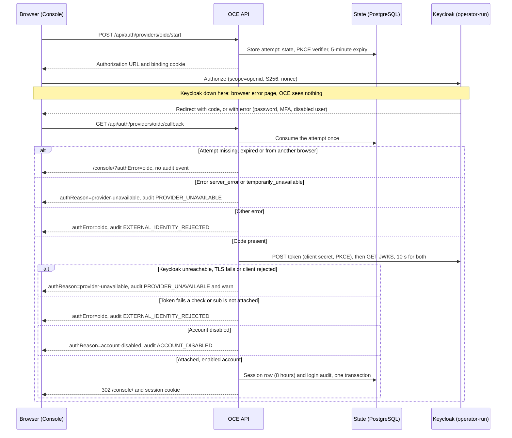
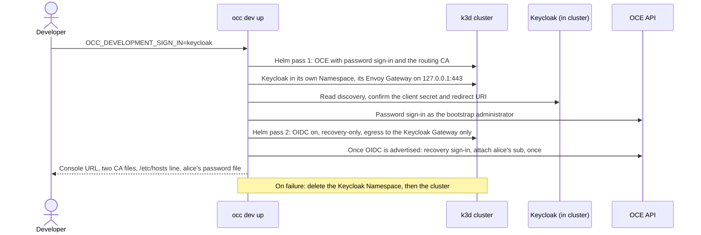

# Proposal: Support Keycloak OIDC sign-in with a guide, real-Keycloak CI and a local profile

- **ID:** RFC-0019
- **Created:** 2026-10-03
- **Last updated:** 2026-10-13
- **RFC PR:** [#1117](https://github.com/openclaw/openclaw-enterprise/pull/1117)
- **Implementation plan:** none; delivery is tracked [below](#delivery-and-verification)
- **Related:** [RFC-0001](0001-oidc-sign-in.md) (generic OIDC sign-in,
  [#790](https://github.com/openclaw/openclaw-enterprise/pull/790));
  [Keycloak operator guide](../../docs/guides/deploy/oidc-keycloak.md);
  [OIDC operations](../../docs/guides/deploy/oidc-operations.md);
  [Keycloak CI job](../../docs/testing/keycloak.md); PRs
  [#2286](https://github.com/openclaw/openclaw-enterprise/pull/2286),
  [#1137](https://github.com/openclaw/openclaw-enterprise/pull/1137),
  [#1138](https://github.com/openclaw/openclaw-enterprise/pull/1138),
  [#1774](https://github.com/openclaw/openclaw-enterprise/pull/1774)

## Summary

OCE already signs people in through Keycloak, using the generic `oidc` provider from RFC-0001.
There is no Keycloak-specific sign-in code on `main`, and this RFC adds none. All four
supporting parts are on `main` as of 2026-10-13:

1. **An operator guide (2026-10-09)**, plus an
   [operations page](../../docs/guides/deploy/oidc-operations.md) (#2291) for rotation,
   outages, offboarding and the audit record.
2. **A CI job against a real, digest-pinned Keycloak**, merged 2026-10-09 and, since #2286
   (2026-10-13), part of `CI Required`, the check a PR must pass to merge.
3. **An opt-in local Keycloak** (#1137, #1138) inside the developer's k3d cluster, from
   `occ dev up`, the Local Setup command.
4. **A private certificate authority (CA)** for Keycloak (#1774).

@freeqaz accepted this scope on 2026-10-09
([comment](https://github.com/openclaw/openclaw-enterprise/pull/1117#issuecomment-6086953202))
and decided the open questions on 2026-10-13 ([below](#resolved-questions)). Reviewers are
asked to accept this record of those decisions, and the rule that production Keycloak stays
not qualified until a human maintainer, who may be the author, reviews the recorded
walk-through; an agent may record it but not sign it off.

## Motivation

Before the `keycloak-oidc` job, every automated OIDC test ran against `fakeOidc`, a test
fixture that imitates an identity provider (IdP) the way OCE expects one to behave. That proves
OCE against its own reading of OIDC, not against a real IdP. Manual Keycloak checks during #790
found two gaps the fixture could not: a provider outage left no operational log
([#806](https://github.com/openclaw/openclaw-enterprise/pull/806)), and an in-cluster Keycloak
on a port other than 443 needed an undocumented NetworkPolicy
([#903](https://github.com/openclaw/openclaw-enterprise/pull/903)). Neither setup was saved,
and no developer could run a real IdP locally. A later qualification report identified
another outage-message gap, fixed in #2291.

## Goals

- An operator connects OCE to their Keycloak from one guide, which also covers rotation,
  outage and offboarding.
- CI runs browser sign-in, token exchange and key rotation against a real Keycloak on every
  push to `main` and every full-mode pull request, and gates merging on it.
- A developer can opt in to a local Keycloak with `occ dev up`.
- A private-CA Keycloak works through chart values, with the IdP root kept to the API.

## Non-goals

This RFC does not install or manage Keycloak. RFC-0001's limits stay: no account creation at
sign-in (an administrator attaches a Keycloak user to an existing account); only the token's
`sub` is read, never email, groups or roles; no token refresh or storage, no Keycloak sign-out,
no awareness of a Keycloak disable; one issuer, RS256 only, port 443 only; service keys and
Agent credentials unchanged.

## Proposal

### How production sign-in works

This is RFC-0001's flow with Keycloak as the provider. Keycloak authenticates the person;
OCE access rules (IAM) authorize their account. The API is the `controller` service;
State is OCE's PostgreSQL database.

The issuer, authorization, token and key-set (JWKS) URLs are Helm values copied from
Keycloak's discovery document; a bad value fails Helm rendering or API startup, and startup
never calls Keycloak. A login slower than 5 minutes fails at the callback. The token check
requires the exact issuer, the client ID as the only audience, an RS256 signature from a key
of at least 2,048 bits, and this attempt's nonce. Every `authReason` above comes with
`authError=oidc`; a failure in OCE's own State or audit store gives `authReason=unavailable`.
Later requests read State only.

### What the operator provides

The [Keycloak operator guide](../../docs/guides/deploy/oidc-keycloak.md) owns the steps.

| Item        | Requirement                                                                                                                                                   |
| ----------- | ------------------------------------------------------------------------------------------------------------------------------------------------------------- |
| Keycloak    | Operator-run, production mode, persistent database, stable HTTPS hostname on 443, certificate from a public root or a private CA given to the chart.          |
| Client      | Confidential, standard flow only, PKCE `S256`, one exact redirect URI `<auth.baseUrl>/api/auth/providers/oidc/callback`, no audience mapper.                  |
| URLs        | Issuer written exactly as `iss`, without a port. Authorization, token and JWKS URLs on the issuer's host.                                                     |
| Secrets     | Client ID and secret in a dedicated Secret (default `occ-oidc-login`).                                                                                        |
| Recovery    | `auth.recoveryUserId` names an existing account that signs in with a password.                                                                                |
| OCE profile | One API replica with `strategy: Recreate`, PostgreSQL State, HTTPS `auth.baseUrl`, `agentNativeAdmin.enabled: false`.                                         |
| Proxy       | `api.trustedProxy` when an HTTP proxy fronts the API. The chart only warns (by design, #695); without it the API answers forwarded requests 403 and logs why. |

Behind those rows: the chart refuses `auth.oidc.enabled` without `auth.recoveryUserId`, so
OIDC is turned on by upgrading an installed release; sign-in limits and session admission live
in the API process, hence one replica; the chart's NetworkPolicy allows TCP 443 to Keycloak,
where empty `egressCidrs` means any address except `169.254.0.0/16`, and a Keycloak on another
Pod port needs an operator-written NetworkPolicy (#903).

### Operating it

The [operations page](../../docs/guides/deploy/oidc-operations.md) owns the steps.
Implemented behavior:

- **Keycloak down.** Two shapes. Down before the person reaches it, the common case: the
  browser stops on its own error page and OCE writes nothing. Failing after the person left
  it, or unreachable from the API: the API waits up to 10 seconds, returns the browser to
  `authReason=provider-unavailable`, audits `PROVIDER_UNAVAILABLE` and logs
  `authentication.provider-unavailable-warning` with the step
  and cause (`timeout`, `connect_refused`, `tls`, `client_rejected`). Sessions and the
  recovery password keep working.
- **Signing-key rotation.** Add the new key in Keycloak. The API fetches the JWKS on every
  callback, uncached, so no restart is needed. A token signed by a removed key is refused.
- **Client-secret rotation.** The API reads the secret only at startup and derives nothing
  durable from it, so rotation is one online API restart: new secret in Keycloak, replace the
  Secret in place, `rollout restart`. The API returns `503` while its Pod is replaced;
  sign-in can fail with `client_rejected` until the API loads the new secret.
  The worker keeps running, sessions survive, and accounts stay attached: the provider instance
  ID is `sha256(issuer, clientId)` and excludes the secret.
- **Issuer or client-ID change.** A new provider instance: every attachment stops matching,
  and every OIDC session ends on its next request (`authentication.session.end`, reason
  `PROVIDER_NOT_CONFIGURED`). An administrator re-attaches everyone and detaches the old
  methods.
- **Offboarding.** Sessions have a fixed 8-hour lifetime, and a person may hold several.
  Disabling the user in Keycloak blocks the next sign-in but leaves every session alive;
  disabling the OCE account ends them all at once, with one `authentication.account.disable`
  audit row. Service keys outlive both; revoke them separately.

### CI coverage

The `keycloak-oidc` job (a lane) runs the production API in a host process, behind an HTTPS
test ingress, against Keycloak `26.7.5` pinned by digest in
[`tests/fixtures/keycloak/image.json`](../../tests/fixtures/keycloak/image.json). Headless
Chromium fills Keycloak's real login form.

Since #2286 it is a row in the CI Impact lane table and in the `ci` group, so `CI Required`
gates it through the `pr-safe` matrix and the result aggregator. It runs in full mode, on
every push to `main`, merge-queue (`merge_group`) runs, tests mode when its test file changes,
and Full Integration `all`; documentation-only runs skip it.

The realm has two users, `alice` (attached to an OCE account) and `carol` (not). The job
checks ([full list](../../docs/testing/keycloak.md#verified-flows)) discovery and JWKS shape;
`alice` signing in with `client_secret_post` and with `client_secret_basic`; a new signing key
without an API restart; `carol` refused and audited `EXTERNAL_IDENTITY_REJECTED`; sign-out,
then one-click sign-in again; and a user disabled in Keycloak stopping there, never reaching
the callback.

The `fakeOidc` suites in `CI Required` still own the negative cases: bad issuer, audience,
nonce, expiry and keys, untrusted endpoints, secret rotation, the 8-hour limit, an API restart
and session ending. The job itself uses `start-dev`, a file database and a per-run private CA
in a host container; it does not qualify a production Keycloak.

### Local Keycloak profile

#1137 installs Keycloak and #1138 wires sign-in to it. A developer sets
`OCC_DEVELOPMENT_SIGN_IN=keycloak` to run Keycloak inside their local k3d cluster. The
browser sign-in that follows is the production flow above.

What differs from the default local profile:

- It needs Kubernetes compute and control plane, `OCC_DEVELOPMENT_SANDBOX_DRIVER=none` and a
  free `127.0.0.1:443`, mapped to the cluster as `127.0.0.1:443:30443@loadbalancer`; otherwise
  `occ dev up` refuses to start. Any listener on 443, including a wildcard bind, blocks it,
  and another port is not an option: the chart and the API refuse an issuer with a port.
- Keycloak runs `start-dev` with `KC_DB=dev-file` on a 1 Gi volume, so the realm survives Pod
  restarts. It is `https://keycloak.<cluster>.oce.test`, with a certificate from the chart's
  routing CA, which the API already trusts through `NODE_EXTRA_CA_CERTS`; the #1774 values are
  not needed.
- The second Helm pass sets `auth.passwordSignIn: recovery-only`, limits API egress to the
  Keycloak Envoy Gateway Service's ClusterIP plus its Pods on the post-DNAT port 10443, and
  turns native Agent administration off, as the chart requires. The attach call is never
  retried: attaching ends that account's sessions.
- The browser needs two CAs, `browser-ca.crt` for the Console and `gateway-ca.crt` for
  Keycloak, plus an `/etc/hosts` line. The `dev-up-k3d` test imports the two printed files
  into a fresh NSS database and maps only the printed hosts line, with no certificate bypass;
  it does not touch a real `/etc/hosts` or a person's browser profile.

### Private CA

#1774 adds `auth.oidc.caSecretName` and `caSecretKey`, set together, naming a Secret of PEM CA
certificates. It may share the public trust bundle Secret of `gatewayRouting.caSecretName`,
never a credential Secret or the database CA Secret. The opt-in also requires
`database.caSecretName` and a database URL with `sslmode=verify-full`, an explicit
`sslrootcert` and a DNS host; a preload refuses to start otherwise, so IdP trust never widens
database trust.

An init container, `assemble-api-ca`, validates and merges the IdP and Gateway bundles into
`/etc/openclaw/api-extra-ca/ca.crt`, the API's `NODE_EXTRA_CA_CERTS`. Workers
and Jobs are unchanged; Harness (Agent) Pods receive only the Gateway CA through
`OCC_GATEWAY_CA_PATH`. A new versioned Secret replaces the API Pod; an in-place Secret edit
needs `rollout restart`, because the init container runs once per Pod. Leaf renewal under the
same CA needs nothing.

Without the values, every callback to a private-CA Keycloak fails as `PROVIDER_UNAVAILABLE`,
`cause: tls`. Before #1774 the only chart-level route was an external Gateway issuer's
`gatewayRouting.caSecretName` bundle, which also reaches workers.

## Delivery and verification

State on 2026-10-13, all on `main`:

- **CI job and guide (#1133 to #1136): merged 2026-10-09.** `keycloak-oidc` required since
  #2286 (`5bfd8b43d`, 2026-10-13).
- **Operations page and outage message: #2291 (`fc05015c8`).** Client-secret rotation became
  one online restart after review confirmed the secret is read only at startup.
- **Forwarded-request diagnosis: #2287 (`41ebd3826`)**, logged as
  `authentication.forwarded-refused-warning`.
- **Local Keycloak profile: #1137 (`6becd3a8e`) and #1138 (`b1695fd2a`).** Follow-up
  #2356 tested administrator mutations and revoked-session denial. At its head `0f2bde92`,
  `dev-up-k3d` passed all six cases, without skips, and cleanup passed
  ([run 38455655121](https://github.com/openclaw/openclaw-enterprise/actions/runs/38455655121)).
  On macOS 26.7.1 ARM64, Docker Desktop 4.94.0 ran `0232c95a`. After user-approved hosts
  and CA trust setup, an agent verified Alice’s Keycloak login and administrator recovery login
  in fresh Chrome 156 Incognito. Both origins showed secure connections, without warning
  bypasses.
- **Private CA: #1774 (`cb63275da`).** The reported production-shaped check covers 9 of 9
  cases, including a negative control, both rotation paths and Agent Pods receiving only the
  Gateway CA; this RFC has no reviewer-accessible recording to verify that report.
  [#2294](https://github.com/openclaw/openclaw-enterprise/pull/2294) (`8a117c842`) merged the
  follow-up CA error messages and guide corrections.
- **Production qualification: unverified; human sign-off pending.** The 2026-10-13 report
  describes production-mode Keycloak 26.7.5 on PostgreSQL, private-CA TLS and the real OCE
  chart, exercising attachment, unattached-user denial, outage, both rotations, API restart
  and offboarding. No recording is linked in PR #1117. Provide a reviewer-accessible
  recording of those checks before a human maintainer, who may be the author, signs off.
  An agent-operated local walkthrough cannot supply that sign-off.

## Rationale and alternatives

**Keep only the fake provider.** Cheapest, but it did not find #806, #903 or finding 1193; a
manual Keycloak check did.

**A separate job rather than extending `postgres-auth`.** The Keycloak image is about 450 MB
and takes 20 to 50 seconds to start, and `postgres-auth` mocks `globalThis.fetch`, so a
Keycloak test there would never make a real HTTP call.

**A k3d chart-topology job** is the most faithful proof but costs about ten minutes per run;
see below.

**Rejected:** a user namespace for the CI network (`unshare -rn`), which Ubuntu 24.04 runners
restrict; `.localhost` names for the local profile, which resolve to the Pod itself inside a
Pod; Testcontainers, which hides the digest pin.

**Costs that stay:** about 1 GB of memory, login-form selectors tied to the pinned version, a
lane flake now blocks merges, and both the CI job and the local profile need `127.0.0.1:443`
free.

## Resolved questions

@freeqaz decided these on 2026-10-13.

| Question                                                                                           | Decision                                                                                                                                                                                                                                                  |
| -------------------------------------------------------------------------------------------------- | --------------------------------------------------------------------------------------------------------------------------------------------------------------------------------------------------------------------------------------------------------- |
| When does `keycloak-oidc` join `CI Required`?                                                      | As soon as it is validated, solid and not slow, not after a fixed soak. Done in #2286.                                                                                                                                                                    |
| Keycloak version policy                                                                            | Pin 26.x by digest, one shared pin in `image.json`. On each bump, recheck the login-form selectors and run Full Integration `openshell` by hand, whose refresh proof shares the pin ([#2013](https://github.com/openclaw/openclaw-enterprise/pull/2013)). |
| A permanent k3d chart-topology job?                                                                | No per-PR job. Coverage comes from the manual `dev-up-k3d` Keycloak case and from the persona cluster `oce-dogfood-b`: the real chart against production-mode Keycloak on a private CA.                                                                   |
| Should our shared internal test install keep OIDC on, which turns native Agent administration off? | No. OIDC runs on `oce-dogfood-b`. Revisit when native Agent administration works with host-only cookies.                                                                                                                                                  |

## References

[RFC-0001](0001-oidc-sign-in.md) owns the generic contract: configuration, endpoint trust,
ID-token checks, attach semantics and routes. Current behavior:
[Keycloak operator guide](../../docs/guides/deploy/oidc-keycloak.md),
[OIDC sign-in guide](../../docs/guides/deploy/oidc-sign-in.md) (including
[private IdP CA](../../docs/guides/deploy/oidc-sign-in.md#trust-a-private-idp-ca)),
[OIDC operations](../../docs/guides/deploy/oidc-operations.md),
[external sign-in reference](../../docs/reference/authentication/external-sign-in.md),
[stopped maintenance](../../docs/guides/deploy/auth-maintenance.md),
[Keycloak CI job](../../docs/testing/keycloak.md). Source:
[`auth/oidc.ts`](../../apps/controller/src/auth/oidc.ts),
[`auth/id-token.ts`](../../apps/controller/src/auth/id-token.ts),
[`auth/github.ts`](../../apps/controller/src/auth/github.ts),
[`assemble-api-ca.mjs`](../../deploy/helm/openclaw-enterprise/files/assemble-api-ca.mjs) and
[`check-api-database-ca.mjs`](../../deploy/helm/openclaw-enterprise/files/check-api-database-ca.mjs).
