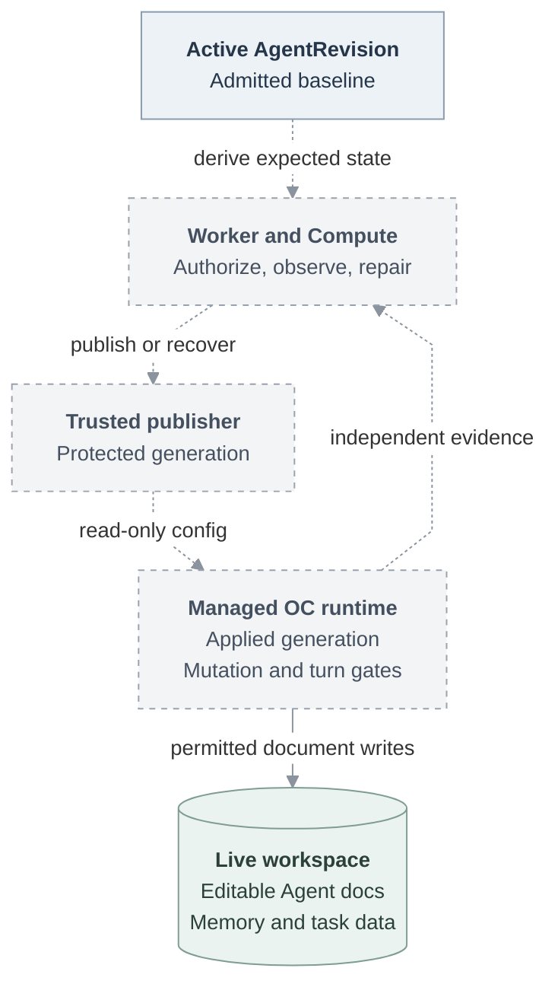

# Proposal: Protect OCE-managed OpenClaw runtime state

- **ID:** RFC-0019
- **Created:** 2026-10-13
- **Last updated:** 2026-10-13
- **Related:** [Agent access](0010-agent-access.md), [storage ownership](0003-gateway-harness-storage-split.md), [plugin policies](0014-plugin-policy-enforcement.md)

## Summary

OpenClaw Enterprise (OCE) should own the configuration, native agent roster,
Gateway plugin selections, and runtime version of each managed deployment.
OpenClaw Control Plane (OCC) admits changes through its existing resource and
deployment APIs. Model turns and native administration cannot change this
managed state. Compute publishes protected effective configuration, and the
existing worker observes and repairs confirmed drift against the active
AgentRevision. Agent documents remain editable; their management is a separate
decision.

This proposal narrows the full native administration exception described by
RFC-0010. It preserves RFC-0003's live workspace ownership. Neither historical
document is rewritten by this draft.

## Motivation and investigation

Source reviewed: OCE `4cb3db1a8655cabc2da445d47582da34efe046f9`, with OpenClaw
runtime pin `90d30a1178a79dddd92e6190b66b95d89dfb3ca8`.

| Current behavior                                                                   | Gap                                                                                                       |
| ---------------------------------------------------------------------------------- | --------------------------------------------------------------------------------------------------------- |
| Dedicated Codex with a workspace node excludes Gateway-local and management tools. | Other harness/topology paths do not have a uniform managed-state contract.                                |
| Native admin grants the shared identity `operator.admin`.                          | OCC checks entry and session retention, then relays native commands without individual mutation checks.   |
| The source ConfigMap is immutable; startup can create a writable effective copy.   | Native edits can survive same-Pod restarts. Pod recreation restores config but preserves persistent data. |
| Worker maintenance re-applies infrastructure and checks readiness.                 | It does not compare live configuration or native roster with desired state.                               |

These findings come from the [Gateway entrypoint](../../apps/controller/src/drivers/compute/kubernetes/runtime-entrypoints.ts),
[native admin contract](../../docs/reference/agent-native-admin.md),
[managed configuration lifecycle](../../docs/reference/drivers/kubernetes-compute/storage-and-credentials.md#managed-native-configuration),
and [worker](../../apps/controller/src/worker.ts).
For example, changing native `gateway.bind` to loopback can leave loopback
readiness healthy while external access fails. A reconciliation poll alone
cannot prevent the intervening unauthorized behavior.

## Goals and boundaries

- Deny managed mutations through model tools, native UI/RPCs, and exposed CLI,
  file, or shell operations; retain permitted workspace execution.
- Detect and recover confirmed drift, including when native listener/auth changes
  make its administration API unreachable.
- Preserve admitted multi-agent rosters, documents, conversations, credentials,
  device state, memory, skills, and task data during recovery.

Document locking/reconciliation, full workspace synchronization, adopting native
edits into OCC, granular native human roles, and general isolation from a
compromised host or trusted Gateway plugin are outside this proposal. An OCE
Agent is a deployment/trust domain, not necessarily one native `main` agent.
Session creation and subagent work within the admitted roster remain permitted.

## Proposal

### Ownership and enforcement

The active immutable AgentRevision supplies the baseline, including admitted
plugin selections and the complete native roster. Compute owns runtime-specific
overlays and the selected image/version. An undeployed Configuration or Agent
draft never becomes a repair target. Runtime-generated node bindings, plugin
artifacts, and peer credentials remain subordinate to that revision.

Managed mode is host-controlled and mandatory for an OCE deployment claiming
this contract. It cannot be disabled through native configuration or a human's
`operator.admin` scope. OC must reject configuration/roster writes and
unapproved Gateway plugin management or package updates at their mutation
owners, before side effects. A refused combined config/document operation must
leave both unchanged; document-only writes remain available.

Reuse OC's existing [config-write guard](https://github.com/openclaw/openclaw/blob/90d30a1178a79dddd92e6190b66b95d89dfb3ca8/src/config/config-write-guard.ts)
for managed Gateway execution. Separately enforce plugin and update ownership:
config immutability does not prohibit every reload or lifecycle effect.
Suppress prohibited management tools across supported harnesses, including
resumed and delegated turns. Tool visibility and approval do not grant mutation
authority. Safe reads can remain available.

### Publish protected effective configuration

Compute must protect the effective file and its publication directory from the
model execution principal. A read-only environment flag or mode bit on a file
owned by that principal is insufficient: shell/file tools could replace it or
change permissions.

Only the trusted OCE publisher may construct and atomically publish an effective
generation. Gateway/execution processes receive read-only access. Reuse existing
rendering and startup owners for plugin installation, provider transport,
workspace-node binding, and peer rotation; retain their native application
acknowledgements. Do not disable trusted publication by applying the immutable
flag indiscriminately to startup helpers.

A Driver/runtime must establish both API enforcement and filesystem/execution
containment before activation. Unsupported paths fail admission explicitly;
they cannot silently run with weaker protection. Kubernetes publication and
embedded native execution need qualification before this invariant is claimed.
Native plugin code remains trusted inside the Gateway process.

### Observe and repair through Compute

Extend the existing [Compute readiness contract](../../packages/contracts/src/index.ts)
with bounded managed-state evidence: exact revision/runtime identity, expected
baseline identity/digest and applied generation, observation time, drift category, and repair
outcome. Never expose config values, credentials, or document contents.
Enable the existing `maintenanceIntervalMs` path for supported managed runtimes;
add no second scheduler or desired-state store.

Compute compares expected effective state using the same admitted inputs and
owned transforms used for publication. It must account for generated values
without ignoring arbitrary extra keys or agents. Version/plugin observations
must reflect the loaded binary/artifacts, not only their requested labels.
Native application acknowledgement is required: matching disk bytes or a Ready
Pod alone does not establish convergence.

For Kubernetes, extend the independent wrapper status readback, which already
pins revision, Pod UID, and container identity. Its status endpoint must remain
independent of mutable native listener/auth settings and protected from model
execution. OC must expose or acknowledge its actually applied generation;
qualifying that upstream interface is a prerequisite, not an existing guarantee.

Confirmed drift closes new native turn admission, including channel-origin
turns, and marks readiness unready. Compute restores the same admitted baseline,
through protected publication or an identity-guarded workload replacement, then
reopens admission only after observing application. Removing an OCC route alone
does not block turns inside OC. Retain persistent claims and runtime data; never
use ordinary native `agents.delete` as drift cleanup, because it can purge
session/workspace state. Unadmitted artifacts remain for explicit operator
cleanup.

### Authority and failure

Reuse current claim fencing, original-deployer reauthorization, and stop/newer
revision checks. Repair must pin the affected runtime and use UID/resource-version
preconditions; a stale worker cannot repair a successor. Lost claims cancel
cooperative work but cannot retract an already-dispatched external mutation.
After an uncertain reply, observe that exact operation/target before retrying.

Authorization loss blocks repair and must become visible. This proposal grants
no new system authority to bypass revocation; recovery requires a currently
authorized OCE deployment/operator action. Runtime-local prevention and a
previously confirmed drift gate continue even if worker repair is unavailable.

Timeouts, dependency failures, and missing replacement Pods mean observation is
unavailable, not confirmed drift. Preserve the last confirmed mismatch until
positive convergence; do not repeatedly reset state because an API timed out.
Polling cadence is a detection target, not a guaranteed repair deadline.

If version drift advanced persistent database schemas beyond the admitted
image's compatibility, recovery stays blocked with turn admission closed. An
operator must resolve compatibility explicitly; automatic repair must not
downgrade databases, restore backups, or delete state to obtain convergence.

The following joins are proposed. Existing components are named for ownership;
the dashed arrows do not imply implemented enforcement.

### Preserve document ownership

`AGENTS.md`, `SOUL.md`, `IDENTITY.md`, and `USER.md` remain live workspace
documents. Agents may update them through permitted file tools, and authorized
people may use existing OCE/native file APIs. Creation inputs still initialize
once; they are not a perpetual baseline. This RFC adds no desired-document
storage, overwrite policy, or reconciliation. Identity/document writes must
remain distinguishable from changes to admitted roster metadata.

## Delivery and verification

Write a separate implementation plan after review. The connected result needs
OC mutation enforcement/application evidence, Compute publication and containment,
and worker observation/recovery. Existing runtime integration suites should prove:

1. Owner chat and native UI/RPC config, roster, plugin, and update mutations are
   refused before effects; denied operations do not change live or saved state.
2. Real file/shell operations cannot overwrite, rename, unlink, or chmod managed
   configuration, even after clearing environment flags or invoking a CLI.
3. Trusted startup, node/peer changes, and explicit OCE redeployment still apply;
   fresh/resumed turns and admitted multi-agent rosters continue working.
4. Controlled privileged drift is detected and repaired with native RPC broken;
   channel turns remain gated until application is acknowledged.
5. Documents remain editable and survive recovery. Conversations, credentials,
   memory, skills, and other runtime data are retained.
6. Stop, successor deployment, actor revocation, lease loss, unavailable status,
   and uncertain repair replies cannot produce stale repair or false convergence.
   Incompatible state after version drift blocks recovery without data rollback.

Existing [native-admin coverage](../../tests/integration/native-admin-k3d-real.test.mjs)
checks redeploy config reset and document preservation; it does not establish
this proposed prevention/repair contract. Source investigation is complete for
this draft; no new live-runtime proof has run.

## Rationale and alternatives

Keeping full native administration retains the documented drift gap. Filtering
tools alone leaves UI/RPC and filesystem paths. Reconciliation alone permits
unauthorized effects before repair and cannot reverse disclosures or destructive
cleanup. Prevention plus recovery uses OCC's existing owners while preserving
authorable runtime data. Editing a mirrored native config as desired state would
create competing authority; admitted OCE deployment remains the change path.

## Decisions for review

- **OC/Compute maintainers:** qualify protected publication, applied-generation
  evidence, and turn admission for each supported topology. Unsupported paths
  must fail before activation.
- **OCE/IAM maintainers:** decide whether future repair should survive original
  deployer revocation under explicit service authority. This draft preserves
  current authorization and reports repair blocked.
- **OCE operators/maintainers:** choose polling/retry budgets and treatment of
  already-running runtimes pending explicit redeployment. No controller restart
  alone is evidence that an existing instance has adopted enforcement.

## References

- [Authoritative architecture](../../docs/design.md)
- [Compute maintenance contract](../../docs/reference/drivers/compute.md)
- [Controller reconciliation](../../docs/reference/controller/reconciliation.md)
- [Live workspace file contract](../../docs/reference/agents.md#live-file-access)
- [Runtime pin](../../deploy/runtime/Dockerfile)
