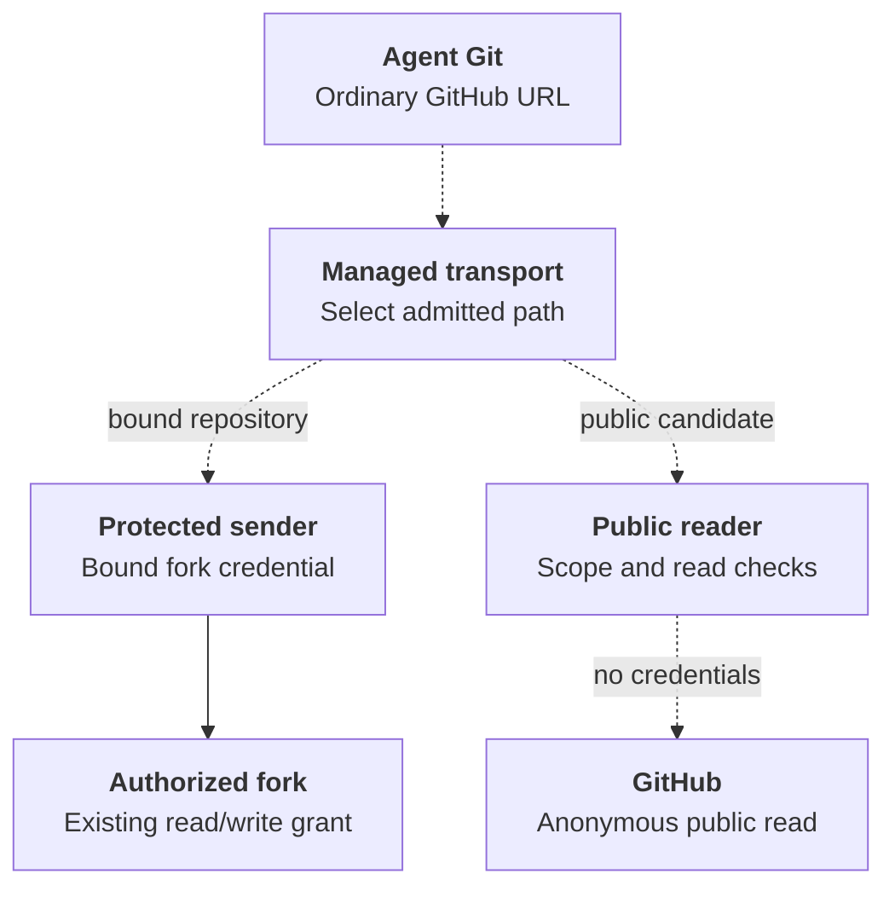

# RFC-0020: Read known public GitHub repositories without a credential

Let an operator install an internal public reader and let a dedicated Agent
revision explicitly select it. An Agent can then inspect a known public pull
request, for example, without provisioning a GitHub App or repository binding.
This complements [RFC-0008's managed repository access](0008-repository-credentials/index.md);
that decision continues to own private access and contribution.

## Trust and lifetime

- **Installation.** The operator enables a private, credential-free reader and
  reserves its Service address through the retirement of every revision that
  selects it. The reader makes bounded GET requests only to the fixed GitHub API
  origin, forwards no caller headers, and stores no completed response. GitHub
  decides public visibility on each read. Provider failures, including pagination
  that cannot be completed within the reader's bounds, must be visible to the Agent.
- **Revision.** An ordinary dedicated Codex revision must explicitly allow that
  Service IP in its native proxy. Compute withholds both the discoverable skill
  and the exact private egress peer when a deny could cover the address. Each
  revision owns its grant through preparation and activation; stop or retirement
  removes only that revision's policy after its Pods terminate. There is no
  reason to enable broader local binding for this path.
- **Caller.** The private HTTP path exposes repository and file names to that
  network. Kubernetes policy constrains which managed Pods can reach the reader;
  the reader authenticates no person, Agent, or tenant. GitHub sees an anonymous
  request, and its quota is shared at the egress address. This is suitable for
  public data, not an authorization contract for managed repositories.

Review the new listener and provider I/O boundary with its security owner, and
qualify an actual Agent read as specified in the [implementation plan](../plans/0020-anonymous-public-github-reads.md).

## Proposed extension: public Git alongside protected Git

An Agent must be able to run `git clone https://github.com/example/public.git`
and later `git fetch` without installing an App in the upstream organization.
The same Agent must retain its separately authorized fork reads and writes.
Clone commands and saved remote URLs use ordinary GitHub HTTPS URLs. A managed
transport helper can route a public read internally; callers do not need a
reader-specific URL or command. The extension remains proposed; implementation
is in progress in PR #4505 and installed-runtime qualification is pending.

### Decision and scope

Extend the existing credential-free reader with Git smart HTTP and compose its
service access with protected, dedicated Codex repository execution. Keep
ordinary Codex selection supported. Public visibility comes from an anonymous
GitHub request, not from an App token, a cached visibility flag, or a successful
credentialed response.

The operator explicitly chooses the Installation-wide ceiling:

- **All public repositories:** allow public reads for any GitHub owner/repository.
- **Repository list:** allow reads only for configured, canonical
  `owner/repository` names that GitHub also serves anonymously. An empty list
  denies all repositories; it never means all public repositories.

Each Agent separately selects no access, all public repositories, or a repository
list. Omission and an empty list grant no access. An Agent's effective access is
the intersection of its selection and the Installation ceiling, limited to
repositories GitHub serves anonymously. Selecting all public repositories cannot
exceed an Installation list. For example, with an Installation ceiling of
`example/library` and `example/tools`, an Agent selecting only `example/library`
cannot read `example/tools`; another Agent can independently select both.

The reader enforces both policies on every Git and API request. The feature is
off until the operator enables it, and enabling it grants no Agent access by
default. Changing the Installation list governs subsequent requests. An Agent
policy change takes effect through deployment of a new revision; it does not
silently rewrite an existing revision's selection. Withdrawing an old revision's
reader authorization denies its subsequent requests. Removing a repository does
not erase content already cloned or interrupt a transfer already authorized.

Initial Git support covers HTTPS smart-protocol discovery and upload-pack,
including shallow clone and incremental fetch. It excludes receive-pack, pushes,
SSH, LFS, archives and arbitrary HTTP proxying. Existing public API reads remain
available under the same service ceiling. Upstream PR/issue writes, managed grant
renewal and replacement of the Credential Proxy's authenticated sender remain
outside scope.

Public-reader access has its own revision selection and does not inherit the
App grant's deadline. Expiring or rotating a fork credential must not widen the
reader's scope or remove an independently selected public-read path. Other
Credential Proxy admission restrictions remain unchanged.

### Ownership and admission

The [shared protected-network contract](0023-egress-proxy-credential-lifecycle/contracts.md#qualified-service-access-under-protection)
owns service acknowledgement and the frozen snapshot. This RFC owns public-reader
scope, capability handling and Git routing. A qualified external-destination
catalog can reuse that contract with separate destination and IAM qualification.

Kubernetes Compute owns the reader's configured peer, Agent selection, managed
runtime files and Kubernetes policy. Extend its Driver contract with a pure
service-access contribution derived from the original source Configuration,
before Sandbox normalization removes the native Codex proxy settings. Add an
explicit per-Agent public-read policy through Driver-owned configuration; a
native proxy allow for the reader address alone no longer grants access. An
absent selection or a covering network deny selects nothing. A request cannot
supply a different service peer. Admission validates and canonicalizes the
selection and records its repository scope with the revision.

OCC supplies its runtime-owned Installation ID to `admitServiceAccess` alongside
that Configuration and Harness. Compute freezes this identity in the service
descriptor for registry ownership. The startup file must not supply or rename
that identity; retain its existing recursive Installation-ID rejection. Profile
and Helm inputs can use the actual ID to initialize the registry's owner label,
but the renderer must omit it from Compute startup configuration.

Sandbox owns enforcement around the Harness. Replace artifact-only protected
policy admission with an explicit protected-network admission that can acknowledge
the existing artifact map and approved credential-free services. Freeze the
acknowledged service descriptors with the Sandbox policy in the Agent revision.
Descriptors identify the Driver-owned service, exact endpoint, named rules and
normalized public-read selection; they contain no credentials. OCC validates the
contract acknowledgement and saves it without interpreting GitHub or OpenShell
policy syntax. Unsupported
Driver combinations refuse admission rather than enable ordinary network access.

The OpenShell adapter installs an inspected rule for the internal reader endpoint
and its supported methods. The Credential Proxy independently checks the frozen
policy before release. Keep the existing GitHub middleware as the sole direct
route to GitHub, retain the empty per-Agent additions requirement, and preserve
the workload-to-supervisor fence. Only trusted supervisors receive the additional
Kubernetes route to the reader. Do not give protected workload Pods a direct
reader or Internet egress allowance.

An old revision without this service descriptor gains no reader skill, transport
helper or network rule when an operator enables the service. Preparation,
activation, worker restart, withdrawal and retirement use the revision's recorded
selection. A changed or missing peer must withdraw its access and observe the
affected Harness stopped before reporting withdrawal complete. Retain the
reserved Service address until the selecting revisions have retired.

### Authenticate the revision at the reader

The original anonymous internal listener cannot enforce per-Agent scope. Replace
that trust boundary for this extension: all supported callers, including ordinary
Codex Agents, must authenticate to the reader with a narrowly scoped, unforgeable
service capability issued by Compute for one Installation, Agent and revision.
This capability authorizes only the frozen public-read selection; it is not a
GitHub credential or general platform identity. It cannot authorize a different
revision or service. Existing revisions gain no capability automatically.
Use certificate-verified TLS for the internal reader connection and project its
trust through the selected Drivers; do not send a service capability over the
original plaintext HTTP listener or disable certificate verification.

The reader verifies that capability and the revision's current authorization
before provider I/O, then applies the current Installation ceiling. Reject
missing, invalid, withdrawn or unverifiable authorization without contacting
GitHub. Do not trust a caller-supplied Agent ID, repository list, source IP or the
managed Git helper as authority. There is no anonymous alternate listener for
Git or API reads that could bypass these checks. Network policy remains an
additional restriction, not the source of Agent identity.

Compute owns capability issuance, protected projection, rotation and withdrawal;
the reader owns verification. The implementation plan must choose the capability
format and the durable publication and verification of revision authorization.
Neither reader nor controller restart may restore withdrawn access. Rotation
must preserve the same scope, and stale or unavailable authorization must fail
closed. Compute automatically renews access material while the revision remains
authorized; its expiry must not require routine Agent redeployment. Recheck each
caller's authorization before joining a shared provider read. Never log the
capability, store it in a saved Git remote URL, or forward it to GitHub. This adds internal
service authentication, not the deferred general Agent Identity component.

### Ordinary URLs and credential separation

Deliver a managed `git-remote-https` adapter through the existing read-only
runtime-file mechanism. Git invokes its standard HTTPS remote helper for ordinary
URLs; the adapter delegates to the image's real Git HTTP transport with inherited
stdin/stdout, cancellation and exit status. It does not implement Git's object
protocol or install a machine-wide Git configuration.

For a repository in the revision's authenticated binding set, delegate the
original URL to the existing protected path. Match repository identity with the
same canonicalization as that path. Otherwise, route an eligible GitHub HTTPS
repository URL through the credential-free reader. A denial, missing repository,
timeout or visibility change never falls back to an authenticated request.
Preserve the image's other Git helpers and existing credential-helper settings;
refuse a conflicting managed-helper configuration. A failure must not turn into
an unfiltered direct connection. Bypassing the client adapter still reaches the
unchanged protected GitHub middleware, which refuses unbound repositories.

The transport adapter provides compatibility, not authority. The reader receives
no App key, installation token or Kubernetes service-account token. It forwards
no caller Authorization, cookies, proxy credentials or arbitrary headers to
GitHub. Even a caller that supplies credentials must not obtain private content
through this service. Authenticated fork traffic never uses the reader, and
reader requests never use the App's credential source.

### Git request and failure contract

Accept only canonical repository paths under the configured public-read endpoint:
`GET .../info/refs?service=git-upload-pack` and `POST .../git-upload-pack`.
Validate method, path, query, content type, encoding and request-size limits
before provider I/O. A POST to upload-pack is a Git read; accepting it does not
permit arbitrary POSTs. Reject receive-pack discovery and upload, malformed
paths, unsupported operations and repositories outside either allowed scope.

Send requests only to the fixed GitHub HTTPS origin with certificate verification.
Follow no redirects. A private/missing repository or a renamed destination cannot
trigger credential selection or a different destination. Stream pack responses
with backpressure instead of retaining complete packs in memory. Give Git
transfers a 4 MiB encoded request-body limit, a 1 GiB response limit and a
10-minute transfer deadline, separate from the existing inline-file API limits.
On overflow, cancellation, timeout or incomplete transfer, terminate the
stream so Git reports failure; never report a truncated pack as success. Retain
the provider slot until upstream work has stopped, including client disconnects.
Helm and profile inputs must restrict reader egress to approved HTTPS destination
ranges for both `github.com` Git traffic and `api.github.com` API traffic.

Quota and concurrent-read limits remain service-wide and per observed caller
address. In protected execution that address can belong to a supervisor; do not
claim per-Agent or per-tenant fairness where the topology shares an address.
Report GitHub failures and retry delays without retaining partial responses or
request headers in logs.

### Proposed request paths

Dashed connections below are proposed. The authenticated path already exists.

### Delivery and required evidence

Submit this amendment before changing the Driver contracts. The
[implementation plan](../plans/0051-protected-public-github-git.md) must connect the contract, paired Drivers, reader, runtime adapter, Helm and
profile inputs, current references and the existing public-read flow. Preserve
the original plan's ordinary-reader qualification record.

Require real Git clone and incremental fetch against a controlled TLS provider
backed by a real Git repository. Verify normal HTTPS URLs and stored remotes,
both scope modes and their intersections, case normalization, absence of
forwarded credentials, private visibility changes, write denial, redirect refusal,
cancellation, size/time limits and incomplete transfers. Exercise the regular OCE Agent deployment path
with the paired Sandbox and Credential Proxy: public object transfer and existing
fork read/write must coexist, unbound private access must fail, and the model
path must remain usable. Register that scenario in the QA matrix and verify
selection, revision replacement, cold recovery and retirement without skips.
Use two Agents with different selections to prove that a direct reader request
cannot access the other Agent's additional repositories. Cover omitted and empty
selections, all-public selection under a narrow Installation ceiling, forged or
missing capabilities, Git and API bypass attempts, capability rotation and
withdrawal, Installation narrowing, reader/controller restart, and unavailable
authorization. Include fork-token rotation and expiry while an independently
selected public clone/fetch path remains usable.
Controlled-provider proof does not establish live GitHub behavior; record the
live anonymous GitHub check and installed OpenShell qualification separately.
