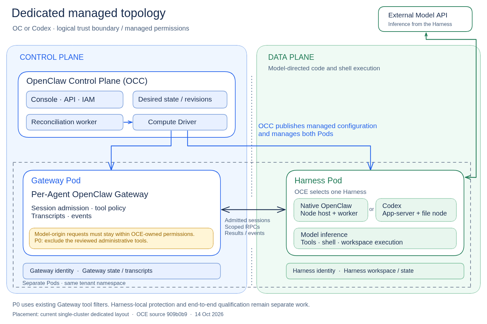

# RFC-0021: Runtime contract for OCE-managed deployments

> This working draft proposes separate boundaries for model-directed work and direct
> human Gateway administration. Findings describe inspected sources; proposed behavior
> and remaining qualification work are identified separately.

**Implementation:** P0 draft; local OC/Codex qualification passes; CI pending.

- **Created:** 2026-10-13
- **Last updated:** 2026-10-23
- **RFC PR:** [#2367](https://github.com/openclaw/openclaw-enterprise/pull/2367)
- **Related:** [Agent access](../0010-agent-access.md), [storage ownership](../0003-gateway-harness-storage-split.md), [plugin policies](../0014-plugin-policy-enforcement.md)

## Summary

OpenClaw Enterprise is an agent deployment platform where OCE admins define the desired configuration of an Agent and deploy it, similar to Kubernetes. The [OpenClaw Control Plane (OCC)](https://github.com/openclaw/openclaw-enterprise/blob/fdd4a5850d9687f3ee0bad2e5e44f156760bbafc/docs/design.md#L11) owns desired state and deployment lifecycle.

OCE has swappable Drivers and a choice of first-party Harness: native OpenClaw or Codex. Both runtimes expose native configuration and administration paths. In dedicated deployments, the Harness and model-written code must run in a separate data-plane workload from the Gateway. Trusted Gateway handlers execute approved tool and RPC operations in the Gateway workload. The Gateway provides a restricted coordination boundary under OCC management; OCE's trusted control plane remains the authority for deployment configuration and lifecycle.

To preserve OCE's ownership of deployment configuration and lifecycle, Gateway calls made by model-directed work must not override OCE-owned configuration or permissions. The same requirement applies to model-origin CLI commands, file changes and plugin operations. A separate default-on OCE deployment setting governs [direct human Gateway administration](gateway-administration.md).

### Dedicated topology: OC or Codex

[Editable Excalidraw source](dedicated-managed-topology.excalidraw). Open the file in Excalidraw to edit the diagram.

Sources: [Harness placement and execution](https://github.com/openclaw/openclaw-enterprise/blob/909b0b9d45c10a40e42ef31d1e53cea6cd846cf5/docs/reference/harness-execution.md#L16), [Gateway/Harness transport](https://github.com/openclaw/openclaw-enterprise/blob/909b0b9d45c10a40e42ef31d1e53cea6cd846cf5/docs/reference/gateway-routing.md#L79).

## OpenClaw Harness vs Codex

OCE owns deployment configuration and lifecycle for both Harnesses. The difference is where native session state lives and where restrictions must be enforced.

**Codex:** Codex app-server owns native execution threads inside the Harness workload. The Gateway coordinates those threads, maintains OC Agent/session state, and supplies Gateway tools. OCE-managed deployments need restrictions on those tools and protection for Codex's local configuration and administrative interfaces.

**OpenClaw:** The Gateway owns OC sessions and assigns execution to a dedicated worker. It can enforce restrictions on model-accessible tools and RPCs outside the Harness workload. The worker's local configuration, credentials and processes still need separate protection.

## Gateway RPC categories

These categories group Gateway RPCs by the resources and permissions they affect. They describe the broader boundary for model-directed work; inclusion in the table does not mean the Harness can invoke every listed RPC. P0 uses the proposed Gateway tool allowlist, action filtering and automation controls below. Direct human administration follows Gateway permissions and managed-mode restrictions.

| Category                                  | What it affects                                                                                        | Representative OC Gateway calls                                                                                           | Managed boundary to establish                                                                                                                                           |
| ----------------------------------------- | ------------------------------------------------------------------------------------------------------ | ------------------------------------------------------------------------------------------------------------------------- | ----------------------------------------------------------------------------------------------------------------------------------------------------------------------- |
| **Observation and discovery**             | Reads health, configuration, history, and available capabilities.                                      | `health`, `config.get`, `models.list`, `sessions.list`                                                                    | Read access stays scoped to the Agent/session and redacts secrets.                                                                                                      |
| **Task and session operations**           | Runs work, creates task state, changes session options, or schedules work.                             | `chat.send`, `sessions.create`, `sessions.patch`, `node.invoke`, `cron.add`, `cron.run`                                   | Work stays within admitted models, tools, workspaces, execution locations, and limits. A session or transient subagent is distinct from deploying a new Agent.          |
| **Deployment configuration and topology** | Changes settings, routing, or the persistent agent roster that define how the deployment runs.         | `config.set`, `config.patch`, `config.apply`, `agents.create`, `agents.update`, `agents.delete`                           | OCE publishes managed configuration and roster changes. A bounded session option differs from changing the configured default.                                          |
| **Runtime and software lifecycle**        | Changes the deployed runtime process, installed runtime code, loaded extensions, or service ownership. | `update.run`, `gateway.restart.request`, `gateway.stop.request`, `plugins.install`, `plugins.uninstall`, `plugins.reload` | OCE owns deployed runtime software and service lifecycle. Any delegated recovery action needs explicit bounds; task cancellation is separate from stopping the runtime. |
| **Authority, trust, and credentials**     | Changes trusted callers/nodes, permissions, approval policy, or credential bindings.                   | `device.pair.approve`, `exec.approvals.set`, `exec.approval.resolve`, `models.authSetApiKey`, `models.authRefresh`        | OCE owns standing authority and credential bindings. Refreshing an approved credential and resolving a bounded approval differ from granting new authority.             |

## OCE-managed deployment boundary

OCE owns the deployed Agent's configuration and permission limits. The Harness executes model-directed work within those limits. OCE-managed deployments must prevent that work from changing the deployment configuration, credentials, installed capabilities and runtime processes that determine its authority.

This boundary applies to both dedicated OC and dedicated Codex. **P0 restricts model-directed work to an explicit Gateway tool allowlist**, including administrator-started chats, children and scheduled jobs. Harness-local configuration, credentials and processes need separate runtime protection; Gateway filtering does not establish the complete managed-runtime guarantee. Automatic drift repair remains separate.

Normal work remains useful: scoped reads and tool discovery, session metadata and history, permitted session model/thinking choices, child tasks, session messaging, ordinary scheduled Agent turns, and shell/file work inside the Harness's execution boundary. The full managed-runtime contract must prevent model-directed work from changing deployed defaults, persistent Agent definitions, plugins, standing permissions, credential bindings or the deployed runtime lifecycle. P0 restricts Gateway-provided capabilities; Harness-local protection and end-to-end qualification remain separate work. Cancelling a task is different from stopping the runtime; creating a child task is different from deploying an Agent. Agent document content remains out of scope.

Item 9 tracks end-to-end qualification.

### Gateway tool policy

**OCE installs the revision's Gateway tool policy on every dedicated OC and Codex deployment.** By default, managed mode blocks local configuration edits. With managed mode off, an authorized Gateway admin can edit the local allowlist. A native Gateway restart activates that edit for subsequent model turns. Redeploying with managed mode on restores the policy saved in OCE.

OC checks the tool and action allowlist after Agent and plugin grants and again at invocation. Stricter restrictions still apply. An empty allowlist withholds Gateway task tools.

The initial baseline retains scoped task, session and observation tools. The concrete names and action sets are listed in [the proposed initial allowlist](remaining-work.md#initial-gateway-tool-allowlist). See [example OCE-generated Gateway configurations](remaining-work.md#example-oce-generated-gateway-configurations) for OC and Codex. Approved plugin task tools can be added by concrete identity; loading a plugin does not grant its tools automatically. The administrative tools `gateway`, `plugins`, `openclaw`, `nodes`, `terminal` and `secrets` are not included.

Discovery and invocation helpers expose only the permitted catalog. `tool_search`, `tool_describe`, `tool_call` and Code Mode cannot recover an unapproved tool or action. Ordinary shell/file work remains within the Harness's execution boundary.

Keep `agents.defaults.modelSelectionScope: "session"` so session model choices do not become deployed defaults. This setting also applies to the human model picker.

Set `cron.triggers.enabled: false` to disable stream schedules, condition triggers and cron script payloads. This applies to human-created and model-created jobs. Ordinary timed Agent turns remain available; model-directed command jobs require the separate P0 automation restriction.

**The Gateway tool policy governs model-directed work.** Direct human Console, CLI and RPC actions retain their existing authorization and, when enabled, managed-mode restrictions. An administrator asking the Agent to act remains subject to the Gateway tool policy.

#### Tools, plugins and administration

A tool is an operation the model can request. OC provides core tools and loads plugins that can contribute additional tools. A plugin is extension code; it can also provide hooks, services and Gateway handlers. The Gateway tool policy controls model tool calls, not all behavior of loaded plugin code.

Here, **OC plugins** means the extensions shown in the Gateway's Plugins page. The model tool named `plugins` administers those extensions. It is separate from the task tools they contribute and from Codex apps or integrations connected through a ChatGPT account. [Plugin tool](https://github.com/openclaw/openclaw/blob/90d30a1178a79dddd92e6190b66b95d89dfb3ca8/src/agents/tools/plugins-tool.ts#L75), [plugin API](https://github.com/openclaw/openclaw/blob/90d30a1178a79dddd92e6190b66b95d89dfb3ca8/src/plugins/plugin-api.types.ts#L225).

The human column below describes existing Gateway-authorized administration with managed mode off. The model allowlist does not grant or remove human permissions.

| Resource                                             | Where OCE configures it                                                                                      | What humans can change directly in OC                                                                                       | When OCE configuration must change                                                                                              |
| ---------------------------------------------------- | ------------------------------------------------------------------------------------------------------------ | --------------------------------------------------------------------------------------------------------------------------- | ------------------------------------------------------------------------------------------------------------------------------- |
| Gateway model tools                                  | The proposed required policy in generated Gateway configuration.                                             | An authorized Gateway admin can edit the local allowlist. Agent turns use the active list.                                  | To persist a tool or action grant across deployments. Loading a plugin alone cannot grant it.                                   |
| Deployment defaults, Agent definitions and lifecycle | OCE Agent/deployment configuration, rendered into Gateway configuration and workload settings.               | Existing authorized configuration, Agent and lifecycle actions remain available.                                            | To change OCE's desired state. Local edits do not update it; automatic drift repair remains separate.                           |
| OC plugin packages                                   | OCE plugin selection/configuration, rendered through `plugins.allow` and `plugins.entries`.                  | Existing authorized plugin installation, activation and configuration remain available.                                     | To change deployed plugin selection or approve its model tools. P0 adds no separate OCE approval gate to human plugin controls. |
| Session choices and schedules                        | Gateway session defaults, including `modelSelectionScope`, cron settings and the proposed automation policy. | Permitted session choices and ordinary schedules remain available. Disabled scripting/stream triggers also apply to humans. | To change deployment limits. Ordinary session use and scheduling need no allowlist edit.                                        |
| Codex native tools, apps and MCP                     | Separate Harness configuration and requirements; outside this Gateway tool policy.                           | Existing native controls apply; no new Gateway UI controls are proposed.                                                    | Through separate Harness policy when changing native capabilities; not through the Gateway tool allowlist.                      |

`plugins.allow` and `plugins.entries` configure OC plugin loading. Ordinary `tools.allow`, `tools.alsoAllow` and `tools.deny` influence model tool access. They are distinct from the proposed required allowlist: current OCE composition adds plugin grants to `tools.allow`, so another ordinary overlay would not enforce the limit. OC must intersect the final tool surface with OCE's approved list. [Current merge behavior](https://github.com/openclaw/openclaw-enterprise/blob/04514330688378316bd0641b8d5560da56aeff85/tests/conformance/plugin-runtime-policy.test.mjs#L578).

For example, OCE can load Diffs and approve its `diffs` task tool while leaving the `plugins` administration tool unavailable to the model. A human enabling another plugin does not automatically grant the model its tools; an authorized OCE administrator must add those tool identities/actions to OCE configuration. Config-mutating plugin administration is subject to managed mode.

### Dedicated OpenClaw implementation

The Gateway owns OC sessions and assigns work to the dedicated worker. Its node identity does not grant general operator configuration RPCs. OC should apply the required allowlist before issuing Gateway tool handles and enforce permitted actions when invoked. Preserve approved worker-local coding tools and existing child permission/placement checks. [Worker preparation](https://github.com/openclaw/openclaw/blob/90d30a1178a79dddd92e6190b66b95d89dfb3ca8/src/gateway/worker-environments/worker-turn-execution.ts#L379), [handle invocation](https://github.com/openclaw/openclaw/blob/90d30a1178a79dddd92e6190b66b95d89dfb3ca8/src/gateway/worker-environments/worker-gateway-tool-runtime.ts#L168).

**OCE work:** automatically publish the baseline and explicitly approved task-tool additions. Keep Gateway administration credentials outside model execution.

**OC work:** add the required Gateway tool allowlist and action/automation enforcement. Reuse existing filtering machinery while keeping the OCE limit separate from additive tool grants.

### Dedicated Codex implementation

Codex combines its native tools with Gateway-supplied dynamic tools. OC's adapter must apply the same Gateway tool allowlist to both the advertised schemas and the executable callback map. Native Codex coding tools and subagents remain governed by their existing policies. [Adapter inputs](https://github.com/openclaw/openclaw/blob/90d30a1178a79dddd92e6190b66b95d89dfb3ca8/extensions/codex/src/app-server/thread-requests.ts#L151), [callback execution](https://github.com/openclaw/openclaw/blob/90d30a1178a79dddd92e6190b66b95d89dfb3ca8/extensions/codex/src/app-server/dynamic-tools.ts#L376).

**OCE work:** publish the shared baseline and retain existing `codexDynamicToolsExclude` settings that remove Gateway implementations Codex replaces. Exclusion alone is no longer the security policy.

**OC adapter work:** enforce the required allowlist without treating it as a restriction on native Codex tools. An ordinary global `tools.allow` can disable native coding tools and subagents, so it cannot be used unchanged for this Gateway-only policy. [Native policy classification](https://github.com/openclaw/openclaw/blob/90d30a1178a79dddd92e6190b66b95d89dfb3ca8/src/agents/harness/execution-environment.ts#L479).

**Beyond Gateway P0: protect configuration and runtime inputs.** OCE must enforce an execution boundary that protects its configuration, credentials, policy files and trusted processes across presets, authentication methods, approvals and delegated work. The Gateway/Harness Pod split alone does not protect app-server from model commands running inside the Harness workload. Token authentication protects its administrative connection; local files and processes need execution restrictions as well.

**For the full runtime contract, OCE must provision effective managed requirements.** Protect the system policy file, its parent directories and referenced code, and verify the merged requirements actually applied. OCE's inspected launcher publishes user config; it does not yet provision the complete protected requirements policy described here. Requirements constrain supported settings but do not freeze every setting or make privileged client RPCs safe for model use. [Current runtime-file contract](https://github.com/openclaw/openclaw-enterprise/blob/04514330688378316bd0641b8d5560da56aeff85/apps/controller/src/drivers/sandbox/openshell.ts#L596), [requirements composition](https://github.com/openai/codex/blob/a6274249d5877030676db098914db686bab7c921/codex-rs/config/src/requirements_layers/stack.rs#L153).

See [Codex requirements coverage](remaining-work.md#codex-requirements-coverage) for supported fields and remaining limits.

**Codex work:** extend native enforcement only where existing requirements and execution restrictions cannot meet the chosen contract. A client RPC allowlist is not a P0 prerequisite while model execution lacks a usable administrative connection. Native child tasks and trusted Gateway thread start/resume remain available.

### P0 work items

OC enforces the Gateway tool policy; OCE applies its baseline automatically for both dedicated Harnesses. These are proposed requirements; unlisted tools and actions remain unavailable.

| Owner            | Work item                                 | Required result                                                                                                                                                                                                                                                                                                                                                                                                                                                                                   | Completion / PR                                                                                                                                                                                                                |
| ---------------- | ----------------------------------------- | ------------------------------------------------------------------------------------------------------------------------------------------------------------------------------------------------------------------------------------------------------------------------------------------------------------------------------------------------------------------------------------------------------------------------------------------------------------------------------------------------- | ------------------------------------------------------------------------------------------------------------------------------------------------------------------------------------------------------------------------------ |
| OC               | 1. Required tool/action allowlist         | Require explicit tool identities and action sets. An empty list permits nothing. Reject unlisted tools/actions and missing required actions; normalize aliases and retain stricter policy. No wildcard or automatic plugin-wide grants.                                                                                                                                                                                                                                                           | Source merged [OC #174547](https://github.com/openclaw/openclaw/pull/174547) — A                                                                                                                                               |
| OC               | 2. Invocation enforcement                 | Filter schemas and check final arguments before effects. Cover direct calls, deferred discovery, Code Mode, worker handles and catalog refresh. Return a clear policy-denial error.                                                                                                                                                                                                                                                                                                               | Source merged [OC #174547](https://github.com/openclaw/openclaw/pull/174547) — A                                                                                                                                               |
| OC               | 3. Model caller authority                 | Apply restrictions to administrator-started chats, channel-owner conversations, children and scheduled Agent turns. Keep model automation access caller-scoped; direct human administration follows separate controls.                                                                                                                                                                                                                                                                            | Source merged [OC #174580](https://github.com/openclaw/openclaw/pull/174580) — B                                                                                                                                               |
| OC               | 4. Automation command-job protection      | Reject command-job creation, conversion, modification, enablement and triggering by model turns in OCE-managed deployments. Check existing jobs and resulting updates, while preserving ordinary Agent-turn schedules.                                                                                                                                                                                                                                                                            | Source merged [OC #174580](https://github.com/openclaw/openclaw/pull/174580) — B                                                                                                                                               |
| OC Codex adapter | 5. Shared Gateway-tool enforcement        | Carry filtered schemas and guarded executors through dynamic-tool callbacks and restored tools. Preserve native Codex coding tools and subagents; keep existing replacement exclusions alongside the shared allowlist.                                                                                                                                                                                                                                                                            | Source merged [OC #174565](https://github.com/openclaw/openclaw/pull/174565) — C                                                                                                                                               |
| OCE              | 6. Final policy composition               | Automatically publish the baseline, approved task-tool additions and automation policy. Intersect the final tool surface after plugin/Agent grants are composed. Existing stricter policy remains; plugin grants, session overrides and delegated or scheduled work cannot widen the Gateway tool policy. Retain session-only model selection and disabled cron triggers.                                                                                                                         | PR open [OCE #2633](https://github.com/openclaw/openclaw-enterprise/pull/2633) — D                                                                                                                                             |
| OCE              | 7. Supported runtime and effective policy | Package a supporting OC version and validate the effective policy before admitting model work in OCE-managed deployments. Missing, invalid or unsupported restrictions must fail visibly.                                                                                                                                                                                                                                                                                                         | PR open [OCE #2633](https://github.com/openclaw/openclaw-enterprise/pull/2633) — D                                                                                                                                             |
| OC + OCE         | 8. Policy activation and tightening       | Activate changes through Gateway restart or deployment replacement after affected old work ends. Rebuild tool catalogs and callbacks under the new deployment policy.                                                                                                                                                                                                                                                                                                                             | OC source merged in A–C; OCE qualification passes; CI/merge pending in D/E                                                                                                                                                     |
| OC + OCE         | 9. Qualification                          | Verify new tools remain unavailable and plugin grants cannot widen access. Test allowed versus prohibited/missing/unlisted actions on a retained tool, and ordinary schedule updates versus command-job conversion/update/enable/run. Cover both Harnesses and invocation paths, administrator/owner chats, children, session recipients, scheduled execution and refresh/resume. Denied calls leave state unchanged; ordinary tasks, native Codex tools and allowed human admin actions succeed. | Local tests [OCE #2633](https://github.com/openclaw/openclaw-enterprise/pull/2633): OC/Codex cases pass on `d308b55c`, including child/replacement. Codex command-conversion coverage is schema-only; final CI/merges pending. |

Completion follows the [delivery sequence](remaining-work.md#delivery-sequence). “Complete” requires merged code and the listed verification; an open PR is tracked separately.

Action filtering alone cannot distinguish `automations(action="update")` on an Agent-turn schedule from the same action on a command job. The job-specific check is required even when the action is permitted.

No Codex app-server change is established as necessary for this Gateway-facing P0. The Codex integration work belongs in OC's adapter. Harness-local configuration, credentials and process protection remain separate work.

## Remaining work

[Remaining work and verification](remaining-work.md) records the runtime protection, Gateway integration and qualification still needed for this proposal.
