# Strands history policy for protected executions

**RFC-0022** · Builds on [RFC-0021: Credential Proxy](../0021-egress-proxy-credential-lifecycle/index.md) · [Credential Proxy implementation](https://github.com/openclaw/openclaw-enterprise/pull/2487)

## Decision

Let an operator limit what a protected Agent may *attempt next*. Add an optional `strands-box` backend for dedicated executions on an enforcing Kubernetes installation. Strands Box inspects HTTPS; Dogwood may stop a request based on this execution’s earlier attempts. An allow only passes the request to [Credential Proxy](../0021-egress-proxy-credential-lifecycle/protocol.md), which still owns credential access, authority to send, and the reply. Keep the default and OpenShell unchanged.

Suppose an Agent submits a job and loses the reply. A policy can stop another submission inside its time window, even though we cannot tell whether the first succeeded. Count the attempt *before* asking for a credential: a later OCE denial can consume the allowance, as can a real startup model probe. This deliberately favors stopping a duplicate over recovering unused allowance. Operators who need only current authorization do not need Dogwood.

 · [Diagram source](assets/request-path.mmd)

## What we would guarantee

1. **No direct path to the protected provider.** Admit protection explicitly, including zero routes as deny-all. Bind one sender, private persistent history, policy, and release to this execution. Kubernetes, not the Box macOS sandbox, contains the Linux workload. Require enforcing ingress *and* egress, original TLS hostname verification at an operator-admitted address, and a qualified node and metadata boundary. Qualify every node where the workload or its trusted sender can run. A proxy setting or a stored NetworkPolicy is not proof. Never fall back to unprotected execution.
2. **Count an observed attempt, not an inferred effect.** Box presents the method, host, canonical path and body length to Dogwood before sending. This covers inspected HTTPS, not arbitrary file reads or provider effects. Treat host and path as sensitive. Refuse if the attempt cannot be durably decided; an attempt OCE later denies can still count. Isolate executions by private history, not a claimed Agent name. Resume only with the same execution, key and policy; if interception identity changes, fence and re-admit. Trust storage against rollback. Outcome recording can be incomplete; never use it as a provider receipt. A new execution has a new allowance; this is not a cross-execution quota or exactly-once delivery.
3. **Authorize the request we actually send.** On the admitted Responses route, omit Codex’s optional Git workspace telemetry from *both* its body and matching header before immutable capture; reject ambiguous copies. This is not general redaction. The trusted sender must check the exact origin address before dialing and mark a cancelled dial indeterminate. Credential Proxy applies both fresh checks, commits at most one send opportunity, and approves the bounded reply before release. Credential-free operation needs an explicit no-material selection at both checks. A lost reply remains possibly dispatched; neither layer retries it.
4. **Withdraw honestly.** Start with at most one protected binding in a dedicated execution. Stop the sender and confirm workload retirement before dropping its fence or disposing of history. Do not claim IAM denial proves physical withdrawal, or that withdrawal recalls a send already authorized. Where RFC-0021 requires a reducing successor on a *live* execution, keep that operation unavailable until we can prove the exact remaining routes, deny-all after the last route, and no history reset.

## How we would ship it

Review this decision alongside RFC-0021; it neither blocks that RFC nor changes its wire protocol. Prove capabilities at two different times: the actual Strands installation must confirm its supported profile before OCE adopts a protected source; later, authenticate this execution’s sender before release. If Kubernetes networking is healthy but that installation registration is missing or stale, refuse adoption before reading provider material. Discovery is not capability evidence. Propose a small terminal HTTPS exchange hook upstream, after Box policy and with no direct-send fallback, rather than adopting a second credential store. Pin the reviewed Box and engine sources and ship their notices.

Before enabling a placement, demonstrate a real protected deployment, one native startup *and* one user turn, both telemetry locations at the origin, and zero additional provider requests at ordinary maintenance. Separately test a temporal refusal before credential access, direct and neighboring bypass, an additive network grant, missing history, an actual forbidden trailer, uncertain dispatch without replay, and actual fenced retirement. Qualify a separately admitted zero-route execution; do not infer deny-all from IAM denial. Requalify the outgoing tree. A test-signed installation cannot prove ordinary worker release; a controlled origin on one Linux cluster cannot qualify a cloud or a commercial provider.
