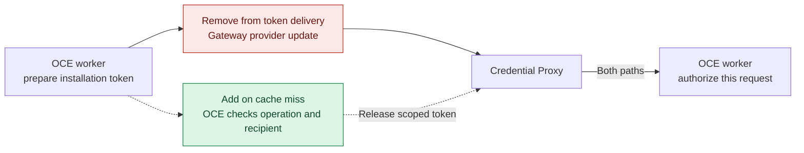

# Design discussion: pulling the Git credential

Could the Credential Proxy fetch a scoped token when the Agent first needs it? This proposed alternative to [online request authorization with installed credentials](online-authorization.md) keeps per-request authorization in OCE. The cold-cache contract remains open.

Today the worker installs the credential through the OpenShell management API. In this proposal the proxy first checks a local allowlist. An unlisted destination stops there. For a listed destination, a cache miss triggers a request for the credential bound to this execution. A hit skips that transfer. Both paths still require a fresh operation decision before the proxy sends.

### What changes for Git?

Red marks the provider update that pull would replace for Git. Green and dashed arrows mark the proposed release check. Sandbox provisioning and other Gateway uses have their own lifecycle.

The open contract question is the first request. Today's `authorize` takes the version already installed at the recipient. Checking the operation **before releasing any token bytes** needs an earlier decision, followed by evidence that the same recipient installed that version. The proposal grants the proxy no general Secret lookup. See the [repository Git authority](../../../packages/contracts/src/protected-repository-git.ts).
