# Credential Proxy and credential lifecycle

**RFC-0023** · [Proposal #1530](https://github.com/openclaw/openclaw-enterprise/pull/1530) · [Interfaces and records](contracts.md) · [Protocol](protocol.md) · [Security and migration](security.md)

## Decision

Let an Agent use a provider without giving it the provider credential. If `build-agent` may read GitHub repository `123`, it makes an ordinary request; a trusted sender verifies which execution sent it, checks whether the read is still allowed, and authenticates to GitHub. A child process has the same access as its parent. A different execution needs its own admitted authority.

Replace `CredentialGatewayDriver` with the `credential_proxy` Installation capability and its `CredentialProxyDriver`. It configures and withdraws egress; `SandboxDriver` installs that configuration and prevents bypass. We retain `SecretDriver` and `CredentialRefreshDriver` for credential access and preparation. These are [distinct responsibilities](contracts.md), not a requirement to run four services.

[Diagram source](assets/overview.mmd)

[GitHub installation-wide access](github-installation-access.md) describes an opt-in authority for ordinary Git and GitHub API work through the same online sender.
A team can separately [approve Git access until it removes that approval](github-installation-access.md#let-a-team-keep-git-access-until-it-removes-approval).
OCE renews short-lived installation tokens so the team can keep working in the same Agent and conversation.

## Two deployment modes

The deployment selects an egress implementation; it does not separately select an authentication mechanism. Protection is an explicit admission decision, independent of how many credentials are configured.

| Mode | What it means |
|---|---|
| **Unprotected** · minimal CI or simple local development | OCE knows the Agent exists but does not authenticate or govern its direct requests. No managed route, clone, or provider credential. Asking for one fails admission, rather than silently using ambient credentials. |
| **Protected** · OpenShell, in production or locally | Authenticate the whole Agent execution, prevent direct egress, and authorize each operation at the admitted level of protection. A route may explicitly require no provider credential; zero allowed routes means deny all. Failure to establish protection never selects unprotected mode. |

## Two levels of protection

We propose qualifying [online request authorization](online-authorization.md) with a released,
unmodified OpenShell for the MVP. **OpenShell v0.1.4 is NOT QUALIFIED.** Release requires a
mandatory check of each actual request, verified encrypted transport, and one never-reused
sandbox identity per execution. If qualified, OCE decides whether the execution may make the
request; OpenShell holds the scoped provider credential and sends it. An allow decision is not
a send receipt.

OCE already has an [experimental OpenShell-owned Codex OAuth path](../../../docs/testing/openshell-oauth.md).
OpenShell keeps the refresh grant, the Harness uses a stable alias, and a separate
operator connection can retrieve an access token. That credential lifecycle does
not establish the three release requirements above. In particular, the released
access-token RPC is not the proposed credential-access and dispatch protocol.

Keep [exact dispatch](protocol.md) for installations that must bind the selected credential,
one send attempt and its response to the same execution. Select the level explicitly at
admission. Never satisfy an exact-dispatch requirement with online authorization, or either
protected level with an unprotected execution.

An operator may separately [preview the configured request hook](online-authorization.md#preview-the-configured-request-hook)
in an isolated installation. Record that OCE observed the hook working, not that OpenShell
will require it after the operator changes the installation. Neither protection level above
can be satisfied by this preview, and no existing admission changes meaning.

## From startup to one repository read with exact dispatch

1. **Admit the execution.** The OpenClaw Control Plane (OCC) admits the routes and grants. Sandbox enforces the plan and authenticates the execution and supervisor installation.
2. **Prepare the credential.** OCE obtains and stores a scoped GitHub installation token in the background. The request path never issues or renews it.
3. **Send the read.** Credential Proxy binds the request and reply to their origin, checks current authority before material access and again before sending, and protects the response. Withdrawal racing the final check may not stop that send.

[Request protocol and failure semantics](protocol.md#capture-and-authorize-a-request) · [Verification and migration](security.md)

A metadata read is not a Git clone or push. For the developer workflow, the
[repository broker](../../../docs/reference/repository-credentials/prepared-native-git.md)
authenticates the Agent session and checks the Git operation and review ref before
using a separately granted, already prepared installation token. Creating a draft pull
request requires an additional grant. Git verifies TLS to the broker. Qualify that
path's admission and recipient separately from the OpenShell release requirements.
