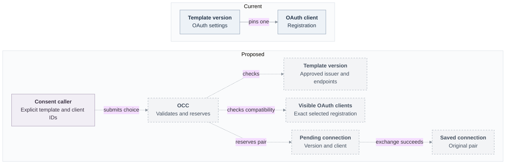

# Separate OAuth clients from Connection Templates

An OAuth Connection Template defines approved authorization settings. It does not select an OAuth client. The consent caller supplies a compatible client for a person who can create a CredentialSource in the Namespace. The Console initially selects the first eligible client. Each template can use several clients, and one client can serve several templates for the same issuer. OCC derives eligibility from compatibility and scope; there is no template-client association record or separate client-use grant.

Template scope and client scope are independent. An Installation-wide template remains available when the selected TokenService supports only Namespace-local clients. The TokenService selected at Installation setup defines which OAuth client scopes are supported, uniformly for confidential and public clients.

This amendment revises the OAuth registration and consent decisions in [RFC-0027](../0027-agent-oauth-connections/index.md) and the proposed TokenService contract in [RFC-0023](index.md). Driver selection and the revised consent behavior are proposals.

## Current and desired behavior

| Area                | Current behavior                                                                                                                                                                 | Desired behavior                                                                                                                                                                                                                    |
| ------------------- | -------------------------------------------------------------------------------------------------------------------------------------------------------------------------------- | ----------------------------------------------------------------------------------------------------------------------------------------------------------------------------------------------------------------------------------- |
| Template            | Each OAuth version contains one optional `oauthClientId`.                                                                                                                        | A version contains approved OAuth settings and no client reference.                                                                                                                                                                 |
| Client registration | Creation copies the template's scope and endpoints, then selects the first registration on a new template version. A client can already appear on multiple compatible templates. | Registration records its own permitted scope and approved issuer, endpoints, and authentication method. Creation through a template does not change that template or select a client.                                               |
| Eligibility         | The template version pins a client.                                                                                                                                              | Any client visible in the target Namespace is eligible when its exact issuer, approved token endpoint, and authentication method are compatible with the template. Preserve the approved revocation endpoint check when configured. |
| Consent             | The start API accepts a template ID and scopes; OCC obtains the client from the version.                                                                                         | The API requires the exact template and client IDs and rejects missing or incompatible choices. The Console preselects the first eligible client in a dropdown and sends that ID.                                                   |
| Lifetime            | Pending and saved connections record the client, but callback and refresh still depend on the template pin.                                                                      | Pending and saved connections retain the chosen client and immutable template version independently. Callback and refresh use that exact pair.                                                                                      |
| Scope               | Client creation inherits template scope.                                                                                                                                         | The selected TokenService admits client scopes. An Installation template can be used with a client in the target Namespace.                                                                                                         |

The current issuer identity is an exact HTTPS URL stored on both records; OCC does not need a new issuer entity. MCP discovery must still verify that the protected resource advertises the selected issuer and that authorization-server metadata returns that exact issuer. An issuer match alone cannot authorize sending a client secret to another token endpoint. An OpenShell Provider ID is a separate Workspace-local identity.

Solid arrows show current behavior; dashed arrows show the proposal. Compatibility is derived from settings, not stored as an association.

## Eligibility and consent

The caller must have `credential_source:create` in the exact destination Namespace. A template is visible if it belongs to that Namespace or the Installation. The selected TokenService must support the client's scope. The client must belong to the target Namespace or the Installation. A client in another Namespace is never eligible. The approved template and client must have the same exact issuer and token URL, a compatible token endpoint authentication method, and matching revocation URL when the template specifies one. These checks apply automatically; there is no administrator approval of individual pairs.

The supported consent entry is `POST /namespaces/{namespaceId}/connections`. Its body must require `oauthClientId` alongside `connectionTemplateId` and optional `selectedScopes`. Its caller must be able to discover eligible clients under the same Namespace consent authority. There is no existing Console consent picker. When added, its client field is a dropdown populated from eligible-client discovery. The dropdown initially selects the first eligible client, so the person does not need to change it when that client is suitable, including when only one client is available. The Console sends the selected ID to OCC; OCC never chooses a client for an omitted ID. Client registration can continue to use a template and version as the source of approved OAuth settings, with client scope selected independently. Registration never mutates the template.

OCC reserves the chosen client and immutable template version before redirecting. The callback must consume unexpired authorization state once, verify the signed-in actor and browser session, recheck exact Namespace authority, and validate the reserved pair before exchange. Preserve shared-callback issuer mix-up protection: record at consent start whether an issuer response is required, then require the callback issuer if that flag was set or another issuer can reach the same callback. Assess that callback across Namespaces, including historical template versions with pending redirects. The pending connection must protect the client from deletion throughout exchange, including after authorization-state consumption, until a saved receipt or terminal cleanup takes over. The saved receipt retains the exact client ID for refresh and through retirement. Rotation uses the current secret of that registration; it does not substitute a different client.

## TokenService scope and custody

At Installation setup, the selected TokenService declares supported OAuth client scopes: Installation, Namespace, or both. OCC applies that declaration to every registration, including public clients with `tokenEndpointAuthMethod: "none"`. A public client has no secret and causes no secret registration, reveal, or rotation, but it is subject to the same client-scope admission rule. A confidential client's secret must be held by the selected TokenService at the client's exact scope.

OpenShell's [Workspace secrets RFC](https://github.com/NVIDIA/OpenShell/blob/c24fcd232f84c132d1e9c163b0375e5c6c8e0614/rfc/0024-workspace-secrets/README.md#L68-L80) defers Installation-wide secrets. Its secrets and providers belong to named Workspaces. Thus an OpenShell TokenService supports Namespace clients only, even for public clients. OCC must map the exact destination Namespace through Compute to its physical Workspace and reject a foreign or unavailable mapping. An Installation-wide template remains usable with a compatible client in that Workspace. A TokenService with genuine Installation-wide client-secret custody may support Installation clients; OpenShell must not simulate that capability by copying secrets or choosing a Workspace implicitly.

The proposed TokenService contract currently uses `InstallationClientSecretRef`, which forbids a Namespace ID. Replace it with an OAuth client secret reference that carries the client's exact scope for registration, update, resolution, removal, and uncertain cleanup. Keep the approved token endpoint and durable selected-owner identity with the lifecycle information. Scope support belongs to the selected Driver facet and applies to clients; there is no template-scope admission operation. Submit this Driver contract change for human review before implementation.

## Storage and verification

Remove `oauthClientId` from template contracts, version records, and their foreign key and scope guard. Use the pending CredentialSource's chosen client as the canonical pending selection and enforce a durable registration reference through exchange. Update saved-connection guards to validate the independently chosen client against the template version and destination Namespace instead of joining through `version.oauth_client_id`. Preserve deletion protection for saved connections. Do not add a pair table, per-client use grant, client default, or duplicate issuer resource.

Use focused API and PostgreSQL coverage for two clients eligible for one template and one client reused by two templates. Verify an Installation template with a Namespace-local OpenShell client, uniform public/confidential scope admission, wrong-Namespace and wrong-endpoint denials, incompatible authentication methods, signed actor/session checks, rejection of a missing callback issuer when another Namespace has a reachable issuer, and rotation. Also start consent while a second issuer is reachable, remove that issuer, and verify that a callback without an issuer is still rejected by the persisted requirement. Consume authorization state, hold the exchange open, and verify that client deletion is denied before a saved receipt exists; then verify saved-reference protection and terminal-cleanup release.

After the contract is submitted and the selected TokenService owner, OpenShell integration, and qualified Gateway are available, run one bounded live proof. Use one Installation-wide template and two compatible clients in the same Workspace; explicitly select one client and complete real OCC/Fastify, PostgreSQL, and provider consent, callback, save, and refresh with that same client. Verify foreign-Namespace denial and rejection of unsupported Installation clients, including public `none` clients. This proof is separate from other credential and Plugin workflows. The RFC and diagram do not prove runtime behavior.
