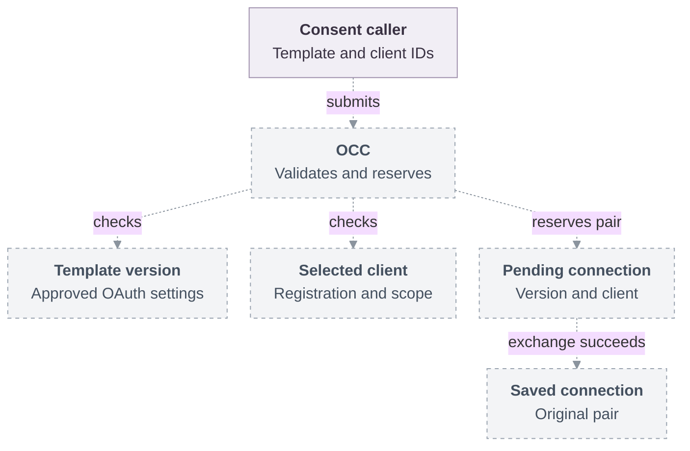

# Separate OAuth clients from Connection Templates

An OAuth Connection Template defines approved authorization settings without selecting an OAuth client. At consent start, the caller supplies the template and an eligible client for a person who can create a CredentialSource in the destination Namespace. A template can use several clients, and one client can serve several templates for the same issuer. OCC derives eligibility from the approved settings and scope.

Template and client scopes are independent: an Installation-wide template can be used with a client registered in the destination Namespace. The selected TokenService defines supported secret scopes; OCC uses those capabilities to govern OAuth client registration.

This amendment revises the OAuth registration and consent decisions in [RFC-0027](../0027-agent-oauth-connections/index.md) and the proposed TokenService contract in [RFC-0023](index.md). The following flow is proposed.

## Eligibility and consent

The caller must have `credential_source:create` in the exact destination Namespace. A template and client are visible if each belongs to that Namespace or the Installation. OCC admits the client's registration scope according to the selected TokenService's secret scope support. A client in another Namespace is never eligible.

The template and client must have the same exact HTTPS issuer and approved token URL, a compatible token endpoint authentication method, and matching revocation URL when the template specifies one. MCP discovery must verify that the protected resource advertises the selected issuer and that authorization-server metadata returns that exact issuer. An issuer match alone cannot authorize sending a client secret to another token endpoint. An OpenShell Provider ID is a separate Workspace-local identity. These checks apply automatically; individual template/client pairs do not require administrator approval.

`POST /namespaces/{namespaceId}/connections` requires `connectionTemplateId` and `oauthClientId`, with optional `selectedScopes`. The caller can discover eligible clients under the same Namespace consent authority. The proposed Console dropdown initially selects the first eligible client and sends its ID, including when only one client is available. OCC rejects an omitted or incompatible client ID. Client registration records its own scope, issuer, approved endpoints, and authentication method. It can use a template version as the source of approved OAuth settings without changing that template.

OCC reserves the chosen client and immutable template version before redirecting. The callback consumes unexpired authorization state once, verifies the signed-in actor and browser session, rechecks exact Namespace authority, and validates the reserved pair before exchange. At consent start, OCC records whether an issuer response is required. The callback requires the issuer if that flag was set or another issuer can reach the same callback, assessed across Namespaces and older template versions with pending redirects. The pending connection protects the client from deletion throughout exchange, including after authorization-state consumption, until a saved receipt or terminal cleanup takes over. The saved receipt retains the exact client ID for refresh and through retirement. Rotation uses the current secret of that registration and never substitutes a different client.

## Secret scope and custody

The selected TokenService supports Installation-wide secrets, Namespace-scoped secrets, or both. OCC permits OAuth client registration in those supported scopes. This policy applies to public and confidential clients. Public clients with `tokenEndpointAuthMethod: "none"` require no secret and cause no secret registration, reveal, or rotation. Confidential client secrets are held by the selected TokenService at the client's exact scope.

OpenShell's [Workspace secrets RFC](https://github.com/NVIDIA/OpenShell/blob/c24fcd232f84c132d1e9c163b0375e5c6c8e0614/rfc/0024-workspace-secrets/README.md#L68-L80) defers Installation-wide secrets. Its secrets and providers belong to named Workspaces, so its TokenService supports Namespace-scoped secrets. OCC consequently permits only Namespace OAuth client registrations with that TokenService, including public clients. Compute maps the exact destination Namespace to its physical Workspace; OCC rejects a foreign or unavailable mapping. An Installation-wide template remains usable with a compatible client in that Workspace. OpenShell must not simulate Installation secret scope by copying secrets or choosing a Workspace implicitly.

The selected TokenService Driver facet declares its supported secret scopes. An OAuth client secret reference carries the client's exact scope for registration, update, resolution, removal, and uncertain cleanup. Lifecycle information includes the approved token endpoint and durable selected-owner identity. Submit this Driver contract change for human review before implementation.

## Persistence and verification

Template versions contain approved OAuth settings and no client reference. The pending CredentialSource records the chosen client as the canonical pending selection and holds a durable registration reference through exchange. A saved connection independently references its template version and client; persistence enforces their compatibility and destination Namespace scope and prevents client deletion while the saved reference exists. No pair table, per-client use grant, stored client default, or duplicate issuer resource is needed.

Use focused API and PostgreSQL coverage for two clients eligible for one template and one client reused by two templates. Verify an Installation template with a Namespace-local OpenShell client, uniform public/confidential scope admission, wrong-Namespace and wrong-endpoint denials, incompatible authentication methods, signed actor/session checks, rejection of a missing callback issuer when another Namespace has a reachable issuer, and rotation. Also start consent while a second issuer is reachable, remove that issuer, and verify that a callback without an issuer is still rejected by the persisted requirement. Consume authorization state, hold the exchange open, and verify that client deletion is denied before a saved receipt exists; then verify saved-reference protection and terminal-cleanup release.

After the contract is submitted and the selected TokenService owner, OpenShell integration, and qualified Gateway are available, run one bounded live proof. Use one Installation-wide template and two compatible clients in the same Workspace; select one client and complete real OCC/Fastify, PostgreSQL, and provider consent, callback, save, and refresh with that same client. Verify foreign-Namespace denial and rejection of unsupported Installation clients, including public `none` clients. This proof is separate from other credential and Plugin workflows. The RFC and diagram do not prove runtime behavior.
