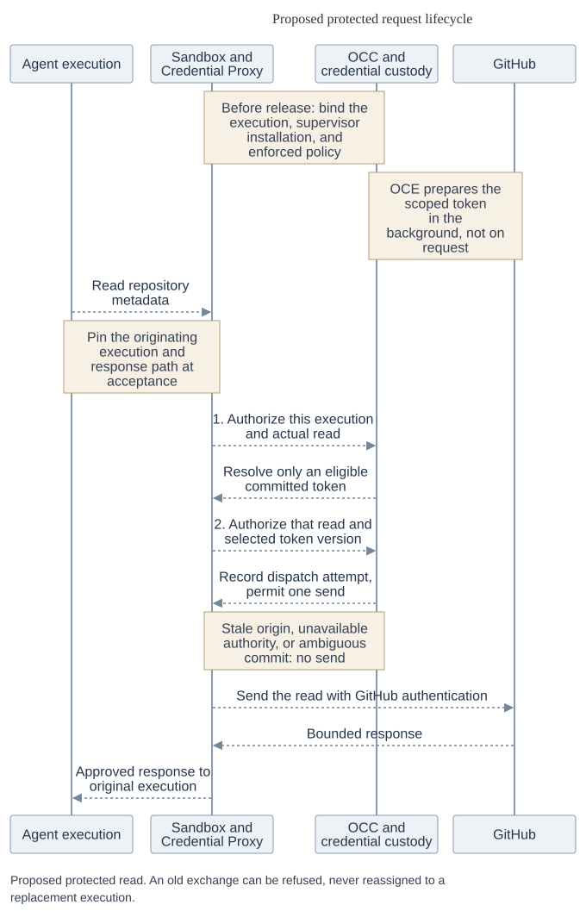

# Execution and request protocol

This page specifies the sequence and failure behavior for [RFC-0023](index.md).
The [interfaces and records](contracts.md) name the parties and data; the
[verification requirements](security.md) define the evidence needed to use them.
A configuration, a credential and an authorization are separate decisions.

For the MVP's [online authorization profile](online-authorization.md), the trust and
release requirements there apply. The stronger dispatch and response guarantees below
remain a distinct profile; an existing admission does not change meaning.

## Establish protected execution

An OpenShell composition may implement Credential Proxy and Sandbox. One way to establish the
channel is for Sandbox to enroll a supervisor-generated public key over its authenticated
installation control channel. Compute verifies the enrollment in the installation attestation before release. The supervisor
keeps the private key outside the Agent, identifies the execution at the sandbox boundary,
and proves possession on a dedicated request channel. The sender verifies that installation and
channel. A copied receipt or sandbox-only bearer is insufficient. Alternatives such as an
execution-scoped bearer or SPIFFE identity must establish the same exchange association.

Before releasing the workload, Compute bounds the wait for applied configuration, eligible material
for each required dynamic grant, and enforcement of the exact wiring. After release, require
authenticated Harness `serving` for this execution before reporting readiness. The Agent needs no
egress credential or provider secret. Check static material by authorized resolution. A route
needing no credential skips only the material requirement.

## Capture and authorize a request

[Diagram source](assets/request-lifecycle.mmd)

### Capture the exchange

In `CredentialProxy.capture(peer, exchange, bounds)`, trusted transport binds the immutable
request and response destination to the authenticated execution, supervisor installation,
channel and stream **before** queuing or consulting current policy. Each multiplexed stream
needs equivalent provenance. Replacing installation A with B invalidates A's open
channels and queued work. Current state can reject A's exchange; it cannot attribute
it or its reply to B.

Match the method, canonical URL, address, TLS name, HTTP authority, ordered headers
and policy-relevant body against exactly one route. Automatic selection requires a
unique match. An explicit binding selector is untrusted intent and must also produce
exactly one match. Failure cannot fall back to another identity or a credential-free
route. Seal the permitted transformation, classification and absolute deadline in a
sender-bound `OperationHandle` usable for at most one dispatch. Bound and parse streams;
a frame requiring a new decision is a new operation.

### Check access and resolve material

`CredentialProxy.forward(operation)` owns both authorization checks and the intervening
resolution. `RequestAuthorizer.check(before_access, operation)` asks OCC online to check
current caller and applicable user rights, execution or delegation, installation and
channel, applied policy, holds, withdrawals, generations, grant and the actual operation.
It also checks static adoption and material reference, or dynamic input-family generation
and owner epoch. The resulting `AccessPermit` allows one resolution for this operation,
resolver and deadline; it does not allow a send.

For a credentialed route, resolve the selected material as described below. Both checks
also apply to cache hits and credential-free routes; a credential-free route performs
**zero material reads**. Never cache an allow decision.

### Commit and authorize the send

Call `check(before_send, operation, materialEvidence | none)` with the same current checks
and the actual selection. Before releasing a `SendPermit`, durably commit the attempt,
accepted origin and response destination, selection, original deadline and finite
`sendStartBy`. If the commit acknowledgment is lost, release no permit and send nothing.
Reconcile that exact attempt without issuing a replacement permit.

### Send and deliver the response

Match the permit to the committed attempt, accepted exchange, sender, selected material
(or none), and both deadlines. A custody handle must belong to that operation and sender.
A mismatch, replay or uncertain prior consumption permits no write. Check usability,
consume the permit once, strip execution authentication and selectors, and inject only at
the admitted destination.

Apply response policy to status, headers, body, trailers and encoding, including errors
and each streaming release. Deliver only to the accepted destination. A redirect or
another operation on the connection requires fresh capture and both checks within the
original deadline. The permit bounds when a send may start; it does not guarantee
exactly-once provider execution. If a write may have reached the provider but its reply was
lost, record possible dispatch and do not send again. Blocking a response cannot undo a
provider write.

### Outcomes

Return `refused` only when no send was possible, with a safe `denied`, `not_ready`,
`unavailable`, cancellation or deadline result. Otherwise record `response`,
`provider_rejected`, `response_blocked` or `uncertain`. An authenticated `SendReceipt`
binds the committed attempt, operation, origin, response destination, sender, material
evidence or absence, deadlines and confirmed or possible dispatch. Return only the
policy-approved response to the caller.

### Git operations

Git discovery, upload-pack and receive-pack are separate operations. For ref-constrained
push, the trusted sender must parse the complete bounded command list, check every old
object ID, new object ID and ref, and dispatch the identical checked commands and
operation. A forbidden second ref rejects the entire push before any provider write. If
the sender cannot enforce this, refuse push. An Agent hook cannot satisfy the contract;
this check does not establish pack or branch safety.

## Resolve credentials

The [resolver contract](contracts.md#credential-access-and-lifecycle) defines the
handle and evidence returned for an authorized read.

### Static material

New sources default to `live`. Migrated `explicit_update` sources select an exact approved
version or immutable snapshot in the same OCE installation and namespace. The read permit binds
the adoption mode, exact selected store and target version, consumer and `static_read` purpose.
Lifecycle input reads require separate `issuer_input` authority. In snapshot mode, the
admitted snapshot owner serves that version. The original Secret is provenance and need not still
exist. Evidence and reuse keys retain adoption, selected store, target, version and revocation
association. Only exact source-update authority and access to the selected target may change that
approval; [migration](security.md#approved-static-material) defines the opt-in.

Default freshness is ten minutes. The default four-hour limit is *total age from authoritative
read*, usable after freshness only on positively classified transport, timeout or throttling failure.
No fallback on missing, denied, revoked, unknown failure, cancellation or unavailable authority.
Neither failure nor a lower cache resets age. Either cache duration zero, or request age limit zero,
requires an authoritative read of the *selected target*, no reusable retention or fallback at any
layer, and use bounded by deadline and expiry. Zero means read again, not expire instantly.

### Dynamic material

`WarmCredentialReader.readWarm` reads only eligible committed material for
`WarmKey = (SourceKey, exact normalized grant, grant hash, isolation ID)`. Add family generation,
owner epoch, preparation attempt, actual grant and provider expiry to the evidence. Cold, expired
or insufficient validity returns `not_ready` without starting work. The reader owns a detached copy
until it confirms the read and sufficient remaining validity, then transfers that copy to custody.
If it cannot confirm either, it erases its copy and returns `not_ready` with no material.
Eligible material can outlast an issuer outage. An unavailable resolver permits no proxy cache,
token push or fallback.

## Prepare and renew credentials

Serialize rotating-input consumption across the *family*, not just a grant key. Fence owner epoch
and attempt in durable storage. Record possible issuance before calling the issuer, validate actual
grant and expiry, then durably commit any replacement input and the candidate before publishing
readiness. A successor must fence the former owner, reconcile its attempt and retain late candidates
for cleanup. If a rotated input was lost, reauthorization may be necessary. Neither a lost lease
nor the original bootstrap Secret licenses replay. Routine renewal must not interrupt eligible use or require a restart.
Exceptional reauthorization may interrupt the affected credential; make that recovery visible.
Show readiness and failures to the Agent owner at provisioning; give operators renewal failures
and time to expiry, with alert policy and thresholds left to the deployment.

OCE alone owns the GitHub App key, signs the App JWT, exchanges it for an installation token scoped
to admitted repositories and permissions, verifies effective grant and expiry, and commits the token,
version, attempt and epoch together in encrypted custody. In that commit, retain the previous
successful version, its verified provider expiry and any outstanding retirement obligation.
Publishing a new version does not revoke the old token. After a lost acknowledgment or restart,
recover which version is current and reconcile both by version. Do not issue again to resolve
that uncertainty or report expiry as provider-confirmed revocation. OCE owns background renewal,
withdrawal and fenced takeover. OpenShell may be the sole lifecycle owner for a different credential family.

## Bootstrap and management callers

Trusted bootstrap proves OCC delegation for the executor, execution, repository,
clone, source, grant, audience and deadline. It runs both checks for each Git operation and cannot
prepare a token. Compute opens the default clone gate only on authenticated success naming the
requested ref, observed commit if known, workspace, attempt, outcome and cleanup. Compute and
bootstrap retain responsibility for a partial workspace or uncertain clone.

For management discovery or configuration, a trusted sender *inside OCC* captures the business operation, obtains
preparation authority bound to the service, initiating user, captured operation, exact source and
grant, destination, and original deadline. After preparation it performs both fresh checks.
Return sanitized business data, never material or an injection callback.

## Withdraw and recover

OCC commits denial and durable withdrawal intent. Credential Proxy `withdrawBinding` advances the policy
generation, tombstones the removed binding and exposes the reducing successor wiring while
pending. Sandbox installs it. Settle only on evidence of that exact generation and remaining route
and binding sets. Keep tombstones past possible late installs. `removeRevision` needs confirmed
destruction or installed deny-all. Reductions affect the next check, but a send whose final check
raced withdrawal can *start after acknowledgment*. Report OCC denial, detachment, source removal
and provider revocation separately.

`configureRevision` can apply a newly admitted plan to the same running execution. To remove a
credential-free route, advance the generation and verify the exact remaining routes and bindings;
removing the last route leaves deny-all enforced. While expansion awaits exact-scope material,
narrower operations may continue only under bindings that remain authorized.

On authenticated credential rejection, `CredentialResolver.reportRejection` must *durably commit
before acknowledging*: deduplicate by sender, operation, attempt and store-qualified material
version, fence that exact version, and record the recoverable obligation. Redelivery after lost
acknowledgment returns the recorded disposition. Coalesce recovery at the dynamic owner. Rejection
of N cannot invalidate or schedule recovery for N+1. A static fence survives eviction, restart and
reread without approving replacement. Never retry the business operation automatically.

Control operations retain their exact accepted-work identity for inspection and
reconciliation, as specified in [contracts](contracts.md#control-operation-recovery).
