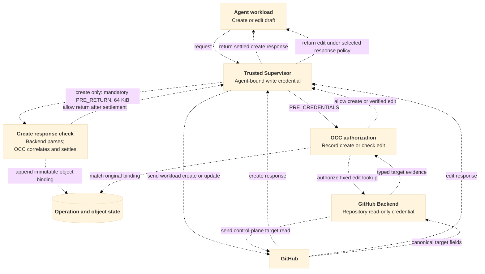

# Selected GitHub repository: authority over an original draft

**Proposed amendment to RFC-0023.** An Agent with an explicitly selected repository grant may create and update drafts that the OpenClaw Control Plane (OCC) can prove it authorized that Agent to create. The selected request path does not currently deliver a trusted create response to OCC, so an allowed create request cannot establish authority to edit the resulting pull request. A workload-supplied ID, branch, title, or shared GitHub App actor cannot supply that proof.

## Decision and scope

Require a trusted, correlated response check before returning a successful create response to the workload. OCC must durably bind the provider's returned pull request ID to the approved create operation. A later edit requires a separate current authorization and an independent live provider read.

This is a distinct, explicitly selected repository policy. The Supervisor sends only inspected workload create and update operations over verified HTTPS to `api.github.com`. The GitHub Backend separately sends a fixed control-plane target read. Reject arbitrary GraphQL, aliases or batching that changes the approved operation, redirects, and alternate workload egress. Keep the existing [installation-wide mode](github-installation-access.md#decision) free of an OCE original-draft filter. Saved bounded-draft grants retain their separate one-create allowance, uncertain-outcome handling and no-replay rule; do not widen or reinterpret them.

All dashed arrows describe the proposed connected contract; they do not establish installed behavior.

## Boundaries and settlement

The Sandbox and Credential Proxy Drivers must establish authenticated, mandatory `PRE_CREDENTIALS` and `PRE_RETURN` bindings on the exact selected workload route, with the Supervisor as the exclusive recipient of the Agent-bound write credential, verified transport, and no bypass. OCC must verify the actual applied bindings, response limit and recipient before release and after material or policy changes. A capability advertisement or configured hook is insufficient. Missing, stale, substituted or unavailable enforcement refuses the protected operation; do not fall back to request-only preview, native Git, installation-wide authority or credential-free egress.

Before allowing create, OCC commits an unspent operation bound to immutable Sandbox, execution, Agent revision and admission identities; grant, provider, credential and stable repository IDs; authenticated sender and response recipient; request ID and digest; and the actual attached material attempt, version and recipient fence. The Supervisor exclusively dispatches workload traffic and injects its write credential. The GitHub Backend owns operation classification, response parsing and the separate control-plane read; OCC owns authorization and durable settlement. OCC receives typed operation and target evidence, not arbitrary forwarded request or credential bytes.

The mandatory Supervisor `PRE_RETURN` registration and handler must enforce a maximum response body of 64 KiB (65,536 bytes) per create. Verify that limit before dispatch. The handler counts actual body bytes before parsing or returning them; refuse a body above the maximum, truncation, or ambiguous framing or encoding. At `PRE_RETURN`, authenticate the Supervisor and correlate the response to that exact pending operation and attempt. Accept only a complete HTTPS GraphQL success with the expected status and schema, no GraphQL errors, duplicate members or trailers. Extract the canonical pull request node ID from that create response. Atomically settle the operation once and append an immutable object binding before releasing the approved response to its original recipient. Store identifiers, digests and outcomes, never tokens or response payloads, in state or logs. Allow many immutable operation/object records per selected grant; this is not the legacy one-draft quota.

Failed, forged, mismatched, replayed, incomplete or lost responses create no successful object receipt or binding. Preserve explicit failed or unknown outcomes. If a mutation may have reached GitHub, or settlement acknowledgment is lost, reconcile that operation without repeating the provider mutation; neither restart nor a claimed success permits replay or edit authority.

For each edit, OCC independently authorizes the GitHub Backend to perform one fixed, purpose-bound control-plane read of the canonical pull request ID, stable repository ID and `isDraft` over verified HTTPS. The Backend uses its own repository-specific read-only credential with only the minimum repository metadata and pull request read permissions. The issuer owns issuance, source credential custody and renewal; the Backend alone receives and holds the issued read credential. It is separate from the Agent-released write credential and is never released to the Supervisor or workload. Missing, expired, wrongly scoped or unavailable read authority or an ambiguous read fails closed; do not fall back to a broader credential. OCC matches the returned fields to the immutable original binding for this Agent and grant, then rechecks current admission, withdrawal, recipient, material attempt/version and fence immediately before authorizing the Supervisor's update. A stale observation, changed execution after restart, missing record, non-draft or different object denies the mutation.

## Acceptance and qualification

Through the ordinary Agent workflow, create two drafts under one selected grant and update an original while it remains a draft. In the same journey, deny edits to a colleague's same-repository draft, a published pull request, a foreign repository, and stale or withdrawn authority, with zero forwarded update mutations. Qualify the separate Backend read and credential boundary; missing or wrongly scoped read authority must cause zero updates and no broader credential fallback. Missing mandatory response enforcement or the 64 KiB registration must prevent create dispatch. Oversize, ambiguous, forged, mismatched or lost responses must yield no edit authority and no repeated create mutation; any original provider effect remains possible and must be reported. If settlement acknowledgment is lost, deny edits until reconciliation confirms the durable binding, and never repeat the create mutation. Replays must not create another binding. Verify that state and logs retain no credential or response payload. Separately retain the bounded grant's one-create/unknown controls and installation-wide behavior. Source, integrated, released Supervisor, installed Agent and live GitHub qualification remain separate; none is established by this proposal.
