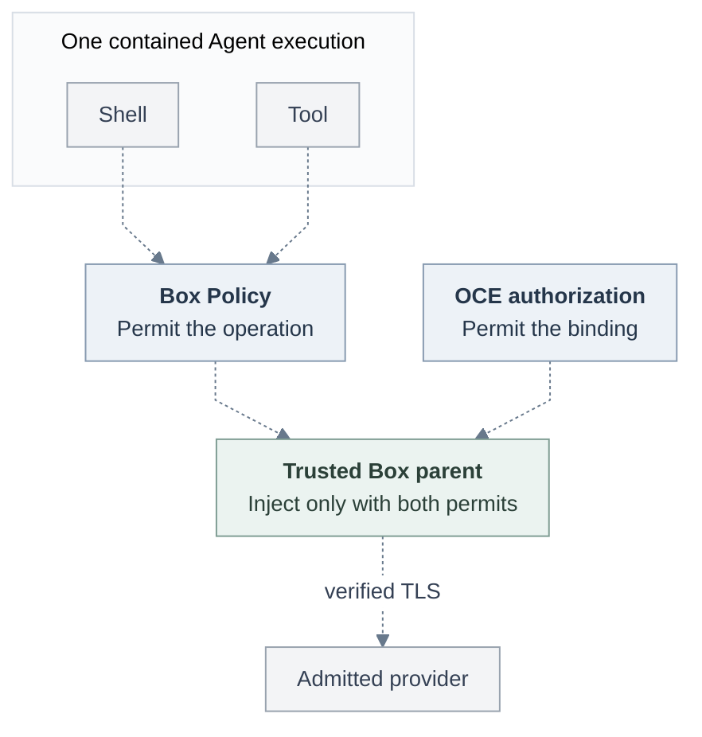

# Agent-wide Box policy for protected execution

**Proposed amendment to [RFC-0023](index.md). Human review and merge required.**

At Box commit `956764b58f2c5ccb12bb7048fd1ced3d8ca1b5d4`, the callback identifies a route within a
Box but cannot identify the calling executable. **Agent-wide Box policy** would let an operator
select one authenticated Agent Sandbox as the principal for routes and injections, initially only in
an isolated pilot. Implementation and qualification are pending.

## Decision

Select this capability only if **every process may use every admitted route and credential binding**
in that Sandbox. A compromised shell, tool, or Model Context Protocol (MCP) server could push an
allowed ref, spend model quota, or send data over an allowed route without learning the credential.
Use separate Agents with distinct Sandbox identities and policies when their trust or access
differs.

Before provisioning, admission must check the complete effective policy.

| Question                    | Required decision                                                                                                                                                                                                                                                 |
| --------------------------- | ----------------------------------------------------------------------------------------------------------------------------------------------------------------------------------------------------------------------------------------------------------------- |
| Who can share access?       | Require explicit operator selection, support from the selected Sandbox Driver, and exactly one authenticated Agent revision and execution incarnation per Sandbox. Omission retains existing requirements.                                                        |
| Who grants access?          | An authorized administrator must delegate the route at Agent scope. Injection also requires reviewed consumer authority at that scope. Combining executable grants cannot confer Agent-wide authority.                                                            |
| Which restrictions overlap? | Treat an Agent-wide grant as overlapping every executable restriction on the route. Refuse mixed subjects in the pilot. Enforce each asserted executable, port, or other bound or refuse admission. Executable-specific enforcement needs separate qualification. |

The capability selects the principal. RFC-0023 still determines the protection level. Preserve the
admission, connection, dispatch, authorization, and evidence requirements of the selected level,
including exact dispatch or online request authorization.

## Policy and credential boundary

In the proposed pilot, both subprocesses below can use the same binding. Each credentialed request
needs two independent permissions.

- **Box Policy authorizes the operation.** The Sandbox authors and installs Policy from admitted
  declarations and prevents bypass. Only Policy can permit network, shell, or filesystem operations.
  Deny each operation unless a Policy rule explicitly permits it. Missing Policy denies access.
  Floor restrictions can only deny. Refuse unsupported representations.
- **OpenClaw Enterprise (OCE) authorizes credential use.** IAM and applicable repository or source
  policy must authorize the current Agent execution, credential source, destination, port, HTTP
  method, and path. Binding and injection require both permissions. The trusted parent replaces a
  binding-specific placeholder from its vault only on an admitted HTTP request. Its injector checks
  the execution, origin, port, method, path, and credential presentation, verifies upstream TLS,
  refuses dangerous redirects, and blocks known disclosures in responses and diagnostics.

Limit credentialed origins to trusted providers. Protection assumes an uncompromised host kernel and
a provider that does not maliciously encode or reflect the credential.

## Startup, withdrawal, and audit

Apply the [release and withdrawal rules](strands-box-held-launch.md#ownership-and-release) and
[containment requirements](strands-box-held-launch.md#trust-boundary). An Agent-wide grant confers
no release authority. Attribute admission, use, denial, version changes, and withdrawal to the Agent
execution and selected capability. Omit secrets and executable attribution from audit records.

## Acceptance criteria

Broader release requires qualification through the normal deployed Agent, actual Box callback, and
trusted injector. Use an invented sentinel for one binding. In one contained execution, run two
distinct real subprocesses against the **same route and binding**. An independently observed trusted
origin must distinguish and accept both requests. Independently verify injection of the sentinel on
each. Both processes must be unable to read or retrieve it.

| Exercise                                                                                                                                                                            | Required observation                                                                                                                                                                                 |
| ----------------------------------------------------------------------------------------------------------------------------------------------------------------------------------- | ---------------------------------------------------------------------------------------------------------------------------------------------------------------------------------------------------- |
| Present executable-only grants, overlapping restrictions, mixed subjects, an unsupported capability, or an unenforceable assertion.                                                 | Enforce the [admission decisions](#decision) before provisioning. Preserve the existing exact-dispatch and online-authorization cases.                                                               |
| Try another Agent, the previous incarnation after replacement, or the wrong route, destination, port, method, or path.                                                              | Refuse each request at the enforcing layer.                                                                                                                                                          |
| Keep Box Policy permissive and revoke the binding. Separately withdraw credential policy and read back its effective version from every serving copy. Separately remove Box Policy. | Refuse a fresh request in each case. Stale or missing delivery readback keeps startup held.                                                                                                          |
| Deny an application request on a permitted proxy connection.                                                                                                                        | Record TCP establishment separately. At the enforcing proxy, verify zero denied application-request bytes forwarded toward the origin. Require zero unauthorized injections and provider operations. |
| Try a forbidden destination or port, then direct egress.                                                                                                                            | Require zero connections to the forbidden destination or port and zero direct connections.                                                                                                           |
| Probe trusted control and release interfaces from the workload.                                                                                                                     | Across **all** refusals, require zero protected-material disclosures, control mutations, and unauthorized releases. Apply any stronger requirements of the selected protection level.                |

Results cover only the tested source, runtime, and deployment.
[TASK-0053](../../plans/0053-strands-box-convergence.md) owns installed qualification.
