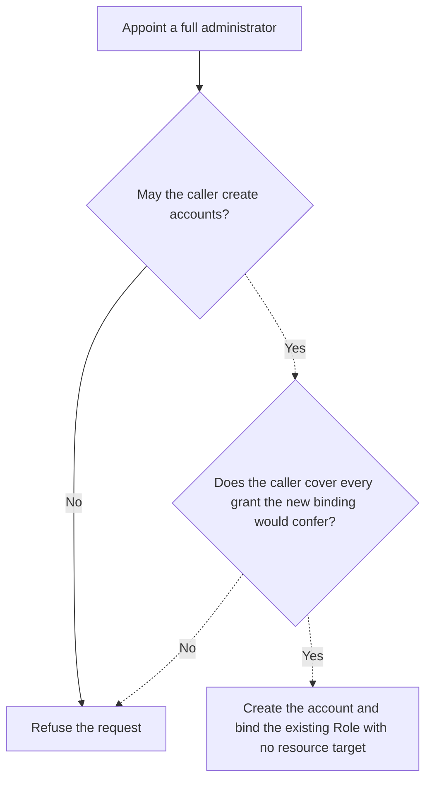

# Proposal: Let an Installation administrator appoint a second one

- **ID:** RFC-0024 (provisional on this branch; renumber before merge)
- **Created:** 2026-10-02
- **Last updated:** 2026-10-23
- **RFC PR:** [#889](https://github.com/openclaw/openclaw-enterprise/pull/889) (draft)

## Decision requested

In the dogfood test reported on October 2, an operator created a second account
with the built-in _Installation administrator_ Role. That person could create
accounts and open `/observability`, but `GET /namespaces` returned `[]` and
`POST /namespaces` returned `403`. Following the documented procedure had left
the bootstrap administrator as the only human who could create a Namespace.

**IAM model owners: choose A, B, or C. We recommend A.** Let an administrator
give a new account the same access they hold, but require the caller to cover
_every_ grant they are about to give. Otherwise the limited administrator from
that test could create a third account more powerful than their own. A changes
only new, explicit grants; it does not promote anyone on upgrade. This PR
corrects the operator guidance and implements none of the options.

## Why the same Role gave two people different access

A Role says _what_ someone may do. Its binding also says _where_. An exact
binding to the Installation object does not mean “the Installation and
everything in it.” [The IAM source at `5dd0cd0f`](https://github.com/openclaw/openclaw-enterprise/blob/5dd0cd0f083d68d268f38f271b69f5f4382ef971/packages/iam/src/index.ts)
still makes this distinction; the HTTP results above are from the October
report, not a claim about a currently running Installation.

| How the account got the administrator Role                                                                   | Where the Role applies                                                                                                                                                                                                 |
| ------------------------------------------------------------------------------------------------------------ | ---------------------------------------------------------------------------------------------------------------------------------------------------------------------------------------------------------------------- |
| Bootstrap human (and bootstrap ServicePrincipal): binding has no resource target                             | Includes the Role’s Namespace create, read, and delete permissions, as well as its Agent, Secret, and other permissions.                                                                                               |
| Additional human: `POST /api/auth/accounts` with `roleId: role_admin_<uuid>` binds to the exact Installation | Only `installation:administer` and `installation:read`. This includes account and service key administration. Reading a known Namespace, its IAM policy, and the deployment inventory each returned `403` in the test. |

A Namespace Role cannot close this particular gap: its permission on the
Namespace itself is read, not create or delete. For someone who needs ordinary
Namespace access, keep the existing [Add a person](../../docs/guides/topics/iam.md#add-a-person)
path: omit `roleId`, then grant access in the intended Namespace.
[PR #281](https://github.com/openclaw/openclaw-enterprise/pull/281) introduced
account creation without a Role.

## A. Change what account creation can grant (recommended)

Keep the [account endpoint’s](../../docs/reference/authentication.md#account-provisioning)
existing gate: a human session with `installation:administer`. Add an explicit choice to appoint a full
administrator. A request that supplies only the existing `roleId` continues
to grant access to the exact Installation object. Omitting the Role still
creates an account without grants. Existing provisioning clients can keep
using either form.

When the caller explicitly requests full access, IAM must verify that the
caller holds each permission of the built-in administrator Role at the same
or a broader scope. A caller who lacks any required grant receives `403`.
The refusal creates no account, Principal, enrollment, or binding.

Dashed paths are proposed. Use the grant coverage rule from
[PR #624](https://github.com/openclaw/openclaw-enterprise/pull/624), which
prevents service key issuance beyond the caller’s grants. For account creation,
compare against the _proposed binding_, before committing it. The existing
`coversIdentityAccess` compares two identities already in policy; comparing the
caller to a new identity with no grants would check the wrong thing. A caller’s
own untargeted binding to the same Role is sufficient coverage, not the only
possible proof. If the selected IAM Driver cannot establish coverage, refuse the request.
The check must still hold when the grant commits. A concurrent revocation
that removes coverage before then must prevent the grant.

On success, `createAuthPrincipalSeed` would bind the existing Role with no
resource target, as bootstrap does; `validateAuthAccountPrincipalSeed` would
require that shape for this path. Preserve the single account-creation
transaction, an audit record that distinguishes the exact and full grants, and the no-grant default. No change to
[authorization’s meaning of an exact binding](../../docs/reference/authorization.md)
is needed.

Before shipping A, demonstrate the difference on an Installation with a known
Namespace: the bootstrap human can appoint a second administrator who can see
it and create a Namespace; the limited administrator from the example cannot
appoint one; and an existing exact binding gains nothing on upgrade. Operators
can create a new account when they intend the broader grant. IAM owners should
separately decide whether to document an explicit delete-and-recreate procedure
for an existing binding. Never rewrite those bindings automatically.

## B. Make an Installation target include everything in it

Change the evaluator instead. This would immediately broaden _existing_
Installation-targeted bindings as well as new ones, and give “exact” a special
meaning for this resource. Choose B only if that wider authorization change is
the intended decision.

## C. Keep the narrower administrator and document the limit

No authorization change. Operators can delegate account and service key
administration, but still cannot appoint a second human who can create or
delete Namespaces. A built-in Role named _Account administrator_ would describe
that access more clearly, at the cost of additional API surface. Until behavior
changes, the operator guides should describe this limit.
