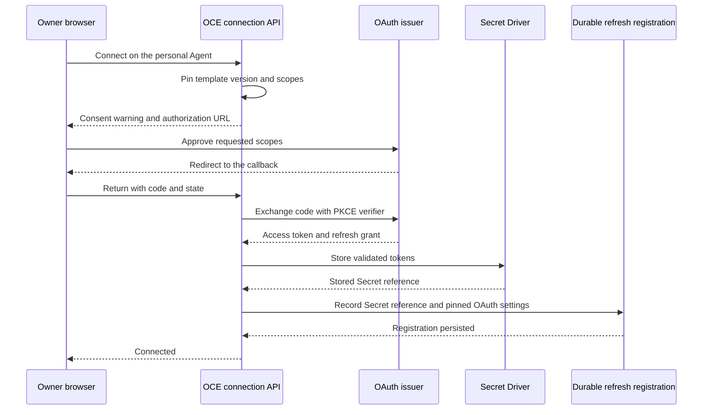

# Proposal: Connect a user's OAuth account to a personal Agent from the console

- **ID:** RFC-0024
- **Created:** 2026-10-20
- **Last updated:** 2026-10-30
- **RFC PR:** [#3068](https://github.com/openclaw/openclaw-enterprise/pull/3068)
- **Implementation plan:** Not yet written; the next step is `$spec plan RFC-0024`
- **Companion:** [Driver contracts, failure, and verification](contracts.md)
- **Related:** [RFC-0016](../0016-sandbox-credential-injection/index.md) and its
  [Credential Refresh companion](../0016-sandbox-credential-injection/credential-refresh.md);
  [RFC-0010 personal access](../0010-agent-access.md#access-contract);
  [credential sources](../../../docs/reference/credential-sources.md);
  [per-Agent sandbox policies](../../../docs/reference/sandbox-policies.md);
  [RFC-0023 Credential Proxy](../0023-egress-proxy-credential-lifecycle/index.md)

## Summary

A user signs in to the OCE console, opens their personal Agent, selects
**Connect Google**, approves access on Google's consent page, and then deploys the
Agent. The Agent's tool, such as `gog`, can then read that user's Gmail. Only that
user can use the Agent.

An Installation administrator creates an `OAuthConnectionTemplate` by entering
OAuth settings or by starting with an MCP server URL. MCP setup discovers the
settings and resolves the OAuth client. A Preset references the template by ID.
When the Agent owner clicks **Connect**, OCE uses the saved version for consent
and code exchange. The Secret Driver stores the tokens, the Token Service
refreshes them, and OpenShell presents the prepared
access token at the approved endpoint. The deployed tool receives a placeholder.
OCE core contains no provider-specific endpoints, scopes, or binaries.

## Motivation

Today a user who wants an Agent to read their Gmail must export a refresh token
with a local sign-in tool, store it and the client secret as Namespace Secrets,
register an `oauth2-refresh-token` source, bind it, grant the Agent's service
principal `operate`, and deploy
([credential sources](../../../docs/reference/credential-sources.md)). The refresh
token passes through the user's terminal and the OCC Secret store, and anyone with
access to the Agent can use the mailbox.

Device login, used only by the experimental `codex-oauth` model source, does not
help: Google's device-code flow does not permit Gmail scopes. Gmail needs the
browser authorization-code flow, with an OCC callback.

After the code exchange, browser connections use the [RFC-0023 Token Service lifecycle](../0023-egress-proxy-credential-lifecycle/contracts.md#credential-access-and-lifecycle).
It separates background refresh from the worker's outbound request.

## Goals

- A user connects their own account in the console without handling a client
  secret, refresh token, or access token, then deploys their Agent.
- Only the connecting user can use, deploy, or open an Agent that holds their
  connection, until every copy of the credential is withdrawn.
- Administrators add a provider by creating a connection template, not by
  changing OCE code or Installation configuration.
- The credential reaches only the connection template's binary, endpoint, and
  allowed HTTP methods.
- Revocation, a denied consent, and an uncertain exchange each produce a visible
  state and one recovery action.

## Non-goals

- Shipping `gog` or any provider tool in the OCE runtime image. Operators supply an
  image that contains the connection template's binary.
- Device-code connections for tool credentials, and changes to model
  authentication (`harnessAuth`).
- Service-account or domain-wide delegation.
- Reducing what the approved scope can read. `gmail.readonly` exposes the whole
  mailbox to the tool.
- Shared Agents with connections, and per-message user identity inside an Agent.
- Namespace-owned connection templates. Start with the Installation-wide catalog;
  add Namespace templates later only if Namespaces need different providers or
  OAuth clients.

## Proposal

### Connection templates

An `OAuthConnectionTemplate` is an Installation-scoped resource with IAM kind
`connection_template` and actions `create`, `read`, `update`, `delete`, and `use`.
Installation administrators manage the catalog through the API, CLI, and console.
They grant `use` on an exact connection template to a person, or to a Namespace so
that anyone connecting an Agent in that Namespace may use it. IAM gains
Installation-level access bindings for this ([IAM changes](contracts.md#iam-driver)).
A user needs `use` to see a connection template under **Connect** and to start a
connection from it. Credential sources created from it stay in the Agent's
Namespace.

| Field                               | Why it is needed                                                                                                                            |
| ----------------------------------- | ------------------------------------------------------------------------------------------------------------------------------------------- |
| `displayName`                       | The label on the **Connect** button and consent warning.                                                                                    |
| `issuer`                            | The authorization server's identifier, an exact `https` URL. It scopes the client ID and is the expected `iss` for `accountIdentity: oidc`. |
| `authorizationUrl`, `tokenUrl`      | Exact `https` URLs for browser consent and the authorization-code exchange.                                                                 |
| `revocationUrl`                     | Optional exact `https` URL where the issuer accepts token revocation requests. An administrator can enter it during manual setup.           |
| `clientId`, `clientSecret`          | For a preregistered client, its ID and any required secret. DCR supplies these for an MCP client registered at setup.                       |
| `scopes`, `authorizationParameters` | Approved scopes and extra consent parameters. Google uses `access_type=offline` and `prompt=consent`.                                       |
| `requiredScopes`                    | Defaults to all approved scopes. When some scopes are optional, the owner selects a nonempty subset that includes the required ones.        |
| `resource`                          | Optional OAuth resource indicator. OCE pins it for authorization, code exchange, and refresh.                                               |
| `endpoint`                          | Credential destination (`host`, `port`, `path`) with `read-only` or `full` access. An MCP transport requires `full`.                        |
| `envVar`, `binary`                  | The placeholder variable and the one executable that may send it.                                                                           |
| `accountIdentity`                   | `none` (default) or `oidc`. With `oidc`, the required scopes include `openid email` so OCE can show the connected address.                  |
| `jwksUri`                           | Optional with `oidc`. Without it, the Driver discovers the signing keys from `issuer`.                                                      |

MCP setup uses the official TypeScript MCP client to discover metadata and offers
Dynamic Client Registration (DCR) when supported, or accepts a preregistered
client. It saves the resulting `OAuthConnectionTemplate` with the MCP server URL
for plugin binding and the discovered OAuth resource. Existing template IDs,
versions, Preset references, and fixed-scope connections keep their meaning.
[MCP template setup](contracts.md#mcp-template-setup)

OCC rejects non-HTTPS URLs. Where OpenShell supplies a configured list of tool
binaries, OCC also rejects a binary outside that list. Admission must separately
verify that the runtime can enforce the consented restriction.

The callback URI is derived from the console origin as
`https://<console-host>/oauth/callback`. The template response shows the exact URI
for manual registration. OCE includes the same URI in its DCR request.

With `accountIdentity: oidc`, the consent screen lists the two extra scopes. The
Refresh Driver verifies the provider before accepting the template version and
verifies the ID token at callback. Console can then show the verified address so
the owner can check which account they connected. [OIDC verification](contracts.md#oidc-account-identity)

### Connection profile

OCE creates a Namespace-scoped `CredentialSource` for each connection made from
an `OAuthConnectionTemplate`. Its optional `profile` describes the external account.
The `externalUserId`, `email`, and `name` fields are each optional strings.
Credential source reads return the profile. An Agent binds the source by ID, and
its connection list returns the same profile. Each API checks its existing read
permission. The Secret keeps its own name. How OCE populates the profile is deferred.

### Versions and consent

An edit never changes what an existing connection does. Changing any field except
`displayName` creates a new connection template version. The credential source
pins the version, issuer and its URLs (including any `revocationUrl`), client
registration, resource when present, effective scopes, authorization parameters,
endpoint and access, variable, binary, and OIDC settings. These values govern
code exchange, refresh, and credential delivery, so later edits cannot redirect
a user's grant or credential.
Source configuration is already immutable.

After a new version, existing connections keep working and Agent details show
**Reconnect to apply changes**. Reconnecting asks for consent again and creates a
new source. To stop an old version, for example after an endpoint compromise,
administrators disconnect the affected sources. OCC refuses to delete a connection
template while any source references one of its versions.

Rotating the client secret is not a consent change. The secret belongs to a client
registration for one `issuer` and `clientId` pair, so the same client ID at another
issuer stays independent. Rotation applies to new connections; existing
connections keep the secret they were configured with until the provider disables
it ([client registrations](contracts.md#client-registrations)).

### Personal Agents

A connection belongs to the person who completed consent. This proposal needs a
maintainer decision on how OCC records that owner and restricts invocation.
[RFC-0010](../0010-agent-access.md#access-contract) describes personal access;
it does not supply an enforced owner check for every way to invoke an Agent.

We propose recording the owner's identity on the source. At bind, deploy, and
every grant or channel change, OCC must check who can actually invoke the Agent,
including inherited permissions. An administrator can stop or delete an Agent
and disconnect its source. Administrative membership alone cannot authorize a
chat, deployment, or opening the native admin UI. Refuse the binding if an
existing access path lets a second principal invoke the Agent. Reject a later
grant that would open such a path while the Agent holds the source.

A channel can carry the owner's messages if it verifies the sender as that
same human and prevents other people, bots, and Agents from invoking the tool
or receiving its results. Refuse a binding that cannot enforce both conditions.
Whether current channel adapters can offer these guarantees remains open.

An Agent holds the source while its saved settings list it, a pending deployment
includes it, or any deployed revision retains it. Removing the saved binding does
not end the restriction: revisions keep their own source snapshots, and withdrawal
is asynchronous. The restriction ends only when every revision's attachment
reports `revoked`, or the revision is retired, with no pending deployment or
reattachment that includes the source. A failed or stalled withdrawal keeps it in
force; administrators can stop or delete the Agent.

An administrator, or a user with `agent:create`, creates the Agent for the owner.
The Agent's `connections` list names each required connection template, and
deployment returns `409` until each has a `ready` source. Each invocation path must enforce the owner check before the Agent receives input.

### Presets and connection templates

A [Preset](../../../docs/reference/presets.md) is a Namespace copy of Agent launch
settings that the creator edits; later Preset changes never affect the Agent. A
connection template defines how one person's account is connected and where its
credential may go, and only Installation administrators change it. A Preset
therefore references connection templates instead of copying them.

Add `agent.connections` to the Preset template, a list of
`{ "connectionTemplateId": "…" }` entries. Creating an Agent from the Preset copies
that list into the Agent's `connections`; the console shows one **Connect** button
per entry. One Preset can combine several connection templates, such as Gmail and
Calendar read-only, with the Configuration and instructions that use those tools.
An unknown or unusable connection template fails Agent creation with `400`; the
Preset stays valid.

### Driver contract changes

These changes require review of this RFC before implementation. The
[companion](contracts.md) defines their inputs, results, and failure behavior.

1. **OCE** owns browser authorization for every `OAuthConnectionTemplate` and
   uses the client registration and OIDC verification contracts on the
   `CredentialRefreshDriver`. The Token Service receives the stored grant's
   reference and pinned OAuth settings for refresh.
2. **Protected egress** uses the [RFC-0023 contract](../0023-egress-proxy-credential-lifecycle/contracts.md).
   The sender must enforce the consented destination and HTTP methods. Admission
   must also establish the promised executable restriction before the Agent can
   use the connection.
3. **`IAMDriver`** gains Installation-level access bindings, a `namespace` subject
   kind, and an optional Namespace context on authorization requests.

Browser connections use the existing `oauth2-refresh-token` source type. For a
template-created source, the Backend must select the Token Service as its only
refresh owner and support delivery of prepared access tokens. Manual registration
keeps its existing Secret-backed path.

### Console and API flow

1. `POST /namespaces/:namespaceId/agents/:agentId/connections` takes the template
   ID. For selectable scopes, Console also sends the displayed version and the
   owner's `selectedScopes`. OCC checks template `use`, Agent ownership, and
   approved scopes before creating a `registering` source. It pins the version and scopes
   in the session, stores private session state in a Namespace Secret, and returns
   the source ID and authorization URL. Existing callers can supply just the ID
   for a fixed-scope template.
2. The console shows the destination and scopes the tool is requesting, then
   opens the consent URL in a popup. When a browser blocks popups, it redirects
   the page.
3. `GET /oauth/callback` requires the session that started the connection. OCC
   finds the session by a hash of `state`, rejects reuse or an age above ten
   minutes, and consumes the callback once. OCE exchanges the code, validates
   the grant, and registers the stored tokens for refresh. The response sets
   `Referrer-Policy: no-referrer` and redirects without the query string. OCC
   excludes the code from logs and audit. [Browser authorization](contracts.md#browser-authorization)
4. On `ready`, OCC adds the source to the Agent's `credentialSources` and grants
   the Agent's service principal exact source `operate`.
5. Agent details show the connection with **Reconnect** and **Disconnect**.
   Reconnect creates a new source and replaces the binding. Disconnect removes the
   binding and requests withdrawal. Issuer-side token revocation is a separate
   operation. [Withdrawal and recovery](../0023-egress-proxy-credential-lifecycle/protocol.md#withdraw-and-recover)

Audit records connection start, completion, failure, reconnect, and disconnect
with the actor, connection template ID, Agent ID, and source ID. It never records
codes, tokens, or provider account content.

## Delivery and verification

An implementation plan will order the resource and IAM, Driver contracts,
connection API and enforcement, console with Storybook coverage, and a Google Gmail
operator guide. The [companion](contracts.md#required-outcomes) lists the required
integration, real-cluster, and live-provider outcomes.

## Rationale and alternatives

- **Connection templates in Installation configuration.** Startup configuration
  describes the installation's Drivers and images. Providers change more often and
  need IAM, so they fit an API-managed resource.
- **Connection settings inside Presets.** A Preset copy is editable by the Agent
  creator, which would let a creator change scopes, endpoints, or the OAuth client.
  It would also copy client secrets into every Namespace that holds the Preset.
- **Let users edit or mount the connection's Secret.** A manual update could
  overwrite a rotated refresh token, and a mount could expose it to the worker.
  Connection setup and refresh have write access. The stored token set cannot be
  mounted into a workload.
- **Installation-owned Secrets for the OAuth client secret.** The Driver already
  manages the client registration. Adding an Installation Secret would introduce
  a new Secret scope solely for this feature.
- **A Google-specific Gateway type.** Each new provider would need an OCE release.
- **Shared Agents with a warning.** Anyone with access could read the mailbox.
- **Consent for the whole execution.** RFC-0023 gives processes in the same
  execution the same egress authority. That can include programs other than the
  tool named on the consent screen. This proposal keeps the narrower promise.
  Maintainers must decide whether to require independently enforced executable
  isolation or ask the owner to consent explicitly to the whole execution.
  Until a supported mechanism matches the consent, refuse deployment.

## References

- [Credential sources](../../../docs/reference/credential-sources.md)
- [CredentialRefreshDriver contract](../../../docs/reference/drivers/credential-refresh.md)
- [OpenShell Credential Gateway](../../../docs/reference/drivers/openshell-credential-gateway.md)
- [Console Agent creation](../../../docs/reference/console/create-and-deploy.md)
- [Per-Agent sandbox policies](../../../docs/reference/sandbox-policies.md)
- [Shared Driver contracts](../../../packages/contracts/src/index.ts)
- [Google limited-input device scopes](https://developers.google.com/identity/protocols/oauth2/limited-input-device)
