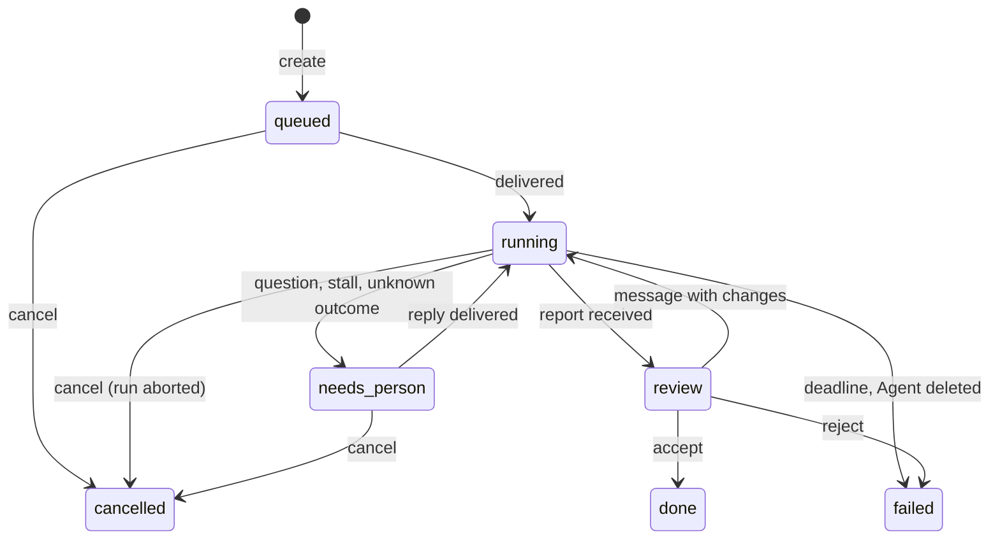
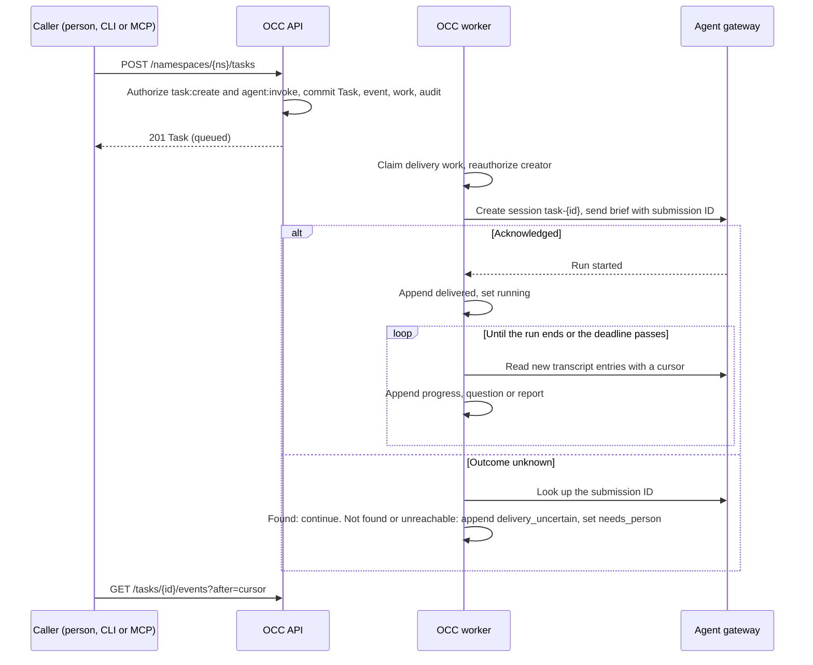

# Proposal: Agent Tasks for dispatching work and following it

- **ID:** RFC-0024
- **Created:** 2026-10-25
- **Last updated:** 2026-10-25
- **RFC PR:** pending
- **Implementation plan:** to follow after review
- **Related:** [API, CLI and MCP surface](api.md) · [Operator view](operator-view.md) ·
  [Failure handling and limits](failure-and-limits.md) ·
  [Agents](../../../docs/reference/agents.md) · [Gateway routing](../../../docs/reference/gateway-routing.md) ·
  [Controller worker](../../../docs/flows/controller-worker.md) · [RFC-0006](../0006-basic-rbac/index.md) ·
  [RFC-0013](../0013-platform-audit/index.md)

## Summary

Add a Namespace-scoped **Task** resource to the OpenClaw Control Plane (OCC). A person, or a coding agent that acts
for a person, creates a Task with a brief and assigns it to one Agent. The OCC worker delivers the brief as a turn in
a dedicated session on that Agent's gateway and records what happens as an append-only **Task feed**: delivery,
progress, questions, the final report and artifacts such as pull request links. People reply, decide, cancel or accept
the result through the same API. A console **Operator view** shows what is running, what needs a person and what
changed. The [CLI and an MCP server](api.md) expose the same operations, so an external coding agent can dispatch and
read Tasks with the caller's own key. No new credential reaches the Agent, and every dispatch is authorized and
audited.

## Motivation

A small team runs software work with agents in this pattern: one person guides a coordinating agent, which runs five
or six worker agents in parallel. Each worker gets a written brief, leases its item so no other worker takes it, posts
progress to a shared board, records findings and writes a final report. The person reads summaries, answers
questions and approves consequential actions such as merges. In four weeks one team produced more than 25,000 board
posts and 3,000 landed changes this way, entirely outside OCE.

OCE deploys and governs the Agents that could do this work, but it cannot take the work:

- **No API sends work to an Agent or reads its conversation.** OCC routes cover lifecycle, status, logs, diagnostics
  and four fixed workspace files. The only chat surfaces are Slack and the opt-in
  [native admin UI](../../../docs/reference/agent-native-admin.md), which needs exact-Agent `administer` and whose
  native commands OCC does not authorize or audit.
- **Automation reaches a turn only around the platform.** Smoke checks and operators send turns from inside the
  gateway Pod to its loopback chat endpoint with the gateway password: cluster access, no OCC IAM or audit.
- **Nothing records what an Agent did for whom.** Runtime logs withhold prompts and replies by design and keep no
  history. The audit ledger records mutations, not work.
- **No shared state for coordination**: no assignment, lease, question, decision or result record, and no view
  across Agents.

## Goals

1. A permitted caller assigns a Task to an exact Agent in its Namespace and receives a Task ID at once.
2. The Agent receives the brief as a turn in a session that belongs to that Task. Later messages from people go to the
   same session.
3. Callers can read the Task state and feed with a cursor, and an operator can see blocked, stalled and finished
   Tasks across Agents without reading transcripts.
4. Delivery is at most once. A retry never starts a second run silently; an uncertain outcome becomes visible and a
   person decides.
5. Dispatch, people's messages, decisions and cancellation are authorized through the selected IAM Driver and audited.
6. A coding agent outside the cluster dispatches and follows Tasks through the CLI or MCP with an existing service key.
7. A first slice is useful for the team above within days of starting, on Kubernetes Compute.

## Non-goals

- **Agents dispatching to other Agents.** An Agent workload cannot authenticate to OCC yet
  ([workload identity](../../../docs/design.md#remaining-design-work) is deferred). The coordinating agent stays
  outside OCE in the first slice.
- **Pools, scheduling and automatic assignment.** A Task names one Agent.
- **A general project tracker.** Tasks have no sprints, estimates or cross-Namespace views. An external tracker can
  link to a Task.
- **Channel integration.** Posting Task events to Slack is later work. Slack conversations do not become Tasks.
- **Budgets and model-usage accounting.** Budgets remain [future work](../../../docs/design.md#remaining-design-work).
- **Merge or deploy decisions by Agents.** A Task can request a decision from a person; it cannot grant authority.

## Proposal

### Owners

| Owner | Responsibility |
|---|---|
| OCC API | Authenticates, authorizes the exact operation, and commits the Task, its first event, worker work and audit together. |
| OCC state (`packages/occ`) | Task and TaskEvent persistence, state transitions, limits and the delivery work queue. |
| OCC worker | Claims delivery work, reauthorizes the creator, sends turns, reads the session and appends events under its claim. |
| Compute Driver | Unchanged. Supplies the private gateway endpoint (`getGatewayEndpoint`), as for workspace files. |
| Agent gateway | Owns the session transcript and the run. OCC never copies the full transcript. |
| Console and CLI | Clients of the same API. The MCP server is a CLI mode, not a service. |

No Driver contract changes. Delivery reuses the authenticated route OCC uses for
[workspace files](../../../docs/flows/workspace-files.md): OCC opens WSS to Envoy with the mounted service key, and
Envoy forwards to the Agent's gateway Service. An integration-test helper already drives a native session over this
route (`sessions.create`, `sessions.send`, `agent.wait`, `chat.history`). Compute Drivers without the route (Docker,
SSH) reject Task creation with `501` in the first slice.

### Model

A **Task** has: ID, Namespace, title (at most 200 characters), brief (Markdown, at most 64 KiB), assignee Agent ID,
optional parent Task ID, creator, optional client `requestId`, state, deadline, current lease and timestamps.

A **TaskEvent** is an append-only record with a per-Task sequence number, kind, author (a Principal,
ServicePrincipal, the assignee Agent, or OCC), text (at most 16 KiB) and optional artifact
(`pull_request`, `commit` or `link`, with a URL). Kinds: `created`, `delivered`, `progress`, `question`,
`decision_requested`, `message`, `decision`, `report`, `artifact`, `state_changed`, `delivery_uncertain`,
`stalled` and `interrupted`. A Task keeps at most 2,000 events; at the limit OCC rejects new people's messages and
stops projecting progress.

`needs_person` is the state the Operator view prioritizes. `done`, `failed` and `cancelled` are terminal.
Proposed states and transitions; nothing here is implemented.

### Lifecycle

Proposed flow. The gateway operations are the native session RPCs: `sessions.create`, `sessions.send`, `agent.wait`,
`chat.history` (with a delta cursor) and `chat.abort`. The plan confirms their behavior in the pinned OpenClaw release,
for both embedded and dedicated execution.

1. **Admission.** Creation needs `task:create` in the Namespace and `invoke` on the exact assignee Agent, which must
   be in the same Namespace and have a selected revision. A repeated `requestId` from the same creator returns the
   existing Task.
2. **Delivery.** The worker claims delivery work in the existing controller work queue, reauthorizes the creator
   before each send, and records a submission ID before sending. After a lost claim it reconciles by that ID and
   never resends without a match.
3. **Progress.** The worker appends new assistant text as `progress` events, at most 4 KiB each. Tool output stays in
   the gateway.
4. **Result.** OCC's brief header asks the Agent to end its final reply with a result block: outcome (`done`,
   `needs_person` or `failed`), summary and artifact URLs ([format](api.md#result-block)). `done` records a `report`
   and moves to `review`; `needs_person` records a `question`. A reply without a valid block goes to `review` as is.
   Slice 3 replaces this text convention with Task tools.
5. **People's input.** A message or decision becomes an event, then a follow-up turn in the same session. A person
   with `task:update` accepts or rejects a result in `review`.

### Failure and limits

[Failure handling and limits](failure-and-limits.md) owns the details. In short: a repeated `requestId` returns the
first Task; a lost worker reconciles by submission ID and never resends without a match; an unknown outcome, a stall
(30 minutes without transcript activity), a redeploy during a run or a lost `invoke` grant moves the Task to
`needs_person` without aborting the run; a deadline (default 2 hours, at most 24) aborts the run and fails the Task.

An Agent runs at most one Task at a time in the first slice, and OCC queues the rest in creation order. Sessions of
one Agent revision share its workspace and, with OpenShell, one Sandbox, so two Tasks on one Agent could edit the
same checkout. A Namespace holds at most 200 open Tasks. Model cost follows the Agent's existing model
configuration; OCC counts turns per Task, not spend.

### IAM, tenancy and audit

New permissions, granted to the bootstrap administrator and otherwise only through Roles. `invoke` is the action
[RFC-0006](../0006-basic-rbac/interfaces.md#agent-invocation) proposes for submitting a turn; this proposal uses the
same name and meaning, without RFC-0006's role catalogue or connector admission:

| Resource kind | Action | Permits |
|---|---|---|
| `agent` | `invoke` | Submit work to this exact Agent. Does not imply `read`, `operate` or `administer`. |
| `task` | `create` | Create a Task in the Namespace (needs `agent:invoke` too). |
| `task` | `read` | Read the Task and its feed, or include it in a list. |
| `task` | `update` | Post a message, decide, accept, reject or cancel. |

Tasks reference only Agents in their own Namespace. Namespace-scoped service keys cannot see another Namespace's
Tasks. OCC audits creation, delivery, uncertain delivery, people's messages, decisions, cancellation and every
authorization denial, with Task ID and actor, and without brief or message text. Agent-authored events are Task
content, not audit evidence.

### Credential custody

The Task path adds no Secret and sends no credential to an Agent. OCC reaches the gateway with the service key Envoy
already verifies for workspace files. On that route the gateway gives OCC `operator.admin`, so a Task turn is an
owner turn with full native authority over that one gateway. The plan must connect with only the scopes that session
send and read need, if the gateway honors narrower scopes for this identity; otherwise this is a recorded limit
(question 7). The Agent works with its existing repository credentials and model
credentials, including the Credential Proxy path where selected. OCC stores no Agent credential in a Task and
rejects a brief or message that its existing sensitive-value sanitizer detects. A Task cannot widen what its Agent
may reach.

### How Tasks differ from channels

A Slack message is a conversation with a Slack user ID. OCE does not map it to an OCE principal, does not authorize it
per message and keeps no record. A Task is an OCC resource with an owner, a state, an IAM check per operation, audit
and a feed that survives redeployment. Channels stay the place for chat; Tasks are for assigned work.

## Delivery and verification

A prototype outside the product repository is exercising the transport and the operator view against a real
deployment; its findings will update this section before review. The product slices are:

1. **Slice 1, dispatch and feed.** Task and TaskEvent tables, the four permissions, REST routes, worker delivery and
   projection, the result block, the CLI `task` commands and `occ mcp`. Integration proof on a real Kubernetes
   fixture: create, deliver, report, people's follow-up, cancel, duplicate `requestId`, lost claim after send,
   denial without `invoke`, cross-Namespace denial, and audit rows. Model turns use the real-runtime test path.
2. **Slice 2, Operator view.** The console pages in [Operator view](operator-view.md), with Storybook states and
   media.
3. **Slice 3, Agent-side tools.** After workload identity lands: Task tools in the Agent (post progress, ask, report,
   attach artifact), replacing the result block; Agent-to-Agent dispatch within a Namespace.

## Rationale and alternatives

- **Keep the workspace board and reach turns from inside Pods.** This works today but has no OCE identity, IAM or
  audit, and puts cluster credentials on the coordinator's machine. It is the reason for this proposal.
- **Native OpenClaw sessions, automations and session dispatch through native admin.** They are per gateway, need
  `administer`, and OCC cannot authorize or audit each command. Tasks reuse the session machinery and add OCC
  ownership.
- **Slack as the board.** Identity is a Slack user ID, history lives in Slack, and there is no state or lease.
- **An external tracker as the store.** It splits authorization between two systems and still needs the delivery and
  result path proposed here.
- **Brief and report files through workspace files.** The API allows four fixed names and has no trigger or feed.
- **Wait for RFC-0006's Agent invocation.** RFC-0006 proposes submit, status, result and cancel behind `invoke`, with
  duplicate-dispatch fences, but is deferred past 0.x behind its role catalogue and connector admission. This
  proposal delivers a narrow automation subset with the same action and the same rule: an unknown start never
  authorizes an automatic resend.
- **A general gateway RPC route in OCC.** A superseded transport plan passed `chat.send` and `chat.history` through
  OCC. Raw RPCs give callers native semantics without an OCC record, state or bounds.
- **Agents post directly to OCC.** The better long-term shape, and slice 3; it needs workload identity first.

## Unresolved questions

1. **Action.** Add `invoke` on `agent` now, ahead of RFC-0006, or reuse `operate`? `operate` already allows writing
   workspace files, which can change an Agent's instructions. The owner decides; this proposal recommends `invoke`.
2. **Who accepts results.** Any `task:update` holder, or the creator only? Owner decision.
3. **Result block.** Is a text convention acceptable for slice 1? Owner and the Harness owners decide.
4. **One running Task per Agent.** Should an Agent with a sandboxed dedicated Harness run more than one session?
   The Compute and Harness owners decide; the bound stays explicit either way.
5. **Retention.** Tasks and events stay until the Task or its Namespace is deleted. Does the owner want an expiry?
6. **Dedicated versus embedded.** Does the first slice support both execution modes? The plan confirms the
   gateway's session RPCs on each.
7. **Gateway scope.** Can OCC's gateway identity connect with narrower scopes than `operator.admin` for Task
   sessions? The Compute owners and OpenClaw maintainers decide. Until then, Task turns have owner authority inside
   the assigned gateway, which `invoke` holders reach without `administer`. Restrict `invoke` grants accordingly.
8. **Pull request allowance.** Prepared native Git allows one draft pull request per repository grant. A worker that
   opens a pull request per Task needs a different allowance. The repository credential owners decide.

## References

- Current Agent routes and limits: [Agents](../../../docs/reference/agents.md), [HTTP API](../../../docs/reference/api.md)
- Transport: [Gateway routing](../../../docs/reference/gateway-routing.md), [workspace files flow](../../../docs/flows/workspace-files.md)
- Work queue: [Controller worker](../../../docs/flows/controller-worker.md), [reconciliation](../../../docs/reference/controller/reconciliation.md)
- IAM: [Authorization](../../../docs/reference/authorization.md), [permissions](../../../docs/reference/cheatsheets/permissions.md)
- Observation today: [runtime logs](../../../docs/flows/agent-runtime-logs.md), [audit ledger](../../../docs/flows/audit-ledger.md)
