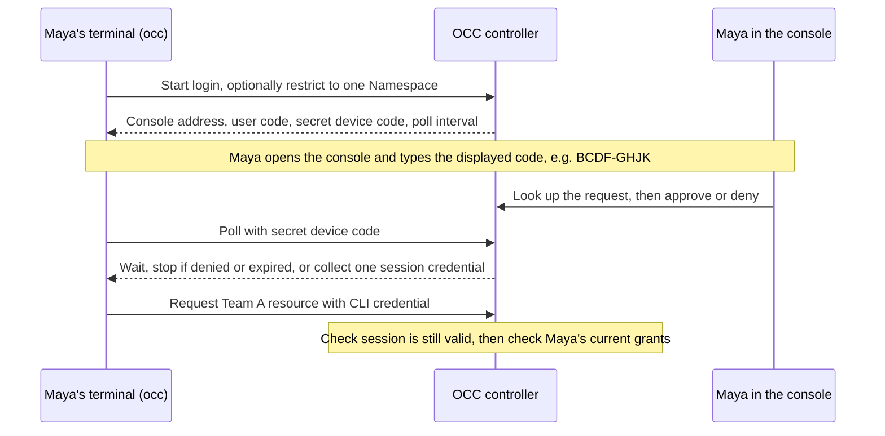

# Proposal: Let people sign in to `occ` with their console account

- **ID:** RFC-0024 (provisional until merge)
- **Created:** 2026-10-04 · **Last updated:** 2026-10-23
- **Review:** [RFC #1235](https://github.com/openclaw/openclaw-enterprise/pull/1235) ·
  [Implementation proposal #1619](https://github.com/openclaw/openclaw-enterprise/pull/1619) depends on acceptance here.

## The decision: should signing out of the console also end CLI access?

In our two-team Keycloak trial, a member could read their team's resources in the console but
couldn't make the same request from a terminal as themselves. We propose `occ login`: the member
types a code from their terminal into the console, approves, and returns to their shell. The CLI
then acts as that person, with their current resource permissions and no way to renew its session.

**We recommend ending CLI access when the approving browser session ends.** Suppose Maya approves
at 15:00 from a console session that expires at 17:00. Her CLI access ends by 17:00, even though
the configured maximum is eight hours. If she signs out at 15:30, her next CLI request gets `401`.
If instead an administrator removes her Team A access, her next read of Team A gets `403`: she's
still signed in, but no longer has permission. Closing the browser window isn't the same as signing out.

An independent CLI session would spare Maya another login during a long SSH session, but signing
out of the console would leave a copied credential usable, potentially for the rest of eight hours.
OCE maintainers, please decide the lifetime in this RFC. Keep implementation proposal #1619 unmerged
until the RFC is accepted, then [demonstrate these distinctions with the two team accounts](#delivery-and-verification).
[Other choices we need before release](#unresolved-questions) include whether approval requires a recent sign-in.

## Why a service key doesn't solve the member's problem

In dogfood round 15 (D386, following D39), `occ` took `--service-key-file`, the controller
rejected `Authorization`, and the documented session recipe required a password. Members got `403`
trying to [issue a service key](../../docs/reference/authentication/service-api-keys.md#issuance).
[Namespace service keys subsequently landed in #1600](https://github.com/openclaw/openclaw-enterprise/pull/1600):
an administrator can create a Namespace ServicePrincipal, grant it a Role and issue its key.
That key identifies the ServicePrincipal, lasts 1–365 days, and survives the issuer's sign-out or disable.
Keep it for CI and unattended clients; Maya's terminal should use her identity and leave her audit trail.

This proposal covers password, GitHub, Google and OIDC console sign-in, including terminals reached
over SSH, in containers or through port-forwards. It doesn't shorten service-key lifetimes, accept
identity-provider tokens at OCC, or make OCC a general-purpose OAuth server. Except for an optional
Namespace restriction, the first version wouldn't offer narrower grants such as a read-only session.

## From `occ login` to the first authenticated request

The ten-minute code on Maya's screen lets her *approve* the waiting terminal. A different, secret
code stays in `occ` and lets that terminal *collect* the credential once. This follows RFC 8628
device authorization; the identity provider sees an ordinary console sign-in. OCE's existing
`/namespaces/:ns/agents/device-authorizations` is a device-flow *client* for Agent credentials.
Reuse its code display, not its authorization route.

1. **Start.** `POST /api/auth/cli/device-authorizations` needs no sign-in. Return `verificationUri`
   (`/console/cli-login`), `userCode`, `deviceCode`, `interval` and `expiresIn: 600`. Use at least
   128 random bits for the secret code and eight characters from a 20-consonant alphabet for the
   displayed code (about 34 bits). Store only their SHA-256 hashes, plus the requesting address,
   expiry, optional `namespaceId` and an unverified `clientLabel` of at most 64 printable characters.
   Limit starts to 30 per minute per trusted client address; cap pending requests at 1,000, evicting the oldest.
2. **Approve in the browser.** Under `/api/auth/cli/device-authorizations`, `POST /lookup` and
   `POST /decide` take the typed code in the body, never the URL. Omit `verification_uri_complete`
   so a link can't supply an attacker's code for one-click approval. Require a current human browser
   session, the configured `Origin` and this tab's `x-occ-session-key`. Share a budget of five wrong
   codes per minute across both endpoints, limited by account and by client address. These rate
   limits are per controller; the guarded authentication profile runs one.
3. **Show what approval grants.** Display the account, terminal's address, explicitly unverified
   label, any Namespace restriction and actual session expiry. Tell the person that this terminal can
   use their current resource permissions, limited to the displayed Namespace if they selected one.
   Say “Only approve a code you just requested.” Emphasize the warning if browser and terminal addresses differ; without
   [trusted proxies](../../docs/reference/settings/production.md#github-sign-in-and-trusted-proxies),
   both may identify only the ingress. Someone can still persuade Maya to type their code. Denial is final.
4. **Collect once.** `occ` polls `POST /api/auth/cli/token` at the stated interval, handles
   `authorization_pending` and `slow_down`, and stops on `access_denied` or `expired_token`.
   At collection, recheck the approving browser session and account under the same rules as a CLI
   request. If the browser signed out after approval, return `access_denied` and issue no credential.
   In one transaction, validate the parent, consume the approval, insert the CLI session and record its issue.
   If audit fails, roll back, return `503` and let `occ` poll again. If the commit succeeds but its
   response is lost, the code is spent: Maya can find and revoke the issued session in the console,
   then start a new login. Never recover or return the lost token.

## What the credential can do, and what ends its use

Return `expiresAt` and a bearer credential containing 256 random bits, base64url-encoded with
prefix `occcli_` for secret scanners. In `occ.cli_sessions` store its SHA-256 `token_hash`, `user_id`,
`parent_session_id` referencing `occ.session` with `ON DELETE CASCADE`, optional `namespace_id`,
`client_label`, `created_at` and `expires_at`. Expiry is the earlier of the parent's expiry and
`now + cliSessions.maxLifetimeSeconds` (900–28,800 seconds, default 28,800). To get a full lifetime,
Maya may need a fresh browser sign-in. Allow ten active CLI sessions per parent; sweep expired device
authorizations and expired or consumed sessions at startup and periodically, in bounded batches.

On every request, across controllers, check the binding in State. Admission reports
`method: "cli_session"` and the browser's `(betterAuthIssuer, userId)`. The IAM Driver resolves the same
Principal and checks current grants; the token contains none. A Namespace restriction sets
`admittedScope.namespaceId` and excludes Installation and other-Namespace routes.

| Event | Required result on the next request |
| --- | --- |
| Grant or Role binding removed | `403` for a resource that required it. No new login should restore the grant. |
| Approving browser signs out or its session expires | `401`. Deleting the parent cascades to the CLI session; the CLI expiry can never be later than the parent's. Prompt for `occ login`, with no refresh. |
| OCE account disabled or sessions revoked, in the guarded profile | `401`. Read CLI session, parent and account together; require an unexpired parent, an enabled account and matching versions. Existing account revocation advances the version and deletes its `occ.session` rows. |
| Sign-in method detached, provider removed, or client ID or issuer changed | `401` if the old CLI credential is presented again. End sessions for that method. Require a still-configured provider and bind `method_id`, `version` and `method_version` from [the parent's authentication record](../../migrations/0037_human_authentication.sql). |
| Disabled only at the identity provider | Access may continue until expiry, up to eight hours. OCE may not learn of the disable until the next sign-in, just as for a browser session. |
| Password-only profile | Method-binding fields are null. Check the parent exists and hasn't expired; this [authentication profile](../../docs/reference/authentication/external-sign-in.md) has sign-out, expiry and `purge-sessions`, but no online disable or revoke check. |
| `occ logout`, or Maya revokes this CLI session in the console | `401` if the old CLI credential is presented again. End just this session. Logout calls `DELETE /api/auth/cli-sessions/current` and removes the local credential. Console users can list and revoke their own sessions at `/api/auth/cli-sessions` (`GET`) and `/:id` (`DELETE`). |

**A stolen token can exercise Maya's current resource permissions.** It must get `403` if used to
approve another CLI login, read or manage accounts (including creation and recovery), issue or
revoke service keys, use native admin, or inspect `GET /api/auth/session`. In particular, even an
Installation administrator's CLI session must not be convertible into a days-long service key.

The [CLI client](../../internal/occclient/client.go) [sends `x-api-key`](../../internal/occclient/transport.go),
and [controller admission](../../apps/controller/src/auth/index.ts) distinguishes that key from a
browser session. Add `x-occ-cli-session`, with no `Origin` requirement. Reject an invalid explicit
credential, or both credential headers together, with `401`; never fall back to a cookie. In the
[controller route gates](../../apps/controller/src/index.ts), admit the new method (unknown methods
get `503`), keep `humanAccountActor` browser-only, explicitly deny service-key operations (admin
and grant coverage checks alone don't distinguish a CLI session), and treat the CLI header like
`api_key` in `requireWorkspaceFileCsrf`. Keep [native admin](../../apps/controller/src/http/native-admin.ts) browser-only.

Reserve `Authorization` for [workload admission](../../apps/controller/src/admission/admission-verifier.ts).
[Token-service proposal #924](https://github.com/openclaw/openclaw-enterprise/pull/924) closed without
merging. It concerned outbound credentials for Agents and isn't a dependency here. The designs
share opaque bearers, hash-only storage, no plaintext recovery, durable revocation and secret-free
audit. If that service is pursued, test rejection in both directions: an Agent bearer at OCC and
`occcli_` at that gateway.

## What stays on the terminal and in the audit trail

`occ auth status` shows account, expiry, Namespace restriction and credential source. Pin credentials
to their issuing OCC origin; never follow redirects. Prefer the OS keychain, storing only the token.
Time out the keychain probe so Secret Service can't hang an SSH login. If unavailable, or with
`--credential-store=file`, use `$XDG_CONFIG_HOME/occ/sessions/<origin-digest>.json`, mode `0600` in
a `0700` directory. Refuse symlinks and group- or world-readable files. A non-secret profile holds
origin, CA bundle path, session ID, expiry and email. Explicit `--service-key-file` or
`OCC_SERVICE_KEY_FILE` still wins, preserving existing scripts.

Redact both credential headers in controller logs and `occ` errors. Audit identifiers, never either
code or the token. Under `openclaw.auth.cli-sessions`, `approve` and `deny` record Principal,
authorization ID, requesting address, label and Namespace; `issue` records CLI session ID, parent
session key and expiry. Fail closed with `503` if approval or issuance can't be audited. Record
`revoke` for logout or console revocation, `authentication.session.end` for cascades, and the
CLI method and session ID on resource events so Maya's browser and terminal activity are distinguishable.

## What would demonstrate this works

Ship controller routes, State tables and application-role grants, `auth.cliSessions.enabled` and
lifetime setting, OpenAPI and [authentication reference](../../docs/reference/authentication.md);
then console approval and revocation, and [`occ` commands](../../internal/occcli/cli.go) and stores.
An older controller returns `404` at login; explain that sign-in is unsupported. On rollback it
ignores the CLI header and, with no browser cookie in the terminal, returns `401`.

The acceptance test is the original two-team task, through real `occ`. Each Keycloak member must get
their console result on their own team and `403` on the other. Exercise the grant-loss and `401`
cases above, the different provider-only disable result, denial of account reads and key issuance,
and a Namespace-bound session trying an Installation route. These are requirements, not test results.

Below that test, cover the device state machine, code normalization, shared wrong-code limit, each
admission gate and password-only binding. In PostgreSQL race two collectors, fail audit before
commit, and sign out between approval and collection. The last case must return `access_denied`
without creating a CLI session or an issuance event. Exercise cascades, method detach, parent-bounded
expiry, sweep and the session cap. In the
browser cover denial, wrong and expired codes, return after sign-in, ignoring a code in the URL and
the address warning; in `occ` cover origin pinning, file protections and keychain timeout.

## Unresolved questions

A desktop loopback with PKCE (RFC 8252) could come later; it doesn't serve this SSH path. Provider
device flows vary and GitHub's would grant repository authority. Copying a browser cookie loses
separate revocation and audit. [Service keys](../../docs/reference/authentication/service-api-keys.md)
remain for automation; doing nothing still leaves the member without a CLI.

| Who decides | Choice that remains open |
| --- | --- |
| RFC owner and OCE maintainers | End CLI access with the approving browser, as proposed, or allow an independent session of at most eight hours, still subject to account controls? |
| Authentication reviewers | Use `x-occ-cli-session`, as proposed, or `Authorization: Bearer`, which third-party proxies more often redact? |
| RFC owner | Rely on the typed code and warning, or require recent sign-in (for example, within 15 minutes) to reduce device-code phishing? |
| RFC owner | Enable by default, as proposed because resource authority can't exceed the browser's, or require opt-in? |
| RFC owner | Let Installation administrators list and revoke someone else's individual CLI sessions? [Account-wide revocation](../../docs/reference/authentication/external-sign-in.md#session-and-recovery-controls) already ends all their sessions in the guarded profile. |
| OCE maintainers | Include the optional Namespace restriction in the first release, as proposed? |
| CLI maintainers | On Linux, prefer keychain with file fallback, as proposed, or default to the file? Supporting the keychain adds a Go dependency either way. |

Related contracts: [OIDC console sign-in](0001-oidc-sign-in.md) and [how OCE maps identities to Principals](../../docs/reference/authorization.md#principals).
