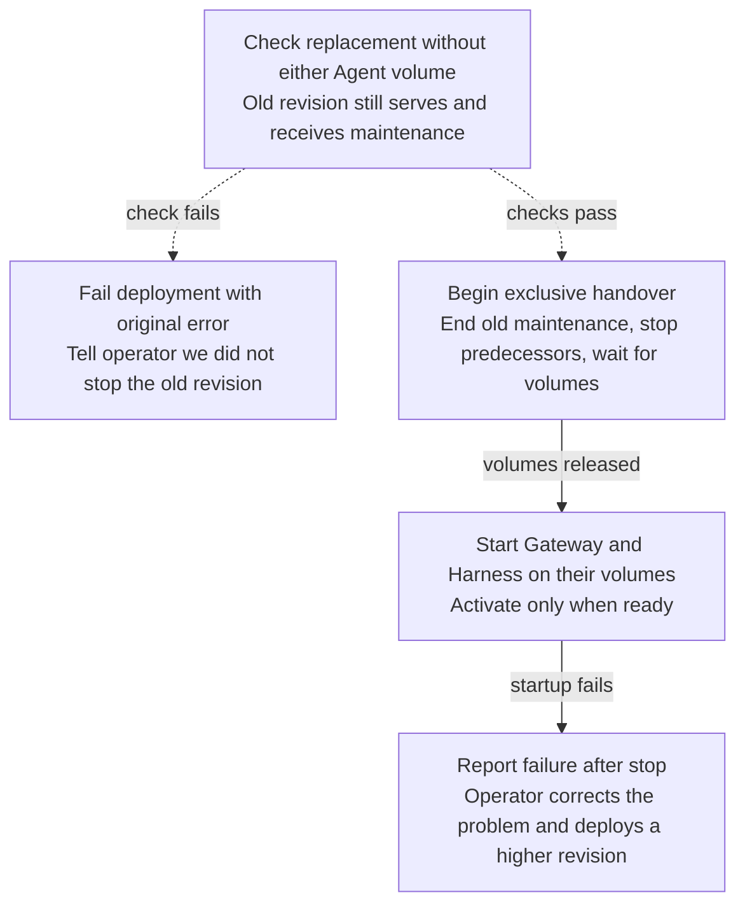

# Proposal: Check a dedicated replacement before stopping its predecessor

- **ID:** RFC-0024
- **Created:** 2026-10-03
- **Last updated:** 2026-10-23
- **RFC PR:** [#1045](https://github.com/openclaw/openclaw-enterprise/pull/1045)

## Let an operator correct a bad deployment while the Agent still serves

In an observed redeploy, an operator put the wrong model credential in a Secret. One second after the
request, the controller deleted the working revision. The replacement reported
`RUNTIME_AUTHENTICATION_FAILED` 27 seconds later. Nobody could use the Agent until the operator
deployed again. The operator needed the authentication error while they could still use the Agent
and correct the Secret.

**Decision requested:** Check the replacement credential, configuration and images while the
current revision still serves and receives maintenance. If the provider rejects the credential,
fail the deployment with the original error and tell the operator *we did not stop the previous
revision*. That is a fact the controller can report, not a claim that it just verified Agent health.

Keep the [exclusive handover](../../docs/reference/drivers/compute.md#production-revision-stages).
The Harness owns the Agent’s workspace, and the Gateway owns its private SQLite state. Each needs
its volume to itself. We can discover some failures before the interruption, but we cannot start
a second full Agent to prove the handover will succeed. The first implementation task is to move
the point where the worker retires the old revision’s maintenance. Adding a credential probe
after that point would be too late.

## Put the boundary at “begin stopping,” not “replacement admitted”

In [the worker](../../apps/controller/src/worker.ts), a newer exclusive revision can
supersede the old revision’s reconciliation and maintenance as soon as it is admitted.
`prepareRevisionPass` then calls `stopPredecessors` before `prepareAfterPredecessors`.
[Kubernetes Compute](../../apps/controller/src/drivers/compute/kubernetes/index.ts) already
rejects some invalid settings at admission. Keep those checks there. A credential can be
well-formed and still be refused by the provider; admission alone cannot settle that case.

Dashed arrows are the proposed change. Solid arrows are the existing exclusive handover.
The stop can yield while the Gateway drains and resume in another worker pass. Once stopping
has begun, a retry must not go back to reporting that no predecessor was stopped.

### Before stopping, use only resources that belong to the replacement

Add an optional Compute stage, `prepareWithoutExclusiveResources(revision, context)`, before
`stopPredecessors`. Drivers that omit it keep their current ordering. For a dedicated Kubernetes
replacement, the stage would:

1. Prepare the replacement’s revision-owned Secrets, ConfigMaps and NetworkPolicies. Changing
   them must not change what the serving revision reads.
2. Ensure the replacement images are present on the node that holds the Agent’s claims. A
   short-lived pull Pod can do this without mounting a volume.
3. Run the Harness startup model check from a short-lived probe Pod, also without either volume.
   This makes one provider request. Treat the probe as part of the replacement Harness’s
   credential boundary: same Agent Namespace, Harness NetworkPolicy, workload identity and model
   credential. Do not give the credential to the controller or Gateway, or write it to a log.

The stage must be safe to repeat after loss of a worker lease, including the possibility of
another provider request. Both Pods belong to the candidate and follow its failed-revision cleanup.
If a check fails, preserve its failure code and record in deployment status that this attempt did
not stop a predecessor. Leave the active route, credential sessions and maintenance in place.

### When stopping begins, keep the existing single-writer and recovery rules

After the check returns, the worker must establish that it still owns the deployment and that
this candidate is still the intended replacement before it can end maintenance, close credential
sessions or start a drain. A newer revision takes its own turn through the check.

Coordinate the transition with predecessor reconciliation so no old maintenance or retry can
recreate a competing workload. Close earlier credential sessions, stop *every* predecessor
(including failed candidates), and wait for resource release. A failed or yielded stop does not
authorize preparing the replacement on those volumes. After release, prepare the dedicated
Gateway and Harness, wait for readiness, then activate. If startup fails now, the old revision can
still be recorded as current even though it is no longer serving. Recovery is a higher revision,
not automatic rollback.

The [workspace decision](../plans/38-harness-rwo-workspace-plan.md) was to give the dedicated
Harness a per-Agent ReadWriteOnce claim. The Gateway has another such claim and uses `Recreate`.
A surge or `RollingUpdate` would risk two writers. Copies per revision or different storage
semantics would reopen that decision, including SQLite’s suitability for shared storage.
[Embedded Agents](../../docs/reference/harness-execution.md) are outside this proposal.

## Review the change by making the same credential fail on each side of the stop

Deliver the Compute contract, worker ordering, Kubernetes stage and deployment-status consumers
together. Use the [worker revision fixtures](../../tests/helpers/postgres-worker-revision-fixture.mjs)
[extracted in #1553](https://github.com/openclaw/openclaw-enterprise/pull/1553).
Kubernetes Compute maintainers should review the contract and worker transition. Update
the Compute, Harness execution, Kubernetes Compute and deployment status API references.

- **Provider refuses before stop.** In the [PostgreSQL revision-worker tests](../../tests/integration/postgres-worker-agent-revision.test.mjs),
  hold the probe pending long enough to run predecessor maintenance, then reject the credential.
  Verify the old route still serves, maintenance continues, and status records the deployment
  failure *and* that no stop began. The console’s `replacementFailed` must not say “Probably down”
  on that evidence, and native admin’s `replacesActiveWorkload` must preserve authorized access.
- **A newer revision supersedes the candidate during the check.** Hold the newer revision’s check
  pending and let the superseded candidate’s probe succeed. Verify that the serving revision still
  receives maintenance, its credential sessions stay open and the worker has not begun draining its Gateway.
- **Startup refuses after stop.** Let the probe pass, then fail authentication at startup.
  Preserve the console’s “Probably down” warning and native admin’s unavailable result. Add a case
  where the stop yields during Gateway drain and another worker resumes it. That worker must
  remember that stopping already began, even if it did not issue the original stop.
- **Successful handover.** Measure interruption before and after in the [real Kubernetes test](../../tests/integration/kubernetes-compute-real.test.mjs).
  A local k3d redeploy recorded by October 3 showed roughly 75 seconds of interruption in a
  once-per-second Pod poll. Termination, attachment and startup still take time. The observation
  explains why to measure the interruption, not how many seconds this change would save.

## Decide when the provider check is worth its cost

**Compute maintainers:** probe every redeploy, or only when the
credential or Harness settings differ from the active revision? **Product:** pay for both the
probe and the startup check, or let the Harness omit its check for the same credential generation?
Either way, a successful probe is evidence about one request, not a promise of readiness or rollback.
