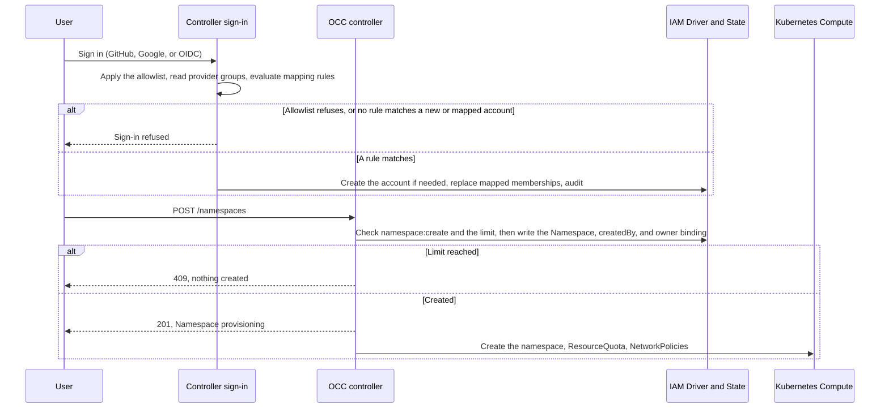

# Proposal: Default users sign in through identity provider mappings and own their Namespaces

- **ID:** RFC-0024 (provisional; renumber before merge)
- **Created:** 2026-10-29
- **Last updated:** 2026-10-29
- **RFC PR:** Not opened
- **Implementation plan:** None yet
- **Related:** [RFC-0024 Agent Author role (#4045)](https://github.com/openclaw/openclaw-enterprise/pull/4045),
  [Additional Installation administrators (#889)](https://github.com/openclaw/openclaw-enterprise/pull/889),
  [Agent OAuth connections (#3068)](https://github.com/openclaw/openclaw-enterprise/pull/3068),
  [RFC-0006](0006-basic-rbac/index.md), [Authorization](../../docs/reference/authorization.md)

## Summary

An Installation administrator maps identity provider groups to OCC Groups. At
each sign-in, OCC reads the person's provider groups, creates their account if
a mapping matches, and updates their mapped Group memberships. Members of the
built-in **Default users** Group hold the built-in **Default User** Role, which
lets them create Namespaces and nothing else. A person who creates a Namespace
becomes its **owner** and runs their own Agents there. Mappings can also put a
team into a shared Namespace with the RFC-0024 Agent Author Role. The Namespace
is the isolation boundary for connected OAuth accounts, so OCE does not need a
first-class personal Agent. Existing sign-in, account, and Namespace flows keep
their current behavior.

## Motivation

Today every capability starts with an Installation administrator:

- **Accounts.** External sign-in admits only identities that an administrator
  attached to an account created first. Unknown identities fail, and no default
  Role exists ([external sign-in](../../docs/reference/authentication/external-sign-in.md)).
- **Namespaces.** Only the bootstrap administrator's unscoped binding grants
  `namespace:create` (#889), and `createNamespace` grants its creator nothing.
- **Agents and credentials.** Every IAM write and guided provisioning require
  Installation `administer`, so other users see `MEMBER_GRANT_REFUSED`.

RFC-0024 (#4045) removes the third gap for a person whom an administrator
assigns Agent Author in one Namespace. This proposal removes the administrator
from the first two steps, and from per-person assignment, for people the
enterprise identity provider already places in a group.

The IAM model already evaluates Group bindings, and PostgreSQL already stores
Groups and memberships (`iam_groups`, `iam_group_memberships`). Nothing writes
them today.

The personal-Agent design in #3068 protects a connected account with per-Agent
checks that span many paths and miss Namespace-wide and Group grants. A
Namespace boundary gives the same protection in one place.

## Goals

- An administrator maps provider groups to OCC Groups once, instead of creating
  each account.
- A matched person gets an account at first sign-in, and their mapped
  memberships follow the provider at each sign-in.
- A Default users member creates a limited number of Namespaces, owns each one,
  and completes the regular Agent workflow there. Other users cannot read or
  change them.
- A mapped team can share Agents in a Namespace that an administrator created,
  including Agents connected to a shared OAuth account.
- A connected OAuth account is protected by its Namespace and its template's
  sharing, not by per-Agent ownership checks.
- Existing flows do not change.

## Non-goals

- Mapping provider groups to the Installation administrator Role (#889 owns
  additional administrators).
- Access requests, SCIM provisioning, Roles that owners define, or owners
  sharing their Namespace.
- Per-user resource accounting beyond the Namespace limit and the existing
  Kubernetes ResourceQuota.

## Proposal

### Owners and state

| Concern                                | Owner                                                                                     |
| -------------------------------------- | ----------------------------------------------------------------------------------------- |
| Default User Role, Default users Group | Built-in at bootstrap, like the Installation administrator Role                           |
| Mapping rules                          | New Installation IAM API and console Settings card; Installation `administer`; PostgreSQL |
| Account creation and membership        | Controller sign-in path, through the IAM Driver, in one transaction with its audit event  |
| Namespace limit                        | Installation setting (Helm `defaultUser.namespaceLimit`), always set                      |
| Owner binding and limit check          | `createNamespace`, in the Namespace creation transaction                                  |
| Agent credential grants                | RFC-0024 exact `operate` grants for the Agent's ServicePrincipal                          |

### Mapping rules

A mapping rule names one sign-in provider, one provider group, and one OCC
Group:

| Provider | Provider group                                                           |
| -------- | ------------------------------------------------------------------------ |
| GitHub   | An organization or `org/team`, read with the existing membership lookups |
| Google   | A Workspace hosted domain (`hd`), with a verified email                  |
| OIDC     | A configured claim (for example `groups`) that contains a given value    |

Google exposes groups only through its Admin API, so Google rules match a
hosted domain. Rules match exact, case-normalized values. A rule can target:

- **Default users**, the built-in Installation Group bound Installation-wide to
  the Default User Role.
- **A Namespace Group**, which an administrator creates in a team Namespace and
  binds Namespace-wide to the Agent Author Role.

A rule cannot target an Installation Group with any other binding. An
Installation-wide binding on a resource inside a Namespace would apply in every
Namespace, so the Default User Role holds only `namespace:create`; validation
and a database constraint enforce this.

### Existing flows keep working

Mapping rules add one path, account creation at sign-in, and change no existing
one. An Installation without rules behaves exactly as today:

- Administrators create accounts and attach GitHub, Google, or OIDC identities
  with the existing APIs. Those accounts sign in without matching a rule, keep
  their direct bindings, and receive no Default User Role unless an
  administrator adds them to Default users.
- The GitHub and Google allowlists (`OCC_AUTH_GITHUB_ALLOWED_ORGS`,
  `OCC_AUTH_GITHUB_ALLOWED_TEAMS`, `OCC_AUTH_GOOGLE_ALLOWED_DOMAINS`) stay. They
  run first and admit or refuse every sign-in, including accounts an
  administrator created. Rules apply only to identities the allowlist admits.
- Password sign-in, service keys, and sessions are unchanged.
- A Namespace that an administrator creates gets no owner binding and no limit;
  the administrator's unscoped binding already covers it.

### Membership at each sign-in

After the provider authenticates a person and its allowlist admits them, OCC
reads their provider groups and evaluates the provider's rules:

- **No account, a rule matches.** OCC creates the account, Principal, provider
  attachment, and matched memberships, audited with the matched rules and the
  reason `sign_in_mapping`.
- **No account, no match.** Sign-in fails and nothing is created.
- **Mapped account.** OCC replaces the mapped memberships with the matched set.
  With no match, sign-in fails and the mapped memberships are removed; the
  account and its Namespaces remain.
- **Account an administrator created.** Sign-in succeeds as today, and OCC
  still updates its mapped memberships.

Each membership records its source, a rule or an administrator. Sign-in changes
only rule memberships, so an administrator can add someone outside the
provider's groups to Default users directly. Every membership change is audited.

Memberships change only at sign-in. A person removed from a provider group keeps
access until their next sign-in or until their session expires (at most eight
hours). For immediate effect, an administrator disables the account.

### Creating a Namespace makes the creator its owner

When the caller's `namespace:create` comes from the Default User Role,
`createNamespace` checks the caller's Namespace limit, then writes the Namespace, its `createdBy` Principal, and a Namespace-wide
binding of the caller to the managed **Namespace owner** Role, in one
transaction. This extends RFC-0024's rule that only managed Roles may grant
Namespace-wide `create`.

The Namespace owner Role is the Agent Author permission set plus
`namespace:read`, `namespace:delete`, and `agent:administer`, which the native
admin UI requires for chat. Like Agent Author, it excludes IAM administration,
ServiceAccount creation, and Sandbox Policy changes. OCC creates the default
Presets with its own authority; today that step fails for a caller without
`preset:create`.

The limit counts the caller's Namespaces that are not `deleting`, under the same
lock as the insert, so concurrent requests cannot exceed it. A refused request
creates nothing and returns `409`.

_Proposed flow; none of these steps is implemented._

### Agents, credentials, and Slack

In a Namespace they own, or a team Namespace whose Group holds Agent Author, a
person uses the regular Agent workflow. RFC-0024 grants each Agent's
ServicePrincipal `operate` on exactly the Secrets and credential sources it
uses, so `MEMBER_GRANT_REFUSED` no longer applies. Guided provisioning must
accept the Namespace owner instead of requiring Installation `administer`.

Slack needs no new contract: Slack tokens are Namespace Secrets referenced from
the Agent's Configuration. The operator still provides the channel runtime and
the Slack egress proxy.

### Connected accounts follow the Namespace

An administrator marks each connection template **personal** or **shared**. OCC
cannot tell from the provider whether an account belongs to one person, so the
template decides how far a connection may reach:

| Template | Where a person can connect it                                                                     | Who can act as the account                                     |
| -------- | ------------------------------------------------------------------------------------------------- | -------------------------------------------------------------- |
| Personal | A Namespace they own, where no other human holds a grant directly or through a Group              | Only the owner; the channel restriction stays                  |
| Shared   | A team Namespace whose Group holds Agent Author, when template `use` is granted to that Namespace | Every person with access to the Agent, and its channel members |

Personal is the default and keeps the #3068 protection for accounts such as a
person's Gmail. That one Namespace check replaces the per-Agent owner and
grantee checks. Shared fits a team mailbox or a team service account: the
consent warning says that everyone in the Namespace, and anyone in the Agent's
channels, can act as the account. Any member with `agent:update` can disconnect
or reconnect it, and the connection records who connected it. A person can
still connect a personal account through a shared template; the administrator
limits this by granting shared templates only to team Namespaces.

Slack members are outside OCC IAM, so a personal connection keeps the channel
restriction until a Slack rule limits the Agent to its owner. The bootstrap
administrator's unscoped binding covers every Namespace; see
[Unresolved questions](#unresolved-questions).

### Failure and recovery

- **Provider unavailable.** Sign-in fails and memberships do not change. A
  failed group lookup never counts as "no groups".
- **Removed from the provider group, or disabled.** Owner bindings, Namespaces,
  and running Agents remain until an administrator deletes them, as in RFC-0024.
- **Deleted rule.** Its memberships are removed at each member's next sign-in.
- **Partial writes.** Each transaction writes all of its rows or none. A
  Namespace whose Kubernetes setup fails stays `provisioning` or `failed` and
  counts against the limit until it is deleted.

## Delivery and verification

Group and membership writes, and account creation at sign-in, change the IAM
Driver contract. Template sharing changes the RFC-0023 connection template
contract. The feature depends on RFC-0024 for managed Namespace-wide
bindings, Agent credential grants, and Agent Author bindings on Groups. A
separate implementation plan will cover:

1. The Default User Role, Default users Group, membership sources, and Group
   writes in the IAM Driver.
2. Mapping rules: API, storage, and console card.
3. Account creation and membership sync at sign-in for each provider.
4. The Namespace owner binding, `createdBy`, the limit, and default Presets.
5. Guided provisioning for owners, Create Namespace in the console, and an
   empty-state landing for a new user.
6. Template sharing, and the Namespace rules that replace the #3068 per-Agent
   ownership checks.

Required outcomes, proved with PostgreSQL integration tests and the regular
Kubernetes Agent workflow, with OIDC on the Keycloak lane and a real `groups`
claim:

- With no rules, administrator-created accounts sign in, allowlists refuse
  non-members, and an unknown identity is refused, as today.
- A matched identity gets one account and its mapped memberships; an unmatched
  identity gets nothing; both are audited.
- Removal from the provider group removes the membership at the next sign-in and
  refuses sign-in without a match; an administrator membership survives.
- A failed group lookup refuses sign-in and changes no membership.
- A Default users member creates a Namespace and completes the Agent workflow
  with a Secret-based model credential and a Slack app, without administrator
  action. A second user is refused every read and write there.
- The limit refuses the next Namespace, including under concurrent requests.
- Mapped team members deploy Agents in the team Namespace and are refused in
  other Namespaces.
- An owner connects a personal template in their own Namespace and is refused
  in a team Namespace. A team member connects a shared template in the team
  Namespace, and another member deploys and uses that Agent.

## Rationale and alternatives

- **Bind the Default User Role once, at first sign-in.** Simpler, but a person
  removed from the provider group keeps the Role until an administrator notices.
  Syncing at each sign-in keeps the provider as the source of truth.
- **SCIM provisioning.** Immediate removal, but a new inbound API and provider
  setup. SCIM can later write the same memberships.
- **Access requests.** Covers people outside every provider group, but needs an
  approval queue. Direct administrator membership covers exceptions for now.
- **Treat every connected account as personal.** Safe, but rules out team
  mailboxes and shared service accounts.
- **First-class personal Agents (#3068).** Needs checks on every path that can
  grant, deploy, or chat, and misses Namespace-wide and Group grants.

## Unresolved questions

- **Default Namespace limit.** One per user, or a small number for separate work
  and test Namespaces? Product decides.
- **OIDC group claims.** Some providers omit large group lists from the ID token.
  Is the ID token or UserInfo claim enough for the first release?
- **Administrator mappings.** Should mappings later grant the Installation
  administrator Role, or should #889 keep administrators explicit?
- **Administrator access to owners' Namespaces.** Should administrators keep
  deploy and native-admin access to owners' Agents, especially Agents with a
  connected account? Secret values stay undisclosed either way.
- **Connection templates.** Grant template `use` to Default users, or keep
  granting it per Namespace or person?
- **Slack and connected accounts.** Should shared connections allow channels by
  default? Can a personal connection allow Slack when the Agent accepts direct
  messages only from its owner? That needs a Slack identity rule OCC can verify.
- **Inactive accounts.** Should OCC report Namespaces whose owner no longer
  matches a rule or is disabled?

## References

- [Authorization](../../docs/reference/authorization.md), including
  [access bindings and Groups](../../docs/reference/authorization.md#access-bindings-and-groups),
  and the [permissions cheat sheet](../../docs/reference/cheatsheets/permissions.md)
- [Account provisioning](../../docs/reference/authentication.md#account-provisioning)
- [External sign-in allowlists](../../docs/reference/authentication/external-sign-in.md#organization-and-team-allowlist)
- [Namespace IAM policy flow](../../docs/flows/namespace-iam-policy.md)
- [Agent provisioning flow](../../docs/flows/agent-provisioning.md)
- [Slack integration](../../docs/guides/integrations/slack.md)
