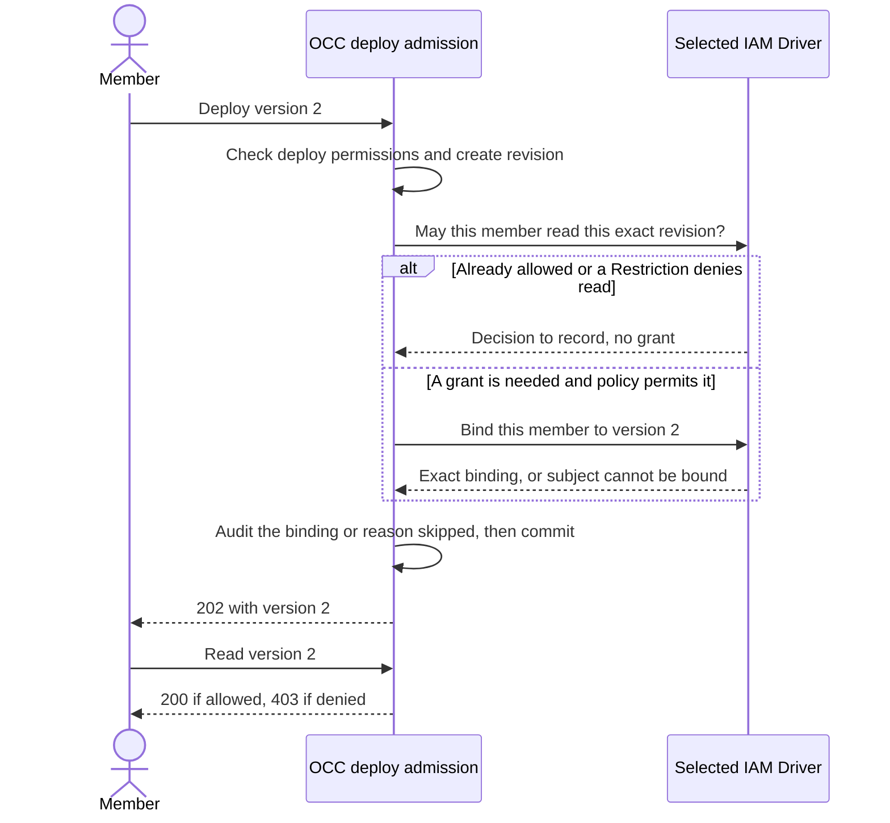

# Proposal: Let a deployer read the Agent revision they just deployed

- **ID:** RFC-0024
- **Created:** 2026-10-07
- **Last updated:** 2026-10-23
- **RFC PR:** [#1606](https://github.com/openclaw/openclaw-enterprise/pull/1606)
- **Delivery:** [Implementation PR #1605](https://github.com/openclaw/openclaw-enterprise/pull/1605)
  depends on this decision. No separate plan.

## Summary

A member deploys version 2. Deploy returns `202 Accepted` with the new revision;
her next request to read that revision returns `403 Forbidden`. In the reported
case, the Console then showed _version 1_ as current and successful.
[The Console now explains the gap](https://github.com/openclaw/openclaw-enterprise/pull/849),
but she still needs an administrator to grant access before she can follow version 2.

**Decision requested:** Let the OpenClaw Controller (OCC), when it admits version 2,
grant this member `agent_revision:read` on that exact revision. IAM maintainers must decide how long that access lasts. If an administrator
withdraws Agent deploy or Configuration read, should the member still be able to
read version 2 and its queued deployment? The answer determines what
[implementation PR #1605](https://github.com/openclaw/openclaw-enterprise/pull/1605)
must enforce.

## What changes for the member

[Deploy](../../docs/reference/agents/deployment.md#revisions-and-deployment) checks
Agent `deploy`, `read` on the Configuration it captures, `operate` on the bound
Secrets, and permission for the Harness authentication source.
[Revision read is separate](../../docs/reference/authorization.md#manage-namespace-policy):
a binding on the Agent cannot authorize a read of its revisions. Sharing the Agent therefore does not, by itself, let another member read version 2.

With this proposal, in a Namespace where policy permits the grant:

1. **Deploy version 2 → `202`.** OCC has accepted the deployment, not declared
   version 2 running. The deploy response already includes the revision snapshot.
2. **Read version 2 → `200`.** The member can also follow deployment status if she
   has Agent `read` and `operate`. The grant adds no access to logs or native administration.
3. **Read the administrator's version 1 → `403`.** She gets no access to earlier
   or later revisions from this grant. Someone she shares the Agent with still
   needs their own permission to read version 2.

If a [Restriction](../../docs/reference/authorization.md#restrictions) denies
revision read, the intended sequence is still `202` then `403`. That Restriction
governs the later read; it cannot conceal the snapshot deploy already returned.
To prevent the deployment, restrict `deploy`.

## Make the access decision inside deploy admission

`OpenClawController.deployAgentWithAuthorization` locks the Namespace and Agent,
creates the revision, sets desired state and queues reconciliation. Decide access
after the revision row exists, before committing that transaction and its deploy
audit event. A later read uses the ordinary authorization path.

The sequence below is proposed for an IAM Driver that can commit Namespace
policy in the same transaction. “No grant” is an intentional, audited outcome.
An unexpected failure to write the grant or audit event instead rolls back admission,
including the revision.

### Decide and record the grant

| At admission, in this order                                                                                                                                                                       | What OCC writes                                                                                                                                      |
| ------------------------------------------------------------------------------------------------------------------------------------------------------------------------------------------------- | ---------------------------------------------------------------------------------------------------------------------------------------------------- |
| The selected IAM Driver cannot commit this policy with platform State (`namespacePolicyTransaction` is not `platform-unit-of-work`, or the required Role and binding operations are unavailable). | No policy. Record `external-iam-policy`; never write around the Driver.                                                                              |
| The Driver already allows the exact read, as for the bootstrap administrator.                                                                                                                     | No policy. Record `already-readable`.                                                                                                                |
| The Driver denies read and returns nonempty `restrictionIds`.                                                                                                                                     | No Role or binding. Record `restricted` and those IDs, even for an exact-revision denial.                                                            |
| Read needs a grant, but the caller cannot be a Namespace binding subject (for example, an Installation-scoped ServicePrincipal).                                                                  | No binding. Remove the Role only if this admission created it; record `subject-not-bindable` and continue deploy.                                    |
| Read needs a grant and the caller can be bound.                                                                                                                                                   | Create `binding_<revisionId>_deployer_read` for this subject and revision, through the Driver's normal subject check and target and Namespace locks. |

Reuse one immutable Role per Namespace, `role_<namespaceId>_deployed_revision_read`,
named “Deployed revision read,” with exactly `agent_revision:read`. The precedent
is `role_<namespaceId>_agent_secret_operate`. If the Role ID already exists with
different permissions, fail admission with `409` and name the conflicting Role.

In the deploy event, put the binding ID, subject, Role and target in
`details.grantedAccessBindings`, using the `removedAccessBindings` record shape.
On a skip, omit that list and set `details.revisionReadGrantSkipped`; for
`restricted`, also set `details.revisionReadRestrictionIds`. Provisioning deploys
record the same details in their handoff checkpoint event.

### Later access and deletion

An administrator can remove this binding through the [Namespace IAM
API](../../docs/flows/namespace-iam-policy.md) without changing the Agent. A
later Restriction overrides the binding but leaves it in policy. OCC deletes
revisions with their Agent; its deletion finalizer atomically removes bindings
targeting those revisions, identified in the accepted delete event's
`accessBindingsRemovedOnCompletion`. Namespace teardown removes all Namespace policy.

## Unresolved questions

### When an administrator withdraws a deploy prerequisite

Assume the member keeps Agent read and operate. Consider withdrawing Agent
deploy and Configuration read separately. In both cases the next deploy must
return `403`. Choose one policy for the previously admitted revision:

| Policy                             | Read version 2 and its queued deployment after withdrawal   | Administrator action                                           |
| ---------------------------------- | ----------------------------------------------------------- | -------------------------------------------------------------- |
| End the access derived from deploy | Both return `403` unless another grant authorizes the read. | Grant revision read explicitly for a handoff or investigation. |
| Keep the exact revision grant      | Both return `200` while the binding remains effective.      | Remove that binding to end the access granted by deploy.       |

[Review of draft #1605](https://github.com/openclaw/openclaw-enterprise/pull/1605#pullrequestreview-5532859520)
observed the second policy after withdrawing each prerequisite separately.
Deleting the generated binding then denied both reads while another authorized
revision remained readable. IAM maintainers still need to select the lifetime.
Verify the selected outcomes against both withdrawals and retain the independent
grant as a control.

### Who may create revision grants?

- **Product:** Must an Installation be able to reserve all revision grants to
  administrators? This proposal has no opt-out. Denying revision read is a
  different policy from reserving who can grant it.

## Rationale and alternatives

An exact binding is visible, removable and consistent with the
[`readAdmittedRevisions` direction in RFC-0006](0006-basic-rbac/interfaces.md),
without waiting for creation profiles, approval or Groups deferred past 0.x.
Deriving read from current Agent and Configuration access would instead add the
IAM evaluator's first derived rule and could expose revisions to people who
never deployed them. Keeping the manual grant preserves today's policy at the
cost of an administrator intervention after every member deploy.

One Role per revision would roughly double the policy rows. An unconditional
binding would clutter policy for administrators who already have read, and could
not override a Restriction. Failing deploy on that Restriction would deny an
action the policy did not name.

## Delivery and verification

Review [implementation PR #1605](https://github.com/openclaw/openclaw-enterprise/pull/1605)
only after deciding this RFC. It covers deploy and provisioning audit details,
[authorization](../../docs/reference/authorization.md), the [permissions cheat
sheet](../../docs/reference/cheatsheets/permissions.md), deployment and Agent
details guides, and the Namespace policy flow. The Console can use its existing
revision list and unreadable-version message.

The decisive PostgreSQL integration case is the three requests above, plus listing
only version 2, denying the person the Agent was shared with, and finding the exact
binding in the deploy event. Also require the recorded outcome and policy effects
in every admission row above; exercise Installation, Namespace and exact-revision
Restrictions, repeated deploys reusing the Role, and Agent deletion removing the
bindings. These are acceptance conditions, not a claim of live verification.
Verify provisioning separately through its admission and audit path.
