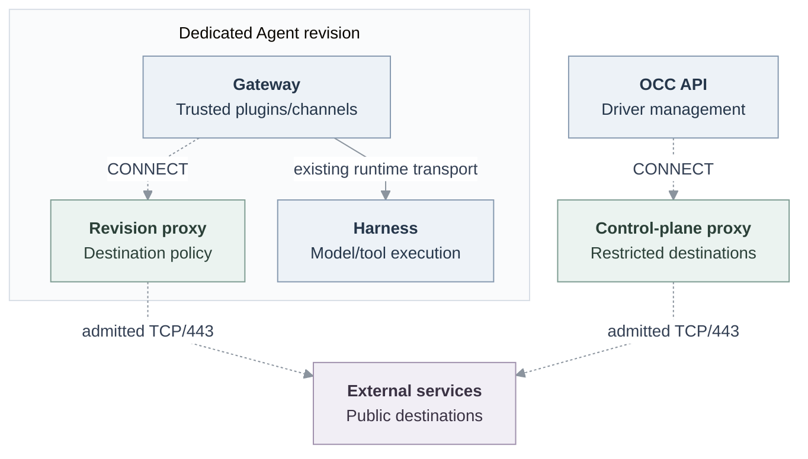

# Proposal: managed outbound HTTPS for dedicated Gateways

- **ID:** RFC-0024
- **Created:** 2026-10-14
- **Last updated:** 2026-10-24
- **Implementation:** [Draft PR #2518](https://github.com/openclaw/openclaw-enterprise/pull/2518)
- **Delivery plan:** [Implementation-owned plan](https://github.com/openclaw/openclaw-enterprise/blob/17340527e83e97f5bfa77220cb7f04ee6124bb65/specs/plans/0023-gateway-outbound.md)

## Problem and proposed decision

Dedicated Gateways run trusted OpenClaw plugins, channel clients, and integration
services. Their Kubernetes network fence permits selected internal transports and
a Slack-specific proxy. It does not provide a general route for plugin discovery
or integration HTTPS. Plugin manifests do not declare every destination that
their code may contact.

Let administrators approve external connectivity for trusted Gateway software.
Extend the existing Agent, Compute, and Channel contracts: each dedicated Agent
selects its access, and Kubernetes Compute supplies an isolated HTTP CONNECT proxy
for each revision that needs external access. NetworkPolicies make that route
mandatory. Replace the Slack-specific transport with this generic facility.

This is destination-controlled transport, not credential mediation. Plugins remain
trusted code in the Gateway process and retain their native integration credentials.
Model credentials remain with the dedicated Harness. This proposal does not
isolate plugins from each other or protect Gateway credentials from a compromised
plugin. [Credential Proxy](0023-egress-proxy-credential-lifecycle/index.md) and
[Sandbox policies](../../docs/reference/sandbox-policies.md) retain their own
contracts; composing them with this transport requires separate qualification.

## Access and ownership

The Agent field `gatewayOutbound` belongs to OpenClaw Enterprise (OCE), outside
native Configuration values:

| Selection                | Additional Gateway access                                                    |
| ------------------------ | ---------------------------------------------------------------------------- |
| `channelsOnly` (default) | None beyond enabled, supported channels' requirements.                       |
| `restricted`             | Exact administrator-approved DNS hosts on TCP/443.                           |
| `publicHttps`            | Public TCP/443 for the whole trusted Gateway, subject to address exclusions. |

Trusted Channel Drivers contribute management and Gateway destinations. Enabling
a supported channel adds its requirements; disabling it removes only that
contribution on the next deployment. Manually approved access remains separate.
Kubernetes Compute declares and validates its capability through the platform
contract. OpenClaw Control Plane (OCC) does not hardcode Kubernetes settings or
Slack destinations.

The Installation controls whether outbound access and public mode are enabled,
the proxy image and resources, and forbidden infrastructure CIDRs. Public mode is
disabled by default. Operators must exclude actual cluster, API-server, database,
node, and other infrastructure addresses, including publicly addressed services.
There is no private-network exception in this delivery.

Changing the selection requires both `update` and `administer` on the exact Agent,
in addition to existing Configuration and credential grants. Configuration edits
and plugin installation cannot widen it. Deployment still requires `deploy` and
current protected-reference checks. Successful mutations and authorization denials
retain attributable audit evidence; worker dispatch rechecks admitted authority.

## Routing and enforcement

Proposed routes are dashed. The existing Gateway–Harness transport and Harness
egress remain with their current Compute and Sandbox owners.

Each revision owns a proxy Deployment, ClusterIP Service, nonsecret policy, and
NetworkPolicies. Only its Gateway may connect to that proxy. Different Agents do
not pool permissions. The proxy receives no provider credentials, Kubernetes API
token, shared workspace, or persistent state. Platform-controlled labels and
policies establish the peer boundary; namespace administrators remain trusted.

Compute gives the Gateway one proxy route for channels and integrations, with
exact exclusions for approved internal endpoints. Caller-supplied proxy settings
cannot replace it. The Gateway receives no direct public TCP/443 grant. Clients
that ignore the proxy fail at the network fence rather than bypass policy.

The proxy accepts CONNECT only to port 443. It checks the destination policy,
resolves through trusted DNS, rejects a result set containing any forbidden
address, and pins a vetted IPv4 address for the connection. Mandatory exclusions
cover private, loopback, link-local, metadata, shared, multicast, and reserved
ranges, plus Installation exclusions. Public mode also permits vetted public
IPv4 literals; restricted mode does not. IPv6 targets and IPv6-only resolution
are unsupported. A redirect needing another tunnel repeats admission.

TLS remains end-to-end, with native certificate and hostname verification. The
proxy does not inspect encrypted HTTP methods, paths, bodies, or WebSocket frames.
TCP/443 permission is not proof that the client uses HTTPS, nor does it prevent
disclosure to an allowed destination. Native credential and action authorization
remain necessary.

## Deployment and withdrawal

Saving changes updates desired state. Deployment snapshots the selected access,
channel requirements, and admitted Installation exclusions into the immutable
revision. Unsupported selections fail admission; forbidden resolved destinations
fail CONNECT. Compute prepares the proxy before starting its Gateway. Failed
preparation grants no fallback. The Console shows required channel access,
additional access, draft versus deployed state, and readiness or denial evidence;
it does not expose proxy addresses or Kubernetes object settings.
Diagnostics exclude credentials, HTTP bodies, and unbounded provider output.

Runtime policy combines admitted exclusions with current exclusions. Loosening
the Installation ceiling cannot broaden an old revision. Tightening it reconciles
running proxies and closes affected established tunnels before OCC reports the
change applied. A maintenance interval is not a total withdrawal deadline: queue
delay and Pod termination also count.

On terminal loss of deployer, credential, backend, or Sandbox authority, or
refusal of admitted access by current configuration, OCC durably records access
withdrawal before infrastructure effects. Retries and restarts finish removal
even if authority returns. For a revision also admitted to the public GitHub
reader, withdrawal independently removes that reader's policy and terminates its
exact Harness, even if its configured peer is unchanged. All selected closures
must finish before terminal completion, preserving failure and retirement
obligations. Ordinary Harnesses without that reader access retain their existing
behavior. Restoration requires a new authorized revision.

During normal stop, retain the proxy while the Gateway drains, then remove it
after Gateway termination. Retirement deletes only that revision's resources;
stale cleanup cannot delete a successor. Agent deletion removes all its proxies.
Retire the replaced Agent-wide channel grants only after affected Gateway Pods
terminate, so established connections do not survive the old route.

## Control-plane requests

Credential validation and directory lookup happen before an Agent Gateway exists.
The OCC API therefore uses a separate restricted instance of the same proxy
implementation. Trusted Driver management operations supply its destinations;
Agent grants cannot widen them. Driver clients receive this transport explicitly.
Database, Kubernetes, and internal clients retain their own transports.

Replace the Slack-specific proxy process, packaging, and configuration while
preserving credential validation, directory lookup, Gateway HTTPS, Socket Mode,
and cleanup. Slack owns its endpoint declarations. Other Channel Drivers can
contribute requirements, but this contract does not implement Teams credentials,
callbacks, native configuration, or provider qualification.

## Alternatives and operating cost

The proposed baseline uses standard NetworkPolicy enforcement, without requiring
a particular CNI. Compare alternatives against the same originating process,
mandatory route, policy isolation, and connection-withdrawal requirements:

| Alternative                                   | Trade-off against this proposal                                                                                                                                                                                               |
| --------------------------------------------- | ----------------------------------------------------------------------------------------------------------------------------------------------------------------------------------------------------------------------------- |
| Keep the Slack-only route                     | Lowest change, but leaves ordinary trusted integrations without connectivity.                                                                                                                                                 |
| Direct public TCP/443 with address exclusions | Simpler public mode, but standard NetworkPolicy does not express hostname rules. Existing-connection withdrawal is implementation-defined.                                                                                    |
| CNI hostname policy, such as Cilium           | Avoids proxy-aware clients, but adds a specific networking dependency and DNS-derived IP policy semantics.                                                                                                                    |
| Shared or tenant proxy                        | Reduces process overhead. Requires trustworthy revision-to-policy mapping, selective tunnel withdrawal, and shared failure handling; credentials or fenced listeners are possible identity mechanisms.                        |
| Proxy sidecar                                 | Shares the Gateway's Pod-level NetworkPolicy permissions. Making forwarding mandatory requires another enforcement boundary.                                                                                                  |
| OpenShell-managed Gateway                     | Could mediate Gateway traffic by running the Gateway inside an OpenShell sandbox. OCE currently delegates only the Harness; Gateway placement, routing, and lifecycle would require additional integration and qualification. |

[Kubernetes NetworkPolicy semantics](https://kubernetes.io/docs/concepts/services-networking/network-policies/)
explain both Pod-level enforcement and existing-connection limits.
[OpenShell ownership](../../docs/reference/drivers/openshell-sandbox.md#ownership-model)
explains OCE's current process boundary. OpenShell's existing
[workload and service support](https://github.com/NVIDIA/OpenShell/blob/v0.1.5/docs/how-it-works/sandboxes/overview.mdx)
makes Gateway containment a candidate extension of OCE's integration. Neither
destination control nor credential mediation substitutes automatically for the other.

Separate revision proxies make policy identity and tunnel ownership follow
existing Kubernetes resource ownership. Terminating one proxy closes its tunnels
without adding a shared proxy session protocol. The cost is an extra process and
objects per prepared or running revision needing access. The prototype requests
25m CPU and 64Mi memory per proxy, with one replica; replacement interrupts its
connections and clients must reconnect. These defaults are not fleet-scale
capacity or availability evidence.

Topology and forwarding implementation are separate decisions. The prototype
uses a small Node CONNECT process. A maintained proxy such as Envoy or Squid
could preserve the topology if it meets the same destination checks, address
pinning, WebSocket lifetime, shutdown, resource, and logging contract. No such
configuration is qualified here. [Envoy's security guidance](https://www.envoyproxy.io/docs/envoy/latest/configuration/http/http_filters/dynamic_forward_proxy_filter)
also requires independent restrictions against private-address and DNS attacks.
Review should assess this reuse opportunity without assuming a named product is
already an equivalent replacement.

## Compatibility and required proof

The first delivery targets dedicated Gateways with proxy-aware HTTPS clients and
IPv4 upstreams. The managed Gateway requires Node.js 24.5 or newer to use the
generated proxy settings with its standard HTTP clients. Libraries with custom
transports may need an explicit proxy agent. No UDP/QUIC, IPv6-only transport,
arbitrary-plugin compatibility, or plugin installation/persistence is promised.
Embedded execution retains its existing networking. Dedicated native OpenClaw,
non-Codex models, Teams, and protected Harness/Credential Proxy compositions need
separate qualification.

Acceptance requires the regular API-to-deployment workflow: exact authorization,
PostgreSQL persistence, immutable admission, proxy readiness, native Gateway
requests, and attributable denial evidence. Prove restricted/public access,
automatic Slack plus extra hosts, direct-socket and forbidden-address denials,
DNS pinning, cross-Agent isolation, unchanged Harness credentials and networking,
and lifecycle cleanup. Tightening must close an already established tunnel while
stale cleanup leaves a successor intact. Prove control-plane routing independently
of a Gateway.
Rebuilt Console previews and live provider/runtime checks establish different
outcomes; record missing prerequisites without substituting synthetic proof.
Implementation results remain in the linked draft and its plan, not in this
decision document.
