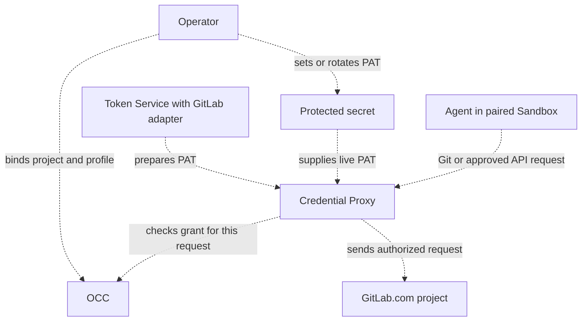

# Proposal: Support GitLab.com repository credentials

- **ID:** RFC-0024
- **Created:** 2026-10-21
- **RFC PR:** [#3137](https://github.com/openclaw/openclaw-enterprise/pull/3137)
- **Implementation plan:** [0024-gitlab-repository-credentials](../plans/0024-gitlab-repository-credentials.md)
- **Related:** [Feature request #3135](https://github.com/openclaw/openclaw-enterprise/issues/3135), [RFC-0023: Credential Proxy and credential lifecycle](0023-egress-proxy-credential-lifecycle/index.md), [implementation PR #2487](https://github.com/openclaw/openclaw-enterprise/pull/2487)

## Summary

Teams that keep source in GitLab must mirror their projects to GitHub or run Agents without repository access. We propose binding an Agent to one GitLab.com project. The selected Credential Proxy would authenticate approved requests with a project service account’s personal access token (PAT). The Agent would receive neither the PAT nor general API access.

The design includes opening a draft merge request from an approved branch. Maintainers still need to choose who supplies and rotates the PAT.

## Goals

- Add GitLab.com alongside GitHub. Support Git reads, approved branch pushes, and draft merge-request creation.
- Authorize each Git or API request for the bound project. Deny missing, expired, or revoked credentials and disallowed operations.
- Document setup, verification, expiry, rotation, and revocation.

## Non-goals

- This proposal covers a GitLab.com project binding. Configuring multiple Git providers together is a separate design.
- Self-managed GitLab or configurable upstream hosts.
- Human-delegated access as the default team workflow.
- Merge, approve, or administer merge requests.
- Giving an Agent a GitLab token or general API access.
- Requiring automatic PAT creation or rotation for the first release.
- Claiming this research spike tested a live GitLab.com project.

## Proposal

### Provider and project binding

The existing `repo` capability lists approved projects and resolves bindings. The proposed GitLab Repo Driver binds a numeric project ID to its canonical Git path on `https://gitlab.com`. The sender uses the ID for API routes, the path for Git, and the approved ref for pushes. Reject any origin, path, or project ID that differs from the binding.

Current composition selects GitHub and configures `gh`. Its repository sender admits Git operations and a [draft pull request](../../packages/contracts/src/prepared-github-egress.ts). Its separate installation profile admits GitHub REST and GraphQL. GitLab needs client configuration and a mapping from each approved operation to its Git exchange or API method, route, and request fields.

### GitLab mapping to the GitHub team runbook

The GitHub runbook uses an organization-owned App installed only on selected repositories. It stores the private key in the protected credential path, then binds and verifies access through the normal Agent workflow. GitLab's closest team-owned model is a project service account with a personal access token (PAT). It is project-bound, available on all GitLab.com tiers, and limited to 100 accounts per top-level group on Free. A top-level group Owner must verify identity. This model does not use GitHub's App installation and private-key flow. [GitLab service accounts](https://docs.gitlab.com/user/profile/service_accounts/)

| GitHub team runbook step                                                         | GitLab.com counterpart and gap                                                    |
| -------------------------------------------------------------------------------- | --------------------------------------------------------------------------------- |
| Create an organization-owned App; disable webhooks and user OAuth.               | Create a project service account; authenticate Git and API requests with its PAT. |
| Grant selected repository permissions and install on only intended repositories. | Assign the minimum project role and project-bound fine-grained grants.            |
| Record App, installation, and repository IDs.                                    | Save the project ID and canonical path; do not accept them from Agent input.      |
| Put the App private key in the protected service input.                          | Keep the PAT in the protected service credential path, outside Agent files/logs.  |
| Bind through the registry and use the normal Agent flow.                         | Bind the project; fix the host to gitlab.com and authorize every request.         |
| Verify changes and PR creation, then retire and rotate credentials.              | Verify Git and draft MR; deny other operations. Track expiry and rotate safely.   |

### Capability parity with GitHub

These profiles describe the proposed GitLab tasks. The adapter may use `glab` or call the API directly. OCE enforces the selected profile even when the PAT grants more. GitLab distinguishes code download from push and MR reads from creation. [Git permissions](https://docs.gitlab.com/auth/tokens/fine_grained_access_tokens_other/), [REST permissions](https://docs.gitlab.com/auth/tokens/fine_grained_access_tokens_rest/).

| Profile and GitHub task                                                | GitHub usage                                                        | GitLab usage                                                                                                                                                                                                                                                |
| ---------------------------------------------------------------------- | ------------------------------------------------------------------- | ----------------------------------------------------------------------------------------------------------------------------------------------------------------------------------------------------------------------------------------------------------- |
| `git-read`: inspect project, issues, PRs, diffs, checks                | `gh repo view`, `gh issue list/view`, `gh pr list/view/diff/checks` | [`glab repo view`](https://docs.gitlab.com/cli/repo/view/), [`glab issue list/view`](https://docs.gitlab.com/cli/issue/list/), [`glab mr list/view/diff`](https://docs.gitlab.com/cli/mr/list/), [`glab ci status`](https://docs.gitlab.com/cli/ci/status/) |
| `git-write`: push branch; create or discuss draft PR; issues read-only | `git push`, `gh pr create --draft`, `gh pr comment`                 | `git push`, [`glab mr create --draft`](https://docs.gitlab.com/cli/mr/create/), [`glab mr note`](https://docs.gitlab.com/cli/mr/note/)                                                                                                                      |
| `git-full`: add issue creation and comments                            | `gh issue create/comment`                                           | [`glab issue create`](https://docs.gitlab.com/cli/issue/create/), [`glab issue note`](https://docs.gitlab.com/cli/issue/note/)                                                                                                                              |

For draft creation, the sender builds `POST /projects/:id/merge_requests` from the bound project ID, an approved source branch, an explicit target branch, and a title prefixed with `Draft:`. Both branches must already exist in that project. Reject a missing branch, a foreign `target_project_id`, or unapproved fields before sending the create. This operation cannot push, fork, mark ready, merge, or approve. [Create a merge request](https://docs.gitlab.com/api/merge_requests/#create-a-merge-request) · [Draft titles](https://docs.gitlab.com/user/project/merge_requests/drafts/)

Record the operation ID before the first HTTP write. Keep its receipt when releasing the credential. If the sender proves it wrote no HTTP bytes, record that the create was not sent. If GitLab may have received it, keep the outcome unknown and reconcile the original operation without resubmitting. Confirm creation only from GitLab evidence tied to that operation, project, and both branches.

Service accounts can hold fine-grained PATs: GitLab's API documents `granular_scopes` on rotated service-account tokens. The statement that fine-grained-token enforcement excludes service accounts describes enforcement, not token capability. GitLab documents project-bound Code Download/Push and Merge Request Read/Create permissions. However, its project service-account token endpoint documents coarse scopes; fine-grained PAT creation for the current user is an experimental GraphQL mutation. Validate a supported setup before finalizing the runbook. If this requires a broad bootstrap token, revoke it before binding. Rotation preserves granular grants but revokes the old token when issuing its replacement, so update the protected credential as one controlled operation. [Fine-grained PATs](https://docs.gitlab.com/auth/tokens/fine_grained_access_tokens/), [Git and REST permissions](https://docs.gitlab.com/auth/tokens/fine_grained_access_tokens_other/), [service-account token API](https://docs.gitlab.com/api/service_accounts/), [GraphQL token creation](https://docs.gitlab.com/api/graphql/reference/experimental/mutations/#personalaccesstokencreate).

### Relationship to RFC-0023 and its implementation

RFC-0023 remains Proposed. Its [merged implementation](https://github.com/openclaw/openclaw-enterprise/pull/2487) gives the OpenClaw Control Plane (OCC) ownership of grants, execution identity, expiry, and withdrawal. Reuse its provider-scoped grant identity and delivery records. For GitLab, the paired Sandbox must prevent direct access. The selected Credential Proxy must check the execution, current grant, and actual operation before using the PAT. Withdrawal denies the next request even while the PAT is valid. A request that already passed that check may finish.

GitLab issues the PAT. With a live secret, the operator rotates or revokes it in GitLab and updates the protected secret. With a prepared credential, Token Service owns acquisition, custody, and retirement through a GitLab adapter. Requests cannot issue or renew tokens. Ending a sender’s lease releases its local copy. The source owner handles revocation at GitLab.

### Architecture

Dashed arrows show the proposed GitLab path. The sender uses the selected PAT source.

## Delivery and verification

Use one running Agent, the selected Credential Proxy and paired Sandbox, and an authorized GitLab.com project. Record the installed versions, tier, project role, and token grants.

1. Clone a commit absent locally. Push a known commit to the allowed branch and verify its SHA at GitLab. Open a draft MR and verify its draft status, project, branches, and head commit in GitLab. Drop the reply to a separate create and verify recovery sends no second POST.
2. Attempt a forbidden push. Verify no upload reaches GitLab. Withdraw the OCE binding while the PAT is still valid. Try a fresh fetch from the same Agent. Verify denial while its conversation still works. Use an observer that saw the allowed Git traffic to confirm zero upstream fetch requests. Record any gap in that observation.

The [implementation plan](../plans/0024-gitlab-repository-credentials.md) covers credential failures and token non-disclosure. This spike ran no live GitLab operations. Stock OpenShell’s refusal of unqualified Git access is a separate result.

## Rationale and alternatives

GitLab.com Free supports project service accounts, and fine-grained permissions can bound project Git and REST operations. The documented service-account API does not describe a stable fine-grained token creation procedure, so validate setup and rotation before selecting this path. OCE must enforce its own project and operation boundary.

Support lets teams keep GitLab as their source of truth and retain their review and CI path while using the managed workflow already available for GitHub.

## Unresolved questions

1. **Credential maintainers:** Should GitLab use a live static secret or a prepared-token provider? Which owner handles expiry, replacement, custody, and retirement for the selected source?
2. **Product maintainers:** Can a supported GitLab.com project-service-account flow create the required fine-grained PAT without an experimental or lingering broad token, and how should rotation preserve its grants without interrupting active bindings?

## References

- [Repository credentials team runbook](../../docs/guides/repository-credentials/team-runbook.md)
- [Current repository credential reference](../../docs/reference/repository-credentials.md)
- [Repository policy contract](../../packages/contracts/src/repo.ts)
- [Protected repository-delivery contract](../../packages/contracts/src/protected-repository-git.ts)
- [Credential Proxy Driver contract](../../packages/contracts/src/credential-proxy.ts)
- [Current provider composition](../../apps/controller/src/composition/repository-credentials/platform.ts)
- [GitHub client router](../../apps/controller/src/drivers/repo/github/credentials/client/router.ts)
- [RFC-0008: Repository credentials](0008-repository-credentials/index.md)
- [RFC-0023: Credential Proxy and credential lifecycle](0023-egress-proxy-credential-lifecycle/index.md), [merged implementation PR #2487](https://github.com/openclaw/openclaw-enterprise/pull/2487)
- [RFC format example, PR #3050](https://github.com/openclaw/openclaw-enterprise/pull/3050)
- [GitLab service accounts](https://docs.gitlab.com/user/profile/service_accounts/)
- [GitLab fine-grained PATs](https://docs.gitlab.com/auth/tokens/fine_grained_access_tokens/)
- [GitLab fine-grained Git permissions](https://docs.gitlab.com/auth/tokens/fine_grained_access_tokens_other/)
- [GitLab fine-grained REST API permissions](https://docs.gitlab.com/auth/tokens/fine_grained_access_tokens_rest/)
- [GitLab service-account token API](https://docs.gitlab.com/api/service_accounts/)
- [GitLab GraphQL token creation](https://docs.gitlab.com/api/graphql/reference/experimental/mutations/#personalaccesstokencreate)
