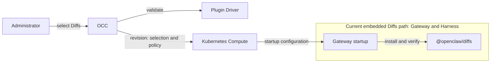

# RFC-0024: Managed native OpenClaw plugins

- **Created:** 2026-10-21
- **Implementation plan:** [Managed native OpenClaw plugins](../plans/0024-managed-native-openclaw-plugins.md)

## Decision for review

An administrator should be able to authorize a Google connection once, then give each Agent a different set of actions on that connection. For the first release, the administrator selects a reviewed Google integration before deployment. The Gateway delivers its skill and the dedicated Harness worker runs [gog](https://github.com/openclaw/gogcli). Before injecting a credential, the proxy checks each request against the calling execution’s binding. A script that calls Google directly must pass the same check as gog.

**Two choices need maintainer agreement.** Suppose an administrator turns off Gmail writes for one Agent while a directly configured credential rule still allows the same operation. Which rule governs the next request? If the Agent is already running, when does that decision take effect? The [credential authorization policy](#credential-authorization-policy) defines what the Console must show and how other Agents sharing the connection stay isolated.

## Plugins and capabilities

OpenClaw uses _plugin_ broadly. An integration can combine several components:

- **Gateway extension:** Code loaded in the Gateway. It can register tools, channels, providers, hooks, and other runtime behavior, and shares the Gateway's trust boundary.
- **Tool:** An operation the model can call. The runtime loads its handler, which may do the work itself or delegate it: Diffs registers a Gateway-side handler; in the proposed Google path, the Harness’s general execution tool launches gog in its worker; and an MCP client forwards a tool call to its server. OCE must admit the handler's placement and any delegated execution.
- **Skill:** Instructions that guide the model. A skill may point to scripts or executables.
- **CLI:** An executable invoked through an execution tool. The proposed Google placement puts gog in the Harness worker.
- **MCP server:** A server that exposes named tools through Model Context Protocol (MCP). In the proposed dedicated OpenClaw path, the MCP client in the Harness pod sends a request through admitted egress; the remote server executes the tool where it is hosted.

An **OCE integration** is an administrator-selectable Plugin Driver catalog entry that associates reviewed components with connection requirements, placement, and access choices. Three OCE components handle it:

- **[Plugin Driver](../../docs/reference/drivers/plugin.md):** Provides the catalog and validates policy.
- **OpenClaw Control Plane (OCC):** Owns Agent selection and revision admission.
- **Compute:** Prepares and activates the runtime for the admitted revision.

The current [managed native plugin flow](https://github.com/openclaw/openclaw-enterprise/blob/c2e52fc9e367d7e0327270162ca5a99383ec1398/docs/flows/agent-plugins.md#L105-L179) uses Diffs, a Gateway extension that exposes a diff tool and viewer. OCC records the selection and policy in the Agent revision; Compute projects startup configuration; Gateway startup resolves the bundled catalog release, then installs and verifies the package. In [embedded OpenClaw](https://github.com/openclaw/openclaw-enterprise/blob/c2e52fc9e367d7e0327270162ca5a99383ec1398/docs/guides/topics/remote-harness.md#L3-L6), Gateway and Harness run in one workload, so there is no separate Harness pod to receive another copy. OCE's [managed OpenClaw catalog currently requires embedded mode](https://github.com/openclaw/openclaw-enterprise/blob/c2e52fc9e367d7e0327270162ca5a99383ec1398/apps/controller/src/drivers/plugin/index.ts#L372-L375).

**Proposed dedicated Google path:** OCE must project the admitted Google selection into OpenClaw’s skill discovery and worker-turn setup. The Gateway [builds a skill-aware system prompt](https://github.com/openclaw/openclaw/blob/f8386bc7df0a6c9eda7a28ae81943c5c06a414ff/src/gateway/worker-environments/worker-turn-prompt.ts#L118-L133) and [sends it with selected skill resources to the worker](https://github.com/openclaw/openclaw/blob/f8386bc7df0a6c9eda7a28ae81943c5c06a414ff/src/gateway/worker-environments/worker-turn-execution.ts#L512-L586). The [gog skill pinned by OCE](https://github.com/openclaw/openclaw/blob/f8386bc7df0a6c9eda7a28ae81943c5c06a414ff/skills/gog/SKILL.md#L1-L60) guides the model to commands such as `gog gmail search`; the [dedicated OpenClaw Harness](https://github.com/openclaw/openclaw-enterprise/blob/31156790238dff36eaf29bce1a2f6ae5dce50834/docs/guides/topics/remote-harness.md#L81-L96) runs gog through its native exec tool. Google operations are not registered as separate native tools. The Gateway retains turn admission, routing, and transcripts but loads no Google extension. OCE must qualify skill eligibility and resource delivery for the worker where gog is installed.

OCE can admit reviewed third-party skills, tools, and executable dependencies for Agent selection when their runtime code executes in an admitted worker or sandbox. Review the complete release and its dependencies: skill instructions can direct authority the Agent already has. Gateway-loaded code requires separate platform-managed review and admission. OCE retains ownership of platform integrations such as channels, providers, background services, and security controls.

Google activation requires the selected artifact, a ready connection, and reviewed destination bindings. The worker receives the credential placeholder and certificate authority (CA) trust. The skill directs the model to supported commands and a durable Agent workspace index.

**ClawHub** is an external OpenClaw ecosystem registry and a later discovery source. A separate OCE marketplace service is not required. OCE can expose public search and details with compatibility and admission status. OCE must verify an exact release, classify the complete artifact and dependencies, admit the placement and capabilities, and deliver it through managed deployment. Publisher updates require new release admission and Agent deployment. A registry outage must not prevent deployment of an admitted release. Qualify anonymous access in the target environment; private registry access is outside P0.

## Credentials and connection ownership

An operator can register multiple OAuth applications in one OCE Namespace, with each client ID and secret stored as a Kubernetes-backed OCE Secret. An administrator can select an authorized saved connection. To create a user-consent connection, the administrator chooses an OAuth application and Google products such as Drive, Docs, Sheets, Gmail, and Calendar. OCE presents scopes supported by the reviewed Google catalog, grouped by product; the catalog expands as products are added. It preselects scopes based on the chosen products and Agent access level; the administrator can select or clear all scopes in a product group, adjust individual scopes, and add custom scopes. OCE requests the final selection when redirecting to Google's consent screen. Access through the managed plugin path depends on [scopes actually granted by Google](https://developers.google.com/identity/protocols/oauth2/web-server#step_6_check_which_scopes_users_granted), the effective credential authorization policy, and provider prerequisites.

OCE plugin management initiates consent before Agent deployment. A trusted OCE connection handler completes the callback and code exchange, then hands the returned refresh grant and initial access token to the selected credential lifecycle. Only its admitted owner stores the grant and refreshes tokens. The initial token must pass admission and eligibility checks. OpenShell can be the selected owner for Google. OCC stores the source reference and requested versus observed granted scopes, and marks the connection ready after handoff succeeds. This extends the separation in the [Credential Refresh design](0016-sandbox-credential-injection/credential-refresh.md). The [personal Agent OAuth proposal](https://github.com/openclaw/openclaw-enterprise/pull/3068) addresses a related consent and custody flow; align the shared mechanics while keeping its personal-Agent policy distinct.

OCC records the selected source and plugin settings in the Agent revision. Deployment admits a fresh execution-specific credential grant, binding, and routes derived from that selection. The worker receives a placeholder; the authorization path below controls credential use. Tokens, refresh grants, and client secrets stay out of model context, saved scripts, logs, and Agent configuration. Authorized Agents may share a connection; withdrawing one binding must not alter another Agent’s access.

## Plugin limits and enforcement

The administrator selects Google services and configures read-only or all supported actions. Google enforces the scopes actually granted; those scopes may not correspond one to one with OCE’s action settings. A custom scope requires administrator-approved allowlists for destinations, operations, and inputs, with enforcement in place before activation and applied before credential injection. Catalog metadata and API schemas provide candidates for review; they do not confer authority.

P0 qualifies the managed path with a working reviewed Google integration. Broader coverage of the pinned gog release, including services that require [Workspace service-account credentials](https://github.com/openclaw/gogcli/blob/ec34fedc23dd9d3e90f0401144cec42e06a50783/docs/commands/gog-auth-add.md), is an expansion goal rather than a P0 release prerequisite. OCC records the connection and supported settings with the Agent revision, with requested and granted scopes tracked separately. Selecting a narrower plugin setting does not narrow a broader saved Google grant.

### Credential authorization policy

The Credential Driver exposes schema-validated JSON credential authorization policy through OCE configuration and Console. Administrators can configure credential policy directly; plugin action settings stay on the Agent revision so the plugin UI can render them. OCE translates supported plugin actions into authorization rules for the selected Agent binding. One effective policy per binding governs request authorization and is shown in the credential UI. **Open decision:** How directly configured credential policy and plugin-derived rules produce that effective policy. A merge is one candidate; rule precedence, edit and ownership semantics, and when policy changes take effect in running executions need discussion.

A shared saved connection must not union one Agent's grants into another's binding; any credential-wide rule must make its effect on all authorized consumers explicit. Provider scopes and account restrictions remain an upper bound on what a proxy allow can accomplish. The P0 effective-policy view must distinguish saved configuration from policy confirmed applied at the execution's enforcement boundary; a successful configuration save alone does not confirm enforcement.

OCE must maintain a reviewed, versioned translation from supported plugin actions to credential/network authorization rules, alongside required scopes, credential modes, and prerequisites. HTTP methods identify requests; read/write classifications require reviewed operation semantics. An enabled action produces binding-scoped URL/method and input rules. Action enforcement does not require translating those permissions into Harness configuration; the Harness still receives the runtime setup, skill, and connection placeholder needed to use the integration.

Plugin-derived rules must have stable plugin/action ownership. Disabling an action withdraws only its rule contribution and must not delete independently configured rules or grants owned by another action. If another source still authorizes the same request, the Console must show that effective access. How direct edits to plugin-derived rules are represented and survive regeneration remains open.

Administrators can add or change rules directly for a new API or action without waiting for an OCE translator. A missing translator adds no automatic grant and must be shown as requiring manual configuration. Manually configured rules must pass the same validation and enforcement checks. Discovery must not create wildcard grants. Public API schema retrieval uses no credential.

**Operation-aware egress:** The Credential Proxy authorizes each actual credentialed request against the effective policy for its authenticated execution and binding before injection; the same policy governs gog and custom code. A caller-supplied plugin name or placeholder is not authority. Match the approved origin, normalized path, HTTP method, query constraints, and relevant parsed body fields; reauthorize redirects and operation changes. A network route alone must not authorize credential use.

### Input validation and enforcement limits

For shared endpoints, authorization must inspect the fields that select the actual operation and its allowed arguments. For example, an [MCP tool call](https://modelcontextprotocol.io/specification/2025-06-18/server/tools#calling-tools) carries the protocol method, tool name, and arguments in its body; allowing its URL or `POST` method alone cannot distinguish those actions. Input validation must enforce permitted values and resource constraints, not just schema shape. The policy schema must define required fields, types, allowed values, and treatment of unknown fields. Reject malformed, ambiguous, oversized, or unsupported input when it prevents the required authorization check. For [Google batch requests](https://developers.google.com/workspace/gmail/api/guides/batch), authorize every inner operation before forwarding any of the batch; otherwise deny the batch.

Authorization must be mandatory and fail closed: deny requests without a matching grant, prevent direct egress through Sandbox, and prevent later middleware from broadening an authorized request. An operation without an enforceable URL/input rule remains unavailable; manual JSON cannot compensate for a missing matcher. Record the Agent, revision, connection, policy version, matched rule, and decision without credentials or private request/response data.

This request-time boundary comes from the [Credential Proxy RFC](https://github.com/openclaw/openclaw-enterprise/blob/7d472f3f7d3b5104deb7e18ae7a2627ce1da0f91/specs/rfcs/0023-egress-proxy-credential-lifecycle/online-authorization.md#L11-L37), extending [RFC-0016’s placeholder and endpoint-binding design](https://github.com/openclaw/openclaw-enterprise/blob/99c762c6ca57a9aa2fb9caaeea07045859aecb3b/specs/rfcs/0016-sandbox-credential-injection/index.md#L326-L334). Its [mandatory-authorization release gate](https://github.com/openclaw/openclaw-enterprise/blob/7d472f3f7d3b5104deb7e18ae7a2627ce1da0f91/specs/rfcs/0023-egress-proxy-credential-lifecycle/online-authorization.md#release-requirements-for-mandatory-online-authorization) governs qualification of the selected runtime; OpenShell v0.1.4 is explicitly not qualified. Plugin P0 owns the action-to-policy translation.

### MCP and other limits

No new managed remote MCP integration is required for native-plugin delivery. If additional discovery or per-tool control is needed, investigate whether the existing path has a concrete gap before scoping separate work. Discovery with a credential for an approved server can expose candidate tool names through [`tools/list`](https://modelcontextprotocol.io/specification/2025-06-18/server/tools#listing-tools); an administrator still selects and admits the tools and permitted arguments. Discovery metadata does not establish trusted read/write classifications.

[OpenShell network rules](https://github.com/NVIDIA/OpenShell/blob/20cb306d3ae864f82a91784c8cccb8d33b75b5f4/docs/how-it-works/policies/network-rules.mdx#L499-L542) document MCP tool-name matching without argument filtering. Its [HTTP request middleware](https://github.com/NVIDIA/OpenShell/blob/v0.1.4/docs/extensibility/supervisor-middleware/operations.mdx) documents body inspection and is a candidate for input enforcement; the deployed path still needs qualification.

Other providers and multiple end-user Google accounts on one Agent are later work. Per-action approval, reviewer routing, OpenClaw elicitation, and general granular tool-permission parity are outside P0. Any future custom-code approval flow must enforce a bounded grant outside the code and remains separate from the P0 credential authorization rules. Existing [plugin approval policies](0014-plugin-policy-enforcement.md) remain a separate contract.

## Delivery and qualification

A local proof of concept exercised Gmail reads with a temporary worker patch and custom image. The [implementation plan](../plans/0024-managed-native-openclaw-plugins.md) covers catalog admission, OAuth setup, worker packaging, policy translation and deployment. The first release must demonstrate the following on an ordinary dedicated deployment:

- A reviewed Gmail read reaches Google through both gog and custom code. A denied operation through either caller produces no upstream request.
- Two Agents share a saved connection with different access. Withdrawing one binding stops its subsequent credentialed requests while the other Agent retains its own access.
- After worker replacement, the Agent can reuse its indexed workspace with a newly admitted execution binding. Console distinguishes saved settings from the policy confirmed at the enforcement boundary.

ClawHub discovery and release admission follow the first release. Investigate remote MCP support only if the existing path has a demonstrated gap. The plan also tracks credential visibility, additional providers and credential modes.
