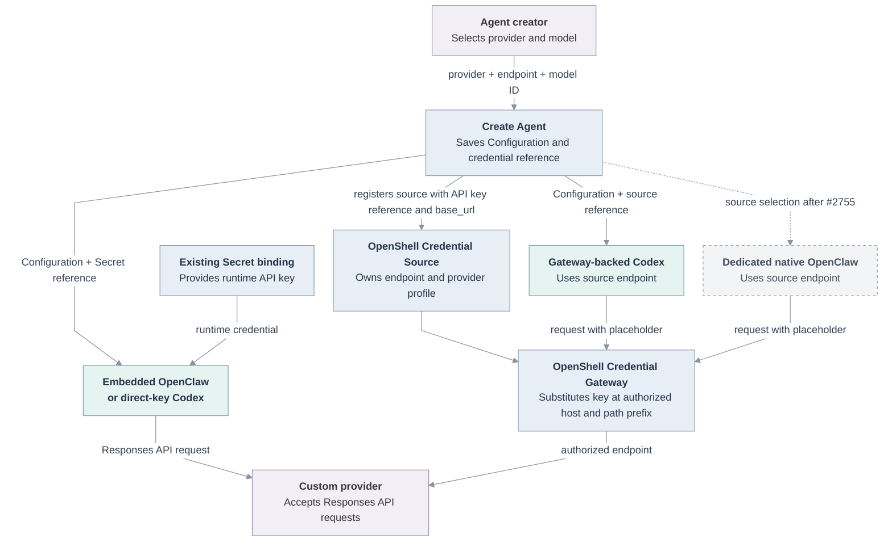

# Proposal: Custom Responses API providers with manual model selection

- **ID:** RFC-0024
- **Created:** 2026-10-20
- **Last updated:** 2026-10-26
- **Implementation plan:** [RFC-0024 implementation plan](../plans/0024-openai-compatible-model-endpoints.md)
- **Related:** [PR #913: Support OpenAI-compatible Codex model endpoints](https://github.com/openclaw/openclaw-enterprise/pull/913), [Create Agent reference](../../docs/reference/console/create-and-deploy.md), [Compute Driver contract](../../docs/reference/drivers/compute.md), [Harness execution](../../docs/reference/harness-execution.md)

## Decision

Keep the existing OpenAI default. Permission to use a shared model Secret does not authorize sending its key to a custom endpoint. The credential owner or an authorized credential administrator must bind it to that endpoint. An OpenShell Credential Source does this through immutable `base_url`; Create Agent shows that URL as read-only. A different destination needs a new authorized binding.

Allow arbitrary custom endpoints only with separately supplied endpoint-specific credentials. The backend must persist and check the credential reference and endpoint together; reject mismatches. Do not infer consent from `secret:operate` or a UI confirmation. Until direct Secret delivery can enforce this binding, reject shared Secrets at unapproved custom URLs. Tell the creator which provider receives the key. A blank endpoint keeps the Dedicated Codex Installation-default-then-OpenAI precedence and Embedded OpenClaw's OpenAI default. This decision does not confine Harness egress or prevent Harness code from using a directly delivered key elsewhere.

## Motivation

OpenClaw Enterprise (OCE) Create Agent offers static OpenAI choices and manual model-ID entry, but no per-Agent endpoint. The current form also labels a custom destination as OpenAI even when another provider operates that endpoint and receives the key. This proposal separates provider identity from the Responses wire protocol and covers all three execution topologies.

Existing Configuration and Create Agent paths support provider `baseUrl` values and manual model IDs. Reuse `apps/controller/src/drivers/openai-endpoint.ts` for server-side HTTPS and `/v1` validation; it rejects credentials, queries, fragments, wildcards, port `0`, and rewritten IPv4 forms, with no loopback HTTP exception. OpenClaw's [custom-provider guidance](https://github.com/openclaw/openclaw/blob/main/docs/concepts/model-providers/custom-providers.md) describes the same configuration pattern.

[PR #913](https://github.com/openclaw/openclaw-enterprise/pull/913) adds the Dedicated Codex API-key Responses path and `runtime.codexModelBaseUrl` Installation default. This RFC adds a per-Agent override and endpoint selection for Embedded OpenClaw. OCE's Gateway Driver binds keys to a Credential Source host and base-path prefix; Dedicated Codex reads that URL and calls the provider directly. OpenShell v0.1.4 requires custom profiles for alternate hosts and removed `inference.local`. Dedicated native OpenClaw uses a separate provider-fenced path; current Compute rejects custom source endpoints there, and [PR #2755](https://github.com/openclaw/openclaw-enterprise/pull/2755) proposes that runtime change.

## Goals

- Add a fixed custom provider choice for the Responses API. It requires an endpoint URL, a provider API key, and a manual model ID.
- Support custom endpoints in Embedded OpenClaw, Dedicated Codex, and Dedicated native OpenClaw. The first two use a credential-authorized endpoint; Dedicated native OpenClaw uses its source-owned endpoint.
- For Gateway-backed Dedicated Codex, use an owner-authorized endpoint-bound API-key Credential Source; an explicitly selected existing source remains authoritative. Register a new source for a custom destination only with a separately supplied key or separate owner authorization.
- Keep shared model credentials bound to destinations authorized by their owner. Permit a custom destination with a separately supplied endpoint-specific credential; do not infer destination consent from `secret:operate` alone.
- Reuse the existing Secret binding and Agent HTTPS egress policy. Expose `runtime.codexModelBaseUrl` as `agentProvisioning.codexApiKeyBaseUrl` in the existing Compute capability for authorized Installation readers.

## Non-goals

- Remote model discovery or a model catalog refresh API. Consider this in a follow-up RFC or implementation change after manual endpoint use is qualified.
- Add a general provider registry, new credential type, model proxy, or browser-to-provider request. The custom choice is one fixed Console provider option.
- Add provider-specific authentication. The custom choice supports bearer API keys only; ChatGPT OAuth and Codex service-account tokens remain OpenAI-provider choices.
- Let an Agent creator redirect an existing shared model Secret to a destination that its owner has not authorized.
- Add Chat Completions-only support to the shared OpenClaw and Codex path. Codex currently uses the Responses API.
- Add or broaden Agent egress, change provider-specific infrastructure, or claim that the configured hostname is allowlisted.
- Override the immutable endpoint of an existing Credential Source. A different endpoint requires a new source.
- Add an Agent-controlled endpoint override for Dedicated native OpenClaw. Its source owns the endpoint, and support depends on [PR #2755](https://github.com/openclaw/openclaw-enterprise/pull/2755).

## Proposal

### Provider, endpoint, and manual model selection

Add **Custom (Responses API)** to the existing Provider selector. OpenAI remains the default provider and keeps its static model list, OpenAI API-key help, Service Accounts, and ChatGPT OAuth choices. Anthropic remains unchanged. The custom choice is not a provider registry.

When the custom provider is selected, show a required endpoint field and a generic **Provider API key** label. Do not show OpenAI's key placeholder or documentation link. Require a manual model ID and hide the static OpenAI list. Show an endpoint-bound Credential Source URL as read-only. A separately supplied key may use a custom endpoint only when the backend creates its endpoint-specific binding; do not offer shared Secrets for unapproved URLs. Changing provider or endpoint clears the credential and model.

Validate and normalize the URL with the existing OpenAI endpoint helper. Require HTTPS and a `/v1` base path; reject wildcards, port `0`, credentials, queries, fragments, and host spellings the URL parser rewrites. The helper has no loopback HTTP exception. Do not contact the endpoint while editing or saving.

For direct delivery in Embedded OpenClaw and Dedicated Codex, save the endpoint under a fixed internal `custom` provider key with `api: "openai-responses"` and a `custom/<model-id>` reference. Carry the credential's endpoint authorization with the model-auth binding and reject a shared Secret when no matching owner-authorized destination exists. For Gateway delivery, use the Credential Source's immutable `base_url` and derive the Dedicated Codex provider endpoint from that source. Store the custom model ID and display name without OpenAI-specific metadata for Embedded OpenClaw and Dedicated Codex. Keep the key in its Namespace Secret or Credential Gateway; do not put it in Agent Configuration.

When Create Agent registers an OpenAI-provider API key through the Gateway, resolve `agentProvisioning.codexApiKeyBaseUrl`, then OpenAI. Kubernetes Compute sets this capability from `runtime.codexModelBaseUrl` when configured. The endpoint is non-secret and appears only in the authorized Installation response. For a custom provider, use an owner-authorized source whose `base_url` matches the selected endpoint, or a separately supplied key with a new endpoint-specific binding. Do not register a shared Secret from an Agent-supplied URL. OpenShell substitutes the key only at the profile's host and configured base-path prefix. A changed URL needs a new source; the field cannot override a source selected directly. This path supports Dedicated Codex, not Embedded OpenClaw.

For Dedicated native OpenClaw, the creator selects an existing OpenShell API-key Credential Source. Its immutable `base_url` determines the provider endpoint, and the Agent cannot redirect that credential. Show the source endpoint as read-only. This workflow remains pending [PR #2755](https://github.com/openclaw/openclaw-enterprise/pull/2755); do not enable it in Create Agent until that runtime change is accepted and integrated. The phase must also satisfy Compute's existing Dedicated OpenClaw model-metadata requirements rather than inventing defaults.

### Create Agent interface mockup

Keep the current form layout and spacing. For the custom provider, place the endpoint field between **API key Secret** and **Model**, and replace the static model chooser with manual model-ID entry.

```text
Agent name
[____________________________________________________________]

Model provider
Provider                         Harness
[Custom (Responses API)      v] [Codex                        v]

Authentication method            Provider API key
[Endpoint-approved credential v] [Choose credential or supply a new key v]

Responses endpoint
[https://models.example.test/v1______________________________]
The selected provider receives this key. A shared credential uses its owner-approved endpoint; changing it requires a new authorization. Supply a separate key to use a custom endpoint.
Choose this harness only when the endpoint supports streaming Responses requests and tool calls.

Model
Model ID
[provider-model-id___________________________________________]
Enter the model ID listed by this endpoint.
```

With the OpenAI provider, keep the existing **Choose a model** list and **Enter model ID manually** control. With the custom provider, show the manual field and do not imply that OCE has checked the model ID with the provider. Dedicated Codex must also allow manual entry when its Installation default points to a custom endpoint.

### Runtime use by OpenClaw and Codex

Embedded OpenClaw uses its provider Configuration; it does not use the OpenShell SandboxDriver. Direct Secret delivery for Dedicated Codex sets its projected provider endpoint. Gateway-backed Codex derives the provider URL from the selected source's `base_url`; OpenShell substitutes the placeholder only at the profile's authorized host and base-path prefix. Dedicated Codex keeps `wire_api = "responses"`. OAuth and Service Account authentication remain available only with the OpenAI provider. Dedicated native OpenClaw uses its source-owned endpoint and remains pending [PR #2755](https://github.com/openclaw/openclaw-enterprise/pull/2755).

The Embedded OpenClaw, Dedicated Codex, and Dedicated native OpenClaw paths call `/v1/responses`. The pinned OCE runtime includes OpenClaw's custom-provider Responses transport, and Codex supports the Responses wire API. A catalog entry does not prove request or streaming compatibility. Qualify OpenAI, then one endpoint and model through real turns in all three workflows; do not generalize that result to every compatible service.

### Credential, validation, and egress boundaries

The browser saves the URL and model ID; it does not call the endpoint. The backend authorizes the exact credential-destination pair. HTTPS and URL validation do not establish trust in the provider. OpenShell binds a Gateway-delivered key to the source profile's host and base-path prefix, but that does not establish provider trust.

Direct Secret delivery exposes the model key to the Harness. The current Agent NetworkPolicy allows broad public HTTPS; it does not allowlist the configured hostname or prevent Harness code from using the key elsewhere. Do not describe endpoint selection, URL validation, or Kubernetes Secret storage as egress confinement. Use endpoint-bound Gateway delivery when host/path enforcement is required. The plan records the current CIDR exclusions and their verification limits. Restricted model egress remains separate work under `TODO(model-egress-proxy)` and RFC-0017. Dedicated native OpenClaw retains the Credential Gateway's exact-host policy.



The diagram shows proposed runtime paths. The dashed connection marks the Dedicated native OpenClaw phase as pending #2755. It does not prove endpoint compatibility or deployment egress.

## Compute capability

This proposal extends the existing `ComputeAgentProvisioningCapabilities` contract with optional `codexApiKeyBaseUrl` and the existing `harnessAuth` binding with its authorized endpoint. The Agent and `AgentRevision` persist the endpoint beside the credential reference; secret values remain in the selected Secret Driver. It adds no route, model-discovery API, API egress rule, standalone database entity, or new secret-value format. It reuses the existing OpenShell API-key Credential Source and provider-profile path for Gateway-backed Dedicated Codex. Create Agent cannot automatically register a shared Secret against its own URL; direct delivery must reject a shared key when its endpoint authorization does not match.

### Coordination with PR #2755

[PR #2755](https://github.com/openclaw/openclaw-enterprise/pull/2755) proposes custom endpoints for Dedicated native OpenClaw with `credential_source` authentication. It requires the endpoint to match the bound source, so Agent Configuration cannot redirect that credential. This RFC stages that workflow after #2755 is accepted and integrated; the phase must add the supported caller, satisfy Compute's model-metadata requirements, and run a real Agent turn.

## Delivery and verification

[The implementation plan](../plans/0024-openai-compatible-model-endpoints.md) owns the ordered changes and proof. Required proof includes:

1. Playwright for the OpenAI and custom providers, including model ID entry, endpoint changes, credential clearing, validation, persisted Configuration, and error states. Verify that an Agent creator cannot pair a shared Secret with an unapproved endpoint, that an authorized endpoint-bound source fixes the endpoint, and that a separately supplied key creates a distinct endpoint-specific binding. Inspect the matching Storybook scenarios and provide screenshots and a short video outside the repository.
2. Verify that `GET /installation` returns `agentProvisioning.codexApiKeyBaseUrl` to Installation readers when configured and omits it otherwise. Regenerate and check OpenAPI output for the response field; the operation and permission inventory do not change.
3. Real streaming turns with a tool call in Embedded OpenClaw, Dedicated Codex, and Dedicated native OpenClaw, first with OpenAI and then a qualified custom endpoint. Verify the selected endpoint, credential path, and Agent egress. For Gateway delivery, verify the source profile's host and base-path prefix and its denial outside that profile. Confirm that the direct-key path is reported as Harness-accessible and broad-egress, not as hostname-confined.
4. Updated Create Agent, Codex, OpenShell, and execution-flow documentation.

RFC acceptance does not establish implementation or runtime availability. Missing enforcing k3d networking, endpoint access, or authorized credentials leaves the corresponding proof outstanding.

## Rationale and alternatives

Reuse the existing Secret binding, OpenShell source profile, and Codex Installation default while making the custom provider a distinct user choice. Omit OpenAI-specific metadata for Embedded OpenClaw and Dedicated Codex; keep Dedicated native OpenClaw's source ownership and metadata admission.

Remote discovery is deferred. `discoverAgentModels` and `ComputeDriver.discoverHarnessModels` support built-in catalogs at fixed URLs. Custom discovery needs endpoint validation, catalog requests, and API egress changes; assess it after manual endpoint use is qualified.

Use one custom provider choice and the Responses API for all three workflows. Assess other protocols and provider-specific features after this path is qualified.

## Remaining proof

- **Agent egress:** Reuse the policy above; it does not allowlist the endpoint hostname or confine direct-key Harness traffic. A restricted model proxy remains separate work.
- **Responses API qualification:** Use OpenAI first, then OpenRouter's documented beta Responses endpoint as the first candidate. Its docs do not prove every model works with every Harness. Require real streaming Agent turns with a tool call in all three workflows before claiming compatibility; record failures by request or stream behavior.

## References

- [OpenClaw custom-provider configuration](https://github.com/openclaw/openclaw/blob/main/docs/concepts/model-providers/custom-providers.md)
- [OpenClaw custom Responses transport support, merged upstream](https://github.com/openclaw/openclaw/issues/43018)
- [Codex model provider configuration](https://developers.openai.com/codex/config-reference)
- [OpenRouter Responses API reference](https://openrouter.ai/docs/api/api-reference/responses/create-responses) (qualification candidate only; not an OCE provider integration)
- [OpenShell v0.1.4 inference and custom endpoint guidance](https://docs.nvidia.com/openshell/v0.1.4/how-it-works/inference)
- [OpenShell v0.1.4 provider profiles and credential binding](https://docs.nvidia.com/openshell/v0.1.4/how-it-works/providers/overview)
- [OCE's pinned OpenClaw Responses transport](https://github.com/openclaw/openclaw/blob/f8386bc7df0a6c9eda7a28ae81943c5c06a414ff/packages/ai/src/transports/openai-responses-client.ts)
- [OpenAI API key safety and workload identity guidance](https://help.openai.com/en/articles/5112595-best-practices-for-api-key-safety)
- [RFC-0004: Initial OCC Prometheus metrics](0004-occ-prometheus-metrics.md) and [RFC-0018: Installation profiles](0018-installation-profiles-design/index.md), accepted proposals with scoped delivery and verification records.
- [RFC-0022: Shared Driver configuration definitions](0022-driver-configuration-contributions.md), a merged proposal that remains `Proposed` pending its decision and implementation review.
