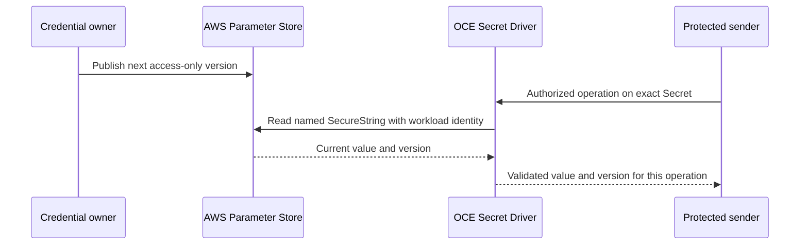

# Read rotating AWS parameters through the Secret Driver

- **ID:** RFC-0024
- **Related:** [Secret Driver](../../docs/reference/drivers/secret.md), [Credential Proxy](0023-egress-proxy-credential-lifecycle/index.md)

## Decision

Let an Installation operator bind an existing Namespace Secret to one AWS Systems
Manager Parameter Store SecureString. For that binding, the Secret Driver reads
the current published value when an authorized protected credential operation
needs it. Publishing the next access token under the same parameter does not
require a change to the Agent, a second approval, or an hourly import.

The binding is opt-in and fixed in the trusted Secret Driver configuration. It
identifies the Namespace ID, Secret ID, existing backend UID and full parameter
ARN. A tenant cannot choose a parameter, a field within a credential bundle,
an AWS role, a region override or an endpoint. AWS must hold the **single
distributable credential** at this ARN. The issuer keeps refresh tokens and
signing keys in its own custody. The Driver never refreshes a credential or
writes to AWS.

## Read and rotation

1. OCC authorizes the caller and the exact Credential Source as usual. The
   Secret Driver verifies the original Namespace, backend UID and ownership.
   A missing or replaced binding is a denial.
2. The trusted controller uses workload identity and authenticated AWS HTTPS
   to call `GetParameter` for the exact ARN with decryption enabled. It verifies
   the returned ARN, SecureString type, numeric version and value bounds.
   The IAM policy needs only that parameter and, for a customer managed key,
   decryption through SSM for the exact encryption context. Agents receive
   neither AWS credentials nor the secret.
3. The Driver rechecks ownership and the operation deadline after the AWS read.
   It returns the value only to the trusted existing credential path, together
   with the AWS version scoped to that binding and its observation time.
   Existing provider validation and send authorization still apply. A failed
   read, expired credential, wrong destination or revoked authorization does
   not fall back to a cached token or to the local Kubernetes value. An already
   admitted request can finish under its existing policy.
4. The next protected request reads AWS again. Thus version B can replace A
   without operator intervention. An AWS publication, a successful protected
   read using B, and the upstream provider accepting B are different observations.
   Never log values or make them available via a public value-read API.

## Compatibility and delivery

The Kubernetes Driver continues to own the local Secret identity; the AWS
parameter owns the value for a mapped protected read. While mapped, refuse
local value updates, compare-and-swap, environment projections, and value
paths that cannot enforce this contract. Return a clear unsupported-delivery
error rather than giving those callers old local bytes. Removing an OCC
Secret must never delete an AWS parameter. The operator must withdraw active
use before removing or changing a mapping: previously delivered credentials
are not revoked by editing Installation configuration. Preserve ordinary
create, update, delete, projection and trusted reads for unmapped Secrets.

This first cut targets Parameter Store and existing protected, per-request
consumers. Changes to an environment or to a Credential Gateway that copied
material during registration still need their supported reconfiguration and
activation. A stored reference alone does not repair those installations.
Secrets Manager can implement the same contract separately with its own
version semantics. Installing a cluster-wide synchronizer or permitting
arbitrary AWS locators in Agent configuration is unnecessary.

Qualify the configured controller path with a rotated synthetic SecureString:
two fresh authorized reads observe A then B under the same binding; an invalid
read, changed local owner, or withdrawn request yields no protected send.
Preserve ordinary unmapped Secret behavior. Verify real AWS IAM and TLS in
the target deployment before calling it installed. No release or live AWS
qualification is claimed by this proposal.
