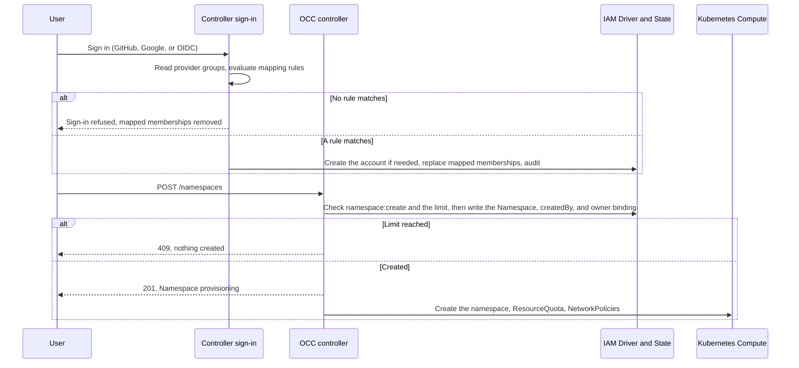

# Proposal: Map identity provider groups to the Default User Role so users own their Namespaces

- **ID:** RFC-0024 (provisional; renumber before merge)
- **Created:** 2026-10-29
- **Last updated:** 2026-10-29
- **RFC PR:** Not opened
- **Implementation plan:** None yet
- **Related:** [RFC-0024 Agent Author role (#4045)](https://github.com/openclaw/openclaw-enterprise/pull/4045),
  [Additional Installation administrators (#889)](https://github.com/openclaw/openclaw-enterprise/pull/889),
  [Agent OAuth connections (#3068)](https://github.com/openclaw/openclaw-enterprise/pull/3068),
  [RFC-0006](0006-basic-rbac/index.md), [Authorization](../../docs/reference/authorization.md)

## Summary

An Installation administrator maps identity provider groups to OCC Groups. At
each sign-in, OCC reads the person's provider groups, creates their account if
a mapping matches, and updates their mapped Group memberships. Members of the
built-in **Default users** Group hold the built-in **Default User** Role, which
lets them create Namespaces and nothing else. A person who creates a Namespace
becomes its **owner** and can create, deploy, and chat with Agents there, with
their own Secrets, credential sources, and Slack app. The same mappings can put
a team into a shared Namespace with the RFC-0024 Agent Author Role. The
Namespace is the isolation boundary, so OCE does not need a first-class personal
Agent.

## Motivation

Today every capability starts with an Installation administrator:

- **Accounts.** External sign-in admits only identities that an administrator
  attached to an account created first. Unknown identities fail, and no default
  Role exists ([external sign-in](../../docs/reference/authentication/external-sign-in.md)).
- **Namespaces.** Only the bootstrap administrator's unscoped binding grants
  `namespace:create`. A Role given at account creation binds to the exact
  Installation object, so it cannot authorize Namespace creation (#889).
  `createNamespace` grants its creator nothing
  (`packages/occ/src/index.ts`).
- **Agents and credentials.** Namespace Roles cannot grant `create`, every IAM
  write requires Installation `administer`, and so does guided provisioning.
  Only an administrator can grant an Agent's ServicePrincipal `operate` on its
  Secrets, so other users see `MEMBER_GRANT_REFUSED`.

RFC-0024 (#4045) removes the third gap for a person whom an administrator
assigns Agent Author in one Namespace. This proposal removes the administrator
from the first two steps, and from per-person assignment, for people the
enterprise identity provider already places in a group.

The IAM model already evaluates Group bindings, and PostgreSQL already stores
Groups and memberships (`iam_groups`, `iam_group_memberships`). Nothing writes
them today.

The personal-Agent design in #3068 protects a connected account with per-Agent
checks on deploy, native admin, grantees, channels, and plugin approvers. Those
checks span many paths and miss Namespace-wide and Group grants. A Namespace
that only its owner can use gives the same protection with one boundary.

## Goals

- An administrator maps provider groups to OCC Groups once, instead of creating
  each account.
- A matched person gets an account at first sign-in, and their mapped
  memberships follow the provider at each sign-in.
- A Default users member can create a limited number of Namespaces, owns each
  one, and completes the regular Agent workflow there, including Secrets,
  credential sources, Slack, and native admin chat. Other users cannot read or
  change those Namespaces.
- A mapped team can share Agents in a Namespace that an administrator created.
- An Agent with a connected OAuth account is protected by its Namespace, not by
  per-Agent ownership checks.

## Non-goals

- Mapping provider groups to the Installation administrator Role (#889 owns
  additional administrators).
- Access requests, SCIM provisioning, Roles that owners define, or owners
  sharing their Namespace.
- Per-user resource accounting beyond the Namespace limit and the existing
  Kubernetes ResourceQuota.

## Proposal

### Owners and state

| Concern                                | Owner                                                                                     |
| -------------------------------------- | ----------------------------------------------------------------------------------------- |
| Default User Role, Default users Group | Built-in at bootstrap, like the Installation administrator Role                           |
| Mapping rules                          | New Installation IAM API and console Settings card; Installation `administer`; PostgreSQL |
| Account creation and membership        | Controller sign-in path, through the IAM Driver, in one transaction with its audit event  |
| Namespace limit                        | Installation setting (Helm `defaultUser.namespaceLimit`), always set                      |
| Owner binding and limit check          | `createNamespace`, in the Namespace creation transaction                                  |
| Agent credential grants                | RFC-0024 exact `operate` grants for the Agent's ServicePrincipal                          |

### Mapping rules

A mapping rule names one sign-in provider, one provider group, and one OCC
Group:

| Provider | Provider group                                                           |
| -------- | ------------------------------------------------------------------------ |
| GitHub   | An organization or `org/team`, read with the existing membership lookups |
| Google   | A Workspace hosted domain (`hd`), with a verified email                  |
| OIDC     | A configured claim (for example `groups`) that contains a given value    |

Google exposes groups only through its Admin API, so Google rules match a
hosted domain. Rules match exact, case-normalized values. A rule can target:

- **Default users**, the built-in Installation Group bound Installation-wide to
  the Default User Role.
- **A Namespace Group**, which an administrator creates in a team Namespace and
  binds Namespace-wide to the Agent Author Role.

A rule cannot target an Installation Group with any other binding. An
Installation-wide binding on a resource inside a Namespace would apply in every
Namespace, so the Default User Role holds only `namespace:create`; validation
and a database constraint enforce this.

Mapping rules replace the GitHub and Google allowlists
(`OCC_AUTH_GITHUB_ALLOWED_ORGS`, `OCC_AUTH_GITHUB_ALLOWED_TEAMS`,
`OCC_AUTH_GOOGLE_ALLOWED_DOMAINS`). With no rules, only identities that an
administrator attached to an account can sign in, as today.

### Membership at each sign-in

After the provider authenticates a person, OCC reads their provider groups and
evaluates the provider's rules:

- **No account, a rule matches.** OCC creates the account, Principal, provider
  attachment, and matched memberships, audited with the matched rules and the
  reason `sign_in_mapping`.
- **No account, no match.** Sign-in fails and nothing is created.
- **Mapped account.** OCC replaces the mapped memberships with the matched set.
  With no match, sign-in fails and the mapped memberships are removed; the
  account and its Namespaces remain.
- **Account an administrator created.** Sign-in succeeds as today, and OCC
  still updates its mapped memberships.

Each membership records its source, a rule or an administrator. Sign-in changes
only rule memberships, so an administrator can add someone outside the
provider's groups to Default users directly. Every membership change is audited.

Memberships change only at sign-in. A person removed from a provider group keeps
access until their next sign-in or until their session expires (at most eight
hours). For immediate effect, an administrator disables the account.

### Creating a Namespace makes the creator its owner

`createNamespace` checks `namespace:create`, then the caller's Namespace limit,
then writes the Namespace, its `createdBy` Principal, and a Namespace-wide
binding of the caller to the managed **Namespace owner** Role, in one
transaction. This extends RFC-0024's rule that only managed Roles may grant
Namespace-wide `create`.

The Namespace owner Role is the Agent Author permission set plus
`namespace:read`, `namespace:delete`, and `agent:administer`, which the native
admin UI requires for chat. Like Agent Author, it excludes IAM administration,
ServiceAccount creation, and Sandbox Policy changes. OCC creates the default
Presets with its own authority; today that step fails for a caller without
`preset:create`.

The limit counts the caller's Namespaces that are not `deleting`, under the same
lock as the insert, so concurrent requests cannot exceed it. A refused request
creates nothing and returns `409`. The Installation administrator has no limit.

_Proposed flow; none of these steps is implemented._

### Agents, credentials, and Slack

In a Namespace they own, or a team Namespace whose Group holds Agent Author, a
person uses the regular Agent workflow. RFC-0024 grants each Agent's
ServicePrincipal `operate` on exactly the Secrets and credential sources it
uses, so `MEMBER_GRANT_REFUSED` no longer applies. Guided provisioning must
accept the Namespace owner instead of requiring Installation `administer`.

Slack needs no new contract: Slack tokens are Namespace Secrets referenced from
the Agent's Configuration. The operator still provides the channel runtime and
the Slack egress proxy.

### Personal Agents become Namespace isolation

For #3068, a person can connect an OAuth account only to an Agent in a
Namespace they own, where no other human holds a grant directly or through a
Group. A team Namespace never qualifies. That one check replaces the per-Agent
owner and grantee checks. Two concerns remain:

- **Channels.** Slack members are outside OCC IAM, so the channel restriction
  for Agents with a connected account stays until a Slack rule limits them to
  the owner.
- **Administrators.** The bootstrap administrator's unscoped binding covers
  every Namespace. See [Unresolved questions](#unresolved-questions).

### Failure and recovery

- **Provider unavailable.** Sign-in fails and memberships do not change. A
  failed group lookup never counts as "no groups".
- **Removed from the provider group.** The next sign-in removes the membership.
  Owner bindings remain; an administrator decides whether to delete the
  Namespaces.
- **Disabled account.** Sign-in and API requests fail. Namespaces and running
  Agents remain until an administrator deletes them, as in RFC-0024.
- **Deleted rule.** Its memberships are removed at each member's next sign-in.
- **Partial writes.** Each transaction writes all of its rows or none. A
  Namespace whose Kubernetes setup fails stays `provisioning` or `failed` and
  counts against the limit until it is deleted.

## Delivery and verification

Group and membership writes, and account creation at sign-in, change the IAM
Driver contract. The feature depends on RFC-0024 for managed Namespace-wide
bindings, Agent credential grants, and Agent Author bindings on Groups. A
separate implementation plan will cover:

1. The Default User Role, Default users Group, membership sources, and Group
   writes in the IAM Driver.
2. Mapping rules: API, storage, console card, and removal of the allowlists.
3. Account creation and membership sync at sign-in for each provider.
4. The Namespace owner binding, `createdBy`, the limit, and default Presets.
5. Guided provisioning for owners, Create Namespace in the console, and an
   empty-state landing for a new user.
6. Replace the #3068 per-Agent ownership checks with the Namespace rule.

Required outcomes, proved with PostgreSQL integration tests and the regular
Kubernetes Agent workflow, with OIDC on the Keycloak lane and a real `groups`
claim:

- A matched identity gets one account and its mapped memberships; an unmatched
  identity gets nothing; both are audited.
- Removal from the provider group removes the membership at the next sign-in and
  refuses sign-in without a match; an administrator membership survives.
- A failed group lookup refuses sign-in and changes no membership.
- A Default users member creates a Namespace and completes the Agent workflow
  with a Secret-based model credential and a Slack app, without administrator
  action. A second user is refused every read and write there.
- The limit refuses the next Namespace, including under concurrent requests.
- Mapped team members deploy Agents in the team Namespace and are refused in
  other Namespaces.
- An owner connects an OAuth account in their own Namespace and is refused in a
  team Namespace.

## Rationale and alternatives

- **Bind the Default User Role once, at first sign-in.** Simpler, but a person
  removed from the provider group keeps the Role until an administrator notices.
  Syncing at each sign-in keeps the provider as the source of truth.
- **Give every admitted person the Default User Role.** No mapping step, but no
  way to choose who gets which access, and no team Namespaces.
- **SCIM provisioning.** Immediate removal, but a new inbound API and provider
  setup. SCIM can later write the same memberships.
- **Access requests.** Covers people outside every provider group, but needs an
  approval queue. Direct administrator membership covers exceptions for now.
- **One shared Namespace with Agent Author for everyone.** Users could use each
  other's credentials. Team Namespaces are for groups that intend to share.
- **First-class personal Agents (#3068).** Needs checks on every path that can
  grant, deploy, or chat, and misses Namespace-wide and Group grants.

## Unresolved questions

- **Default Namespace limit.** One per user, or a small number for separate work
  and test Namespaces? Product decides.
- **OIDC group claims.** Some providers omit large group lists from the ID token.
  Is the ID token or UserInfo claim enough for the first release?
- **Administrator mappings.** Should mappings later grant the Installation
  administrator Role, or should #889 keep administrators explicit?
- **Administrator access to owners' Namespaces.** Should administrators keep
  deploy and native-admin access to owners' Agents, especially Agents with a
  connected account? Secret values stay undisclosed either way.
- **Connection templates.** Grant template `use` to Default users, or keep
  granting it per Namespace or person?
- **Slack for Agents with connected accounts.** Allow Slack when the Agent
  accepts direct messages only from its owner? This needs a Slack identity rule
  that OCC can verify.
- **Inactive accounts.** Should OCC report Namespaces whose owner no longer
  matches a rule or is disabled?

## References

- [Authorization](../../docs/reference/authorization.md), including
  [access bindings and Groups](../../docs/reference/authorization.md#access-bindings-and-groups),
  and the [permissions cheat sheet](../../docs/reference/cheatsheets/permissions.md)
- [Account provisioning](../../docs/reference/authentication.md#account-provisioning)
- [External sign-in allowlists](../../docs/reference/authentication/external-sign-in.md#organization-and-team-allowlist)
- [Namespace IAM policy flow](../../docs/flows/namespace-iam-policy.md)
- [Agent provisioning flow](../../docs/flows/agent-provisioning.md)
- [Slack integration](../../docs/guides/integrations/slack.md)
