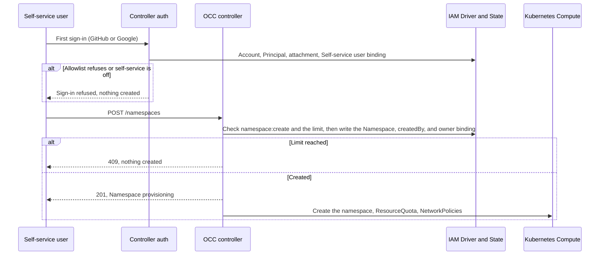

# Proposal: Self-service users create and own their Namespaces

- **ID:** RFC-0024 (provisional; renumber before merge)
- **Created:** 2026-10-29
- **Last updated:** 2026-10-29
- **RFC PR:** Not opened
- **Implementation plan:** None yet
- **Related:** [RFC-0024 Agent Author role (#4045)](https://github.com/openclaw/openclaw-enterprise/pull/4045),
  [Additional Installation administrators (#889)](https://github.com/openclaw/openclaw-enterprise/pull/889),
  [Agent OAuth connections (#3068)](https://github.com/openclaw/openclaw-enterprise/pull/3068),
  [RFC-0006](0006-basic-rbac/index.md), [Authorization](../../docs/reference/authorization.md)

## Summary

Add an opt-in **self-service** mode. When an Installation enables it, a person
whom the sign-in allowlist admits gets an OCC account at first sign-in, bound to
a built-in **Self-service user** Role. That Role lets them create Namespaces and
nothing else. When they create a Namespace, OCC makes them its **owner** in the
same transaction. The owner can create Agents, Configurations, Secrets, and
credential sources in that Namespace, deploy and chat with those Agents, and
connect each Agent to its own Slack app. The Namespace is the isolation
boundary, so OCE does not need a first-class personal Agent.

## Motivation

Today every capability starts with an Installation administrator:

- **Accounts.** External sign-in admits only identities that an administrator
  attached to an account created first, with a password. Unknown identities
  fail, and no default Role exists ([external sign-in](../../docs/reference/authentication/external-sign-in.md)).
- **Namespaces.** Only the bootstrap administrator's unscoped binding grants
  `namespace:create`. A Role that an account receives at creation binds to the
  exact Installation object, so it cannot authorize Namespace creation (#889
  shows this for a second administrator). `createNamespace` grants its creator
  nothing; the creator cannot read the Namespace afterwards
  (`packages/occ/src/index.ts`, `createNamespace`).
- **Agents and credentials.** Namespace Roles cannot grant `create`, and every
  IAM write requires Installation `administer`. An Agent's ServicePrincipal
  needs `operate` on each Secret and credential source it uses; only an
  administrator can grant it, so the console shows `MEMBER_GRANT_REFUSED` to
  other users. Guided provisioning also requires Installation `administer`.

RFC-0024 (#4045) removes the third gap for a person whom an administrator
assigns the managed Agent Author Role in one Namespace. Self-service removes the
administrator from the first two steps for people the Installation already
trusts to sign in.

The personal-Agent design in #3068 protects a connected account with checks on
each Agent: owner-only deploy and native admin, no other grantees, no channels,
no plugin approvers. Those checks span many paths and still miss
Namespace-wide and Group grants. A Namespace that only its owner can use gives
the same protection with one boundary.

## Goals

- An Installation administrator can enable self-service. It is off by default,
  and enabling it changes no existing account or grant.
- An admitted person who signs in for the first time gets an account and the
  Self-service user Role, without administrator action.
- A self-service user can create up to a configured number of Namespaces and
  becomes the owner of each one.
- An owner completes the regular Agent workflow in their Namespace: create,
  configure, add Secrets and credential sources, deploy, chat in the native
  admin UI, read logs, stop, and delete.
- An owner can use their own Slack app with an Agent, through Namespace Secrets.
- Another self-service user cannot read or change that Namespace.
- An Agent with a connected OAuth account is protected by its Namespace, not by
  per-Agent ownership checks.

## Non-goals

- Groups, claim-to-Role mapping, or a general Role catalog.
- Owners sharing a Namespace or delegating IAM. Administrators keep the
  existing IAM APIs.
- Self-service for password accounts or for OIDC without an allowlist.
- Billing, chargeback, or per-user resource accounting beyond the Namespace
  count limit and the existing Kubernetes ResourceQuota.
- Kubernetes API access for users.

## Proposal

### Owners and state

| Concern                         | Owner                                                                                          |
| ------------------------------- | ---------------------------------------------------------------------------------------------- |
| Enable self-service, set limits | Installation settings (Helm `selfService.*`), read at startup                                  |
| Admit a person at sign-in       | Existing provider allowlists: GitHub organizations or teams, Google hosted domains             |
| Create the account and binding  | Controller auth path, through the selected IAM Driver, in one transaction with its audit event |
| Owner binding and limit check   | `createNamespace`, in the Namespace creation transaction                                       |
| Agent credential grants         | RFC-0024 reconciliation of exact `operate` grants for the Agent's ServicePrincipal             |
| Namespace isolation at runtime  | Existing Kubernetes namespace per OCC Namespace, with ResourceQuota and NetworkPolicies        |

### Sign-in creates the account

When self-service is enabled and the provider's allowlist admits an identity
with no account, OCC creates the account, its Principal, the provider
attachment, and an Installation-wide binding to the built-in Self-service user
Role. The audit event records the provider, the subject, and the reason
(`self_service_sign_in`). Startup refuses self-service when no allowlist is
configured, so enabling it never opens sign-up to every GitHub or Google
account. OIDC has no allowlist today and is not supported.

The Self-service user Role has one permission: `namespace:create`. It binds
Installation-wide because the Namespace collection is not inside any Namespace.
It must never hold a permission on a resource inside a Namespace, because an
Installation-wide binding would then apply in every Namespace. Validation and a
database constraint enforce this. An administrator can still remove the binding
or disable the account; the existing account controls apply.

### Creating a Namespace makes the creator its owner

`createNamespace` checks `namespace:create`, then the caller's Namespace limit,
then writes the Namespace, its `createdBy` Principal, and a Namespace-wide
binding of the caller to the managed **Namespace owner** Role, in one
transaction. The binding is server-written and Namespace-wide, so it extends
RFC-0024's rule that only managed Roles may grant Namespace-wide `create`.

The Namespace owner Role is the RFC-0024 Agent Author permission set plus
`namespace:read`, `namespace:delete`, and `agent:administer`. Agent Author does
not include `agent:administer`, which the native admin UI requires for chat. The
owner Role excludes IAM administration, ServiceAccount creation, and Sandbox
Policy changes, as Agent Author does. Default Presets are
created by OCC itself after the owner binding, not with the caller's authority;
today that step fails for a caller without `preset:create`.

The limit counts Namespaces whose `createdBy` is the caller and whose status is
not `deleting`. The check runs under the same lock as the insert, so concurrent
requests cannot exceed it. A refused request creates nothing and returns `409`
with the limit in the message.

_Proposed flow; none of these steps is implemented._

### Agents, credentials, and Slack

Inside their Namespace, the owner uses the regular Agent workflow. RFC-0024
grants each Agent's ServicePrincipal `operate` on exactly the Secrets and
credential sources it uses, during Agent and Configuration saves, after checking
the caller's own permission. The console then stops calling the IAM routes, and
`MEMBER_GRANT_REFUSED` no longer applies to owners. Guided provisioning must
accept the Namespace owner instead of requiring Installation `administer`.

Slack needs no new contract. Slack tokens are Namespace Secrets referenced from
the Agent's Configuration, and no Installation-wide Slack app exists. The
operator still provides the channel runtime and the Slack egress proxy.

### Personal Agents become Namespace isolation

For #3068, a person can connect an OAuth account only to an Agent in a
Namespace they own, where no other human holds a grant. That one check replaces
the per-Agent owner and grantee checks. Two concerns remain, because the
Namespace boundary does not cover them:

- **Channels.** Slack members are outside OCC IAM. Anyone in a channel can
  prompt an Agent that holds a connected account. The channel restriction for
  such Agents stays until a Slack rule limits them to the owner.
- **Administrators.** The bootstrap administrator's unscoped binding covers
  every Namespace. See [Unresolved questions](#unresolved-questions).

### Failure and recovery

- **Disabled account.** Sign-in and API requests fail. Bindings, Namespaces,
  and running Agents remain until an administrator deletes the Namespaces, the
  same revocation semantics as RFC-0024.
- **Removed allowlist entry.** The person can no longer sign in. Their existing
  account and grants are unchanged.
- **Self-service turned off.** New sign-ins and new Namespaces fail for
  self-service users; existing owners keep their Namespaces.
- **Partial writes.** Each transaction writes all of its rows or none. A
  Namespace whose Kubernetes setup fails stays `provisioning` or `failed`, as
  today, and still counts against the limit until it is deleted.

## Delivery and verification

The feature depends on RFC-0024 for the Namespace-wide managed binding and the
Agent credential grants. A separate implementation plan will list the steps:

1. Installation setting, the Self-service user Role, and account creation at
   sign-in.
2. `createdBy`, the Namespace owner Role and binding, the limit, and default
   Presets under OCC's authority.
3. Guided provisioning for owners, and console changes: Create Namespace and an
   empty-state landing for a new user.
4. Replace the #3068 per-Agent ownership checks with the Namespace rule.

Required outcomes, each proved with PostgreSQL integration tests and the
regular Kubernetes Agent workflow:

- With self-service off, an unknown identity still fails sign-in and nothing is
  created.
- With it on, an admitted identity gets exactly one account and one
  Self-service user binding; a refused identity gets nothing; each outcome is
  audited.
- The owner creates a Namespace, sees it, and completes the Agent workflow with
  a Secret-based model credential and a Slack app, without administrator action.
- A second self-service user is refused every read and write in that Namespace.
- The limit refuses the next Namespace, including under concurrent requests.
- An owner connects an OAuth account in their own Namespace and is refused in a
  Namespace where another person holds a grant.

## Rationale and alternatives

- **Keep the current model plus RFC-0024.** An administrator creates each
  account and Namespace and assigns Agent Author. It is safe but needs an
  administrator per user, which is the work this proposal removes.
- **One shared Namespace with Agent Author for everyone.** Agent Author applies
  to every Agent and Secret in the Namespace, so users could read and change
  each other's Agents and use each other's credentials.
- **First-class personal Agents (#3068).** Per-Agent ownership needs checks on
  every path that can grant, deploy, or chat, and it misses Namespace-wide and
  Group grants. Namespace isolation enforces the same rule where IAM already
  decides access.
- **Creator-only ownership of individual resources (RFC-0006).** Finer-grained
  but needs an ownership contract on every resource kind. The Namespace owner
  covers the self-service case with existing scopes.
- **Claim or Group mapping to Roles.** Useful later, but OCC has no Group writer
  or claim mapping, and an allowlist plus one fixed Role is enough to start.

## Unresolved questions

- **Default Namespace limit.** One per user keeps the model simple; a small
  number allows separate work and test Namespaces. Product decides; the limit
  must always exist when self-service is on.
- **Administrator access to owners' Namespaces.** Administrators can operate
  every Namespace today. Should they keep deploy and native-admin access to an
  owner's Agents, especially Agents holding a connected account? IAM model owners
  decide; Secret values stay undisclosed either way.
- **Connection templates.** Should self-service users receive `use` on
  connection templates by default, or should administrators keep granting it per
  template? The Installation administrator decides per template today.
- **Slack for Agents with connected accounts.** Keep the channel restriction, or
  allow Slack when the Agent accepts direct messages only from its owner? This
  needs a Slack-side identity rule that OCC can verify.
- **Inactive accounts.** Should OCC report or clean up Namespaces whose owner is
  disabled? The proposal leaves cleanup to administrators.

## References

- [Authorization](../../docs/reference/authorization.md) and the
  [permissions cheat sheet](../../docs/reference/cheatsheets/permissions.md)
- [Account provisioning](../../docs/reference/authentication.md#account-provisioning)
- [External sign-in allowlists](../../docs/reference/authentication/external-sign-in.md#organization-and-team-allowlist)
- [Namespace IAM policy flow](../../docs/flows/namespace-iam-policy.md)
- [Agent provisioning flow](../../docs/flows/agent-provisioning.md)
- [Slack integration](../../docs/guides/integrations/slack.md)
