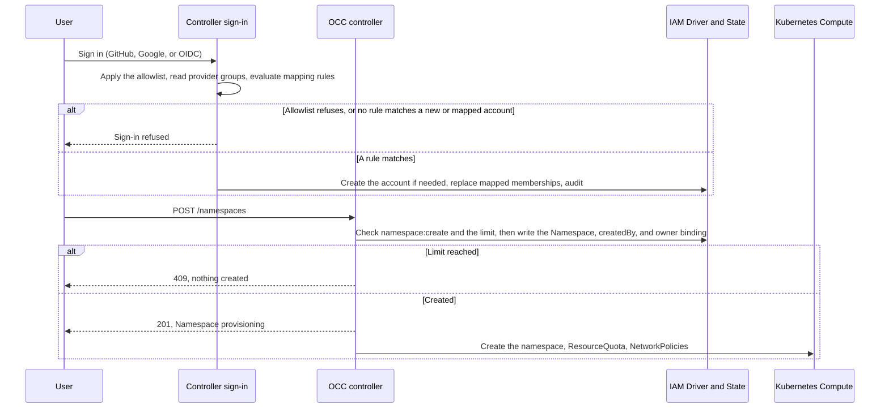

# Proposal: Default users sign in through identity provider mappings and own their Namespaces

- **ID:** RFC-0026 (provisional; renumber before merge)
- **Created:** 2026-10-29
- **Last updated:** 2026-10-30
- **RFC PR:** [#4207](https://github.com/openclaw/openclaw-enterprise/pull/4207)
- **Implementation plan:** [TASK-0050](../plans/0050-default-users.md)
- **Related:** [Agent Author role (#4045)](https://github.com/openclaw/openclaw-enterprise/pull/4045),
  [Additional Installation administrators (#889)](https://github.com/openclaw/openclaw-enterprise/pull/889),
  [Agent OAuth connections (#3068)](https://github.com/openclaw/openclaw-enterprise/pull/3068),
  [RFC-0006](0006-basic-rbac/index.md), [Authorization](../../docs/reference/authorization.md)

## Summary

An Installation administrator maps identity provider groups to OCC Groups. At
each sign-in, OCC creates the person's account if a mapping matches and updates
their mapped memberships. Members of the built-in **Default users** Group can
create Namespaces, and each creator becomes that Namespace's **owner**. Mappings
can also put a team into a shared Namespace as **Namespace members**. The
Namespace is the isolation boundary for connected OAuth accounts, so OCE does
not need a first-class personal Agent. Existing flows keep their behavior.

## Motivation

Today every capability starts with an Installation administrator:

- **Accounts.** External sign-in admits only identities that an administrator
  attached to an account created first. Unknown identities fail, and no default
  Role exists ([external sign-in](../../docs/reference/authentication/external-sign-in.md)).
- **Namespaces.** Only the bootstrap administrator's unscoped binding grants
  `namespace:create` (#889), and `createNamespace` grants its creator nothing.
- **Agents and credentials.** IAM API bindings name one existing resource, so
  they cannot grant `create`, and every IAM write and guided provisioning
  require Installation `administer`. Other users cannot give an Agent access to
  its Secrets and see `MEMBER_GRANT_REFUSED`.

IAM already evaluates Group bindings stored in `iam_groups` and
`iam_group_memberships`, but nothing writes them. #3068 protects a connected
account with per-Agent checks; a Namespace boundary gives the same protection in
one place.

## Goals

- An administrator maps provider groups to OCC Groups once, instead of creating
  each account.
- A matched person gets an account at first sign-in, and their mapped
  memberships follow the provider at each sign-in.
- A Default users member creates a limited number of Namespaces, owns each one,
  and completes the regular Agent workflow there. Other users cannot read or
  change them.
- A mapped team can share Agents in a Namespace that an administrator created,
  including Agents connected to a shared OAuth account.
- Existing flows do not change.

## Non-goals

- Mapping provider groups to the Installation administrator Role (#889 owns
  additional administrators).
- Access requests, SCIM provisioning, Roles that owners define, or owners
  sharing their Namespace.
- Per-user resource accounting beyond the Namespace limit and the existing
  Kubernetes ResourceQuota.
- Namespace sandbox ceilings, which owners will set within the Installation
  ceiling; the Guardrails work owns them.

## Proposal

### Owners and state

| Concern                         | Owner                                                                                     |
| ------------------------------- | ----------------------------------------------------------------------------------------- |
| Built-in Roles, Default users   | Created by a migration, so existing and new Installations get the same rows               |
| Mapping rules                   | New Installation IAM API and console Settings card; Installation `administer`; PostgreSQL |
| Account creation and membership | Controller sign-in path, through the IAM Driver, in one transaction with its audit event  |
| Namespace limit                 | Installation configuration `defaultUser.namespaceLimit`, 1 when absent                    |
| Owner binding and limit check   | `createNamespace`, in the Namespace creation transaction                                  |
| Agent credential grants         | `deployAgent`, through the existing Agent operate Roles                                   |

### Built-in Roles

| Role             | Bound to                             | Scope          | Permissions                                                                                                                                                                                                                                                                                                                |
| ---------------- | ------------------------------------ | -------------- | -------------------------------------------------------------------------------------------------------------------------------------------------------------------------------------------------------------------------------------------------------------------------------------------------------------------------- |
| Default User     | The Default users Group              | Installation   | `namespace:create`                                                                                                                                                                                                                                                                                                         |
| Namespace member | A team Namespace's Group             | Namespace-wide | `agent`: `create`, `read`, `update`, `delete`, `deploy`, `operate`, `administer`, `read_logs`, `manage_policy`; `sandbox_policy`: `read`, `update`; `configuration` and `preset`: `create`, `read`, `update`, `delete`; `secret` and `credential_source`: the same plus `operate`; `agent_revision:read`; `namespace:read` |
| Namespace owner  | The person who created the Namespace | Namespace-wide | Namespace member plus `namespace:delete`                                                                                                                                                                                                                                                                                   |

`agent:administer` opens the native admin UI for chat. Neither Namespace Role
can create ServiceAccounts or service keys, or change IAM. Secret values stay
write-only.

Today only the bootstrap administrator's binding grants `create`, because each
IAM API binding names one existing resource and one identity. This RFC allows
Namespace-wide and Group bindings only for these built-in Roles, which nobody
can change, and which only OCC or an Installation administrator can bind. The
Default User Role holds no permission on a resource inside a Namespace, because
an Installation-wide binding would apply in every Namespace. Validation and
database constraints enforce these rules.

### Mapping rules

A mapping rule names one sign-in provider, one provider group, and one OCC
Group:

| Provider | Provider group                                                           |
| -------- | ------------------------------------------------------------------------ |
| GitHub   | An organization or `org/team`, read with the existing membership lookups |
| Google   | A Workspace hosted domain (`hd`), with a verified email                  |
| OIDC     | A configured claim (for example `groups`) that contains a given value    |

Google exposes groups only through its Admin API, so Google rules match a
hosted domain. Rules match exact, case-normalized values. A rule targets either
Default users or a Group that an administrator creates in a team Namespace and
binds to the Namespace member Role. A rule cannot target a Group with any other
binding.

### Existing flows keep working

Mapping rules add account creation at sign-in and change nothing else. Without
rules, an Installation behaves exactly as today:

- Accounts that administrators create sign in without a rule and keep their
  bindings. They join Default users only when an administrator adds them.
- The GitHub and Google allowlists (`OCC_AUTH_GITHUB_ALLOWED_ORGS`,
  `OCC_AUTH_GITHUB_ALLOWED_TEAMS`, `OCC_AUTH_GOOGLE_ALLOWED_DOMAINS`) stay and
  run first for every sign-in. Rules apply only to identities they admit.
- Password sign-in, service keys, and sessions are unchanged.
- A Namespace that an administrator creates gets no owner binding and no limit.

### Membership at each sign-in

After the provider authenticates a person and its allowlist admits them, OCC
reads their provider groups and evaluates the provider's rules:

- **No account, a rule matches.** OCC creates the account, Principal, provider
  attachment, and matched memberships, audited with the matched rules and the
  reason `sign_in_mapping`.
- **No account, no match.** Sign-in fails and nothing is created.
- **Mapped account.** OCC replaces the mapped memberships with the matched set.
  With no match, sign-in fails and the mapped memberships are removed; the
  account and its Namespaces remain.
- **Account an administrator created.** Sign-in succeeds, and OCC updates its
  mapped memberships.

Each membership records its source. Sign-in changes only rule memberships, so an
administrator can add an exception directly. Every change is audited.

Memberships change only at sign-in. A person removed from a provider group keeps
access until their next sign-in or until their session expires (at most eight
hours). For immediate effect, an administrator disables the account.

### Creating a Namespace makes the creator its owner

When the caller's `namespace:create` comes from the Default User Role,
`createNamespace` checks the caller's Namespace limit, then writes the
Namespace, its `createdBy` Principal, and a Namespace-wide binding of the caller
to the Namespace owner Role, in one transaction. The owner binding comes first,
so the creator's own grant creates the default Presets; today that step fails
for a caller without `preset:create`.

The limit counts the caller's Namespaces that are not `deleting`, under the same
lock as the insert, so concurrent requests cannot exceed it. A refused request
creates nothing and returns `409`.

_Proposed flow; none of these steps is implemented._

### Agent credentials and Slack

An Agent's ServicePrincipal needs `operate` on each Secret and credential source
it uses. Today only an Installation administrator grants it, through the console
or guided provisioning (`ensureAgentOperateGrants` in
`packages/occ/src/index.ts`); this RFC adds no Agent Role.

OCC also writes these exact grants in the deploy transaction when the built-in
Namespace member or owner Role is among the Roles that allow the caller
`agent:deploy` and `operate` on the source (each decision's `roleIds` evidence).
A deploy allowed only by other Roles writes no grant, so existing custom Roles
gain nothing. OCC reuses the Namespace's operate Role, audits each write, and
writes nothing when the deploy fails. So `MEMBER_GRANT_REFUSED` no longer
applies to members and owners, and guided provisioning accepts their Roles
instead of Installation `administer`. OCC removes a grant it wrote when no
Configuration and no pending or running revision of the Agent references the
source, so a running Agent keeps its access.

Slack needs no new contract: Slack tokens are Namespace Secrets referenced from
the Agent's Configuration. The operator still provides the channel runtime and
the Slack egress proxy.

### Agent sandbox policies

Namespace members and owners can change their Agents' network additions within
the Installation's `sandboxNetworkPolicyCeiling`, the only ceiling for now. They
can also turn on an Agent's `sandboxPolicyEditing` switch, which today requires
Installation `administer`; the ceiling bounds what they add. The switch, and
this rule, last until the Guardrails work replaces them. An empty ceiling allows
no additions.

### Connected accounts follow the Namespace

An administrator marks each connection template **personal** or **shared**. OCC
cannot tell from the provider whether an account belongs to one person, so the
template decides how far a connection may reach:

| Template | Where a person can connect it                                                        | Who can act as the account                                     |
| -------- | ------------------------------------------------------------------------------------ | -------------------------------------------------------------- |
| Personal | A Namespace they own, where no other human holds a grant directly or through a Group | Only the owner; the channel restriction stays                  |
| Shared   | A team Namespace, when template `use` is granted to that Namespace                   | Every person with access to the Agent, and its channel members |

Personal is the default and keeps the #3068 protection with one Namespace check.
Shared fits a team mailbox or service account; the consent warning says who can
act as the account. Any member with `agent:update` can disconnect or reconnect
it, and the connection records who connected it. Nothing stops a personal
account on a shared template, so administrators grant shared templates only to
team Namespaces.

The bootstrap administrator's unscoped binding covers every Namespace; see
[Unresolved questions](#unresolved-questions).

### Failure and recovery

- **Provider unavailable.** Sign-in fails and memberships do not change. A
  failed group lookup never counts as "no groups".
- **Removed from the provider group, or disabled.** Owner bindings, Namespaces,
  and running Agents remain until an administrator deletes them.
- **Deleted rule.** Its memberships are removed at each member's next sign-in.
- **Partial writes.** Each transaction writes all of its rows or none. A
  Namespace whose Kubernetes setup fails stays `provisioning` or `failed` and
  counts against the limit until it is deleted.

## Delivery and verification

The built-in Roles that hold `create`, Group and membership writes, and account
creation at sign-in change the IAM Driver contract. Template sharing changes the
RFC-0023 connection template contract. The proposal does not depend on #4045. A
separate implementation plan will cover:

1. The built-in Roles, the Default users Group, membership sources, and Group
   writes in the IAM Driver.
2. Mapping rules: API, storage, and console card.
3. Account creation and membership sync at sign-in for each provider.
4. The Namespace owner binding, `createdBy`, the limit, and default Presets.
5. Agent operate grants and their removal, sandbox policy editing, guided
   provisioning, Create Namespace, and an empty-state landing.
6. Template sharing, and the Namespace rules that replace the #3068 per-Agent
   ownership checks.

Required outcomes, proved with PostgreSQL integration tests and the regular
Kubernetes Agent workflow, with OIDC on the Keycloak lane and a real `groups`
claim:

- With no rules, administrator-created accounts sign in, allowlists refuse
  non-members, and an unknown identity is refused, as today.
- A matched identity gets one account and its mapped memberships; an unmatched
  identity gets nothing; both are audited.
- Removal from the provider group removes the membership at the next sign-in and
  refuses sign-in without a match; an administrator membership survives.
- A failed group lookup refuses sign-in and changes no membership.
- A Default users member creates a Namespace and completes the Agent workflow
  with a Secret-based model credential and a Slack app, without administrator
  action. A second user is refused every read and write there.
- The limit refuses the next Namespace, including under concurrent requests.
- Mapped team members deploy Agents in the team Namespace and are refused in
  other Namespaces.
- An owner adds a sandbox network rule inside the Installation ceiling and is
  refused outside it.
- A member's deploy writes the Agent's grants; a deploy allowed only by a
  custom Role writes none and is refused as today.
- Replacing a Secret in a Configuration removes the old grant only after no
  pending or running revision references it.
- An owner connects a personal template in their own Namespace and is refused
  in a team Namespace. A team member connects a shared template in the team
  Namespace, and another member deploys and uses that Agent.

## Rationale and alternatives

- **Build on the proposed Agent Author Role (#4045).** It is not accepted, it
  omits `agent:administer`, and an administrator assigns it per person. If it is
  accepted, the Namespace member Role and Agent Author should become one Role.
- **Grant at deploy to anyone with `deploy` and `operate`.** Simpler, but
  existing custom Roles would silently gain the power to grant.
- **Grant when a Configuration is saved.** One shared Configuration would grant
  every Agent that uses it; deploy is the single choke point.
- **Bind the Default User Role once, at first sign-in.** Simpler, but a person
  removed from the provider group keeps the Role until an administrator notices.
- **SCIM or access requests.** Each needs new APIs; SCIM can later write the
  same memberships.
- **Treat every connected account as personal.** Safe, but rules out team
  mailboxes and shared service accounts.
- **First-class personal Agents (#3068).** Needs checks on every path that can
  grant, deploy, or chat, and misses Namespace-wide and Group grants.

## Unresolved questions

- **Default Namespace limit.** One per user, or a small number? Product decides.
- **OIDC group claims.** Some providers omit large group lists from the ID token.
  Is the ID token or UserInfo claim enough for the first release?
- **Administrator access to owners' Namespaces.** Should administrators keep
  deploy and native-admin access to owners' Agents, especially Agents with a
  connected account? Secret values stay undisclosed either way.
- **Connection templates.** Grant template `use` to Default users, or keep
  granting it per Namespace or person?
- **Slack and connected accounts.** Should shared connections allow channels by
  default? Can a personal connection allow Slack when the Agent accepts direct
  messages only from its owner?
- **Inactive accounts.** Should OCC report Namespaces whose owner no longer
  matches a rule or is disabled?

## References

- [Authorization](../../docs/reference/authorization.md), including
  [access bindings and Groups](../../docs/reference/authorization.md#access-bindings-and-groups),
  and the [permissions cheat sheet](../../docs/reference/cheatsheets/permissions.md)
- [Account provisioning](../../docs/reference/authentication.md#account-provisioning)
- [External sign-in allowlists](../../docs/reference/authentication/external-sign-in.md#organization-and-team-allowlist)
- [Namespace IAM policy flow](../../docs/flows/namespace-iam-policy.md)
- [Agent provisioning flow](../../docs/flows/agent-provisioning.md)
- [Slack integration](../../docs/guides/integrations/slack.md)
