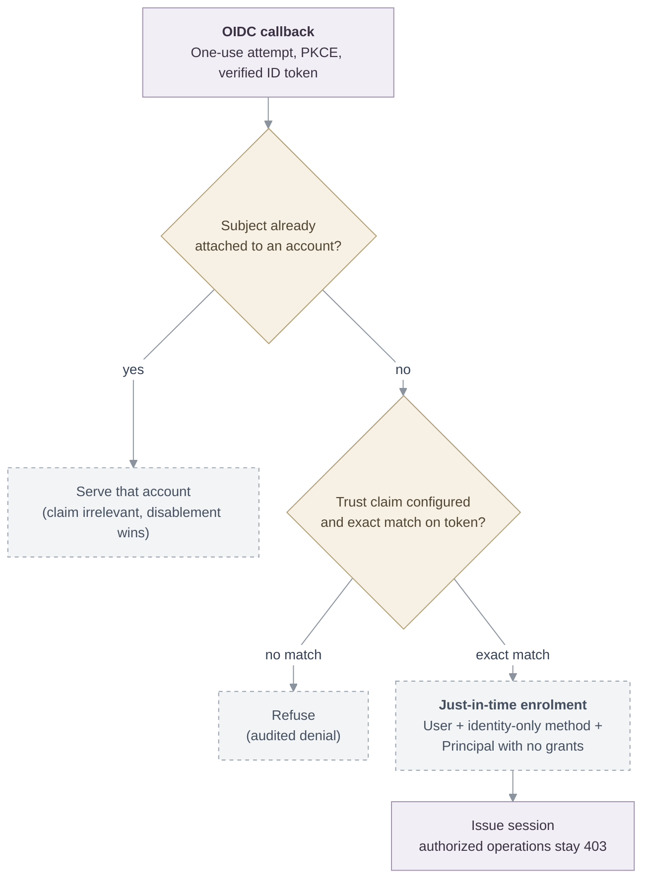

# Proposal: OIDC trust-claim just-in-time enrolment

- **ID:** RFC-0026
- **Created:** 2026-10-28
- **Last updated:** 2026-10-28
- **RFC PR:** [openclaw/openclaw-enterprise#3899](https://github.com/openclaw/openclaw-enterprise/pull/3899) (also carries the experimental implementation)
- **Related:** [RFC-0001](0001-oidc-sign-in.md) (attached-only OIDC sign-in), [external sign-in](../../docs/reference/authentication/external-sign-in.md), implementation [PR #790](https://github.com/openclaw/openclaw-enterprise/pull/790)

## Summary

Add an opt-in pair of settings that let one verified OIDC ID token vouch for an otherwise
unknown subject: when the operator configures a *trust claim* — an exact claim name and an
exact string value — a verified token carrying that pair authenticates the subject and
enrolls them just-in-time as a human account with no grants. The same token's email claim,
when usable, becomes the account's address. Attached accounts, and every authorization
decision, are unchanged.

## Motivation

RFC-0001 listed "provisioning, just-in-time accounts or signup; group, role or claim
mapping" among its non-goals and its sponsor confirmed the non-goals stay binding, so
every OIDC subject must be attached to an existing account by an administrator before that
person can sign in. That is a scope boundary, not a recorded rejection: RFC-0001 argues
merits against discovery, email matching and JWKS caching, but records no argument against
admitting members from their issuer. [RFC-0010](0010-agent-access.md) already accepts
zero-grant human enrollment (administrator-driven, for sharing) as a direction, so the
account shape this proposal enrolls is in the platform's accepted design space.

What no prior decision covers is **who admits**. For teams whose IdP already asserts realm
membership, the manual attach step adds no assurance the pinned issuer does not already
carry: an unknown member simply cannot sign in until an administrator attaches their
`(iss, sub)`. This proposal lets the operator delegate **admission** to a claim the issuer
already puts in the ID token, while OCE continues to own **authorization** exclusively.
The claim admits a person once; it never grants anything.

## Goals

- **Exact-match trust.** `OCC_AUTH_OIDC_TRUST_CLAIM` (a claim name) and
  `OCC_AUTH_OIDC_TRUST_VALUE` (a printable string) are both-or-neither and validated at
  startup; only `openid` is requested, so the IdP must issue the claim into the ID token
  itself; trust is evaluated only after full ID-token verification.
- **Zero-grant enrolment.** One transaction writes the user, an identity-only sign-in
  method, a native Principal with no Role or AccessBinding, and the enrolment; the account
  has no password and every authorized operation stays refused until an administrator
  grants one. Enrolment is audited as `authentication.account.self-enrol` before
  `authentication.login`.
- **Attached semantics preserved.** Attached identities sign in with or without the claim;
  a disabled account always refuses; removing the configuration revokes nothing already
  enrolled (an administrator detaches or disables to remove access).
- **Attempt currentness preserved.** The sign-in attempt's creation time travels into the
  enrolment, so an account change after the attempt began (for example an administrator
  revoking its sessions) refuses the callback exactly as for attached identities, and two
  simultaneous first sign-ins for one subject enroll exactly one account — the
  later-arriving callback is refused and the person signs in again.
- **Email from the token, when usable.** The claim named by
  `OCC_AUTH_OIDC_TRUST_EMAIL_CLAIM` (default `email`) is stored normalized like every
  other account address and marked verified only when the token asserts `email_verified`
  exactly true; without a usable value the account gets a deterministic non-deliverable
  placeholder address. An address another account already holds is refused — accounts are
  never matched or linked by email.

## Non-goals

Helm chart wiring for the trust settings; changing an enrolled account's address later;
claim-driven authorization, roles or group mapping; more than one issuer; SCIM;
IdP-driven logout or offboarding; provisioning anything beyond the human sign-in account.
Zero-grant sharing from [RFC-0010](0010-agent-access.md) is a separate decision.

## Proposal

The **operator** owns the trust decision (the configured claim name, value and email
claim); the **issuer** owns the claim's meaning and the subject's identity; **OCE** owns
authorization, account lifecycle and audit. The entry point is the existing OIDC callback;
no new route, provider or scope is introduced.

After ID-token verification, the callback compares the configured claim name and value
against the verified claims. An unknown subject with a match enters just-in-time
enrolment; everything else keeps its current refusal. The diagram shows the decision; the
experimental paths are labelled.

The enrolment resolves the account's address from the token's email claim (or the
deterministic placeholder), writes all four rows transactionally, and appends the audit
events. Concurrent first sign-ins for one subject are arbitrated by the existing unique
constraints: the enrolment runs inside a savepoint, so a uniqueness conflict rolls back to
the savepoint and resolves — the winner's account is served only if the attempt predates
it (it does not, under this race, so the loser refuses and retries), and an address held
by an unrelated account fails closed. Locks are taken user-first then account, matching
`snapshotExternal` and session issuance.

Admission is one-time. The claim is an **authorization marker from a trusted issuer, not a
shared secret**: an ongoing entitlement check is deliberately absent. A subject who loses
the claim keeps signing in until an administrator detaches or disables the enrolment;
rotating the claim value affects only identities not yet enrolled.

## Delivery and verification

The experimental implementation and its proof are in
[PR #3899](https://github.com/openclaw/openclaw-enterprise/pull/3899):

1. `tests/integration/postgres-oidc-trusted-claim.test.mjs` (12 subtests) covers
   configuration validation, refusal without trust, enrolment shape and audit order,
   account reuse, no-claim and wrong-value refusals, token-email storage
   (verified/unverified/malformed-fallback), held-email refusal, mid-attempt revocation,
   simultaneous first sign-ins, and disabled accounts, against real PostgreSQL.
2. Neighbouring suites pass unchanged (`postgres-oidc-sign-in`, `postgres-human-authentication`,
   `postgres-auth-accounts`, `postgres-oidc-tab-binding`, OIDC transport and ID-token
   tests); the suite is registered in the `postgres-auth` CI lane.
3. Real-Keycloak 26.8 evidence at the PR: browser-driven enrolment and refusal, and an
   administrator revocation landing between the IdP redirect and the callback.

Remaining if the decision is accepted: Helm values for the three settings; a trust-claim
mapper plus a claim-less user in the CI `keycloak-oidc` realm and lane; an address-change
path for self-enrolled accounts; console visibility of self-enrolments.

## Rationale and alternatives

- **Keep attached-only admission** (RFC-0001 as written) is the safest default and remains
  the behavior without the settings; this proposal is strictly opt-in.
- **SCIM or invitations** would provision richer accounts but add a protocol, credentials
  and a reconciliation surface for what is here one boolean admission decision.
- **Claim-to-role mapping** is rejected: authorization stays explicit and OCE-owned, so a
  compromised or over-broad claim cannot widen what an enrolled account may do.
- **Ongoing claim enforcement** is rejected for the same reason it is excluded from
  attached sign-in today: revocation and disablement are administrator-owned account
  operations, not token contents.

## Unresolved questions

- **Sponsorship.** RFC-0001 left claim-based admission out of scope rather than rejecting
  it; does OCE now want it? Deciding owner: the maintainers. Until resolved, the
  implementation stays experimental and env-var-only.
- **Offboarding semantics.** Should losing the claim (value rotation, attribute removal)
  ever affect an enrolled account? Binding invariant either way: only detach or disable
  removes access.
- **Address changes.** Should a self-enrolled account (or its administrator) get a path to
  replace the token-derived or placeholder address, and does replacing it re-verify?
- **Visibility.** Do self-enrolments need console listing or limits beyond the audit
  trail?

## References

- [RFC-0001: Generic OIDC sign-in](0001-oidc-sign-in.md) — the attached-only decision and
  its exclusions.
- Implementation of attached-only admission:
  [PR #790](https://github.com/openclaw/openclaw-enterprise/pull/790),
  [PR #731](https://github.com/openclaw/openclaw-enterprise/pull/731).
- [External sign-in reference](../../docs/reference/authentication/external-sign-in.md)
  and the experimental trust-claim section in the
  [OIDC sign-in guide](../../docs/guides/deploy/oidc-sign-in.md#trust-claim-enrolment-experimental).
- Experimental implementation and evidence:
  [PR #3899](https://github.com/openclaw/openclaw-enterprise/pull/3899).
