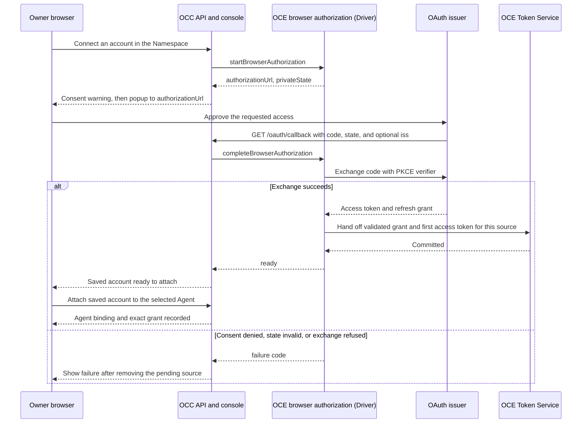

# Proposal: Connect an OAuth account once and grant individual Agents access

- **ID:** RFC-0027
- **Created:** 2026-10-20
- **Last updated:** 2026-11-04
- **RFC PR:** [#3068](https://github.com/openclaw/openclaw-enterprise/pull/3068)
- **Implementation plan:** [Backend implementation and plan, #3098](https://github.com/openclaw/openclaw-enterprise/pull/3098)
- **Companion:** [Driver contracts, failure, and verification](contracts.md)
- **Related:** [RFC-0016](../0016-sandbox-credential-injection/index.md) and its
  [Credential Refresh companion](../0016-sandbox-credential-injection/credential-refresh.md);
  [RFC-0010 personal access](../0010-agent-access.md#access-contract);
  [credential sources](../../../docs/reference/credential-sources.md);
  [per-Agent sandbox policies](../../../docs/reference/sandbox-policies.md);
  [RFC-0023 Credential Proxy](../0023-egress-proxy-credential-lifecycle/index.md)

## Summary

Alice connects Gmail once in a Namespace and approves access with Google. Later
she attaches the saved connection to her Research Agent and to a second Agent.
Each Agent gets its own grant on the credential source. Alice can detach the
Research Agent and keep the second Agent working under the original consent.

The connection records who approved the provider grant and which scopes they
approved. Namespace IAM governs who can use it. When an Agent sends a request,
OCE checks that Agent's grant and the actual request before adding a credential.
A Gmail policy allowing only message headers applies to both `gog` and a script
running in the same Agent execution.

Installation administrators define **connection templates** for the whole
Installation or for a single Namespace. Presets can reference them. OCE handles client setup, consent,
and the authorization-code exchange. For MCP it uses the official TypeScript
MCP client. After exchange, the OCE Token Service keeps the grant and refreshes
access tokens in the background. OpenShell presents the prepared token at the
approved endpoint. The deployed tool receives only a placeholder.
OCE core contains no provider-specific endpoints, scopes, or binaries.

## Motivation

Today a user who wants an Agent to read their Gmail must export a refresh token
with a local sign-in tool, store it and the client secret as Namespace Secrets,
register an `oauth2-refresh-token` source, bind it, grant the Agent's service
principal `operate`, and deploy
([credential sources](../../../docs/reference/credential-sources.md)). The refresh
token passes through the user's terminal and the OCC Secret store, and anyone with
access to the Agent can use the mailbox.

Device login, used only by the experimental `codex-oauth` model source, does not
help: Google's device-code flow does not permit Gmail scopes. Gmail needs the
browser authorization-code flow, with an OCC callback.

After the code exchange, browser connections use the [RFC-0023 Token Service lifecycle](../0023-egress-proxy-credential-lifecycle/contracts.md#credential-access-and-lifecycle).
It separates background refresh from the worker's outbound request.

## Goals

- A user connects their own account in the console without handling a client
  secret, refresh token, or access token, then deploys their Agent.
- A user can keep a connection personal or share its use through Namespace IAM.
  Attaching a completed connection to another Agent needs no repeat consent for
  the same approved access.
- Administrators add a provider by creating a connection template, not by
  changing OCE code or Installation configuration.
- Each protected request must fit the approved destination, scopes, and deployed
  request policy before the sender presents a credential.
- Revocation, a denied consent, and an uncertain exchange each produce a visible
  state and one recovery action.

## Non-goals

- Packaging provider tools or requiring a particular executable for OAuth consent.
- Device-code connections for tool credentials, and changes to model
  authentication (`harnessAuth`).
- Service-account or domain-wide delegation.
- Per-message provider identity. A shared Agent uses the account attached to it
  for requests from its authorized users, subject to the deployed request policy.
- Delegating template administration to Namespace administrators.

## Proposal

### Connection templates

Installation administrators manage the catalog. They set the scope at creation:
the whole Installation or one Namespace. Client registrations in different
scopes rotate independently. A person with `credential_source:create` in the
destination Namespace can connect an account using a template available there.
OCC checks scope and authority when listing usable templates, starting consent
and handling the callback. The [per-template IAM proposal](contracts.md#iam-driver)
can be reviewed independently.

An OAuth template has two setup methods. For manual setup the administrator
supplies the provider and approved recipient. For MCP discovery the administrator
enters the server URL. The protected resource identifies its resource and accepted
authorization servers. The administrator selects one issuer. OCC validates its
metadata and shows the observed endpoints, capabilities and scopes separately
from the administrator's choices. The administrator can set a scope allowlist
or leave the choice to the connecting user and provider. The approved recipient
identifies where the token may be sent. Plugin policy determines which
operations are allowed there. Saving pins the effective values. A later
discovery can propose a new version.

The Google starter defaults to **Google APIs**. One saved account can serve
Gmail, Calendar, Drive, and other Google APIs. Administrators can narrow the
template to one HTTPS endpoint. OCC accepts the `google_apis` recipient
only for Google's published issuer and OAuth endpoints. It pins that choice
on the template version and the saved account. The Google Workspace Driver
selects exact routes from its reviewed operations and the granted scopes.
One presentation can serve multiple API hosts. The Sandbox checks each
request's host, operation and arguments. Public discovery requests carry no
bearer token. Narrowing the grant withdraws any broader presentation.

An administrator registers an OAuth client against a saved template version.
OCC takes its availability, issuer and client authentication endpoints from that
version. The administrator supplies the client ID, authentication method and
any secret. The selected Driver protects the secret. The first registration
fills an empty client selection. An administrator chooses whether to switch an
existing selection. Consent pins the selected client's identity.

A version records the approved recipient (for MCP, both the protected resource
and the server URL). The Agent plugin release owns its named credential slots
and their local delivery placeholders. [MCP authorization contract](contracts.md#mcp-authorization)

OCC rejects non-HTTPS URLs. At deployment it verifies that the selected Sandbox
and protected sender can enforce the approved request policy.

The callback URI is derived from the console origin as
`https://<console-host>/oauth/callback`. The template response shows the exact URI
for manual registration. OCE includes the same URI in its DCR request.

With `accountIdentity: oidc`, the Refresh Driver verifies the provider before it
accepts the connection template version, and verifies each ID token against it
([OIDC verification](contracts.md#oidc-account-identity)). The consent screen
lists the two extra scopes. When the Driver returns a verified address, OCC stores
it on the credential source and shows "Connected as alice@example.com" so the
person can spot a wrong account. Agent access follows the same attachment rules
whether or not the source has an address.

### Versions and consent

An edit never changes what an existing connection does. Changing any field except
`displayName` creates a new connection template version. The credential source
records the version and the values its owner approved: issuer and its URLs, client
registration, this connection's scopes, authorization parameters, endpoint and
access, and OIDC settings. OCC and both Drivers use only that
record, so an administrator cannot redirect a user's refresh grant or credential.
Source configuration is already immutable.

After a new version, existing connections keep working and Console shows
**Reconnect to apply changes**. Reconnecting asks for consent again and creates a
new source. To stop an old version, for example after an endpoint compromise,
administrators disconnect the affected sources. OCC refuses to delete a connection
template while any source references one of its versions.

When an administrator rotates the secret for the same OAuth client, the next
code exchange or token refresh uses its current secret. An existing account
can refresh its original grant without another consent flow. Its issuer,
client identity and approved destinations stay pinned to the registration.
See [client registrations](contracts.md#client-registrations).

### Ownership and Agent attachments

A completed connection records its source, Namespace, consenting identity and
approved template version. A personal source grants use to its owner. An
authorized administrator can share access to that specific source through
Namespace IAM. Seeing a source in the picker requires read access; choosing it
requires authority to use it. Membership in the Namespace alone grants neither.

Attaching requires `agent:update` on the target and `credential_source:operate`
on the ready source in the same Namespace. In one transaction OCC records the
binding, grants the Agent's service principal exact `operate` on that source,
and audits the action. It rejects an incomplete connection, including one with
a callback or token handoff in flight. Each Agent needs its own authorized
attachment. Deployment admission and worker dispatch verify the binding and
the Agent's current grant. A queued revision cannot use a withdrawn attachment.

Before attachment, Console identifies the account, its allowed access and the
selected Agent. Anyone already allowed to invoke that Agent, including through
its channels, may ask it to act with those provider permissions. The owner can
choose an Agent with a private audience when attaching a personal account.
[RFC-0010](../0010-agent-access.md#access-contract) governs Agent access.

Detaching removes only the target Agent's authority. OCC prevents new sends
through that attachment, withdraws it from serving revisions, and tracks cleanup
until it succeeds or the revision retires. Other Agents' bindings and the
underlying connection remain usable. Disconnecting the account withdraws every
attachment and retires the saved grant. A failed withdrawal stays visible and
can be retried without renewing the Agent's authority.

### Presets and connection templates

A [Preset](../../../docs/reference/presets.md) is a Namespace copy of Agent launch
settings that the creator edits; later Preset changes never affect the Agent. A
connection template defines how one person's account is connected and where its
credential may go, and only Installation administrators change it. A Preset
therefore references connection templates instead of copying them.

Add `agent.connections` to the Preset template, a list of
`{ "connectionTemplateId": "…" }` entries. Creating an Agent from the Preset copies
that list into the Agent's `connections`; for each entry the console offers a
compatible saved connection or the option to connect an account. One Preset can combine several connection templates, such as Gmail and
Calendar read-only, with the Configuration and instructions that use those tools.
An unknown or unusable connection template fails Agent creation with `400`; the
Preset stays valid. Deployment requires a ready, authorized binding for each entry.

### Driver contract changes

These changes require review of this RFC before implementation. The
[companion](contracts.md) defines their inputs, results, and failure behavior.

1. **`CredentialRefreshDriver`** exposes browser authorization, client registration,
   and OIDC provider verification to OCC. After exchange, the Driver hands the
   source's grant and first access token to the OCE Token Service for refresh.
2. **Protected egress** uses the [RFC-0023 contract](../0023-egress-proxy-credential-lifecycle/contracts.md).
   The sender checks the authorized execution, destination and request policy
   before it presents the credential. The same request gets the same decision
   from every process in that execution.
3. **`IAMDriver`** gains Installation-level access bindings, a `namespace` subject
   kind, and an optional Namespace context on authorization requests.

Browser connections use the existing `oauth2-refresh-token` source type. For a
template-created source, the Backend must select the Token Service as its only
refresh owner and support delivery of prepared access tokens. Manual registration
keeps its existing Secret-backed path.

### Console and API flow

_The diagram shows a template with configured OAuth endpoints. MCP adds scope
selection before the redirect and uses the
[MCP authorization contract](contracts.md#mcp-authorization)._

1. For MCP or a template without a scope limit, the owner reviews requested
   scopes in Console before starting OAuth.
   `POST /namespaces/:namespaceId/connections` takes the template
   ID, the version shown for consent, and any selected scopes. OCC
   checks template availability and `credential_source:create` in the Namespace, and validates the
   selection. It then registers an empty source as `registering` and calls
   `startBrowserAuthorization`. OCC saves `privateState` in a private attempt row bound to the initiating
   browser and identity and returns the source ID and `authorizationUrl`.
2. The console shows the destination and scopes the person will approve, then
   opens the consent URL in a popup. When a browser blocks popups, it redirects
   the page.
3. `GET /oauth/callback` requires the session that started the connection. OCC
   finds the session by a hash of `state`, rejects reuse or an age above ten
   minutes, and calls `completeBrowserAuthorization` once. The response sets
   `Referrer-Policy: no-referrer` and redirects without the query string. OCC
   excludes the code from logs and audit.
4. OCC saves the account for its owner in the destination Namespace. **Connect**
   in account settings stops there. **Connect and attach to this Agent** in a
   plugin records the target Agent and slot before redirect. After consent OCC
   checks the caller's current rights and the slot and applies the same attachment
   as the saved-account picker. If this fails the account stays saved and the
   caller can retry attachment without repeating consent.
5. **Detach** removes one Agent's binding. **Disconnect account** shows the
   affected Agents and withdraws the account from all of them. **Reconnect**
   creates a newly consented source; replacing a binding requires the same
   authority as a new attachment.

Audit connection and attachment mutations together with their state changes.
Record the actor, template, Namespace and source IDs, plus the Agent ID for each
attachment change. Exclude codes, tokens and provider account content.

## Delivery and verification

An implementation plan will order the resource and IAM, Driver contracts,
connection API and enforcement, console with Storybook coverage, and a Google Gmail
operator guide. The [companion](contracts.md#required-outcomes) lists the required
integration, real-cluster, and live-provider outcomes.

## Rationale and alternatives

- **Connection templates in Installation configuration.** Startup configuration
  describes the installation's Drivers and images. Providers change more often and
  need IAM, so they fit an API-managed resource.
- **Connection settings inside Presets.** A Preset copy is editable by the Agent
  creator, which would let a creator change scopes, endpoints, or the OAuth client.
  It would also copy client secrets into every Namespace that holds the Preset.
- **OCC exchanges the code and stores the refresh token as a Secret.** This needs no
  new Refresh Driver methods, but it puts a rotating refresh token in OCC storage
  and inherits the `issuerRotated` update hazards.
- **Installation-owned Secrets for the OAuth client secret.** The Driver already
  manages the client registration. Adding an Installation Secret would introduce
  a new Secret scope solely for this feature.
- **A Google-specific Gateway type.** Each new provider would need an OCE release.
- **Executable-specific consent.** RFC-0023 authenticates the execution. A
  process name adds no evidence that a request is authorized. Restricting the
  operation, including its arguments when relevant, lets every process make the
  same allowed request and blocks the same denied one. Existing credentials
  issued with narrower executable-only consent require equivalent enforcement
  or fresh consent before granting execution-wide authority.

## References

- [Credential sources](../../../docs/reference/credential-sources.md)
- [CredentialRefreshDriver contract](../../../docs/reference/drivers/credential-refresh.md)
- [OpenShell Credential Gateway](../../../docs/reference/drivers/openshell-credential-gateway.md)
- [Console Agent creation](../../../docs/reference/console/create-and-deploy.md)
- [Per-Agent sandbox policies](../../../docs/reference/sandbox-policies.md)
- [Shared Driver contracts](../../../packages/contracts/src/index.ts)
- [Google limited-input device scopes](https://developers.google.com/identity/protocols/oauth2/limited-input-device)
